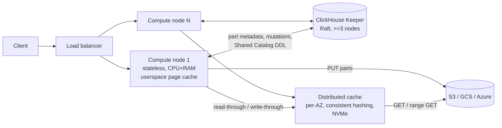

# ClickHouse on Object Storage

> Research notes on how ClickHouse stores, reads and changes data when object storage (S3, GCS or Azure Blob) is the primary data backend.
> Code references point to the `master` branch of `github.com/ClickHouse/ClickHouse`, shallow-cloned on 2026-10-31 (commit `977ed4e7`). Note that the disk code recently moved from `src/Disks/ObjectStorages` to `src/Disks/DiskObjectStorage/...`. Older blog posts and docs use the old paths.
> Throughout, **[source]** means the claim comes from a doc, blog or paper, **[code]** means it was read in the source tree, and **[inference]** marks my own interpretation.

---

## 1. Overview

ClickHouse is an open-source, column-oriented OLAP database. It targets high-throughput ingestion of append-mostly event data, such as observability, clickstream and metrics, together with low-latency analytical queries over billions to trillions of rows. Its storage engine family is **MergeTree**. A MergeTree table is a set of immutable, sorted, columnar *parts* that background *merges* combine, in an LSM-like way but without levels [source: VLDB 2024 paper].

ClickHouse can use object storage in three distinct ways:

| Mode | What it is | Who uses it |
|---|---|---|
| **MergeTree on an object-storage "disk"** (`type=s3` / `object_storage`, plus a `metadata_type`) | Every file of a part becomes one or more blobs. A *metadata layer* maps the logical file tree onto the blobs. | Self-managed OSS and tiered storage (hot local volume, then a `TTL ... TO VOLUME 's3'` cold volume) |
| **SharedMergeTree** (ClickHouse Cloud, closed source) | Parts live in object storage, part metadata lives in ClickHouse Keeper, and compute nodes are stateless. | ClickHouse Cloud. All services were migrated to it [source: stateless-compute blog]. |
| **`s3` / `s3Cluster` table functions and engines** (`StorageObjectStorage`) | Query external Parquet, CSV or other files, or data lakes (Iceberg, Delta), in place. | Ad-hoc lake queries and bulk ingest (`INSERT ... SELECT FROM s3Cluster`) |

This document focuses on the first two modes, which treat object storage as the database's own backend, and covers the third more briefly.

---

## 2. Architecture outline

### 2.1 Layering (OSS)

```
 SQL / query pipeline
        |
 MergeTree engine  (src/Storages/MergeTree)
   parts, granules, marks, primary index, merges, mutations, TTL
        |  IDataPartStorage  (DataPartStorageOnDiskFull | DataPartStorageOnDiskPacked)
        v
 IDisk  ->  DiskObjectStorage  (src/Disks/DiskObjectStorage/DiskObjectStorage.h)
        |                \
        |                 IMetadataStorage  (logical path -> list of blobs)
        |                   - MetadataStorageFromDisk           ("local": small files on local FS)
        |                   - MetadataStorageFromPlainObjectStorage ("plain": key == path, write-once)
        |                   - MetadataStorageFromPlainRewritableObjectStorage ("plain_rewritable")
        |                   - MetadataStorageFromKeeper ("keeper": registered only under #if CLICKHOUSE_CLOUD,
        |                     implementation not in the OSS tree)
        |                   - web / web_index (read-only static datasets over HTTP), Memory, Cache
        v
 IObjectStorage   (src/Disks/DiskObjectStorage/ObjectStorages/IObjectStorage.h)
   - CachedObjectStorage  --> FileCache (src/Interpreters/FileCache) on local NVMe
   - S3ObjectStorage / AzureObjectStorage / HDFS / Web / Local
        |
 IO buffers: WriteBufferFromS3 (multipart), ReadBufferFromS3 (ranged GET),
             ReadBufferFromRemoteFSGather, AsynchronousBoundedReadBuffer,
             ThreadPoolRemoteFSReader, CachedOnDiskReadBufferFromFile
```

The important design choice [code] is that **MergeTree does not know it is on S3**. It talks to `IDisk` through a POSIX-like API (create directory, write file, hard link, rename, remove). `DiskObjectStorage` emulates a filesystem by splitting each "file" into **immutable blobs with random keys** plus a **metadata record** that names the blobs. This lets the same engine run on local disks, on S3, or tiered across both.

### 2.2 ClickHouse Cloud (SharedMergeTree)



Write path (Cloud) [source: SharedMergeTree blog]: the node writes the new part to object storage, records the part metadata (which files belong to the part and where their blobs live) in its local cache and in Keeper, and then acknowledges the insert. Other replicas learn about the part through Keeper subscriptions. The blog states that the data is durable once acknowledged, so `insert_quorum` is not needed [source: SMT blog, SMT docs].

Read path (Cloud) [source: distributed-cache blog]: the node checks its userspace page cache (RAM). On a miss it goes to the distributed cache node that owns the block by consistent hashing, and on a further miss that node goes to S3. Blocks are fetched from many cache nodes in parallel.

Background work: merges and mutations can run on any replica. Merge throughput scales with node count while Keeper keeps up [source]. Old parts are deleted after a grace period (`old_parts_lifetime`, 8 min default in OSS [code]).

### 2.3 Data flow in the OSS `s3` disk (local metadata)

1. **INSERT**: rows are sorted by the primary key, and a temporary part directory `tmp_insert_<part>/` is written through a `DiskObjectStorageTransaction`. Each column file streams into a `WriteBufferFromS3` (one or more S3 objects with random keys). When each buffer finalizes, the transaction records "file X -> blob K, size S". On commit, the local metadata files are written and the directory is renamed to `<partition>_<min>_<max>_<level>`. The rename touches only local metadata, never S3.
2. **SELECT**: the primary index (`primary.idx`, loaded into memory) and skip indexes pick granule ranges. Marks (`*.mrk3/.cmrk3`) translate granules into byte offsets. The reader issues ranged GETs through the filesystem cache, with prefetching.
3. **Merge**: the engine reads the source parts (range GETs, mostly sequential), writes a new part (PUTs and multipart uploads), commits metadata, and later removes the old parts. That removal decrements ref counts and DELETEs blobs whose count reaches zero.

---

## 3. Data model & on-disk / object format

### 3.1 Parts, granules, marks and indexes

From the VLDB 2024 paper and code [source + code]:

- A **part** is a directory. Each MergeTree insert creates one (or more, one per partition). Parts are self-describing ("include all metadata required to interpret their content without additional lookups to a central catalog") and immutable.
- **Wide** parts have one file per column (or substream): `col.bin` (compressed data) plus `col.cmrk2`/`.mrk2` (marks). **Compact** parts store all columns in one `data.bin` and one marks file. A part is compact if it is smaller than `min_bytes_for_wide_part`, which is **10 MiB in OSS but 1 GiB in ClickHouse Cloud**. This is a compile-time default in `MergeTreeSettings.cpp` behind `#if !CLICKHOUSE_CLOUD` [code]. The Cloud default is much larger because every file costs object PUTs and GETs [inference].
- **Granule** = `index_granularity` = 8192 rows, capped adaptively by `index_granularity_bytes` = 10 MiB [code: `MergeTreeSettings.cpp`]. The granule is the smallest unit that indexing and scanning work on.
- **Compressed blocks**: the I/O unit. A block holds several granules of one column and is formed by byte size (~64 KiB to 1 MiB). Each block is LZ4 or ZSTD compressed and can be chained with codecs such as Delta or Gorilla. Each block carries a checksum and header [source: paper].
- **Marks**: for each granule, `MarkInCompressedFile { offset_in_compressed_file, offset_in_decompressed_block }` [code: `src/Formats/MarkInCompressedFile.h`]. With marks, a reader can GET exactly the byte range that holds granules *i..j* of one column. This is the key property that makes ranged reads from S3 efficient. Marks are themselves compressed (`compress_marks = true`) and cached in the `MarkCache`.
- **Primary index** (`primary.idx`, or `primary.cidx` when compressed): a *sparse* index holding the primary-key value of the first row of each granule. The paper notes that "only 1000 entries are required to index 8.1 million rows." It is loaded lazily (`primary_key_lazy_load = true`) and can live in a primary-key cache (`use_primary_key_cache`) [code].
- **Partition min/max** (`minmax_<col>.idx`, `partition.dat`) and **skip indexes** (`skp_idx_<name>.idx/.cmrk`): min-max, set, bloom, token/ngram bloom and the newer text index. They prune at the granularity of N granules.
- **Part metadata files**: `columns.txt`, `checksums.txt` (per-file sizes and hashes, used for integrity checks and fetches), `count.txt`, `default_compression_codec.txt`, `serialization.json`, and `metadata_version.txt`.

Part directory names follow `<partition_id>_<min_block>_<max_block>_<level>[_<mutation>]`. For example, `all_1_1_0` is a fresh insert and `all_1_5_2` is the result of merging blocks 1 to 5. A mutation of `all_1_1_0` produces `all_1_1_0_2` [source: updates blog].

### 3.2 Packed parts (one object per small part)

`DataPartStorageOnDiskPacked` [code: `src/Storages/MergeTree/DataPartStorageOnDiskPacked.h`] "stores all files of part in one archive", `data.packed`. Projections and a few files written separately (`txn_version.txt`, `delete-on-destroy.txt`, `invalidated_system_columns.txt`) stay outside the archive. Skip indexes are nested as a virtual `skp_idx.packed` inside `data.packed`. The archive has an index of `(name, offset, size)` (`PackedFilesIO`, versioned v0/v1). The settings `min_bytes_for_full_part_storage`, `min_rows_for_full_part_storage` and `min_level_for_full_part_storage` (new in 25.10) decide when a part is "full" (one blob per file) rather than "packed" [code]. On object storage this turns a small part with dozens of files into **one PUT**, and later into ranged GETs inside one object [inference: the code comments do not say "S3", but this is the obvious motive].

### 3.3 Disk metadata: mapping logical files to blobs

`metadata_type` selects an `IMetadataStorage` implementation [code: `src/Disks/DiskObjectStorage/MetadataStorages/`].

**(a) `local` (default)**: `MetadataStorageFromDisk`. Each logical file is a small text file on the local disk (`metadata_path`, default `/var/lib/clickhouse/disks/<disk>/`) that mirrors the logical path. Its format is `DiskObjectStorageMetadata` [code: `DiskObjectStorageMetadata.{h,cpp}`]:

```
<version>              # 1..5; writer emits VERSION_FULL_OBJECT_KEY = 5
<n_objects> <total_bytes>
<bytes_0> <object_key_0>
...
<ref_count>            # number of hard links
<read_only 0/1>        # v>=3
<inline_data>          # v>=4: small files stored inline, no blob at all
```

The total size is checked against the sum of the object sizes on load. **Hard links are implemented by incrementing `ref_count`**. This is how mutations "hard-link unchanged columns" and how `FREEZE` and backups avoid copying. A file can consist of **multiple blobs**, because appends are simulated by adding blobs ("We always use mode Rewrite because we simulate append using metadata and different files", `DiskObjectStorageTransaction.cpp`) [code]. **Inline data**: `WriteBufferInlineOrBlob` keeps content up to `max_inline_bytes` inside the metadata record and uploads a blob only if the file grows past that threshold [code: `src/Disks/IO/WriteBufferInlineOrBlob.h`]. This removes PUTs for the many tiny part files (`count.txt`, `columns.txt`, and so on).

**(b) `plain`**: the object key *is* the logical path, with no local metadata. It is write-once: no merges and no new inserts [source: docs]. It is used for backups (`s3_plain`) and static, shareable datasets.

**(c) `plain_rewritable`** (24.4+ as disk type `s3_plain_rewritable`; from 24.5 any object storage disk (s3, azure, local) can use `metadata_type = plain_rewritable` [source: docs]): all metadata lives *in the bucket*, with no local state, so a disk can be shared read-only by many servers. Layout [code: `PlainRewritableLayout.{h,cpp}`]:

```
<prefix>/__meta/<dir_remote_name>/prefix.path   # content = logical path of the directory
<prefix>/__meta/snapshot.bin                    # compact ZSTD snapshot of the entire layout
<prefix>/__meta/__tombstone/<removed_name>      # two-phase removal markers
<prefix>/<dir_remote_name>/<file_name>          # data objects: file name preserved, dir randomized
<prefix>/__root/<file_name>                     # files at the disk root
```

Each logical directory gets a **random remote name**. Renaming a directory, which is how MergeTree commits a part (`tmp_insert_x` to `all_1_1_0`), means **rewriting one small `prefix.path` object** instead of copying every file. This is an elegant way to get an atomic rename from a store that has none. On load, the disk LISTs `__meta`, reads every `prefix.path` (using ETags to skip unchanged ones on refresh), and LISTs files by sharded prefix. The code says building the state from scratch is "tens of thousands of requests even for a disk with a single table". Hence `snapshot.bin` [code: `PlainRewritableSnapshotFile.h`]: a VarUInt version followed by ZSTD-compressed, checksummed blocks of at most 1 MiB that list `(logical path, remote path, ETag, mtime, files[name,size,mtime,blob_key])`. The owning writer writes it after state changes (`metadata_snapshot_write_delay_ms = 1000`), and read-only replicas load the whole state "in a single request". Newer versions add **hard links** via `BlobLinkCounts`, which keeps only blobs with more than one link (`enable_hard_links`, default `true` in `MetadataStorageFactory.cpp`, required for mutations). The code warns that hard links "make the metadata of a directory unreadable by servers older than 26.10" [code]. The public docs still say mutations are unsupported on this disk, so they lag behind master [source: docs]. Removals are crash-safe through explicit tombstone markers with `pending` / `pending replace` / committed states, plus an `UndoWithRetries` transaction log. A pending marker rolls back, and a committed one is reclaimed on the next load [code: header comments in `PlainRewritableLayout.h`].

**(d) Cloud / SharedMergeTree**: part-to-blob metadata lives in **Keeper** [source]. The OSS factory (`MetadataStorageFactory.cpp`) registers a `metadata_type = keeper` (`MetadataStorageFromKeeper`) only inside `#if CLICKHOUSE_CLOUD`, and the class itself is not in the OSS tree. A code comment notes that Keeper node paths reuse the S3 key-compatibility prefix ("No reason, it just happened. Now it has to be preserved.") [code]. However, master now contains `src/Disks/DiskObjectStorage/Replication/` (`BlobCopierThread`, `BlobKillerThread`, `ObjectStorageRouter`, `ClusterConfiguration`), which suggests multi-location blob replication and asynchronous GC under a metadata store [code, purpose inferred from names and structure].

### 3.4 Object key naming

[code: `src/Common/ObjectStorageKeyGenerator.cpp`, `ObjectStorages/S3/DiskS3Utils.cpp`]

- The default S3 generator is `createObjectStorageKeyGeneratorByPrefix(uri.key)`, which produces keys matching the regex `<prefix>/[a-z]{3}/[a-z]{29}`. That is a **3-character random "directory"** (26^3 = 17,576 prefixes) followed by a 29-character random name. The random leading characters spread load across S3 partitions, which matters given the per-prefix request-rate limits (about 3,500 PUT and 5,500 GET per second per prefix) [inference on the motive].
- `key_template` (RE2 regex, for example to include `{replica}` macros) and `key_compatibility_prefix` allow custom layouts. They require `storage_metadata_write_full_object_key` [source: docs].
- The Azure default is `[a-z]{32}` with no prefix shard.
- Keys are random and never reused, so **every blob is immutable and write-once**. "Overwriting" a file means writing a new blob and changing the metadata.

---

## 4. How it achieves it

### 4.1 Writes

- **No WAL**: "ClickHouse writes inserts directly to disk while other LSM-tree based stores typically use write-ahead logging" [source: paper]. Durability equals the part being written and committed. On S3 the part is durable once all multipart uploads complete and the metadata commits (local FS, Keeper, or `prefix.path`).
- **Batching**: clients are expected to insert large batches (the paper suggests about 20,000 rows or more). Alternatively, **async inserts** buffer server-side and flush one part per threshold or timeout. On object storage, small parts are expensive: each costs several PUTs plus merge amplification. `parts_to_delay_insert = 1000` and `parts_to_throw_insert = 3000` per partition provide back-pressure [code].
- **Transactions**: `DiskObjectStorageTransaction` buffers metadata operations, and blob writes record their outcome only when finalized ("only there we actually know how many bytes were written"). This avoids reordering problems between parallel writers and metadata operations [code: `DiskObjectStorageTransaction.cpp` ~L345]. Commit applies metadata operations with retries.
- **Idempotency**: inserts are deduplicated by the hash of the last N parts (or a user token), stored locally or in Keeper [source: paper]. `WriteBufferFromS3` can stamp an `idempotency_id` on objects so that a replayed write can be recognized [code: `WriteBufferFromS3.h`].

### 4.2 Reads

- Pruning goes partition min/max, then the primary index (binary search over the sparse index), then skip indexes. The result is *mark ranges* per part.
- Mark ranges become byte ranges per column file. The reader then issues a **ranged GET per contiguous range** through `ReadBufferFromRemoteFSGather` (which also stitches multi-blob files together), wrapped in `CachedOnDiskReadBufferFromFile` and `AsynchronousBoundedReadBuffer` [code: `src/Disks/IO/`].
- **PREWHERE** reads the filter columns first and fetches the other columns only for surviving granules. On S3 this cuts the bytes fetched directly [source: docs, general knowledge].

### 4.3 Merges (compaction)

- Parts are all peers with no levels. A merge selector picks adjacent parts (by block range within a partition) and k-way merges them, since they are already sorted, up to `max_bytes_to_merge_at_max_space_in_pool = 150 GiB` [code; the paper also cites 150 GB].
- Merges apply engine semantics: Replacing, Summing, Aggregating and Collapsing engines, TTL (delete, recompress, `TO VOLUME 's3'`), and lightweight-delete filtering.
- On object storage a merge is "read N objects, write 1 new set of objects, then delete N". There is **no in-place modification**. The source parts become inactive and are removed when their ref count reaches zero and `old_parts_lifetime` has passed.
- **ReplicatedMergeTree on S3**: by default each replica merges independently and stores its own copy of the data, so 3 replicas means 3x the S3 storage and 3x the merge work. Mitigations include `prefer_fetch_merged_part_size_threshold` (10 GiB) and `remote_fs_execute_merges_on_single_replica_time_threshold` (3 h): for remote disks, one replica merges and the others fetch the result [code: `MergeTreeSettings.cpp`].
- **Zero-copy replication** (`allow_remote_fs_zero_copy_replication`, marked EXPERIMENTAL: "Don't use this setting in production") shares one physical copy among replicas. Replicas coordinate through Keeper nodes `<remote_fs_zero_copy_zookeeper_path=/clickhouse/zero_copy>/zero_copy_s3/<table_uuid>/<part>/<part_id>/<replica>`, which act as reference-count locks. `lockSharedData` / `unlockSharedData` in `StorageReplicatedMergeTree`, with a merge/mutation lock in `ZeroCopyLock.h`, ensure that only one replica merges a given part and that blobs are deleted only after the last replica releases them [code]. The docs call it "not ready for production", disabled by default from 22.8 [source]. The SMT blog lists its problems: metadata is still coupled to servers (each needs a local disk for part metadata), durability depends on three systems (S3, Keeper, local disk), it was designed for few replicas (replication-log contention and lock and communication overhead grow with server count), the replication and cloning code is complex, and commits cannot be atomic across replicas because each server changes its metadata independently [source].

### 4.4 Updates, deletes and retention

- **Classic mutations** (`ALTER TABLE ... UPDATE/DELETE`) rewrite the affected columns into a new part. Unchanged columns are *hard-linked*, which on object storage means a `ref_count++` in metadata with zero data PUTs [source: updates blog; code: `DiskObjectStorageMetadata::ref_count`].
- **Lightweight DELETE** sets `_row_exists = 0`. Originally this was a mutation that rewrites only the `_row_exists` column. With `lightweight_delete_mode = lightweight_update` it becomes a **patch part**. Rows are filtered at read time and physically dropped on the next merge [source].
- **Lightweight UPDATE / patch parts** (25.7+): an UPDATE writes a small *patch part* with only the changed columns plus `_part`, `_part_offset`, `_block_number`, `_block_offset` and `_data_version`. Reads apply patches on the fly, either through a linear merge on `_part_offset` when the source part still exists, or through a hash join on `(_block_number, _block_offset)` after the source has been merged away. Background merges materialize the patches. Patch parts are merged among themselves with ReplacingMergeTree semantics [source: updates blog part 2]. On object storage this replaces an O(table) rewrite with an O(changed rows) PUT. The vendor claims up to "1,000x faster" UPDATEs [source: part 3 title].
- **Cloud "on-the-fly mutations"** (`apply_mutations_on_fly`): update expressions are stored in Keeper and applied at read time until materialized [source: SMT blog].
- **Retention**: `TTL ... DELETE` drops rows during merges, or whole parts if `ttl_only_drop_parts` is set, which is cheap: just DELETE objects. `DROP PARTITION` is metadata-only followed by asynchronous blob deletion.

---

## 5. Object storage interaction patterns

### 5.1 PUT and multipart

[code: `src/IO/S3Defines.h`, `src/IO/S3RequestSettings.cpp`, `src/IO/WriteBufferFromS3.{h,cpp}`]

| Setting | Default |
|---|---|
| `max_single_part_upload_size` | **32 MiB**. Smaller files use one `PutObject`. |
| `min_upload_part_size` | **16 MiB** |
| `upload_part_size_multiply_factor` / `..._parts_count_threshold` | x**2** every **500** parts (part size grows geometrically to stay under the 10,000-part limit) |
| `max_upload_part_size` | 5 GiB |
| `max_inflight_parts_for_one_file` | **20** concurrent `UploadPart`s per file |
| `max_single_operation_copy_size` | 32 MiB. Larger server-side copies use multipart copy [inference from name and usage]. |
| `objects_chunk_size_to_delete` | 1000 keys per `DeleteObjects` (batch delete; `support_batch_delete=false` for GCS) |
| `list_object_keys_size` | 1000 |
| retries | `retry_attempts` 500, initial delay 25 ms, max 5 s; `max_single_read_retries` 4; `max_unexpected_write_error_retries` 4 |
| `check_objects_after_upload` | false (optional HEAD after upload) |
| `s3_max_put_rps` / `s3_max_get_rps` | 0 (unlimited); client-side token-bucket throttles |

`WriteBufferFromS3` "delays the first fully filled buffer". If the stream finishes before a second buffer fills, the data goes out as a single `PutObject`. Otherwise it calls `CreateMultipartUpload`, sends parts asynchronously on a thread pool, and ends with `CompleteMultipartUpload` [code comments]. Request count per file is therefore 1 PUT if the file is 32 MiB or less, and otherwise 2 + ceil(size / part_size) requests.

**Request count per INSERT** [inference]: a wide part with C columns writes about 2C data and mark files, plus primary index, checksums, columns, count, minmax and similar files. That is often 2C+8 PUTs for a single insert on a `local`-metadata S3 disk, minus whatever is inlined. A 100-column table means about 200 PUTs per insert, and this is why batching, compact parts, *packed* parts, inline metadata and the 1 GiB Cloud `min_bytes_for_wide_part` all matter. A compact part is about 3 to 8 objects, and a packed part is about 1 to 3.

### 5.2 GET and range-GET

- Every column read is a **ranged GET** (`Range: bytes=a-b`, where the end is `read_until_position`) [code: `src/IO/ReadBufferFromS3.cpp`]. Positioned reads are supported only for single-blob files [code: `ReadBufferFromRemoteFSGather.h`].
- `remote_read_min_bytes_for_seek` (4 x `DBMS_DEFAULT_BUFFER_SIZE` ≈ 4 MiB) and `DEFAULT_MIN_BYTES_FOR_SEEK = 1 MiB` control seeking. Below the threshold the reader keeps reading and discards bytes instead of opening a new GET, trading bandwidth for fewer requests and less TTFB latency [code].
- `max_download_threads = 4` and `max_download_buffer_size = 10 MiB` enable **parallel range-GETs of one large object** (`ParallelReadBuffer`), used by the `s3` table function and Cloud "splits large objects into parallel chunks" [code + source: stateless blog].
- With the filesystem cache, GETs are aligned to cache segment boundaries (`boundary_alignment` 4 MiB, up to `max_file_segment_size` 32 MiB) [code: `FileCache_fwd.h`]. A point query may therefore fetch a 4 MiB-aligned chunk instead of only the needed 200 KiB [inference]. This trades read amplification for a better hit rate and fewer requests.

### 5.3 LIST

- On the `local` and Keeper metadata paths, **LIST is never used in the hot path**. The logical directory tree lives outside the bucket.
- `plain_rewritable` uses LIST at startup and refresh: it lists `__meta` and lists files by sharded name prefix in parallel ("Listing the files of every directory separately costs one request per directory and dominates…"). The snapshot makes this a single GET [code].
- `s3`/`s3Cluster` glob expansion uses LIST (async iterator `ObjectStorageIteratorAsync`).

### 5.4 DELETE and garbage collection

- Blobs are deleted only when the metadata ref count reaches zero, after a part has been inactive for `old_parts_lifetime` (8 min), so that running queries keep their snapshot. Deletion uses batched `DeleteObjects` of 1000 keys [code].
- Ordering is "metadata first, then blob deletion", so a crash leaks orphans and never leaves dangling references. The docs explicitly note that a crash during `plain_rewritable` hard-link removal "leaves an orphaned object that must be removed by hand" [source]. With zero-copy, Keeper ref nodes gate deletion, and bugs here historically caused data loss or leaks [inference; the experimental status reflects this].

### 5.5 Consistency assumptions

- Correctness relies on **immutability plus unique random keys**. Because no key is ever overwritten, read-after-overwrite issues cannot arise. Strong read-after-write consistency on S3 (since December 2020) matters only for LIST-based discovery (`plain_rewritable`, `s3` globs).
- Atomicity of "commit a part" comes from the metadata layer: a local `rename()`, a Keeper multi-op, or a rewrite of one `prefix.path` object. It never comes from S3.
- `plain_rewritable` snapshots may be stale relative to the bucket. The code accepts this "for the way MergeTree tables use the disk" [code comment].

### 5.6 Metadata in or out of the object store

| Mode | Where part and file metadata lives | Implication |
|---|---|---|
| `local` | Local FS on each server | Fast and cheap. The server is stateful, and losing the local disk orphans the bucket. |
| `plain` | Implicit in keys | Zero metadata, write-once |
| `plain_rewritable` | Bucket (`__meta`, `snapshot.bin`) | Stateless and shareable. A single writer, no replication, startup LIST cost. |
| SharedMergeTree | Keeper, plus in-memory caches on nodes | Stateless compute, many replicas. Keeper is the scalability bottleneck. |

### 5.7 Cost considerations

[source + inference]
- PUT requests cost roughly 12x as much as GETs on S3 Standard. Small-part ingestion is the dominant request-cost risk, so the levers are batching and async inserts, compact or packed parts, inline small files, and merge-on-single-replica.
- With ReplicatedMergeTree and no zero-copy, each replica stores its own copy, multiplying both storage and PUTs. SharedMergeTree stores a single copy.
- The distributed cache is deployed **per AZ** "to avoid cross-zone traffic costs". It can be configured cross-zone for a higher hit rate at the cost of extra latency and transfer fees [source].
- Merges re-read and rewrite data, so write amplification equals the number of times a row is merged, and each pass costs GET and PUT requests. `cache_on_write_operations` / `enable_filesystem_cache_on_write_operations` and `force_read_through_cache_for_merges` let merges use the local cache to save GETs.

### 5.8 Lake mode: `s3`/`s3Cluster` and Iceberg/Delta engines

[code: `src/Storages/ObjectStorage/`, `src/Storages/ObjectStorage/DataLakes/`; settings in `src/Core/Settings.cpp`]

- **Reads**: object discovery uses LIST (globs) or the table format's metadata (Iceberg metadata.json, manifest lists and manifests; Delta log, optionally through delta-kernel; Hudi; Paimon). Manifest-level pruning (`ManifestListPruning.h`) and Parquet row-group min/max skip objects and byte ranges before any data GET. Two caches cut repeated metadata GETs: `use_iceberg_metadata_files_cache` and `use_parquet_metadata_cache`, both default `true`. Iceberg position deletes, equality deletes and deletion vectors are applied at read time.
- **Distribution**: `s3Cluster` / `*Cluster` engines spread work by rendezvous hashing (see section 7). `cluster_table_function_split_granularity` (`file` by default, or `bucket` for Parquet row groups) lets a few large files be split across nodes.
- **Writes (Iceberg)**: `INSERT INTO` an Iceberg table arrived in 25.7 behind `allow_experimental_insert_into_iceberg` and moved to **Beta** in 26.2 (`allow_insert_into_iceberg`). Writers roll data files at `iceberg_insert_max_rows_in_data_file` (1M rows) or `iceberg_insert_max_bytes_in_data_file` (512 MiB) and cap partitions per insert at `iceberg_insert_max_partitions` (100). Each commit writes new manifests and a new `vN.metadata.json`, then advances the version hint with an **S3 conditional write**: `If-None-Match: *` when creating, otherwise an ETag compare-and-swap, retried on conflict (`Iceberg/Utils.cpp`, `WriteBufferFromS3.cpp` `SetIfNoneMatch`). Master also has Iceberg compaction, `ExpireSnapshots`, `RemoveOrphanFiles` and Iceberg mutations (`Iceberg/Compaction.cpp`, `ExpireSnapshotsExecute.cpp`, `RemoveOrphanFilesExecute.cpp`, `Mutations.cpp`). Unlike MergeTree disks, this path relies on object-store conditional writes for atomicity instead of an external metadata layer [code; inference on the contrast].

---

## 6. Performance

### 6.1 Caching layers

From top to bottom:
1. **Query result cache, query condition cache** (`src/Interpreters/Cache/`).
2. **Mark cache, primary index / primary-key cache, uncompressed cache**, all in memory. `prewarm_mark_cache` (default `false`) loads marks at part creation, and `use_primary_key_cache` also defaults to `false` [code].
3. **Userspace page cache** (Cloud, stateless nodes have no OS page cache over local files) [source].
4. **Filesystem cache** (`FileCache`, `src/Interpreters/FileCache/`). A local-NVMe cache keyed by `UInt128` hash of the object path, split into **file segments** (max 32 MiB, aligned to 4 MiB). Layout on disk is `<cache>/<key[0:3]>/<key>/<offset>[_kind]` [code: `Metadata.cpp getKeyPath`]. The eviction policy is **SLRU by default** (protected ratio 0.6), with LRU also available. Other features: background download (5 threads, which complete partially read segments), `max_elements` of 10M, `cache_on_write_operations` (write-through on INSERT and MERGE), and `use_split_cache` with a separate "system" segment (default 10%) for small hot files (`.txt,.json,.idx,.cidx,.dat`) so that index files are not evicted by scans [code: `FileCacheSettings.cpp`]. `CachedOnDiskReadBufferFromFile` chooses a per-segment `ReadType` from `CACHED`, `REMOTE_FS_READ_AND_PUT_IN_CACHE` and `REMOTE_FS_READ_BYPASS_CACHE` [code]. Merges by default read cached ranges but do not populate the cache on misses [code: `force_read_through_cache_for_merges` doc].
5. **Distributed cache** (Cloud). A shared, multi-tenant, per-AZ service with consistent hashing over cache nodes, read-through and write-through. Immutable files mean no invalidation is needed [source].
6. **Cache warming**: Cloud `cache_populated_by_fetch` plus `cache_warmer_threads = 4` pre-download new parts that other replicas inserted or merged. `ignore_cold_parts_seconds` hides not-yet-warmed parts from SELECTs to avoid latency spikes [code: `Settings.cpp`].

### 6.2 Pruning and skipping

The sparse primary index (about 1 entry per 8192 rows), partition min/max, skip indexes, PREWHERE and projections all reduce the number of mark ranges, which directly reduces the count and size of ranged GETs.

### 6.3 Parallelism and prefetching

- `remote_filesystem_read_method = 'threadpool'` (default) makes reads asynchronous on `ThreadPoolRemoteFSReader`. `remote_filesystem_read_prefetch = true` [code].
- **`MergeTreePrefetchedReadPool`** is used when all parts are remote (`allow_prefetched_read_pool_for_remote_filesystem = true`). It "is responsible for creating read tasks… Does prefetching for the read tasks it creates." It runs a priority queue of prefetch tasks, refines ranges before prefetching ("so that ranges dropped by the refiner are never prefetched"), and supports task stealing between threads [code: `MergeTreePrefetchedReadPool.h`]. Budgets are set by `filesystem_prefetch_max_memory_usage` (1 GiB; Cloud uses 10% of RAM), `filesystem_prefetches_limit` (200) and `filesystem_prefetch_step_bytes/marks` (auto) [code].
- Many columns times many parts times many threads gives high concurrency of small range-GETs, which suits S3, where throughput comes from parallelism rather than a single stream.
- `filesystem_cache_segments_batch_size = 20` batches cache-segment lookups [code].

### 6.4 Latency vs cost: numbers cited

The distributed cache blog gives these layer latencies: S3 about 500 ms at p99.99 with 5K IOPS and 2 GB/s per node; SSD 1 ms; intra-AZ network 100 to 250 µs; memory 250 ns.

Benchmarks (Amazon reviews, 151M rows, 76 GB uncompressed, 32 GB compressed; 8 dedicated cache nodes per AZ; the author notes the cache was still in testing, so these are not final production numbers) [source]:

| Config | Full scan cold / hot | Scattered reads cold / hot |
|---|---|---|
| Self-managed SSD | 29.7 s / 5.4 s | 0.18 s / 65 ms |
| Cloud, local FS cache | 18.7 s / 3.8 s | 0.46 s / 60 ms |
| Distributed cache, initial warm-up node | 19.1 s / 3.9 s | 0.42 s / 59 ms |
| Distributed cache, subsequent node | 10.3 s / 3.8 s | 0.21 s / 59 ms |
| Distributed cache, 6 nodes parallel | 4.4 s / 0.7 s | n/a |

When hot, object storage plus cache matches local SSD. For cold *throughput* scans, parallel S3 reads beat a single local SSD. Cold *point lookups* suffer from S3 TTFB (0.46 s vs 0.18 s), and the distributed cache brings that close to SSD.

SharedMergeTree ingest: 26B rows in 67 s on 80 nodes (about 388M rows/s), with roughly linear merge-throughput scaling from 3 to 80 nodes [source].

---

## 7. Scaling

- **Writes**: any node can write a part, with no leader. In OSS ReplicatedMergeTree the replication log in Keeper is a contention point. At 20 nodes the insert replication queue took about 45 min to drain, whereas SharedMergeTree uses Keeper only for metadata and has no log replay or data fetches [source]. Ingest throughput is bounded by part-creation rate (`parts_to_throw_insert`) and merge throughput.
- **Reads**: in OSS, scale out with sharding (Distributed tables), with replicas for read capacity. In Cloud, "hundreds of replicas" per table without sharding, plus parallel replicas, with the distributed cache shared across nodes so that new nodes start warm [source]. `s3Cluster` distributes files across nodes. `StorageObjectStorageStableTaskDistributor` assigns files to replicas by **rendezvous hashing** so that the same file goes to the same node (cache locality), with work stealing once a replica is idle [code: `StorageObjectStorageStableTaskDistributor.h`, `tests/gtest_rendezvous_hashing.cpp`].
- **Metadata**: `local` metadata scales per server but makes nodes stateful. `plain_rewritable` startup costs grow with the number of directories (LIST plus one GET per directory), which the snapshot mitigates. In SMT, Keeper holds part metadata. Nodes cache subsets, subscribe to changes, and fetch only what they need. The Shared Catalog (Keeper `/uuids`, `/names`, `/replicas`, with a global version) removed local `.sql` files [source]. Keeper (Raft) is the vertical-scaling limit for metadata and coordination.
- **Compaction**: in OSS each replica either merges or fetches. With SMT, merges spread across all replicas and throughput scaled linearly in the benchmark [source].
- **Statelessness**: Cloud compute nodes now need "just CPU and memory". There is no local filesystem cache and no metadata on disk [source: stateless compute blog].
- **Multi-tenancy**: the distributed cache is shared across services with authentication and encryption isolation. Cache files can be stored per `user_id` with weights, idle-client TTL eviction, and per-client weights persisted [code: `FileCacheSettings.cpp`, `idle_client_ttl_sec` "Used by the distributed cache server"].
- **Known limits**: zero-copy replication is experimental. `plain_rewritable` supports no replication and a single writer. Too many small parts cause `TOO_MANY_PARTS`. Lightweight-update patch application falls back to an in-memory hash join, so a whole patch must fit in memory [source]. The S3 per-prefix rate limit is mitigated by random 3-character prefixes.

---

## 8. Trade-offs & lessons

1. **Put a filesystem abstraction over blobs, and keep the "directory tree" in a metadata layer.** Random, write-once keys plus a metadata record (path to blobs, size, ref count) give you hard links (cheap mutations, snapshots, backups), atomic rename (part commit) and append without S3 supporting any of them. This is the most reusable idea here. The catch is that metadata becomes a durability dependency, and losing it orphans the bucket.
2. **Atomic directory rename on S3 = an indirection object.** `plain_rewritable` gives every directory a random remote name and stores the logical path in `__meta/<dir>/prefix.path`, so a rename is one PUT. Add a compact snapshot so readers bootstrap with one GET instead of tens of thousands of LISTs and GETs.
3. **Immutable files make caching trivial.** No invalidation is needed in the local cache, the distributed cache or the page cache. Cache segments are keyed by path hash and offset.
4. **Design the file format for ranged reads.** Marks (granule to compressed offset) plus a sparse, in-memory primary index mean a query issues a few precise range-GETs per column, not whole-object reads. Choose block sizes (64 KiB to 1 MiB) and cache alignment (4 MiB) to balance request count against read amplification.
5. **Small objects are the enemy.** The levers are one-part-per-insert with client batching or async inserts, compact parts below 10 MiB (1 GiB in Cloud), packed single-archive parts, inline storage of tiny files in metadata, and multipart only above 32 MiB. All of them reduce PUTs.
6. **Don't replicate data that object storage already replicates.** ReplicatedMergeTree on S3 stores N copies, and zero-copy tried to share them while keeping per-replica metadata and Keeper locks, which turned out fragile. SharedMergeTree's answer is to centralize metadata in a consensus store and keep one data copy. The lesson is to move the *metadata* to shared, strongly consistent storage instead of coordinating per-replica metadata.
7. **Updates should be deltas, not rewrites.** Patch parts plus merge-on-read and materialization at compaction time are the object-storage-friendly path. Hard links let classic mutations rewrite only the changed columns.
8. **GC by ref count with a grace period**, deleting metadata first and blobs later in batches of 1000. Accept that leaked orphans are possible and provide reconciliation.
9. **Throughput comes from parallelism and prefetching**: many concurrent range-GETs, budgeted prefetch queues, parallel chunked GETs for large objects, and work-stealing read pools. Latency comes from layered caching, and a shared cache tier makes elasticity cheap because new nodes are warm.
10. **Locality-aware task distribution** (rendezvous hashing of files to nodes, with stealing) keeps caches effective under scale-out.

---

## 9. Sources

**Blogs, papers and docs**
- Schulze et al., "ClickHouse – Lightning Fast Analytics for Everyone", PVLDB 17 (2024): https://www.vldb.org/pvldb/vol17/p3731-schulze.pdf
- ClickHouse Cloud boosts performance with SharedMergeTree and Lightweight Updates: https://clickhouse.com/blog/clickhouse-cloud-boosts-performance-with-sharedmergetree-and-lightweight-updates
- Building a distributed cache for S3: https://clickhouse.com/blog/building-a-distributed-cache-for-s3
- No more disks: the architecture behind stateless compute in ClickHouse Cloud: https://clickhouse.com/blog/clickhouse-cloud-stateless-compute
- How we built fast UPDATEs for the ClickHouse column store, Part 2: https://clickhouse.com/blog/updates-in-clickhouse-2-sql-style-updates
- UPDATEs Part 3 (benchmarks): https://clickhouse.com/blog/updates-in-clickhouse-3-benchmarks (title and search snippet only)
- Docs, External disks for storing data: https://clickhouse.com/docs/operations/storing-data
- Docs, SharedMergeTree: https://clickhouse.com/docs/cloud/reference/shared-merge-tree
- Jack Vanlightly, Serverless ClickHouse Cloud (ASDS ch. 5, part 2): https://jack-vanlightly.com/analyses/2024/1/23/serverless-clickhouse-cloud-asds-chapter-5-part-2 (search snippet only)

- Docs, Writing data to Iceberg (`INSERT INTO ... IcebergS3`): https://clickhouse.com/docs/guides/use-cases/data-warehousing/getting-started/writing-data

**Code** (branch `master`, base `https://github.com/ClickHouse/ClickHouse/blob/master/`)
- [src/Disks/DiskObjectStorage/DiskObjectStorage.h](https://github.com/ClickHouse/ClickHouse/blob/master/src/Disks/DiskObjectStorage/DiskObjectStorage.h)
- [src/Disks/DiskObjectStorage/DiskObjectStorageTransaction.cpp](https://github.com/ClickHouse/ClickHouse/blob/master/src/Disks/DiskObjectStorage/DiskObjectStorageTransaction.cpp)
- [src/Disks/DiskObjectStorage/MetadataStorages/DiskObjectStorageMetadata.h](https://github.com/ClickHouse/ClickHouse/blob/master/src/Disks/DiskObjectStorage/MetadataStorages/DiskObjectStorageMetadata.h) / [.cpp](https://github.com/ClickHouse/ClickHouse/blob/master/src/Disks/DiskObjectStorage/MetadataStorages/DiskObjectStorageMetadata.cpp)
- [src/Disks/DiskObjectStorage/MetadataStorages/Local/MetadataStorageFromDisk.cpp](https://github.com/ClickHouse/ClickHouse/blob/master/src/Disks/DiskObjectStorage/MetadataStorages/Local/MetadataStorageFromDisk.cpp)
- [src/Disks/DiskObjectStorage/MetadataStorages/PlainRewritable/PlainRewritableLayout.h](https://github.com/ClickHouse/ClickHouse/blob/master/src/Disks/DiskObjectStorage/MetadataStorages/PlainRewritable/PlainRewritableLayout.h)
- [src/Disks/DiskObjectStorage/MetadataStorages/PlainRewritable/MetadataStorageFromPlainRewritableObjectStorage.cpp](https://github.com/ClickHouse/ClickHouse/blob/master/src/Disks/DiskObjectStorage/MetadataStorages/PlainRewritable/MetadataStorageFromPlainRewritableObjectStorage.cpp)
- [src/Disks/DiskObjectStorage/MetadataStorages/PlainRewritable/Metadata/PlainRewritableSnapshotFile.h](https://github.com/ClickHouse/ClickHouse/blob/master/src/Disks/DiskObjectStorage/MetadataStorages/PlainRewritable/Metadata/PlainRewritableSnapshotFile.h)
- [src/Disks/DiskObjectStorage/MetadataStorages/PlainRewritable/Metadata/BlobLinkCounts.h](https://github.com/ClickHouse/ClickHouse/blob/master/src/Disks/DiskObjectStorage/MetadataStorages/PlainRewritable/Metadata/BlobLinkCounts.h)
- [src/Disks/DiskObjectStorage/ObjectStorages/S3/S3ObjectStorage.cpp](https://github.com/ClickHouse/ClickHouse/blob/master/src/Disks/DiskObjectStorage/ObjectStorages/S3/S3ObjectStorage.cpp)
- [src/Disks/DiskObjectStorage/ObjectStorages/S3/DiskS3Utils.cpp](https://github.com/ClickHouse/ClickHouse/blob/master/src/Disks/DiskObjectStorage/ObjectStorages/S3/DiskS3Utils.cpp)
- [src/Disks/DiskObjectStorage/ObjectStorages/Cached/CachedObjectStorage.h](https://github.com/ClickHouse/ClickHouse/blob/master/src/Disks/DiskObjectStorage/ObjectStorages/Cached/CachedObjectStorage.h)
- [src/Disks/DiskObjectStorage/Replication/BlobCopierThread.h](https://github.com/ClickHouse/ClickHouse/blob/master/src/Disks/DiskObjectStorage/Replication/BlobCopierThread.h)
- [src/Common/ObjectStorageKeyGenerator.cpp](https://github.com/ClickHouse/ClickHouse/blob/master/src/Common/ObjectStorageKeyGenerator.cpp)
- [src/IO/S3Defines.h](https://github.com/ClickHouse/ClickHouse/blob/master/src/IO/S3Defines.h), [src/IO/S3RequestSettings.cpp](https://github.com/ClickHouse/ClickHouse/blob/master/src/IO/S3RequestSettings.cpp)
- [src/IO/WriteBufferFromS3.h](https://github.com/ClickHouse/ClickHouse/blob/master/src/IO/WriteBufferFromS3.h), [src/IO/ReadBufferFromS3.cpp](https://github.com/ClickHouse/ClickHouse/blob/master/src/IO/ReadBufferFromS3.cpp)
- [src/Disks/IO/ReadBufferFromRemoteFSGather.h](https://github.com/ClickHouse/ClickHouse/blob/master/src/Disks/IO/ReadBufferFromRemoteFSGather.h), [CachedOnDiskReadBufferFromFile.h](https://github.com/ClickHouse/ClickHouse/blob/master/src/Disks/IO/CachedOnDiskReadBufferFromFile.h), [WriteBufferInlineOrBlob.h](https://github.com/ClickHouse/ClickHouse/blob/master/src/Disks/IO/WriteBufferInlineOrBlob.h), [AsynchronousBoundedReadBuffer.h](https://github.com/ClickHouse/ClickHouse/blob/master/src/Disks/IO/AsynchronousBoundedReadBuffer.h)
- [src/Interpreters/FileCache/FileCache_fwd.h](https://github.com/ClickHouse/ClickHouse/blob/master/src/Interpreters/FileCache/FileCache_fwd.h), [FileCacheSettings.cpp](https://github.com/ClickHouse/ClickHouse/blob/master/src/Interpreters/FileCache/FileCacheSettings.cpp), [Metadata.cpp](https://github.com/ClickHouse/ClickHouse/blob/master/src/Interpreters/FileCache/Metadata.cpp), [SLRUFileCachePriority.h](https://github.com/ClickHouse/ClickHouse/blob/master/src/Interpreters/FileCache/SLRUFileCachePriority.h)
- [src/Storages/MergeTree/MergeTreeSettings.cpp](https://github.com/ClickHouse/ClickHouse/blob/master/src/Storages/MergeTree/MergeTreeSettings.cpp)
- [src/Storages/MergeTree/DataPartStorageOnDiskPacked.h](https://github.com/ClickHouse/ClickHouse/blob/master/src/Storages/MergeTree/DataPartStorageOnDiskPacked.h)
- [src/Storages/MergeTree/MergeTreePrefetchedReadPool.h](https://github.com/ClickHouse/ClickHouse/blob/master/src/Storages/MergeTree/MergeTreePrefetchedReadPool.h)
- [src/Storages/MergeTree/ZeroCopyLock.h](https://github.com/ClickHouse/ClickHouse/blob/master/src/Storages/MergeTree/ZeroCopyLock.h), [src/Storages/StorageReplicatedMergeTree.cpp](https://github.com/ClickHouse/ClickHouse/blob/master/src/Storages/StorageReplicatedMergeTree.cpp) (`getZeroCopyPartPath`, `lockSharedData`, `unlockSharedData`)
- [src/Formats/MarkInCompressedFile.h](https://github.com/ClickHouse/ClickHouse/blob/master/src/Formats/MarkInCompressedFile.h), [src/Storages/MergeTree/MergeTreeMarksLoader.h](https://github.com/ClickHouse/ClickHouse/blob/master/src/Storages/MergeTree/MergeTreeMarksLoader.h)
- [src/Storages/ObjectStorage/StorageObjectStorageCluster.cpp](https://github.com/ClickHouse/ClickHouse/blob/master/src/Storages/ObjectStorage/StorageObjectStorageCluster.cpp), [StorageObjectStorageStableTaskDistributor.h](https://github.com/ClickHouse/ClickHouse/blob/master/src/Storages/ObjectStorage/StorageObjectStorageStableTaskDistributor.h)
- [src/Disks/DiskObjectStorage/MetadataStorages/MetadataStorageFactory.cpp](https://github.com/ClickHouse/ClickHouse/blob/master/src/Disks/DiskObjectStorage/MetadataStorages/MetadataStorageFactory.cpp) (`local`, `keeper` (Cloud-only), `plain`, `plain_rewritable`, `web`, `web_index`)
- [src/Storages/ObjectStorage/DataLakes/Iceberg/Utils.cpp](https://github.com/ClickHouse/ClickHouse/blob/master/src/Storages/ObjectStorage/DataLakes/Iceberg/Utils.cpp) (conditional-write metadata commit), [Compaction.cpp](https://github.com/ClickHouse/ClickHouse/blob/master/src/Storages/ObjectStorage/DataLakes/Iceberg/Compaction.cpp)
- [src/Core/Settings.cpp](https://github.com/ClickHouse/ClickHouse/blob/master/src/Core/Settings.cpp) (remote read and prefetch settings, `cache_warmer_threads`, `ignore_cold_parts_seconds`)

---

## Review notes

Reviewed on 2026-10-31 against ClickHouse `master` at `977ed4e7` and the primary blogs and docs.

**Verified in code**: every code path in Sources exists. These defaults match: `min_bytes_for_wide_part` (10 MiB OSS, 1 GiB under `CLICKHOUSE_CLOUD`), `index_granularity_bytes` 10 MiB, `parts_to_delay/throw_insert` 1000/3000, `old_parts_lifetime` 480 s, the 150 GiB merge cap, `prefer_fetch_merged_part_size_threshold` 10 GiB, the 3 h single-replica merge threshold, the S3 multipart and retry constants in `S3Defines.h`, the key regexes `[a-z]{3}/[a-z]{29}` (S3) and `[a-z]{32}` (Azure), the FileCache constants (32 MiB segment, 4 MiB alignment, 5 background threads, 10M elements, SLRU with 0.6), `use_split_cache` extensions, the metadata file format versions 1 to 5 (writer emits 5), the `plain_rewritable` layout and snapshot comments, `idempotency_id`, the prefetch and remote-read settings, `cache_warmer_threads` / `ignore_cold_parts_seconds` (Cloud-only), and the rendezvous-hashing distributor.

**Verified against blogs**: the SharedMergeTree insert and commit path, 26B rows in 67 s on 80 nodes, the roughly 45 min replication-queue drain at 20 nodes, the distributed-cache latencies and benchmark table, and per-AZ deployment.

**Corrected or added**:
- The OSS factory does register a `keeper` metadata type, but only under `#if CLICKHOUSE_CLOUD`. Added it to the layering diagram and section 3.3(d), along with the `web`, `web_index`, Memory and Cache metadata storages.
- Rewrote the zero-copy drawbacks to match the SMT blog. The "exclusive Keeper locks block merges" item was not in the source.
- Softened "insert_quorum has no effect" to the blog's wording (not needed).
- `plain_rewritable` versions: 24.4 for `s3_plain_rewritable`, 24.5 for any disk. Hard links default to on, and the 26.10 compatibility note now quotes the code. Flagged that the docs lag on mutations.
- Noted that `prewarm_mark_cache` and `use_primary_key_cache` default to `false`.
- Distributed-cache benchmark: added the warm-up row, the cache-node count, the "not final" caveat and the cross-zone option.
- New section 5.8 on lake mode, covering Iceberg/Delta/Hudi/Paimon reads, metadata caches, split granularity, and Iceberg INSERT (25.7, Beta since 26.2) with its `If-None-Match` / ETag CAS commit, compaction and snapshot expiry. This filled a gap, since mode 3 was promised but not covered.

**Not verified**: the Jack Vanlightly and UPDATEs Part 3 references (snippet only), the "1,000x" claim, and the S3 per-prefix request-rate figures, which are AWS general knowledge.
