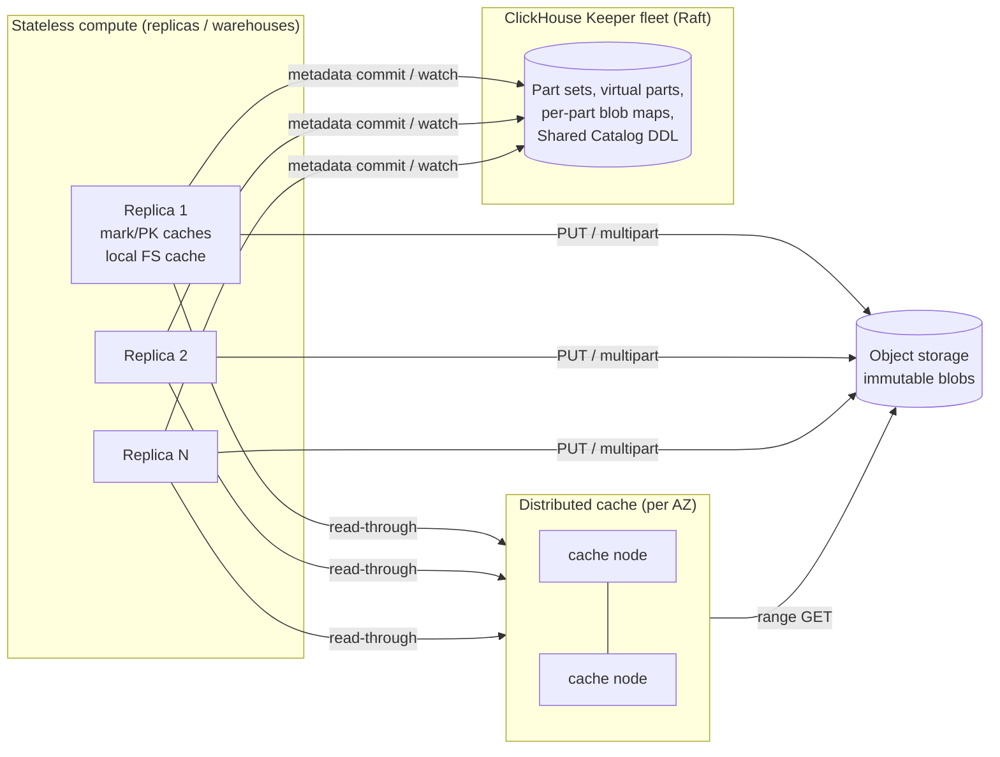

# ClickHouse on Object Storage: Storage Architecture

> Research note on how ClickHouse stores, reads and changes data when the data lives in object storage (S3, GCS, Azure Blob).
>
> **Code basis:** `ClickHouse/ClickHouse` at commit `977ed4e7292b3c64b89d31e5d2b0399e6589eb86` (2026-10-31, the 26.x line). Docs basis: `ClickHouse/clickhouse-docs` at `89036285e33b88b424ebc397cce3cb70e9c2b5a9`. Paths below are relative to the repo root.
>
> **How claims are marked:**
> - **[code]**: checked in source at the SHA above.
> - **[docs]**: from the official docs repo.
> - **[blog]**: from ClickHouse or third-party blog posts. `clickhouse.com` could not be fetched directly from this research session (the host is outside the allowed network domains), so these points come from search-result summaries. Check them against the originals before relying on them.
> - **[inference]**: my own reading.
>
> SharedMergeTree (ClickHouse Cloud) is closed source. What this note says about it comes from docs, blog summaries, and the many `shared_merge_tree_*` settings declared in the open-source tree.

---

## 1. Overview

ClickHouse is an open-source columnar OLAP database written in C++. Its main storage engine family is **MergeTree**. Data is written as immutable, sorted, columnar **parts**. A sparse primary index covers fixed-size **granules** (8192 rows by default). Parts are merged in the background, in the style of an LSM tree. The workloads are analytical: high-rate append ingestion (logs, events, metrics, observability, clickstreams) and scans with aggregation that must answer in sub-second to seconds over billions of rows.

There are two main ways to use object storage as the data backend:

1. **Open-source "S3 disk" (`type=s3` / `object_storage`)**. A ClickHouse *disk* is a filesystem abstraction (`IDisk`). `DiskObjectStorage` implements it by storing every logical file as one or more randomly named blobs in a bucket. The mapping from file names to blobs is kept in a separate **metadata storage**: local files (default), plain (the path *is* the key), plain_rewritable (mapping stored in the bucket itself), web, or a Cloud-only Keeper variant. MergeTree runs on top of this disk unchanged. It is usually combined with a local **filesystem cache** disk (`type=cache`). Replication across servers uses `ReplicatedMergeTree`, either with full data copies or with the experimental **zero-copy replication**.
2. **ClickHouse Cloud: SharedMergeTree + Shared Catalog + distributed cache**. This is the closed-source, cloud-native replacement. Part data sits in object storage. Part *metadata* (which parts exist and which blobs make up each file) lives in ClickHouse Keeper rather than on the local disks of the replicas. Compute nodes become stateless, with caches only ([docs] `docs/cloud/features/05_infrastructure/shared-merge-tree.md`; [blog] "No more disks: the architecture behind stateless compute in ClickHouse Cloud").

Users include ClickHouse Cloud customers and the many companies that self-host ClickHouse with tiered or S3-backed storage. Typical uses are observability stacks (logs and traces, e.g. ClickStack), product analytics and real-time dashboards.

---

## 2. Architecture

### 2.1 Open-source layering

```
            SQL (INSERT / SELECT / ALTER / OPTIMIZE)
                          │
              ┌───────────▼────────────┐
              │  MergeTree / Replicated │  parts, granules, marks, merges, mutations
              │  MergeTree              │  (src/Storages/MergeTree, StorageReplicatedMergeTree.cpp)
              └───────────┬────────────┘
                          │ IDataPartStorage (Full | Packed)
              ┌───────────▼────────────┐
              │ IDisk: DiskObjectStorage│  file API over blobs, transactions
              │  (+ DiskCache wrapper)  │  src/Disks/DiskObjectStorage/
              └─────┬─────────────┬────┘
                    │             │
   ┌────────────────▼───┐   ┌─────▼───────────────────────────┐
   │ IMetadataStorage    │   │ IObjectStorage                   │
   │  local | plain |    │   │  S3ObjectStorage | Azure | HDFS  │
   │  plain_rewritable | │   │  | Local | Web  (+CachedObject-  │
   │  web | keeper(Cloud)│   │   Storage: filesystem cache)     │
   └─────────────────────┘   └──────────────┬──────────────────┘
                                            │ AWS SDK + Poco HTTP (src/IO/S3/*)
                                            ▼
                                   S3 / GCS / Azure / MinIO
```

The main abstractions [code]:

- `src/Disks/DiskObjectStorage/DiskObjectStorage.{h,cpp}`: the disk. It turns `writeFile`, `readFile`, `createHardLink`, `moveDirectory` and `removeSharedFile` into blob operations plus metadata operations.
- `src/Disks/DiskObjectStorage/DiskObjectStorageTransaction.cpp`: groups blob writes and metadata changes into a batch that commits together. `IMetadataStorage.h` describes it as *"more like 'batch operation' than real 'transaction'"*, with no snapshot isolation.
- `src/Disks/DiskObjectStorage/MetadataStorages/*`: the metadata back ends, registered in `MetadataStorageFactory.cpp`: `local`, `plain`, `plain_rewritable`, `web`, `web_index`, and `keeper` (behind `#if CLICKHOUSE_CLOUD`).
- `src/Disks/DiskObjectStorage/ObjectStorages/*`: the object-store clients (`S3ObjectStorage`, `AzureObjectStorage`, `HDFSObjectStorage`, `LocalObjectStorage`, `WebObjectStorage`) and `Cached/CachedObjectStorage`, which interposes the filesystem cache.
- `src/Interpreters/FileCache/*`: the local SSD cache of blob byte ranges (`FileCache`, `FileSegment`, `SLRUFileCachePriority`).
- `src/Disks/DiskObjectStorage/Replication/*`: **new in this tree**. It contains `ClusterConfiguration` (a set of *Locations*, meaning several object stores), `ObjectStorageRouter`, `BlobCopierThread` (copies blobs to the other locations) and `BlobKillerThread` (background blob GC). The `local`, `plain` and `plain_rewritable` back ends call `checkSingleLocation(cluster)`. The `keeper` back end does not [code]. [inference] So multi-location blob replication and asynchronous blob GC are currently used by the Cloud Keeper-backed metadata storage.

### 2.2 ClickHouse Cloud (SharedMergeTree)



- Replicas do not talk to each other to replicate data. "All communication happens through shared storage and clickhouse-keeper". Replication is "asynchronous leaderless". Inserts count as quorum inserts because their metadata is committed to a Keeper quorum. Other replicas fetch new metadata asynchronously ([docs] shared-merge-tree.md).
- The Shared Catalog / `Shared` database engine keeps DDL and catalog state centrally in Keeper with versioning. Nodes track only the last version they applied, which makes compute "fully stateless" with no local disk needed for metadata ([docs]/[blog]).
- The distributed cache is "a shared network service that wraps the filesystem cache". It is deployed **per availability zone** to avoid cross-AZ traffic, and blocks can be fetched from several cache nodes in parallel ([blog] "Building a Distributed Cache for S3", May 2025). A third-party article attributes 100–250 µs cache latency versus about 500 ms for S3 to that post. That figure is unverified.

---

## 3. Data model and on-object format

### 3.1 MergeTree parts

A table is a set of **parts**. Each part is a directory named `<partition_id>_<min_block>_<max_block>_<level>[_<mutation_version>]`, holding a sorted, immutable slice of rows. Part types [code, `MergeTreeSettings.cpp`]:

| Type | Layout | Chosen when |
|---|---|---|
| **Wide** | one `<column>.bin` + one marks file per column (or per substream: Nullable maps, Array sizes, etc.) | part ≥ `min_bytes_for_wide_part` = **10 MiB** (OSS) / **1 GiB** (Cloud build) |
| **Compact** | all columns in a single `data.bin` + `data.cmrk3` | smaller parts |
| **Packed** *storage* | the part's files are concatenated into one `data.packed` archive with an index | `DataPartStorageOnDiskPacked`; governed by `min_bytes_for_full_part_storage`, `min_rows_for_full_part_storage`, `min_level_for_full_part_storage` (25.10) |

Note the Cloud build default: `default_min_bytes_for_wide_part = 1 GiB` under `CLICKHOUSE_CLOUD`, against 10 MiB in OSS [code]. [inference] On object storage, every file is at least one object, so a wide part with 200 columns produces about 400+ PUTs. A much higher wide-part threshold keeps fresh, small parts compact and cuts object count and request cost.

Common files in a part [code, `IMergeTreeDataPart.cpp` list around line 862]: `checksums.txt`, `columns.txt`, `count.txt`, `metadata_version.txt`, `default_compression_codec.txt`, `serialization.json`, `partition.dat`, `minmax_<col>.idx`, the primary index `primary.idx` (or compressed `primary.cidx` when `compress_primary_key=true`, the default), and skip indexes `skp_idx_<name>.idx2` + marks. Column file names longer than `max_file_name_length=127` are replaced by a SipHash128 (`replace_long_file_name_to_hash=true`).

**Packing small files.** Two newer mechanisms exist specifically to reduce object counts:

- `packed_skip_index_max_bytes` (default **1 MiB**, BETA and on by default since 26.8). Skip-index substreams of up to 1 MiB are bundled into a single `skp_idx.packed` per part. The setting's changelog states the purpose: *"cutting object count and read requests on object storage."* [code]
- `PackedFilesIO` (`src/IO/PackedFilesIO.h`). An archive (`.packed`) with an index of `FileOffset{offset, size, uncompressed_size}` per inner file, in format versions v0 and v1. `DataPartStorageOnDiskPacked` stores *all* files of a part in `data.packed`, except `delete-on-destroy.txt`, `txn_version.txt` and `invalidated_system_columns.txt` [code]. A packed part buffers all file data in memory until finalisation. `max_bytes_to_buffer_for_packed_part` (26.11) caps this by spilling to temporary storage.

### 3.2 Granules, marks and the primary index

- **Granule**: the unit of indexing and reading. By default 8192 rows (`index_granularity`), adaptively capped at `index_granularity_bytes` = **10 MiB** [code].
- **Compression blocks**: column data is LZ4/ZSTD/etc. compressed in blocks of 64 KiB to 1 MiB (`min_compress_block_size=65536`, `max_compress_block_size=1048576` [code]). Each block has a header (checksum, method, sizes). A block can hold several granules, and a large granule can span blocks.
- **Marks** (`.mrk2`/`.cmrk2` for wide, `.mrk3`/`.cmrk3` for compact; `compress_marks=true` by default): one mark per granule per stream. A mark holds `(offset of compressed block in .bin, offset inside decompressed block, rows in granule)`. [inference from the long-documented format] This is about 24 bytes per mark uncompressed. Marks turn "granule i" into a *byte range* in a `.bin` blob, so a reader can issue a precise range GET.
- **Primary index**: one entry (the sort-key tuple of the first row) per granule. It is loaded lazily (`primary_key_lazy_load=true`) and optionally cached (`use_primary_key_cache`, `primary_index_cache_size` default 5 GiB) [code].
- **Partition min/max** (`minmax_*.idx`) and **skip indexes** (minmax, set, bloom_filter, ngrambf/tokenbf, the newer `text` full-text index, vector similarity) allow pruning above the granule level.

### 3.3 How a logical file maps to blobs (S3 disk, `local` metadata)

For each logical file of a part (for example `store/3f2/3f2a…/all_1_1_0/id.bin`), the **local metadata disk** (default `/var/lib/clickhouse/disks/<disk>/`) holds a *small text file* in `DiskObjectStorageMetadata` format [code `MetadataStorages/DiskObjectStorageMetadata.cpp`]:

```
5                          <- version (VERSION_FULL_OBJECT_KEY; history: 1 absolute paths,
                              2 relative paths, 3 +read_only flag, 4 +inline data, 5 full keys)
1\t1048576                 <- number of blobs \t total bytes
1048576\tdata/abc/qwhfmzxkoplrtyuewqazxsdcvfrgtbhyu   <- size \t object key  (one line per blob)
0                          <- ref_count (number of extra hard links)
0                          <- read_only
                           <- inline data (escaped; v4+)
```

- A file can consist of **several blobs**. Appends are simulated by adding a new blob, never by rewriting one: *"We always use mode Rewrite because we simulate append using metadata and different files"* [code `DiskObjectStorageTransaction.cpp`]. `ReadBufferFromRemoteFSGather` stitches multiple blobs together on read.
- **Object key generation** [code `src/Common/ObjectStorageKeyGenerator.cpp`]: by default `createObjectStorageKeyGeneratorByPrefix(prefix)` = regex template `<prefix>/[a-z]{3}/[a-z]{29}`. That is a 3-letter random "directory" followed by a 29-letter random name. [inference] The random 3-character prefix spreads keys across S3 index partitions so request rates do not hot-spot, and it makes keys unrelated to table or part names. The template can be overridden with `<key_template>` (a regex with macros such as `{replica}`), with `key_compatibility_prefix` to read older keys [code `ObjectStorages/S3/DiskS3Utils.cpp`].
- **Inline data**: metadata storages that `supportsInlineData()` can store files up to `inline_file_max_bytes` inside the metadata rather than as a blob (`WriteBufferInlineOrBlob`). [code] Only the memory and cache metadata storages advertise support in OSS. In Cloud, `shared_merge_tree_blobs_list_inline_file_max_bytes` (26.9) inlines small files such as `count.txt`, `metadata_version.txt` and minmax indexes into a consolidated `blobs.list` Keeper node, *"saving one blob write and read per small file"* [code, settings text].

[inference] The bucket holds opaque blobs. Without the metadata you cannot reconstruct which blob belongs to which table. This is why the docs warn never to configure bucket lifecycle policies ("could lead to broken tables", [docs] separation-storage-compute.md) and why backing up an S3 disk means backing up the metadata too.

### 3.4 Alternative metadata layouts kept in the bucket

| metadata type | Where the file→key mapping lives | Mutability | Notes [code] |
|---|---|---|---|
| `local` (default for `type=s3`) | local text files (above) | full: hardlinks, renames, appends | not shareable between servers except via zero-copy |
| `plain` (`s3_plain`) | none: logical path == object key | write-once, no rename | used for backups, `ATTACH` read-only tables; optional `object_metadata_cache_size` |
| `plain_rewritable` (`s3_plain_rewritable`) | in the bucket under `__meta/` | renames, hard links (26.10+), removals; not replicated | see below |
| `web` / `web_index` | static HTTP index | read-only | serve tables from a web server / CDN |
| `keeper` (Cloud) | ClickHouse Keeper | full | `MetadataStorageFromKeeper`, multi-location capable |

**plain_rewritable layout** [code `PlainRewritable/MetadataStorageFromPlainRewritableObjectStorage.h`, `PlainRewritableLayout.h`]:

```
/__meta/<32 random a-z>/prefix.path      content: logical dir path (e.g. "/hello/world/")
                                          [explicit form also lists files -> blob keys, for hard links]
/<32 random a-z>/<file name>             the blobs of that directory
/__meta/snapshot.bin                      compact serialized copy of the whole in-memory tree
/__meta/__tombstone/<removed name>        markers for committed-but-unfinished removals
/__root/...                               files in the root directory
```

- A **directory rename is a single small PUT** that rewrites `prefix.path`. The data blobs never move. This is how MergeTree's "write into `tmp_insert_…`, then rename to the final part name" commit works without copying data.
- **Crash safety without transactions**: a removal is first committed by moving the subtree under a `__removed.<16 random>` name, with a tombstone marker written as `pending\n…` and then rewritten as committed. Objects are deleted afterwards. Initial load rolls back pending removals and reclaims committed ones. `MoveFile` with replacement uses a `pending replace` marker plus a backup copy. Marker contents are designed so that a torn write is detected as `Malformed` (its last byte must be present).
- **Startup listing cost**: loading the tree needs LIST over `__meta/`. Because directory names are random `a-z`, the code shards the listing by name prefix: parallel LIST is used once there are ≥ `MIN_DIRECTORIES_TO_LIST_IN_PARALLEL` = 4096 directories, aiming at 64 directories per shard, with a prefix of at most 3 characters. `snapshot.bin` (with `metadata_snapshot_enabled` and `metadata_snapshot_write_delay_ms`) avoids a full listing, using ETags to skip unchanged snapshots.

---

## 4. Write path

### 4.1 From INSERT to part

1. **Batching on the client side or server side.** Every INSERT block becomes at least one part, and on S3 a new part costs many PUTs. So batching matters even more than on local disk. Server-side **asynchronous inserts** buffer small inserts in memory and flush them as one part. In this tree `async_insert` **defaults to true since 26.2**, and `INSERT…SELECT` also goes async by default since 26.10 [code `Settings.cpp`]. A flush happens at `async_insert_max_data_size` = 10 MiB, at 450 queries, or at a busy timeout. `wait_for_async_insert=true` (the default) acknowledges only after the part is durable. Synchronous inserts squash blocks up to `min_insert_block_size_rows`/`_bytes`.
2. **Sort, then encode.** The block is sorted by the ORDER BY key, split by partition, and written column by column through compression. Marks and the primary index are produced as granules close.
3. **Temporary part directory.** Files go to `tmp_insert_<part_name>/` through `IDataPartStorage::writeFile` → `DiskObjectStorage::writeFile` → `WriteBufferFromS3` (wrapped by `CachedOnDiskWriteBufferFromFile` when `cache_on_write_operations` is enabled).
4. **Commit.** `checksums.txt` and `columns.txt` are written last. The temporary directory is **renamed** to the final part name. With `local` metadata this is a local filesystem rename of the *metadata* directory. With `plain_rewritable` it is a rewrite of `prefix.path`. In neither case is any data object copied. The part is then added to the in-memory working set (and, for Replicated or Shared engines, to Keeper).
5. **Too-many-parts back-pressure**: `parts_to_delay_insert=1000` and `parts_to_throw_insert=3000` per partition [code].

[inference] **The commit point is the metadata operation, not the blob upload.** Blobs are written to fresh random keys first. If the server crashes before the rename, the blobs are orphans that cleanup of `tmp_*` directories, or a GC, must remove. Readers never see a partially written part, because only the renamed directory is visible.

### 4.2 `WriteBufferFromS3` (one logical file → one blob) [code `src/IO/WriteBufferFromS3.cpp`, `src/IO/S3Defines.h`]

- If the whole file is ≤ `max_single_part_upload_size` = **32 MiB** → a single **PutObject** at finalisation (`preFinalize` → `do_single_part_upload`).
- Otherwise → **multipart**: `CreateMultipartUpload`, then `UploadPart`s, then `CompleteMultipartUpload`.
  - Part size starts at `min_upload_part_size` = **16 MiB** and is multiplied by `upload_part_size_multiply_factor` = 2 every `upload_part_size_multiply_parts_count_threshold` = 500 parts, capped at `max_upload_part_size` = 5 GiB. At most `max_part_number` = 10000 parts.
  - Up to `max_inflight_parts_for_one_file` = **20** parts upload concurrently on a thread pool. Writing does not wait for each part.
  - `CompleteMultipartUpload` carries an idempotency id (`use_idempotency_id=true`, a random string) and retries transient errors. On cancel or exception the upload is **aborted** (`tryToAbortMultipartUpload`).
  - Storage class is set on `CreateMultipartUpload` (`storage_class_name`). Optional checksums go into `CompleteMultipartUpload`.
- `check_objects_after_upload=false` by default. If enabled, a HEAD verifies the object after upload.
- Client retry policy: `retry_attempts=500`, initial delay 25 ms, max 5 s; request timeout 30 s; connect timeout 1 s; adaptive timeouts on. Optional client-side throttles `max_put_rps`, `max_put_burst`, `max_get_rps`, `max_get_burst` [code `S3RequestSettings.cpp`].

### 4.3 Durability and consistency

- Durability = the object store's durability for blobs, plus the durability of the metadata. With `local` metadata the metadata is on a local disk, so **losing that disk loses the table** (the blobs remain but cannot be interpreted). This is why OSS deployments pair S3 disks with `ReplicatedMergeTree`, and why Cloud moved metadata to Keeper.
- With `ReplicatedMergeTree`, a part is committed to Keeper (the `/blocks` dedup hashes and the part log) and other replicas fetch it. Without zero-copy, each replica writes its **own copy** of the blobs. With zero-copy, replicas share the blobs (§6.4).
- With SharedMergeTree, the part's metadata is committed to a Keeper quorum. That commit is the linearisation point. Insert memoization ids are kept for `shared_merge_tree_memo_ids_remove_timeout_seconds` = 1800 s so that retries are idempotent [code, settings]. Reads on other replicas are eventually consistent unless `select_sequential_consistency` or `SYSTEM SYNC REPLICA LIGHTWEIGHT` is used [docs].
- Multi-location writes (Replication/ in the tree): `writeFileUsingBlobWritingFunction` writes the blob to the local location, then copies it to every other enabled location in parallel (`copyObjectToAnotherObjectStorage`) before the transaction commits. `BlobCopierThread` repairs gaps in the background [code].

---

## 5. Read / query path

### 5.1 Locating data (index analysis happens in memory)

1. **Part set**: from memory. On restart this comes from the local metadata (OSS) or from Keeper (Cloud). Loading part metadata from Cloud Keeper is batched (`shared_merge_tree_parts_load_batch_size=32`) [code].
2. **Partition pruning** with `partition.dat` and `minmax_*.idx`.
3. **Primary key analysis**: binary search or exclusion over the in-memory primary index gives ranges of granules (mark ranges).
4. **Skip indexes** prune further. Their files are fetched (and cached) per part, which is why packing small skip indexes into `skp_idx.packed` cuts GETs.
5. **Query condition cache** (`use_query_condition_cache=true`) remembers, per part and filter, which granules matched nothing, so repeated filters skip the work [code `Interpreters/Cache/QueryConditionCache.*`].
6. **Marks → byte ranges**: the mark cache (`mark_cache_size` default 5 GiB, SLRU/LRU/SIEVE) turns each mark range into `[compressed_offset_begin, compressed_offset_end)` in each needed column's `.bin` blob.

Only the columns the query needs are read (columnar I/O). PREWHERE reads filter columns first and then fetches the other columns only for surviving granules.

### 5.2 The I/O stack for a column read

```
MergeTreeReader (per part, per column stream)
  └─ CompressedReadBuffer (decompress block, checksum)
      └─ AsynchronousBoundedReadBuffer   (remote_filesystem_read_method = "threadpool", prefetch)
          └─ ReadBufferFromRemoteFSGather (logical file = [blob1, blob2, ...])
              └─ CachedOnDiskReadBufferFromFile   (filesystem cache, per blob)
                  └─ ReadBufferFromS3            (ranged GetObject)
```

[code `src/Disks/IO/*`, `src/IO/ReadBufferFromS3.cpp`]

- **Range GETs**: `ReadBufferFromS3` issues `GetObject` with `Range: bytes=offset-(read_until_position-1)` when the reader knows the end of the range (`setReadUntilPosition` comes from the mark range). Otherwise it reads open-ended. `readBigAt` serves positioned reads (`sendRequest(attempt, range_begin, range_begin+n-1)`).
- **Seek versus new request**: for small forward seeks it reads and discards bytes rather than starting a new GET. The threshold is `min_bytes_for_seek` (S3 default **1 MiB**), with `remote_read_min_bytes_for_seek` = 4 × 1 MiB at the query level [code]. [inference] This trades a few wasted bytes against the roughly 10–50 ms first-byte latency of a new GET.
- **Read retries**: `max_single_read_retries=4`, with exponential back-off starting at 100 ms. The read resumes from the current offset after a dropped connection.
- **Async prefetch**: `remote_filesystem_read_prefetch=true`. `MergeTreePrefetchedReadPool` (`allow_prefetched_read_pool_for_remote_filesystem=true`) builds read tasks and prefetches their first buffers ahead of the consumer. Limits are `filesystem_prefetch_max_memory_usage=1Gi` and `filesystem_prefetches_limit=200` [code]. The minimum task size for remote reading is `merge_tree_min_bytes_per_task_for_remote_reading` = 2 MiB (aliased with `filesystem_prefetch_min_bytes_for_single_read_task`; changed from 4 MiB in 24.8).
- **Parallel range download of one large object** (`ParallelReadBuffer`): `max_download_threads=4`, `max_download_buffer_size=10 MiB` [code]. This is used mainly when reading whole objects, e.g. the `s3()` table function.

### 5.3 Caching layers

| Layer | What | Default / key facts |
|---|---|---|
| Mark cache | decompressed marks | 5 GiB, policy selectable; optional `prewarm_mark_cache` |
| Primary index cache | PK columns | 5 GiB, `use_primary_key_cache` opt-in, `prewarm_primary_key_cache` |
| Skip-index mark/uncompressed caches | | `index_mark_cache` 5 GiB |
| Uncompressed cache | decompressed blocks | off by default (`use_uncompressed_cache=false`, size 0) |
| **Filesystem cache** (`type=cache` disk) | raw byte ranges of blobs on local NVMe | see below |
| Userspace page cache | in-memory blocks for object-storage reads | `use_page_cache_for_object_storage` etc., `page_cache_block_size`=1 MiB, look-ahead 16 blocks; opt-in |
| Distributed cache (Cloud) | shared, per-AZ cache service | `enable_read_through_distributed_cache` (server-level since 26.8/26.9), `write_through_distributed_cache` |
| Query result cache / query condition cache | results / granule masks | |

**Filesystem cache details** [code `src/Interpreters/FileCache/*`]:
- Cache key = `sipHash128(remote object path)` (`FileCacheKey::fromPath`), stored on disk under a 3-hex-character prefix directory by key.
- The cache is split into **file segments**: `max_file_segment_size` = **32 MiB**, `boundary_alignment` = **4 MiB**. A miss downloads the aligned segment, so a small read can pull up to a 4 MiB-aligned range. Background download threads (5, queue limit 5000) finish partially downloaded segments.
- Eviction: **SLRU** by default (`slru_size_ratio=0.6` protected share). LRU is also available. `max_elements` = 10 M.
- Read types: `CACHED`, `REMOTE_FS_READ_AND_PUT_IN_CACHE`, `REMOTE_FS_READ_BYPASS_CACHE`. Merges read through the cache but do not populate it by default (`force_read_through_cache_for_merges=false`) to avoid cache pollution.
- **Write-through**: `cache_on_write_operations` (disk config) together with `enable_filesystem_cache_on_write_operations` (query) put freshly inserted or merged data into the cache. Fresh parts are hot, so this avoids reading back what was just written.
- `use_split_cache` can reserve a share (`split_cache_ratio=0.1`) for "system" files (`.txt,.json,.idx,.cidx,.dat`) so that small metadata files are not evicted by large column data.

---

## 6. Data manipulation

### 6.1 Merges (compaction)

- A background merge selector (`merge_selector_algorithm=SIMPLE` by default; there are also StochasticSimple and Trivial) picks adjacent parts within a partition. The size cap is `max_bytes_to_merge_at_max_space_in_pool` = 150 GiB [code].
- A merge **reads** source parts (range GETs, possibly from the cache), merge-sorts them, and **writes** a brand-new part (new random keys, PUT or multipart). The source parts become *outdated*. They are removed after `old_parts_lifetime` = 480 s, once no query holds them.
- On object storage a merge costs a full read plus a full rewrite of the data. [inference] Request cost is driven by *files per part* × *merges per row lifetime*, so compact parts, packed skip indexes and fewer columns matter.
- **ReplicatedMergeTree + zero-copy**: one replica performs the merge and the others "fetch" metadata only. A zero-copy lock in Keeper prevents duplicate merges. Large merges first sleep in proportion to size (`zero_copy_merge_mutation_min_parts_size_sleep_before_lock` = 1 GiB) so that the replica holding the lock wins and the others reuse its output [code].
- **SharedMergeTree (Cloud)**: any replica may merge. To avoid conflicts, merge assignment is distributed by block-number windows (`shared_merge_tree_range_for_merge_window_size=10`), and at most 5 replicas try conflicting ranges. Since 26.6 a **merge coordinator** (`shared_merge_tree_enable_coordinated_merges=true`) prepares merge entries (by default max merge tasks per replica × active replicas) and hands them to merge workers [code, settings text]. Cloud also prewarms the cache with merged parts (`merge_max_bytes_to_prewarm_cache=1 GiB`, `merge_total_max_bytes_to_prewarm_cache=15 GiB`).

### 6.2 Deletes, updates, mutations

- `ALTER TABLE … DELETE/UPDATE` (mutations) rewrite affected parts into new parts. Unchanged columns are **hard-linked**. On an object-storage disk a hard link is a metadata operation: `ref_count += 1` in the metadata file, or an explicit file→blob mapping in plain_rewritable. **No blob is copied** [code `MetadataStorageFromDiskTransactionOperations.cpp`].
- **Lightweight DELETE** writes a `_row_exists` mask column for the affected parts. Rows are dropped physically at the next merge. Lightweight updates (patch parts) follow a similar "write a small delta part and apply on read or merge" model ([blog] SharedMergeTree and Lightweight Updates).
- **TTL**: row TTL is applied on merge. `ttl_only_drop_parts` drops entire parts, which on S3 is a metadata delete plus a blob DELETE batch with no rewrite. TTL `TO DISK/VOLUME` moves parts between tiers (local → S3), which copies data.

### 6.3 Schema evolution

- `ADD COLUMN` is metadata-only. Old parts lack the column and return defaults on read. `DROP COLUMN` and `MODIFY COLUMN` create new parts through mutation, hard-linking unchanged files. `metadata_version.txt` records which table metadata version a part matches. `serialization.json` records per-column serialization (e.g. sparse when the default-value ratio is ≥ 0.9375).

### 6.4 Garbage collection of blobs

- **Local metadata, single server**: removing a file decrements `ref_count`. At 0 the blobs are queued for deletion (`InMemoryRemovalQueue`, optional `persistent_removal_log` with compaction threshold 1000) and deleted with `DeleteObjects` in chunks of `objects_chunk_size_to_delete` = 1000 keys. GCS does not support batch delete. `S3Capabilities` auto-detects this and falls back to single deletes [code].
- **Zero-copy replication** (`allow_remote_fs_zero_copy_replication`, marked *EXPERIMENTAL – "Don't use this setting in production, because it is not ready"* [code]). Each replica holding a part creates a Keeper lock node:
  ```
  /clickhouse/zero_copy/zero_copy_s3/<table_shared_uuid>/<part_name>/<unique_id>/<replica_name>
  ```
  where `unique_id` = the object key of the part's `checksums.txt` blob (or `data.packed`), with `/` replaced by `_` [code `StorageReplicatedMergeTree.cpp`: `getZeroCopyPartPath`, `lockSharedData`; `DataPartStorageOnDiskFull::getUniqueId`]. A replica deleting a part removes its own lock node and deletes blobs only if **no other replica's lock remains**; otherwise it keeps them (`removeSharedRecursive(keep_in_remote_fs)`). Hard-linked files across parts (mutations) are tracked too. Known problems are data loss or "broken parts" when Keeper and object-store state diverge. Altinity and Tinybird describe the design as complex and buggy, and upstream treats it as deprecated ([blog] Altinity "MergeTree on S3"; Tinybird architecture post; GitHub issue #45346).
- **Cloud / multi-location**: `BlobKillerThread` periodically (every 1 s) asks the metadata storage for dead blobs (`getBlobsToRemove`, batch 1600 scaling up to 64000), slices them per location into tasks of 100–1000 blobs (`BLOBS_IN_TASK_HARDWARE_LIMIT = 1000`, *"S3 API prevents deletion if the value exceeds this limit"*), and deletes with 16 up to 64 threads, scaling with backlog [code `Replication/BlobKillerThread.cpp`]. In SharedMergeTree, outdated-part cleanup is limited to `shared_merge_tree_max_replicas_for_parts_deletion = 10` replicas and grouped with rendezvous hashing (`shared_merge_tree_outdated_parts_group_size=2`) [code, settings].

---

## 7. Object storage interaction patterns

This section brings the concrete request-level behaviour together. Values are defaults at the SHA above unless stated otherwise.

### 7.1 Key layout and naming

- **`s3` disk + local metadata**: `<endpoint_prefix>/<3 random a-z>/<29 random a-z>`, e.g. `data/kqz/oxbyfmuwhptgalcnresvdjqikzyxwtu`. Keys are content- and table-agnostic and are never reused. A logical file is 1..N such blobs, with N > 1 only after simulated appends (MergeTree parts are write-once, so N = 1 in practice). This is overridable with `<key_template>`, e.g. to put `{replica}` or a shard in the key.
- **`s3_plain`**: key = logical path, e.g. `backups/…/store/…/all_1_1_0/id.bin`.
- **`s3_plain_rewritable`**: `/<32 random a-z>/<original file name>` plus the `__meta/<dir>/prefix.path` mapping, `__meta/snapshot.bin`, and tombstones.
- **Cloud SharedMergeTree**: blobs in the bucket and a per-part blob map in Keeper. That map was historically **one Keeper node per file**. Since 26.9 `shared_merge_tree_use_blobs_list_for_parts` consolidates it into one `blobs.list` node per part, "collapsing per-part Keeper metadata from O(files) to a small constant while keeping one object-storage blob per file" [code, settings text]. The key generator for the Keeper metadata storage is the same prefix generator, and a comment notes the Keeper prefix equals the S3 key prefix "No reason, it just happened" [code `MetadataStorageFactory.cpp`].

### 7.2 Object sizes

- One object per part file. Column files range from bytes (tiny parts) to many GB. Metadata-ish files (`count.txt`, `columns.txt`, `checksums.txt`, minmax) are tens of bytes to KB. [inference] This long tail of tiny objects is the main inefficiency of the classic design. It explains the trend to compact parts (1 GiB wide threshold in Cloud), `skp_idx.packed`, `data.packed` packed parts, and inlining small files into metadata.
- Uploads: PUT up to 32 MiB; multipart parts start at 16 MiB and grow ×2 every 500 parts.

### 7.3 Request types and when they happen

| Operation | S3 calls |
|---|---|
| Write file ≤ 32 MiB | 1 × PutObject |
| Write file > 32 MiB | CreateMultipartUpload + k × UploadPart (≤ 20 in flight) + CompleteMultipartUpload (idempotency id); AbortMultipartUpload on failure |
| Read granule ranges | GetObject with `Range` (bounded by marks); reuse of the stream for gaps < 1 MiB; open-ended GET when the end is unknown |
| Read via cache miss | GET of 4 MiB-aligned segment(s) up to 32 MiB per segment |
| Hard link / rename / mutation of unchanged columns | **none** on S3 (local metadata), or a small PUT of `prefix.path` (plain_rewritable), or a Keeper op (Cloud) |
| Copy between disks/tables/backups | CopyObject ≤ `max_single_operation_copy_size` 32 MiB, else multipart UploadPartCopy (`allow_native_copy`, `allow_multipart_copy`); falls back to read+write across endpoints |
| Delete part | DeleteObjects batches of ≤ 1000 keys (single DeleteObject on GCS) |
| HEAD | `getObjectInfo` for sizes and existence: optional post-upload check, `plain` metadata (file size = object size), some `exists` checks; avoided on the hot read path because sizes are in the metadata |
| LIST (ListObjectsV2, 1000 keys/page) | not used for queries; used to load `plain_rewritable` metadata at startup (sharded, parallel), by `plain` disks for directory listing, for `s3()` globs, and for disk cleanup tools |

**LIST avoidance**: with `local`, `keeper` or `plain_rewritable` + snapshot metadata, the query path never lists the bucket. It knows exact keys and sizes from metadata. [inference] This keeps it independent of LIST consistency and LIST cost (about 12.5× a GET on S3 pricing).

### 7.4 Parallelism and fan-out

- Per query: `max_threads` streams (by default the number of cores), each reading a set of mark ranges across parts. Each stream has async prefetch. The prefetched read pool keeps up to 200 prefetches / 1 GiB in flight. [inference] A wide SELECT over N columns × M parts × K ranges therefore generates many concurrent small-to-medium GETs. The 2 MiB minimum task size and cache segment alignment keep individual GETs from getting too small.
- Per upload: up to 20 parallel UploadParts per file, and many files of a part written concurrently.
- Parallel replicas (`enable_parallel_replicas`) spread one query's mark ranges across many replicas with a coordinator (`MergeTreeReadPoolParallelReplicas*`). In Cloud, all replicas read the same shared parts. For `s3Cluster` table functions, files are assigned to replicas by consistent/rendezvous hashing to improve cache locality ([blog/GitHub] PR #77326, PR #82511).
- **No hedged GETs found** in `ReadBufferFromS3` [code]. There are retries with back-off and `slow_all_threads_after_network_error=true` (once one thread sees a network error, all threads back off). `use_adaptive_timeouts=true` shortens the first-attempt timeouts. (ClickHouse does have "hedged requests", but those hedge between *replicas* in distributed queries, not between object-store GETs.)

### 7.5 Consistency assumptions and atomic commits

- Relies only on read-after-write for **new keys** (always unique random keys) and never overwrites an object in the classic design. So it does not depend on overwrite or LIST consistency.
- The atomic commit is a **metadata** operation: a local rename (local metadata), a single PUT of `prefix.path` with tombstone protocols for multi-object changes (plain_rewritable), or a Keeper multi-op (Replicated/Shared). The object store is never used as the commit log in OSS MergeTree.
- `plain_rewritable` uses ETags to detect unchanged snapshots. It does not use conditional PUTs for a distributed lock. It is explicitly single-writer, and replication on it is unsupported ([docs], [code] `checkSingleLocation`).

### 7.6 Cost considerations (request count)

- Inserts: about `#files_per_part` PUTs per part. Batching or async inserts, compact parts and packed small files cut this directly.
- Merges: every row is re-PUT at each merge level (write amplification ≈ number of levels) plus re-GET of the inputs. Merges are kept from polluting the cache.
- Reads: the filesystem cache and the distributed cache turn repeated GETs into local or AZ-local reads. 4 MiB alignment trades extra bytes for fewer requests.
- Client-side rate limits (`max_get_rps`, `max_put_rps`) and `s3_max_get_rps` protect against 503 SlowDown. The random 3-letter key prefix spreads load over S3 partitions.

---

## 8. Performance

How ClickHouse gets low latency and high throughput on object storage:

1. **Pruning before I/O.** The sparse PK, partition min/max, skip indexes (bloom, set, minmax, text) and the query condition cache mean most granules are never fetched. All of this works on small in-memory structures (PK, marks).
2. **Columnar, range-exact reads.** Marks give exact compressed-byte ranges per column, so GETs read only needed columns and granules.
3. **Layered caches.** Mark and PK caches (5 GiB each by default), a local NVMe filesystem cache (SLRU, 4 MiB-aligned segments, write-through on insert and merge), an optional userspace page cache, and in Cloud a per-AZ distributed cache. Cache-hint sharing between replicas (`shared_merge_tree_use_metadata_hints_cache`) and prewarming after merges or startup (`prewarm_mark_cache`, `prewarm_primary_key_cache`, cache prewarm of merged parts in Cloud) hide cold-start effects.
4. **Asynchronous prefetch and read-ahead** with a memory budget. Small-gap reads continue the open HTTP stream rather than opening a new one (`min_bytes_for_seek`). HTTP keep-alive connection pooling (keep-alive 5 s, up to 100 requests per connection).
5. **Massive intra-query parallelism** (`max_threads`), SIMD-vectorised decompression and execution, and parallel replicas for scale-out reads.
6. **Large sequential uploads** with up to 20 concurrent multipart parts per file. Parts grow geometrically for very large files.
7. **Fewer objects per part.** Compact parts, packed skip indexes, packed parts and inline small files reduce GETs on cold reads and PUTs on writes.
8. **Avoiding metadata round-trips to S3.** Sizes and keys come from local or Keeper metadata, so there is no LIST and no HEAD in the query path.

Reported numbers (unverified, from search summaries): distributed cache latency of hundreds of microseconds versus hundreds of ms for cold S3; S3 Express One Zone used as a lower-latency tier in Cloud (AWS Storage Blog, "ClickHouse Cloud & Amazon S3 Express One Zone").

---

## 9. Scaling

### 9.1 OSS with S3 disks

- **Stateful nodes.** Each server owns its local metadata (OSS) and so owns its parts. Horizontal scaling is done with **shards** (`Distributed` tables) and **replicas** (`ReplicatedMergeTree`). Adding a replica means fetching all parts. That is a full data copy, unless zero-copy is used, in which case only metadata moves (the experimental case).
- **Tiering**: storage policies with volumes (local hot SSD → S3 cold), with `move_factor` and TTL moves. A very common production pattern is S3 as a cold tier only.
- **Bottlenecks**: number of parts (merge pressure, too-many-parts), number of objects (PUT/DELETE cost, LIST time for plain_rewritable), Keeper load for Replicated tables, and per-node cache size limiting the hot working set.

### 9.2 ClickHouse Cloud

- **Stateless compute.** Data is in object storage, and table metadata and catalog are in Keeper. Nodes hold only caches. Scale-up or scale-down and adding replicas do not copy data. A new replica loads the part list from Keeper. "Hundreds of replicas for each table" are possible "without shards" [docs].
- **Compute–compute separation (Warehouses)**: several compute services share the same data and Keeper metadata, isolating workloads such as ingest and reporting ([blog] "Introducing Warehouses").
- **Keeper as the scaling hot spot.** Many settings exist to cut Keeper load:
  - limiting parts-update leaders (≤ 6 total, ≤ 2 per AZ, re-elected every 30 s + jitter)
  - reading virtual parts from the leader
  - compact outdated-part format (default since 25.9)
  - no per-replica `/metadata` and `/columns` nodes since 25.11 ("Reduce the amount of metadata in Keeper")
  - `blobs.list` consolidation (26.9)
  - idle parts refresh every 3600 s with watches between
  [code, settings text]. [inference] The bottleneck has moved from data replication to metadata fan-out.
- **Merge scaling**: the coordinator distributes merges across workers. Cleanup is spread by rendezvous hashing over a bounded set of replicas.
- **Multi-tenancy**: separate services per tenant. Inside the distributed cache, per-client accounting exists (`idle_client_ttl_sec` = 1 week, per-client weights) [code `FileCacheSettings.cpp`, "Used by the distributed cache server"].

---

## 10. Trade-offs and lessons

**Design choices that worked well:**
- **Immutable, randomly keyed blobs + an external metadata layer.** Commits, renames, hard links and mutations of unchanged columns are pure metadata operations. Nothing in the object store is ever overwritten, so only basic read-after-write semantics are needed.
- **Marks as a byte-range index** separate from the data. A reader can compute exact range GETs from small, cacheable structures.
- **Treat the cache as part of the storage engine**: aligned segments, SLRU, write-through on insert, merge reads that bypass cache population, prewarming, and eventually a shared AZ-local cache tier.
- **Incremental evolution.** The same MergeTree engine runs on local disk, S3, plain S3, web and Keeper metadata through the `IDisk` abstraction.

**Weaknesses and how they were addressed:**
- **Local metadata ties data to a node.** Losing the node's metadata disk makes the bucket unreadable. Zero-copy replication tried to share blobs across replicas through Keeper reference locks but proved fragile (still EXPERIMENTAL, "not ready"). The answer in Cloud was moving all metadata into Keeper (SharedMergeTree, Shared Catalog). In OSS it was `plain_rewritable`, which keeps metadata in the bucket but is single-writer.
- **One object per file = too many small objects.** Wide parts with hundreds of columns explode PUT, GET and DELETE counts and Keeper nodes. Mitigations, roughly in order of appearance: compact parts → much higher wide threshold in Cloud (1 GiB) → `skp_idx.packed` (26.6/26.8) → packed part storage (`data.packed`) → inline small files and a consolidated `blobs.list` (26.9).
- **Merge write amplification** on object storage costs requests and bandwidth. It is mitigated by bigger inserts (async inserts on by default since 26.2), coordinated merges, and not caching merge reads.
- **Lifecycle policies and external tools cannot reason about the bucket**, because the keys are opaque.

**Lessons for a new object-store-backed system:**
1. Keep the **commit point in a strongly consistent metadata store** (Keeper/Raft, or a single conditional-write manifest). Write data to unique keys first. Never overwrite.
2. **Design the format for range GETs**: per-column, per-granule offsets in a small side index that can be cached in memory.
3. **Bound the number of objects per logical unit from the start**: pack small files, inline tiny ones in metadata, and choose a compact layout for small or fresh segments.
4. Plan for **GC as a separate asynchronous subsystem** with batched deletes (≤ 1000 per DeleteObjects), reference tracking, and orphan reclamation after crashes (as with tombstones and `BlobKillerThread`).
5. Add a **tiered cache** (local NVMe with aligned segments plus an optional AZ-local shared tier). Populate it on write. Keep compaction from polluting it.
6. **Avoid LIST on hot paths.** If you need it at startup, shard it by random key prefix or keep a snapshot.
7. Use **random key prefixes** for request-rate spreading, and client-side rate limits and back-off for 503s.
8. Moving metadata to a consensus store makes that store the next bottleneck. Budget for leader-based fan-out, compaction of metadata records and batching from day one.

---

## 11. References

### Source code (ClickHouse/ClickHouse @ `977ed4e7292b3c64b89d31e5d2b0399e6589eb86`)
Permalink base: `https://github.com/ClickHouse/ClickHouse/blob/977ed4e7292b3c64b89d31e5d2b0399e6589eb86/`
- `src/Common/ObjectStorageKeyGenerator.cpp`: default key template `<prefix>/[a-z]{3}/[a-z]{29}`
- `src/Disks/DiskObjectStorage/ObjectStorages/S3/DiskS3Utils.cpp`: `key_template`, `key_compatibility_prefix`
- `src/Disks/DiskObjectStorage/MetadataStorages/DiskObjectStorageMetadata.{h,cpp}`: metadata file format, versions 1–5
- `src/Disks/DiskObjectStorage/MetadataStorages/MetadataStorageFactory.cpp`: local/plain/plain_rewritable/web/keeper registration
- `src/Disks/DiskObjectStorage/MetadataStorages/Local/MetadataStorageFromDisk*.cpp`: ref_count / hard links / removal
- `src/Disks/DiskObjectStorage/MetadataStorages/PlainRewritable/*`: `PlainRewritableLayout.h`, `MetadataStorageFromPlainRewritableObjectStorage.{h,cpp}` (layout, tombstones, sharded listing, snapshot)
- `src/Disks/DiskObjectStorage/DiskObjectStorage{,Transaction}.cpp`: transactions, append-as-new-blob, multi-location copy
- `src/Disks/DiskObjectStorage/Replication/{BlobKillerThread,BlobCopierThread,ClusterConfiguration,ObjectStorageRouter}.*`
- `src/Disks/DiskObjectStorage/ObjectStorages/S3/S3ObjectStorage.cpp`: ListObjectsV2, DeleteObjects, HEAD
- `src/Disks/IO/{ReadBufferFromRemoteFSGather,CachedOnDiskReadBufferFromFile,AsynchronousBoundedReadBuffer,WriteBufferInlineOrBlob}.*`
- `src/IO/{ReadBufferFromS3,WriteBufferFromS3,S3Defines.h,S3RequestSettings,ParallelReadBuffer}.*`, `src/IO/S3/{copyS3File,deleteFileFromS3,getObjectInfo,S3Capabilities}.*`
- `src/IO/PackedFilesIO.h`, `src/Storages/MergeTree/DataPartStorageOnDiskPacked.{h,cpp}`, `DataPartStorageOnDiskFull.cpp`
- `src/Interpreters/FileCache/{FileCache_fwd.h,FileCacheSettings.cpp,FileCacheKey.cpp,SLRUFileCachePriority.*}`
- `src/Storages/MergeTree/MergeTreeSettings.cpp`: part-type thresholds, packing, zero-copy and `shared_merge_tree_*` settings
- `src/Storages/MergeTree/MergeTreePrefetchedReadPool.*`, `MergeTreeReadPoolParallelReplicas*.{h,cpp}`
- `src/Storages/StorageReplicatedMergeTree.cpp`: `getZeroCopyPartPath`, `lockSharedData`
- `src/Core/Settings.cpp`, `src/Core/Defines.h`: read, prefetch, cache and async-insert settings

### Documentation (ClickHouse/clickhouse-docs @ `89036285e33b88b424ebc397cce3cb70e9c2b5a9`)
- `docs/cloud/features/05_infrastructure/shared-merge-tree.md`: SharedMergeTree (https://clickhouse.com/docs/cloud/reference/shared-merge-tree)
- `docs/guides/separation-storage-compute.md`: S3 disk setup, lifecycle-policy warning
- Shared Catalog: https://clickhouse.com/docs/cloud/reference/shared-catalog
- External disks for storing data: https://clickhouse.com/docs/operations/storing-data

### Blog posts and articles (accessed via search summaries; clickhouse.com was not directly fetchable from this session)
- ClickHouse: "ClickHouse Cloud boosts performance with SharedMergeTree and Lightweight Updates": https://clickhouse.com/blog/clickhouse-cloud-boosts-performance-with-sharedmergetree-and-lightweight-updates
- ClickHouse: "Building a Distributed Cache for S3": https://clickhouse.com/blog/building-a-distributed-cache-for-s3
- ClickHouse: "No more disks: the architecture behind stateless compute in ClickHouse Cloud": https://clickhouse.com/blog/clickhouse-cloud-stateless-compute
- ClickHouse: "Introducing Warehouses: Compute-compute separation in ClickHouse Cloud": https://clickhouse.com/blog/introducing-warehouses-compute-compute-separation-in-clickhouse-cloud
- AWS Storage Blog: ClickHouse Cloud & Amazon S3 Express One Zone: https://aws.amazon.com/blogs/storage/clickhouse-cloud-amazon-s3-express-one-zone-making-a-blazing-fast-analytical-database-even-faster
- Altinity: "ClickHouse MergeTree on S3 – Intro and Architecture": https://altinity.com/blog/clickhouse-mergetree-on-s3-intro-and-architecture
- Altinity: "Tips for high performance ClickHouse clusters with S3 object storage": https://altinity.com/blog/tips-for-high-performance-clickhouse-clusters-with-s3-object-storage
- Tinybird: "Storage Architecture: S3, Caching & Replication": https://www.tinybird.co/blog/tinybird-architecture
- Jack Vanlightly: "Serverless ClickHouse Cloud – ASDS Chapter 5 (part 2)": https://jack-vanlightly.com/analyses/2024/1/23/serverless-clickhouse-cloud-asds-chapter-5-part-2 (not fetched)
- GitHub: issue #45346 (zero-copy data corruption), RFC #54644 (MergeTree over S3 improvements), PR #77326 and PR #82511 (consistent/rendezvous hashing for cache locality), PR #80393 (plain_rewritable projections fix)
