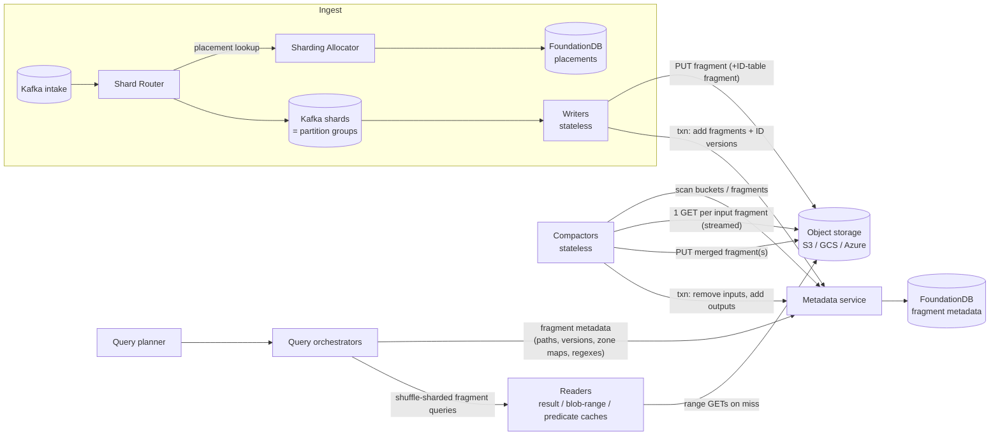

# Datadog Husky: Object-Storage-Backed Event Store

> **Status of sources.** Husky is closed source, so no code is cited here. This document is built from Datadog's four engineering blog posts on Husky (2022–2025), the Flex Logs product post, the DBDB.io entry, and a Datadog On episode listing. Each claim is marked as one of these:
>
> - **[S]**: stated in a primary Datadog source. Short quotes are given where the wording matters.
> - **[I]**: my inference from the stated design, or from how such systems are usually built. Treat these as hypotheses, not facts.
> - **[3P]**: from a third-party source (DBDB.io), not verified against Datadog's own material.

---

## 1. Overview

Husky is Datadog's third-generation **event store**. It stores logs, APM spans, RUM events, Network Performance Monitoring events, CI events, security signals and other "multi-kilobyte timeseries events". Datadog's own description: an *"unbundled, distributed, schemaless, vectorized column store with hybrid analytics/search capabilities, designed from the ground up around commodity object storage"* [S, Introducing Husky].

**Workload it targets** [S]:

- **Very high write volume.** Datadog cites *"more than 100 trillion events and billions of queries every day"* (2025 query post), and *"trillions of events per day"* (2025 compaction post).
- **Append-mostly writes.** *"a large write load of new data with little to no updates of existing records"*. Updates and deletions do exist, but they are rare and not described in detail.
- **Queries skewed to recent data.** *"Queries are biased toward the youngest edge of data, with some analytical queries reaching into older data."* There are two main query shapes:
  - "needle-in-a-haystack" selective searches, such as a request ID, an IP address, or an error string;
  - "analytics-style" aggregations, such as a timeseries over a week or breakdowns by tag.
- **Schemaless, highly variable data.** There is no fixed schema or column types. Event shape varies by product and by tenant. After compaction, a single fragment can contain *"hundreds of thousands (if not millions) of columns"*.
- **Massive multi-tenancy** with strong isolation needs. Monitors (automated queries) must not be impaired by human queries, and the reverse.
- **Exactly-once ingestion.** A duplicate event can flip a monitor evaluation or corrupt usage-based billing.
- **Long retention at commodity cost.** Husky is the technical basis of **Flex Logs**: retention of 3, 6 or 15 months, with compute allocated separately from storage, at roughly $0.05 per million events per month. The **Flex Frozen** tier, sold as up to 7 years, is queried via Archive Search. The Flex Logs post does not say whether Frozen is served by Husky itself [S Flex Logs post; Husky linkage S Introducing Husky].

**Lineage** [S]. The previous generations worked as follows:

- **Generation 1** was a clustered multi-tenant search system. A misbehaving node could take down the whole cluster.
- **Generation 2** removed clustering. Each storage node was an isolated single-node deployment (in effect a cluster of one) consuming specific Kafka **shards** (groups of partitions), with two replicas per shard. A custom query engine fanned out to the shards.
- **Husky (generation 3)** separates storage from compute, in the style of Snowflake and Procella, which the post cites. The Shard Router and the routing layer from generation 2 were kept.

Implementation language: **Go** [3P, DBDB.io]. This is consistent with the reference to Go's `singleflight` library in the query post.

---

## 2. Architecture outline

### Components

| Component | Role | State |
|---|---|---|
| **Shard Router** | Reads raw intake from Kafka and re-publishes each event to a partition belonging to a deterministic **shard** for that tenant and time window. Publishes per-tenant throughput metrics. | Stateless, apart from an in-memory cache of placements [S] |
| **Sharding Allocator** | Returns the immutable, time-bounded **Shard Placement** for a (tenant, timestamp) pair, creating it atomically in FoundationDB if missing. Sharded into isolated deployments, each with its own FoundationDB cluster. | FoundationDB [S] |
| **Autosharder / Sharding Balancer** | Adjust per-tenant shard counts and per-tenant hash salts to balance load across shards. | Configuration stored with tenant metadata [S] |
| **Writers** | Consume assigned shards, deduplicate, buffer per tenant/table, sort, write **fragments** to blob storage, and commit them to the metadata store. Never contacted at query time. | Stateless [S] |
| **Metadata service** | Thin front end over **FoundationDB**. It is the single source of truth for which fragments are visible in each table. It hides FoundationDB internals, including the "hard five-second limit" on transactions (2025 query post). | FoundationDB [S] |
| **Blob storage** | Amazon S3, Google Cloud Storage or Azure Blob Storage. Holds fragments and text-search **segments**. | Durable, delegated [S] |
| **Compactors** | Distributed, autoscaling LSM-style compaction: size-tiered, then locality compaction. They commit atomic swaps to the metadata store. | Stateless [S] |
| **Query planner** | Entry point. Handles context resolution, validation, throttling, optimisation, and splitting a query into **time-based steps**. Merges the results. | Stateless [S] |
| **Query orchestrator** | Per step: fetches fragment metadata, prunes it, dispatches fragment queries to readers with shuffle sharding, and aggregates the results. | Stateless [S] |
| **Reader (leaf) service** | Executes a query against one fragment. Uses large local caches on memory and disk: a result cache, a RocksDB-backed blob range cache, and a predicate cache. | "(almost) stateless": the caches are soft state [S] |

### Diagram

### Data flow

**Write path** [S unless marked]:

1. The Shard Router finds the tenant's placement for the event's timestamp. It then picks a shard with `shards[hash(event_id) % num_shards]` and publishes the event to one of that shard's Kafka partitions. The shard does not depend on when or how often the event is re-sent, so duplicates of an event always land in the same shard.
2. A Writer consumes its assigned shards. For each event it checks an in-memory set of event IDs. That set is backed by per-shard **ID tables** stored in Husky, which the Writer pages in lazily when it needs them.
3. The Writer buffers events per tenant table. Each buffer has a cap on how long any event may wait. When the buffer flushes, the Writer sorts the rows by the table's sort-schema row key and writes **one fragment per buffer** to blob storage. Writer fragments are small: *"a maximum of a few thousand events"*.
4. The Writer commits the new event fragment(s), plus the ID-table updates, to the metadata service in **one FoundationDB transaction**. ID-table updates are versioned, and out-of-order updates are rejected. Once the commit succeeds, the data is visible to queries.

**Read path** [S]:

1. The planner splits the query into time steps and sends each step to an orchestrator.
2. The metadata service enumerates fragments for the time buckets that overlap the step. Fragments are partitioned by time. The metadata service itself already drops fragments whose **pruning regexes** (generated during locality compaction) cannot match; that removed 300 of 1,000 fragments in Datadog's sample. The orchestrator then applies **zone-map pruning** to the fragment metadata it receives. Datadog says zone maps cut downstream work by about 30% on average and by up to 60% for structured events. The query post treats these as two separate mechanisms. Earlier drafts of this document merged them into one.
3. Surviving fragments are routed to reader nodes by shuffle sharding with consistent hashing on fragment ID.
4. Each reader works through these checks in order, stopping at the first one that answers the query:
   - the result cache;
   - fragment column metadata;
   - text-search segments and the predicate cache;
   - its local blob range cache;
   - and only then object storage.
5. Partial results stream back to the orchestrator and then to the planner. Clients poll a job-like interface and see progressive results.

**Background work** [S]:

- **Compaction**: size-tiered first, then locality compaction (LSM levels) within each (table, time-window) bucket.
- **TTL expiry** of tables, including the ID tables.
- **Autosharding and balancing** of ingest placements.
- **Reader-side predicate-cache building.**

---

## 3. Data model & on-disk/object format

### Logical model [S]

- **Tenant → tables.** Each tenant's data lives in dedicated tables. *"We never mix data from different tables in the same file."* There are separate tables for event data and for event IDs. ID tables are per *shard* and are time-partitioned.
- **Rows = events.** Each event has a timestamp plus arbitrary attributes. There is no fixed schema, so columns are discovered dynamically.
- **Time buckets.** *"Fragments in a particular table contain events for a single time window."* The window length is not stated.
- **Sort schema.** Each table has a configured list of columns plus `timestamp`, chosen from analysis of query patterns. The example for logs tables is `service,status,env,timestamp`. Writers concatenate these values into a **row key** and sort by it.

### Fragment format [S]

The fragment is Husky's custom columnar format, described as *"similar to Parquet — with one row group and many pages"*. Datadog then confusingly reuses "row group" for the Parquet-page-like unit. Its structure:

- **A whole fragment is a concatenation of entire columns.** Each column is preceded by a **column header**. Because each column announces itself, a compactor can stream a fragment from a single GET and discover columns as it goes.
- **Each column is split into "row groups".** These are runs of consecutive values, equivalent to Parquet pages. The number of rows per row group is **fixed and uniform across all columns of a fragment**. That lets you line up row group *i* of every column as the same set of rows.
  - The query post says readers keep row groups *"small—just a few hundred rows"* so they fit in CPU caches.
  - The compactor picks the row-group size per output file. The choice is based on the largest value size in the heaviest input column, which keeps memory per row group roughly constant.
  - Log `message` values can be up to 75 KiB. 15k such values would be more than 1 GiB, so row groups are needed to bound memory.
  - If an output exceeds the row-group byte budget, the compactor **restarts that output with a smaller row-group size**.
- **Row-group metadata** includes min/max per column per row group. It is used for lazy skip during scans.
- **A skip list of column offsets** is embedded in the fragment. Readers use it to jump straight to a needed column without scanning past others. This matters when a fragment has around 10^5–10^6 columns.
- **Fragment header** records the sort schema used, plus the **min and max row keys**. Together these define the fragment's lexical extent.
- **Column-level metadata** records which columns exist, min/max values, and explicit value lists when those are small enough. The reader uses it to return empty results without reading any data, for example when a query asks for `@requestId:abc` and the fragment has no `@requestId` column.
- Encoding and compression codecs are **not stated**. [I] Given the "vectorized" claim and the sorted layout, per-column dictionary or RLE encoding with a general-purpose compressor is likely, but this is unconfirmed. The compaction post does say that keeping similar events together *"improves compression"*.

### Text-search segments [S]

These are *"additional files that we call segments, which are attached to fragments"*. A segment holds:

- **Posting lists** stored as **bitsets** of row indexes, keyed by term. Each term has two bitsets: one for "standard text fields" (message, title, `error.stacktrace`) and one for all other fields, which serves full-text search across every field.
- **Hashed n-grams** (4-gram examples are shown), with posting lists keyed by hash. A configurable cap limits the number of n-grams per segment. Hash collisions produce false positives, which are acceptable because n-grams only narrow wildcard searches.

At query time the bitsets rewrite predicates into row sets. For example, `(login AND error) OR unavailable` becomes `row in [1, 5]`.

[I] The posts do not say whether segments are separate objects or byte ranges in the same object. The wording "additional files … attached to fragments" suggests separate objects, referenced from the fragment's metadata entry. Per DBDB.io [3P], the inverted index is optional and configured per column or table.

### Metadata (FoundationDB) [S]

Per-fragment metadata contains:

- file paths;
- fragment versions;
- row counts;
- timestamp boundaries;
- "zone maps used for query matching", which are the per-sort-column pruning regexes.

Datadog lists "zone maps used for query matching" as a field of the metadata. [I] The posts do not define what a zone map contains. It is most likely per-column min/max or value-set summaries. It is not the same thing as the pruning regex below.

The metadata is organised so that a time-range query can enumerate the fragments of the relevant buckets quickly. A record of which buckets "received new data recently" drives compaction scheduling.

The **pruning regex** is built as follows:

1. **During locality compaction** (per the 2025 query post: "pruning regexes generated during locality compaction"), a finite-state automaton matching all values of each sort-schema column is built for the output fragment. [I] Fresh writer fragments that have not yet been locality-compacted probably have no regex and are pruned only by time and zone maps.
2. The automaton is *trimmed* to bound its number of transitions, in a way that preserves "no false negatives".
3. It is converted to a regular expression and stored in metadata, e.g. `^(compactor|reader|writer)$`.

Unlike min/max keys, the regex rejects values that fall *between* min and max but are absent. In the example, `service:metadata` is rejected.

[I] The exact FoundationDB key schema is not published. A plausible layout is `(tenant, table, time_bucket, fragment_id) → metadata blob`, with per-bucket change markers. Because FoundationDB values are capped at 100 KB and transactions at 10 MB / 5 s, the metadata must be compact. That is presumably why the regexes are trimmed, and why the metadata service exists to *"preserve atomicity even though FoundationDB enforces a hard five-second limit on transactions"*.

[3P, DBDB.io] Concurrency control is MVCC with snapshot isolation. Queries work on a temporary copy of the table's metadata, taken when the query starts.

---

## 4. How it achieves it

### 4.1 Writes: exactly-once, stateless ingestion

**Deterministic locality routing** [S]. **Shard Placements** are immutable, non-overlapping and time-bounded ("usually just a few minutes").

- **Choosing shards.** The first shard is `H(tenant_id + salt, totalShards)`, and the placement takes the next *n−1* shards on the ring, skipping excluded shards. A consistent-hash function keeps placements stable when the shard count or the total number of shards changes.
- **Consensus.** The Sharding Allocator does a check-or-create in one FoundationDB transaction, so every Shard Router computes the same placement.
- **Shard counts.** The **Autosharder** sizes `n` per tenant from published metrics. These are based mainly on bytes emitted, because bytes predict ingestion cost better than event counts. It up-shards promptly, and "also down-shards, but this is done over a longer period of time".
- **Balancing.** The **Sharding Balancer** lowers the population variance of per-shard load by changing tenant salts. Each run is capped at a fixed number of moves.

The payoffs:

- Deduplication only ever has to happen within one shard.
- Each Writer sees few tenants. This matters because one file is written per (tenant table, buffer). There is *"an almost-linear relationship between the number of tenants processed by a Husky Writer node and the number of output files uploaded to blob storage"*, and every file costs money.

**Deduplication inside Husky itself** [S]. Event IDs are written to per-shard, time-partitioned **ID tables**, which are ordinary Husky tables. They are committed **in the same FoundationDB transaction** as the event fragments, so data and IDs can never diverge.

- **Paging and caching.** Writers keep recent ID intervals in memory and evict them with an LRU. On restart or reassignment they page in whole intervals with *"a very limited number of IO operations"*. In practice the page-in rate is orders of magnitude below the ingest rate, and Writers can page in IDs at a rate "~2 orders of magnitude higher" than they process events.
- **Conflict detection** is optimistic. Updates to ID tables are versioned, and out-of-order commits are rejected. The losing Writer discards its ID cache and *"consumer progress is reset to the latest committed fragment"*.
- **Rejected alternatives.** Datadog lists four:
  - querying Husky itself for every event ID, which is too slow for high-volume point lookups;
  - holding every seen ID in memory, which does not fit and does not survive restarts or conflicting Writers;
  - an embedded store such as RocksDB, which would make Writers stateful;
  - a remote store such as Redis or Cassandra, which adds a dependency, splits the source of truth, and is hard to scale to long dedup windows.

  A footnote also describes, and rejects for Husky, the approach of writing duplicates, filtering them at query time and pruning them at compaction.

[I] *Commit protocol.* The consumer offset (Kafka position) is most likely stored in FoundationDB in the same transaction as the fragment add and the ID version bump. Otherwise "reset to the latest committed fragment" would not be well-defined. This would make each Writer flush a classic transactional "upload object, then atomically publish pointer + offset" step. An upload whose commit fails leaves an **orphan object**, which a garbage collector must later delete. Datadog does not describe a GC, but one is necessary.

### 4.2 Reads: prune first, cache aggressively, scan lazily

Section 6 covers the details. Briefly, pruning works in layers:

1. Time-bucket selection.
2. Pruning regexes evaluated inside the metadata service (300 of 1,000 fragments in the sample), then zone-map pruning in the orchestrator (about 30% less downstream work on average, up to 60% for structured events).
3. Per-reader result cache.
4. Column existence and value metadata.
5. Segment posting lists and the predicate cache.
6. Row-group min/max with lazy decoding.
7. Only then actual byte reads: first the local disk cache, then the object store.

### 4.3 Manipulation: compaction

**Goals** [S]:

- Minimise fragment count, which reduces object GETs and metadata volume.
- Keep the PUT/GET/CPU spent on compaction low.
- Hit a "Goldilocks" fragment size that balances per-worker vectorised scan speed against query parallelism.
- Narrow the lexical span of each fragment so it can be pruned.

**Lazy compaction of fresh data** [S]. Merging each new small file into a growing big one immediately would mostly produce two-input merges. Instead, compaction waits until merges are "efficient enough" (*"wait until a few dozen fragments are available"*). Datadog says this is *"cheaper in CPU and object store API costs—by an order of magnitude"*. When new data for a bucket becomes unlikely, a "(presumably) final" compaction brings the bucket to its most compact form for long-term retention. Late or backfilled data is handled the same way, as "just another bucket with modified data to be compacted".

**Size-tiered stage** [S]. Fragments are grouped into exponentially increasing size classes. A set of fragments within a class is merged so the output lands in the next class. This repeats until fragments are about **1 million rows**, compared with the roughly 1,000-row fragments written by Writers.

**Locality-compaction stage** [S]. This is a best-effort LSM with levels per (table, time bucket):

- Fragments that have finished size-tiering enter **level 0**.
- Overlapping fragments, judged by min/max row key, are k-way merged into non-overlapping outputs.
- Each level has a row limit. When a level exceeds it, fragments are promoted to the next, exponentially larger level.
- Fragment size is held roughly constant, so fragments at higher levels cover narrower key ranges and are pruned more often.
- Locality compaction is "conservatively configured to not use more CPU than size-tiering alone". It allowed a **30% reduction of the reader pool** when it was first rolled out.

**The merge algorithm** [S]. This is a streaming **k-way merge**, not concatenation:

1. Read the sort-schema columns of every input and compute the global output ordering, a permutation.
2. Stream each remaining column, one column at a time and one row group at a time, from all inputs at once. Write the rows into the output in permuted order.
3. If the output spans several files, those files are disjoint in sort order.

Memory is bounded to roughly one row group per input fragment. The stated design targets are:

- **one GET per input fragment, then streaming in parallel**;
- **saturate the CPU**;
- **fixed memory less than the memory available for one CPU**.

[I] *How "1 GET" and "column-at-a-time" fit together.* The column-major layout means the sort columns are not necessarily at the start of the object, yet the merge needs them first. Several reconciliations are possible:

- (a) Each input is opened with a single streaming GET, and columns are consumed in object order. This works if the format places the sort-schema columns, including `timestamp`, first, and all fragments order the remaining columns the same way, for example lexicographically by name. Then the k inputs can be advanced in lockstep, column by column, and missing columns are filled with nulls.
- (b) The input is spooled to local disk and then re-read.

Option (a) fits all the stated facts: the column header enables "discovering columns as the streaming progresses", and the merge proceeds "one column at a time". I believe (a) is the design, but Datadog has not confirmed it.

**Atomic swap** [S]. The compactor uploads its outputs, then commits one FoundationDB transaction that removes the inputs and adds the outputs. Queries see the table either before or after the swap, never partially.

[I] Input objects cannot be deleted at commit time. In-flight queries may hold snapshots that reference them, and DBDB.io describes snapshot isolation with a per-query metadata copy. Deletes must therefore be deferred until after a grace period that exceeds the maximum query or snapshot lifetime. Datadog has not described this mechanism.

**Retention** [S]. Tables have TTLs, and ID tables use them too. Time bucketing means a whole bucket can expire as a unit. [I] Expiry is therefore metadata removal followed by bulk object deletes, or bucket lifecycle rules if prefixes line up with time. No row-level rewrite is needed.

**Updates and deletes** [S]. Datadog says only that "updates, deletions, and background compactions happen (a topic for another time)". Readers still see a consistent result, because each metadata entry points at an immutable dataset. [I] A copy-on-write approach fits the architecture: rewrite the affected fragments without the deleted rows (for GDPR-style deletion), then atomically swap them like a compaction, possibly preceded by tombstone or row-mask metadata that queries apply until the rewrite lands. A per-fragment **version** field exists in metadata, which is consistent with copy-on-write replacement and gives cache keys that are invalidated by construction.

---

## 5. Object storage interaction patterns

| Aspect | What is known | Basis |
|---|---|---|
| **Backends** | S3, GCS and Azure Blob Storage, behind a generic "blob storage" abstraction. | S |
| **Object type** | Immutable fragments in Husky's columnar format, plus text-search "segment" files attached to fragments. ID tables are also stored as fragments. | S |
| **Object granularity** | One fragment holds one tenant table and one time window. Tables are never mixed in one file. Writers write one fragment per flushed buffer. | S |
| **Object sizes** | Writer output is at most "a few thousand events". After size-tiering, fragments hold about 1M rows. Locality compaction keeps fragment size roughly constant across levels. Byte sizes are not given. [I] Assuming 0.5–2 KB per event before compression and 5–10x compression, writer fragments are about 100 KB–1 MB and compacted fragments are around tens to a few hundred MB. | S (rows) / I (bytes) |
| **Key naming / layout** | Not published. The metadata stores "file paths" per fragment, so keys are opaque, and readers never need to LIST. [I] Keys are probably unique per object (UUID or content-derived), possibly prefixed by tenant/table/time to spread the prefix-based request-rate partitions of S3 and to allow bulk deletes. | S (paths stored in metadata) / I |
| **Writer PUTs** | One PUT per (tenant table, buffer flush), plus ID-table fragment PUTs. Locality routing exists partly to reduce PUT count: "Since we pay for every file created… The number of files (objects) created is an important cost dimension" and "make sure the blob storage bucket can handle our request volume (and avoid getting rate-limited)". | S |
| **Multipart uploads** | Not stated. [I] Writer fragments are probably single PUTs. Compactor outputs of tens or hundreds of MB, produced by streaming, are natural candidates for multipart upload, which lets output stream out as columns are produced with bounded memory. | I |
| **Compactor GETs** | **Exactly one GET per input fragment**, streamed, as an explicit design goal. Plus one or more PUTs per output. | S |
| **Compactor efficiency** | Lazy compaction, which waits for a few dozen inputs, cut "CPU and object store API costs—by an order of magnitude" versus eager merging. | S |
| **Reader GETs** | Range reads of the needed columns and row groups, using the in-fragment column-offset skip list. These go through the "blob range cache", which caches chunks of data retrieved from storage in RocksDB on local disk. Datadog says "issuing multiple GETs on each [fragment] for every query isn't viable", so the design minimises per-query GETs. [I] The probable sequence for a cold fragment is one small range GET for the footer, header or skip list (likely itself cached), followed by range GETs for the needed column chunks, possibly coalesced. | S (range cache, minimise GETs) / I (exact sequence) |
| **Read amplification in practice** | In a sample of 1,000 fragment queries, only 4 (0.4%) reached blob storage. 30 were served from the reader's local cache, and the rest were pruned or answered by caches. | S |
| **LIST** | Not used on the hot path. The metadata store is the authoritative index of objects, and compactors find work by scanning metadata, not by listing buckets. | S (compactors "scan the metadata store") |
| **DELETE** | Inputs become invisible at the compaction commit. Physical deletion is not described. [I] Deletes are deferred and asynchronous, both for compaction inputs after a safety window and for orphaned uploads from failed commits. Some deletes could be handled by bucket lifecycle rules. TTL expiry deletes whole time-bucket fragments. | I |
| **Immutability** | Fragments are never modified in place. Every change (ingest, compaction, delete or update) writes new objects and atomically swaps metadata. Caches rely on this: "if the metadata is unchanged, the data behind it is, too." | S |
| **Consistency assumptions** | Visibility is defined only by FoundationDB, which is strictly serializable. The protocol is upload first, then commit. The object store only needs read-after-write for newly created keys, which S3, GCS and Azure all provide today. There is no reliance on LIST consistency or conditional PUTs. | S (FDB as source of truth) / I (exact requirement) |
| **Metadata location** | Kept entirely out of the object store, in FoundationDB. Fragments still embed their own headers, row-group stats and offset skip list. Metadata includes paths, versions, row counts, time bounds, and zone-map regexes. | S |
| **Cost considerations** | Stated cost drivers are object count (PUT count and per-object metadata), GET count (compaction and query), and reader compute (the most expensive part of the system). Mitigations: tenant locality on ingest, lazy compaction, the single-GET streaming merge, large compacted fragments, pruning, and multi-layer caches. The query post states the overall result as scanning "as little as 0.6% of the underlying data on average". | S |

**Request count per operation**, summarised and partly inferred:

- **Ingest flush**: 1 PUT per tenant-table fragment, plus 1 PUT per ID-table fragment, plus 1 FoundationDB transaction. Likely also segment PUTs where text indexing is enabled. [S/I]
- **Compaction of k inputs into m outputs**: k GETs, m PUTs (or multipart equivalents), 1 FoundationDB transaction, and eventually k DELETEs. [S for GETs and transaction; I for the rest]
- **Query over F candidate fragments**: about 1 metadata read per time step. After pruning and caching, blob GETs are about 0.004·F in Datadog's sample. [S]
- **ID page-in** on Writer restart: a few GETs per ID interval, because ID tables are time-partitioned per shard. [S qualitatively]

---

## 6. Performance

### Fragment sizing and data layout [S]

- **Time bucketing**: queries touch only overlapping windows.
- **Size-tiered compaction**: fragments grow from about 1k to about 1M rows, which cuts GETs and metadata volume.
- **Sort schema and locality compaction**: each fragment covers a narrow lexical range, which enables fragment-level pruning and better compression. This gave about 30% fewer reader nodes at rollout.
- **The "Goldilocks" size** balances vectorised scan efficiency within a fragment against fan-out parallelism across fragments.

### Pruning and skipping [S]

| Layer | Mechanism | Stated impact |
|---|---|---|
| Metadata service | Time-bucket filter, then sort-column FSA pruning regexes (no false negatives) built during locality compaction | 300 of 1,000 in the sample |
| Orchestrator | Zone-map pruning on the returned fragment metadata | About 30% less downstream work on average, up to 60% for structured events |
| Reader: result cache | Fragment-level memoised results, held in memory and persisted to disk across restarts | Hit rate about 80%. 560 of 700 in the sample |
| Reader: column metadata | Column presence, min/max, small explicit value lists | 78 of 700 pruned |
| Reader: segments and predicate cache | Bitsets reduce the query to NO_MATCH, or to MATCH_ALL for `COUNT(*)` | 28 of 700 pruned |
| Reader: row groups | Min/max per row group; a cost-ordered evaluation of predicates; **lazy references** so columns are decoded only when needed | Decoding of unneeded columns is avoided |
| Bytes | Local blob range cache, then object store | 30 local and 4 remote out of 34 |

Overall in the sample, 3.4% of fragment queries scan real data and **0.4% hit blob storage**.

### Caching [S]

- **Result cache**, keyed per fragment. It works because of overlapping UI auto-refreshes, repeated monitors, and dashboard widgets that share filters. Immutability plus fragment versions mean it never needs explicit invalidation.
- **Blob range cache.** Chunks of object data are stored in **RocksDB on local disk**. It has a hit rate of about 70% and an admission heuristic:
  - it skips objects that are too large;
  - it **bypasses the cache when local disk I/O is saturated**, going straight to the network.
  
  It also deduplicates concurrent identical reads in the style of `singleflight`.
- **Predicate cache** is per fragment and per reader. It tracks the evaluation cost of each predicate and periodically caches matching-row bitsets for the top N% most expensive ones in a background job. Its hit rate is only about 3–4% (the text says about 3%, the chart about 4%). Its efficiency is work saved divided by build cost. The text gives it as about 11. The chart puts the average at 14.8, with a range of 7.46 to 22.8. Either way, each cached predicate saves roughly 10x the CPU it cost to build. A cached predicate can also remove the need to fetch its column at all.
- [S, Introducing Husky] Readers are "(almost) stateless". The caches are the "almost".

### Routing for cache affinity [S]

- **Shuffle sharding with consistent hashing on fragment ID.** Each tenant gets a subset of reader nodes, a "shard" whose size is configured per tenant from usage. This gives affinity (cache locality), load balance, and tenant isolation together.
- **Virtual-node weighting.** New nodes start with a smaller share so their cold caches can warm, and heterogeneous hardware gets proportionate weight.
- **Load-aware fallback.** Load is piggy-backed on reader responses and discovered in the background. A query to an overloaded node is redirected to a *consistently chosen secondary*, unless the primary can answer from cache.

### Execution [S]

- Volcano-style iterator model (`open`/`next`/`close`), with parallel pipelines and operator reordering.
- Row groups of a few hundred rows fit in CPU cache, and the simple operators allow compiler auto-vectorisation.
- A cost-based order of predicate evaluation.
- Text search turns predicates into bitset algebra.

### Latency hiding and tail management [S]

- **Streaming partial results** end to end. Clients poll a job interface, and results arrive progressively. In the example, 7 of 8 fragments, about 90% of the data, arrived within 1 second while the slowest fragment lagged.
- The latency distribution per fragment query, measured over about 6.44 trillion data points, is about 2.01 ms at p50/p75, 6.04 ms at p90, 19.93 ms at p95, 257 ms at p99, and **12.8 s at the maximum**. The low median reflects cache hits, and the long tail reflects cold reads from blob storage plus heavy scans.
- Streaming requires **checkpointing** for safe retries.

### Latency vs cost trade-off [S]

At migration, Husky's **median latency rose by "a few hundred milliseconds"** because of the higher latency floor of remote storage compared with local SSD. Datadog says **"the p95/p99/max latencies are dramatically lower on Husky"** and accepted this trade explicitly.

Validation method: dual-write, then shadow 100% of query load for months before switching over.

---

## 7. Scaling

**Write scaling** [S]:

- Writers are stateless and autoscaled by the Watermark Pod Autoscaler on CPU. Shards are kept small, so each Writer owns several shards, and adding Writers reduces shards per Writer.
- Kafka partitions are abstracted into shards. Many partitions, possibly across topics and clusters, map to one shard, so Kafka can scale and fail over independently.
- Per-tenant shard counts follow byte throughput through the Autosharder. Hot shards can be **excluded** from future placements so they can drain their backlog.
- Placements change every few minutes, so routing adapts quickly without breaking determinism.
- The Sharding Allocator is itself sharded across isolated FoundationDB clusters, and placements are cached in Shard Router memory.

**Read scaling** [S]:

- Reader pools are large both horizontally (to minimise shuffle-shard overlap) and vertically (large disks for caches).
- A query over a small tenant's year of data can "burst" onto many readers when there is spare capacity. Conversely, Flex tenants can be capped.
- Reader pools can be partitioned by product, by tenant, or by automated versus human queries. Every pool can read all metadata and blob stores.
- Query planner, orchestrator and metadata services are multi-tenant and deployed across regions, deployments and data centres.
- The orchestrator's load tracking is distributed and stateless.

**Metadata scaling** [S/I]:

- FoundationDB scales horizontally [S].
- The number of fragments is the main factor in metadata scale. Compaction is explicitly responsible for keeping "the number of fragments tracked by the metadata service … reasonable" [S].
- FoundationDB's 5-second transaction limit is hidden behind the metadata service while preserving atomicity [S].
- [I] Large metadata scans for big queries are probably split across several read transactions, or snapshot reads at a pinned version, per time step. That may be one reason the planner breaks queries into time steps. The other is result streaming.
- [S, Introducing Husky] There can be multiple metadata stores and blob stores; the diagram shows several. [I] This implies tenants or products are partitioned across FoundationDB clusters.

**Compaction scaling** [S]:

- The compactor pool is distributed and autoscaling. Work is partitioned naturally by (table, time bucket), and changed buckets are tracked to find work.
- Each compaction is limited to roughly one CPU's worth of memory, so throughput scales linearly with cores.
- The system compacts "thousands of fragments and [processes] dozens of GB of data every second".

**Multi-tenancy** [S]:

- Tenant isolation at the file level, with one table per tenant.
- Locality routing limits the number of tenants per Writer.
- Shuffle sharding on readers, with a per-tenant shard size.
- Compute and storage are decoupled for pricing (Flex Logs).

**Known limits and pain points** [S unless marked]:

- **Object count grows with tenant count.** Writers produce roughly one file per tenant table per flush, so many tiny tenants mean many tiny objects. This is the reason for locality routing.
- **The freshness versus file count tension.** The buffer time cap bounds ingest-to-query latency but increases fragment count.
- **Higher latency floor than local SSD.**
- Fragments with around 10^6 columns need special format support.
- Very large `message` values force adaptive row-group sizing and occasional restarts of a compaction output.
- FoundationDB transaction limits.
- [I] Cold-cache behaviour after scaling events or node replacement. The virtual-node ramp-up exists for exactly this reason.

---

## 8. Trade-offs & lessons

1. **Put the source of truth in a transactional metadata store, not in the object store.** Every visibility change (ingest commit, compaction swap, deduplication state, placements) is a FoundationDB transaction. Object storage then only needs to hold immutable bytes. This removes any dependence on LIST consistency, conditional PUTs, or manifest-file races, and it makes atomic compaction swaps trivial. The cost is a second stateful system with its own limits: the 5-second transactions and value sizes.
2. **Co-commit derived state with data.** Storing deduplication IDs *as Husky tables* and committing them in the same transaction as the events gives exactly-once ingestion without an external KV store. The general lesson is that any auxiliary state that must agree with the data should live behind the same commit point.
3. **Control object count upstream.** File count is a first-class cost and rate-limit concern. Husky shapes the *ingest stream*, through deterministic tenant-local routing, so that each Writer produces fewer, larger objects. This works better than relying only on compaction afterwards.
4. **Make compaction lazy and streaming.** Waiting for a few dozen inputs is about 10x cheaper than eager merges. Designing the format so a merge needs **one sequential GET per input** and bounded memory makes compaction both cheap in requests and CPU-bound. The reusable pieces are self-describing column headers, column-major layout, and uniform row-group size across columns.
5. **Use a hybrid LSM strategy, chosen per goal.** Size-tiering controls object count. Leveled "locality" compaction on a product-chosen sort key controls pruning. Configuring the second stage to cost no more CPU than the first still gave a 30% reduction in reader compute, which is the dominant cost.
6. **Favour metadata-only pruning with no false negatives.** Trimmed-FSA regexes per sort column, built at locality-compaction time, are a compact alternative to min/max, which they beat. [I] They are probably also an alternative to Bloom filters for low-cardinality tags, though Datadog makes no direct comparison. Together with zone maps, metadata-level pruning removed about 30% of fragments in Datadog's sample before any reader was contacted.
7. **Treat object storage as the cold tier behind deep caches, and route for affinity.** The design point is that only about 0.4% of fragment queries reach S3. That requires consistent hashing on immutable fragment IDs, a result cache, a byte-range cache on local disk, warm-up weighting for new nodes, and admission control that skips the disk cache when the disk is the bottleneck.
8. **Let immutability do cache invalidation.** Fragment and version identity act as the cache key. Updates and deletes produce new fragments rather than mutating old ones.
9. **Fight tail latency structurally.** Stream partial results, apply per-fragment fan-out limits, use load-aware secondary routing, and checkpoint for retries. A higher median is acceptable when tails collapse.
10. **Split the services, not just storage and compute.** Writers are never on the query path. Query pools are isolated by workload (monitors versus humans) independently of ingest isolation. Datadog is now looking at splitting cache storage from query compute as well.
11. **Direction of travel.** Datadog says it is adopting Apache **Arrow, Parquet, Substrait and DataFusion** "to decouple components and standardize interfaces" (2025 query post). Datadog job postings from 2026 describe the same move from the custom format toward open standards. They also cite ingestion of "over 100 million events per second", "timely deletion across hundreds of thousands of customer tables", and a goal to "scale a petabyte-scale database to an exabyte-scale one". This suggests the custom format and engine may converge toward open standards over time [S], though the custom fragment format remains central today. [I] Teams starting fresh can likely get much of the fragment-format benefit from Parquet with careful page sizing, page indexes and column ordering, falling back to a custom format only when wide-schema (around 10^6 columns) or streaming-merge constraints bite.

**Open questions, unanswered by public sources:**

- object key scheme;
- multipart usage;
- delete and GC protocol and grace periods;
- codec choices;
- exact segment-object layout;
- the FoundationDB key schema;
- how updates and deletes are applied;
- the time-bucket width;
- the Writer flush thresholds.

---

## 9. Sources

Primary (Datadog):

- Richard Artoul, Cecilia Watt, *"Introducing Husky, Datadog's third-generation event store"*, 2022-05-17. https://www.datadoghq.com/blog/engineering/introducing-husky/ (markdown version: https://www.datadoghq.com/blog/engineering/introducing-husky.md)
- Daniel Intskirveli, Cecilia Watt, *"Husky: Exactly-once ingestion and multi-tenancy at scale"*, 2023-02-22. https://www.datadoghq.com/blog/engineering/husky-deep-dive/ (markdown: https://www.datadoghq.com/blog/engineering/husky-deep-dive.md)
- Damien Profeta, George Talbot, *"Husky: Efficient compaction at Datadog scale"*, 2025-01-29. https://www.datadoghq.com/blog/engineering/husky-storage-compaction/ (markdown: https://www.datadoghq.com/blog/engineering/husky-storage-compaction.md)
- Sami Tabet, *"Inside Husky's query engine: Real-time access to 100 trillion events"*, 2025-10-01. https://www.datadoghq.com/blog/engineering/husky-query-architecture/ (markdown: https://www.datadoghq.com/blog/engineering/husky-query-architecture.md)
- *"Introducing Flex Logs"*, Datadog blog. https://www.datadoghq.com/blog/flex-logs/ (markdown: https://www.datadoghq.com/blog/flex-logs.md)
- Datadog On episode listing, *"Building an Event Storage System"* (Ryan Worl, Guillaume Duranceau), 2022-12-13. https://datadogon.datadoghq.com/episodes/datadog-on-building-an-event-storage-system (listing page only; no transcript consulted)
- Watermark Pod Autoscaler (referenced for Writer autoscaling): https://github.com/DataDog/watermarkpodautoscaler

Secondary / reference:

- DBDB.io entry for Husky: https://dbdb.io/db/husky
- FoundationDB known limitations (5-second transaction limit, referenced by Datadog): https://apple.github.io/foundationdb/known-limitations.html
- Datadog careers, *"Manager I, Engineering - Husky"* (2026 posting; used only for current scale and direction): https://careers.datadoghq.com/detail/7959705/
- InfoQ coverage of Husky ingestion: https://www.infoq.com/news/2023/06/datadog-husky-data-ingestion/ (surfaced in search; not relied on for claims)

No source code is available. Husky is proprietary, so no repository was cloned.

---

## Review notes (2026-10-31)

I spot-checked the claims against the four Datadog engineering posts and a 2026 Datadog job posting. Husky is closed source, so there was no code to check.

**Corrected**
- **Zone maps and pruning regexes are two mechanisms, not one.** The earlier draft merged them. Pruning regexes are generated during locality compaction, not at fragment creation, and the metadata service applies them (300 of 1,000 fragments in the sample). Zone maps are applied in the orchestrator (about 30% average, up to 60% for structured events). Fixed in sections 2, 3, 4.2, 6 and 8.
- **Migration tail latency.** I removed "fell by seconds to hundreds of seconds", which no source says. The section now uses Datadog's wording: "dramatically lower".
- **Predicate cache numbers.** The text and the chart in the source disagree. The section now gives both: a hit rate of about 3–4%, and efficiency of about 11 (text) or a 14.8 average with a range of 7.46–22.8 (chart).
- **Per-fragment latency.** Added the 12.8 s maximum and the size of the sample.
- **Deduplication alternatives.** The list now matches all four options the deep-dive post rejects. "Dedupe at compaction" is only described in a footnote, and the section now says so.
- **Autosharder.** The wording now follows the source: metrics are based mainly on bytes, and down-sharding happens "over a longer period of time".
- **ID page-in rate.** Replaced "100x" with the source's wording, "~2 orders of magnitude".
- **Lineage wording.** "Cluster of one" was shown as a quote but is not in the source, so it is now a paraphrase.
- **Five-second FoundationDB limit.** Attributed to the 2025 query post.
- **Bloom-filter comparison** in lesson 6. Marked as inference, because Datadog makes no such comparison.

**Verified as accurate**
- The "100 trillion events" figure.
- The 1,000-fragment funnel (300 / 560 / 78 / 28 / 30 / 4).
- Result cache hit rate of about 80% and blob range cache of about 70%.
- The RocksDB range cache and `singleflight`-style read deduplication.
- Row groups of "a few hundred rows".
- Lazy compaction ("a few dozen fragments"), and its order-of-magnitude saving in CPU and API costs.
- Fragment sizes: writer output of "a few thousand events" at most, about 1M rows after size-tiering.
- 75 KiB `message` values and restarting a compaction output with a smaller row group.
- One GET per input fragment, column headers, and the embedded skip list of column offsets.
- The 30% reader downscale from locality compaction, and compaction throughput of "dozens of GB per second".
- The S3/GCS/Azure backends (named in the compaction post).
- The table-isolation and file-cost quotes, and that ID tables are committed in the same FoundationDB transaction as the event data.
- "Consumer progress is reset to the latest committed fragment."
- Shuffle sharding, virtual-node ramp-up and secondary routing.
- The median latency increase of "a few hundred milliseconds", and months of 100% shadowing.

**Added**
- Current direction and scale from a 2026 job posting: the move to Parquet, Arrow and DataFusion, ingestion above 100M events/s, and an exabyte-scale goal.
- I found no new Husky engineering post after October 2025, so the document still reflects the latest public material.

