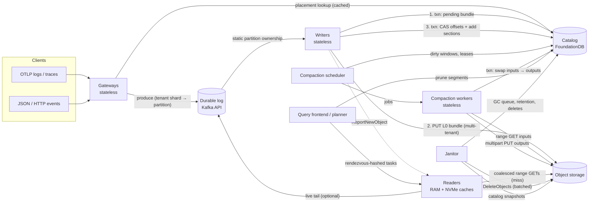

# Design Sketch: A Schemaless Wide-Event Store on Object Storage

> This is a design for a new event store ("**EVS**" below) that holds logs, traces and other wide,
> schemaless events, with object storage as its only durable data tier. Every major choice is traced to
> what we learned from Husky, Quickwit, Loki, Tempo, WarpStream and ClickHouse (see [synthesis.md](synthesis.md)
> and the per-system documents). Numbers are starting defaults to tune, not measured results.
>
> Status: proposal / thought experiment, 2026-10-31.

---

## Contents

1. [Goals and non-goals](#1-goals-and-non-goals)
2. [Design principles carried over from the research](#2-design-principles-carried-over-from-the-research)
3. [Architecture overview](#3-architecture-overview)
4. [Data model: one schemaless event table](#4-data-model-one-schemaless-event-table)
5. [Object types and key layout](#5-object-types-and-key-layout)
6. [The segment file format (`.evs`)](#6-the-segment-file-format-evs)
7. [The catalog](#7-the-catalog)
8. [Write path](#8-write-path)
9. [Compaction](#9-compaction)
10. [Read path](#10-read-path)
11. [Deletes, retention and garbage collection](#11-deletes-retention-and-garbage-collection)
12. [Caching and placement](#12-caching-and-placement)
13. [Scaling and a sizing example](#13-scaling-and-a-sizing-example)
14. [Failure modes](#14-failure-modes)
15. [Alternatives considered](#15-alternatives-considered)
16. [Phased build plan](#16-phased-build-plan)

---

## 1. Goals and non-goals

### Goals

| Goal | Target |
|---|---|
| **One store for logs, spans and arbitrary events** | Same table model, file format, catalog and query engine. Signal type is a column, not a separate system. |
| **Schemaless and wide** | Any JSON or OTLP attribute becomes queryable without configuration. Must handle up to ~10^5–10^6 distinct keys per tenant per day (the regime Husky reports). |
| **Object storage is the only durable data tier** | S3, GCS or Azure Blob. Compute is stateless apart from caches. |
| **Freshness** | Queryable from object storage within **≤5 s** of acceptance (p99). |
| **Query latency** | Interactive: p50 < 1 s and p95 < 5 s for typical "last 1 h, one service" queries. Trace-by-ID < 2 s. |
| **Query shapes** | Needle search (IDs, error strings), filtered aggregations and timeseries, top-K, trace-by-ID, and trace-structure queries over spans. |
| **Exactly-once from the durable log onwards** | Replays never create visible duplicates. |
| **Multi-tenant at very large scale** | Hundreds of thousands of tenants, from bytes per day to TB per day each. Per-tenant isolation in files, caches and quotas. |
| **Cost** | Bound PUTs by writer count, not tenant or partition count. Keep GETs per query proportional to *matching* data. No LIST on any hot path. |

### Non-goals

- Sub-second freshness from object storage. A live-tail path reads from the log for that (§10.6).
- Row-level transactional updates. Updates and deletes are rare and handled by copy-on-write or patch.
- Arbitrary joins across tenants.
- Running on object stores without strong read-after-write for new keys.

---

## 2. Design principles carried over from the research

Each principle is a lesson that several of the six systems arrived at independently.

| # | Principle | Learned from |
|---|---|---|
| P1 | **Immutable, write-once objects with never-reused keys.** Caches are keyed by object identity and never invalidated. | All six |
| P2 | **The catalog is a transactional database, not the bucket.** Visibility, compaction swaps, ingest offsets and dedupe state commit atomically in one place. Object storage only holds bytes. | Husky (FDB), Quickwit (Postgres), ClickHouse SMT (Keeper), WarpStream (VC) |
| P3 | **Upload, then publish; record intent before upload.** Orphans are found from the catalog, never by LIST. | Quickwit stage → upload → publish |
| P4 | **The durable log (Kafka API) is the WAL.** Object writes are idempotent functions of an offset range, and storage runs at RF1 behind it. | Tempo 3.x, Loki dataobj, Husky |
| P5 | **Batch across tenants on the write path, then separate tenants in compaction.** PUT rate ∝ writers × flush rate. | WarpStream (multi-partition files), Husky (tenant-local routing) |
| P6 | **One GET to open any object.** Store the directory offset in the catalog. | Quickwit, Tempo (`footerSize` in meta) |
| P7 | **Prune in layers, cheapest first.** Catalog → in-file directory → auxiliary indexes → page stats → bytes. | Husky's pruning funnel; Tempo; ClickHouse |
| P8 | **Columnar, with uniform row blocks across columns and two-phase reads.** | Husky (uniform row groups), ClickHouse (PREWHERE), Loki (primary/secondary columns), Tempo (second pass) |
| P9 | **Lazy, streaming compaction with bounded memory, run as a separate scheduled service.** | Husky (lazy, one GET per input), Tempo (multipart per row group), Quickwit/Loki/Tempo (dedicated compactors) |
| P10 | **Sort for locality, then prune on metadata.** | Husky locality compaction (−30% readers), Loki dataobj sort schema |
| P11 | **Range-read engineering:** coalesce, split, parallelize, de-duplicate in flight, hedge. | Loki `rangeio`, Quickwit debouncer, WarpStream hedging |
| P12 | **Affinity-routed local caches over shared state;** prewarm new objects on their future owner. | Husky, Quickwit (`ReportSplits`), WarpStream (per-AZ ring) |
| P13 | **Deferred deletes with a grace period, plus a reconciler.** Never rely on bucket TTLs for mixed objects. | Quickwit, Tempo, WarpStream, ClickHouse |
| P14 | **Self-describing objects** so the catalog can be rebuilt from the bucket in a disaster. | WarpStream (metadata section), Quickwit (`split_recovery_metadata`) |
| P15 | **Spread key prefixes from day one.** | Quickwit, Loki, ClickHouse, WarpStream (`503 SlowDown` retrofit) |

---

## 3. Architecture overview



### Components

| Component | State | Responsibility |
|---|---|---|
| **Gateway** | Stateless | Auth, validation, OTLP → event model, assign `@event_id` if absent, route to a partition by **tenant placement**. Enforce per-tenant rate limits. |
| **Durable log** | External (Kafka, Redpanda, WarpStream, MSK…) | Durability on acknowledgement. RF follows the log's own setting. Retention ≥ 24 h, to cover writer outages and replays. |
| **Writer** | Stateless (scratch memory only) | Owns a set of partitions. Buffers events per (tenant, dataset) in Arrow. Every flush interval, encodes **one multi-tenant L0 bundle**, uploads it, and commits it with the offsets in one catalog transaction. |
| **Catalog** | FoundationDB (behind a thin catalog service) | Single source of truth: segment metadata, ingest offsets, pending uploads, compaction leases and dirty markers, delete requests, the GC queue, and tenant placements. |
| **Compaction scheduler** | Stateless (state in the catalog) | Finds dirty (tenant, dataset, window) units, plans merges, leases jobs to workers. |
| **Compaction worker** | Stateless | Streams merges: L0 → L1 split-and-sort, size-tiering, locality compaction, delete rewrites. Builds auxiliary indexes. |
| **Query frontend** | Stateless | Parses queries, prunes in the catalog, splits work into segment tasks, places tasks, merges and streams results. |
| **Reader** | Soft state (caches) | Runs segment tasks against object storage through RAM and NVMe caches. |
| **Janitor** | Stateless | Retention, delete-request enforcement, deferred physical deletes, orphan cleanup, catalog snapshots, a weekly LIST reconciliation as a backstop. |

All Go services would naturally build on **dskit** primitives: `services` for lifecycle, `ring` for writer
partition ownership and reader membership, `kv/memberlist` for gossip, `backoff`, `tenant`/`user` and
`runtimeconfig` for per-tenant limits. Grafana's Loki and Tempo show this pattern working.

---

## 4. Data model: one schemaless event table

### 4.1 Logical model

- **Tenant → dataset → events.** A dataset is a named stream within a tenant: `logs`, `spans`,
  `rum`, `audit` and so on. Datasets carry configuration (sort key, pinned columns, retention, text-index
  fields) but **no required schema**.
- **Event = one row** with a timestamp and arbitrary nested attributes. Nested objects are flattened to dotted
  paths. Arrays of scalars are stored as list columns. Arrays of objects are stored as JSON in the overflow
  column unless pinned.
- **Logs, spans and events share the reserved columns** below. A span is an event with `@kind=span`,
  `@trace_id`, `@span_id`, `@parent_span_id` and `@duration_ns`.

### 4.2 Reserved columns

| Column | Type | Notes |
|---|---|---|
| `@ts` | timestamp (ns) | Event time. Spans use the start time. |
| `@ingest_ts` | timestamp (ms) | Used for late-data handling and backfill retention (Loki's `IngestedAt` lesson). |
| `@event_id` | 128-bit | Client-provided or gateway-assigned (UUIDv7). Used for optional dedupe. |
| `@kind` | enum (log, span, event, metric_point…) | Low-cardinality. Dictionary-encoded. |
| `@service` | string | Promoted from the resource `service.name`. |
| `@severity` | int8 | Log level or span status, normalized. |
| `@body` | string | Log message or event payload text. Text-indexed by default. |
| `@trace_id`, `@span_id`, `@parent_span_id` | 128/64-bit fixed | Fixed-width binary, never strings. |
| `@duration_ns` | int64 | Spans only. |
| `@resource_id` | uint32 | Reference into the segment's **resource dictionary** (§6.5). |
| `@overflow` | binary map | Long-tail attributes (§4.4). |

### 4.3 Column naming and type conflicts

Dynamic attributes become columns named `<scope>.<path>#<type>`:

```
attr.http.status_code#i64      attr.http.status_code#str     (same key, conflicting types → two columns)
attr.user.id#str               res.k8s.pod.name#str          (res.* = resource scope, via the resource dictionary)
attr.db.rows#i64               attr.retry#bool               attr.tags#list<str>
```

- Types: `i64`, `f64`, `bool`, `str`, `bytes`, `ts`, `list<…>`. The query layer exposes a key as one logical
  column and **unions its typed variants** with coercion rules, so `status_code >= 500` reads both `#i64` and
  `#str` (parsed). This avoids failing on conflicts and avoids schema evolution entirely. Every file carries
  its own column set (Husky: "schemaless", columns discovered dynamically).

### 4.4 Taming width: materialized columns vs overflow

Tempo learned that generic key/value attribute columns are slow, and that *dedicated* columns gave up to 75%
lower tail latency. Husky learned that compacted fragments can reach ~10^6 columns. EVS chooses **per segment**
which keys to materialize:

- A key is **materialized** as its own column if it is **pinned** by dataset config, or if its fill rate in the
  segment is ≥ `min_fill` (default 0.5%) and the segment has fewer than `max_columns` (default 20,000)
  materialized columns.
- Everything else goes into **`@overflow`**. Per row, this is a compact binary map
  `[(key_id varint, type u8, value)]`, with key IDs resolved through the segment's **key dictionary**. The key
  dictionary also stores a **row-block bitmap per key**, so `has(key)` and `key = value` still prune at row-block
  granularity before any overflow pages are read.
- Compaction recomputes the choice on the merged segment. Keys that become common get promoted, and keys that
  were noise get demoted. The decision is per file, so there is never a global schema migration (Tempo's
  vParquet5 does the same by dropping unused spare columns per block).
- The catalog keeps a **column-presence bloom** per segment (§7.2). A query on a key that no segment has
  prunes everything without opening files.

### 4.5 Sort keys

Each dataset has a sort key that drives locality compaction and metadata pruning (Husky, Loki dataobj):

| Dataset kind | Default sort key | Why |
|---|---|---|
| Logs | `(@service, @severity, res.host#str, @ts)` | Matches typical filters. Narrows per-segment ranges for pruning. Similar rows compress better. |
| Spans | `(@service, @trace_id, @ts)` | Spans of one trace in one service end up adjacent, which suits trace assembly and per-service scans. |
| Generic events | `(@kind, @service, @ts)` | Safe default. Can be overridden per dataset. |

Fresh (L0) data is time-ordered only. The sort key applies from L1 onwards.

---

## 5. Object types and key layout

### 5.1 Object types

| Object | Extension | Producer | Content | Typical size |
|---|---|---|---|---|
| **L0 bundle** | `.evb` | Writer | One flush from one writer: **many (tenant, dataset) sections**, each a mini-segment in time order, LZ4, no text postings | 1–64 MiB (flush-bounded) |
| **Segment** | `.evs` | Compaction | One (tenant, dataset, window): sorted, zstd, with full auxiliary indexes | L1: 16–256 MiB. L2+: 256 MiB–2 GiB |
| **Patch** | `.evp` | Delete / update path | Row-level masks or column patches for one segment (§11.2) | KBs–MBs |
| **Catalog snapshot** | `.cat.zst` | Janitor | Hourly compressed dump of the catalog keyspace, for disaster recovery | MB–GB |

### 5.2 Key layout

```
<bucket>/<root>/
  v1/b/<h2>/<writer_id>/<bundle_id>.evb                                   # L0 bundles
  v1/s/<h2>/<tenant>/<dataset>/<yyyymmdd>/<segment_id>.evs                # segments (L1+)
  v1/p/<h2>/<tenant>/<dataset>/<yyyymmdd>/<segment_id>.<patch_seq>.evp    # patches
  v1/catalog/snapshots/<yyyymmddhh>.cat.zst                               # catalog snapshots
```

- `<h2>` is the first 2 hex characters of `xxh3(object_id)`. That gives 256 prefixes for spreading S3 request
  rates, as Loki does. If an operator wants more, `<h3>` (4,096) is a config flag fixed at bucket creation.
- **Object IDs are deterministic** where they need to be idempotent, and random elsewhere:
  - `bundle_id = base32(sha256(writer_epoch ‖ sorted[(partition, start_offset, end_offset)]))[:26]`. A replay
    of the same offset ranges produces the same key, as with Tempo's v5 UUIDs.
  - `segment_id` = a ULID (random). Compaction outputs are never retried under the same identity, because the
    lease plus the catalog swap decides which output wins.
- Readers never parse keys. The catalog stores the full path. Tenant and date sit in the segment path so
  operators can do bulk inspection and, if they ever want, prefix-scoped lifecycle rules. EVS itself never
  relies on those rules (P13).

---

## 6. The segment file format (`.evs`)

### 6.1 Why a custom container rather than Parquet as the primary format

| Requirement | Parquet | EVS container |
|---|---|---|
| 10^4–10^6 sparse columns | The footer (Thrift `FileMetaData`) grows with columns × row groups and must be fully decoded to open the file | A directory with a **sorted column table** and lazy per-column metadata. Binary search by name, without decoding the rest |
| Uniform row blocks across columns, for cross-column bitmaps | Pages are not aligned across columns | **Row blocks are aligned**: page *i* of every column covers the same rows (Husky) |
| Text postings, n-gram sketches, blooms, resource dictionary | Not native (bloom only per column chunk) | First-class **sections** |
| Streaming k-way merge with one sequential pass per input | Footer-dependent | Inline column headers plus a deterministic column order (Husky) |
| Interoperability | Excellent | Provided by **export**: mature segments can be transcoded to Parquet and Iceberg (§9.5) |

This is the same conclusion Husky and Loki (dataobj) reached for wide, schemaless observability data. Datadog's
reported move toward Parquet, Arrow and DataFusion is a reminder to keep the **in-memory representation Arrow**,
so the query engine stays standard and the file format stays replaceable.

### 6.2 Physical layout

```
offset 0
┌──────────────────────────────────────────────────────────────────────────┐
│ Preamble (64 B, fixed)                                                   │
│   magic "EVS\x01" | format_version u16 | flags u16                       │
│   tenant_hash u64 | dataset_id u32 | window_start i64 | level u8         │
│   row_count u64 | row_block_rows u32 | min_ts i64 | max_ts i64           │
│   crc32c of preamble                                                     │
├──────────────────────────────────────────────────────────────────────────┤
│ DATA REGION — column chunks in canonical column order                    │
│   for each column (ordered by: sort-key columns first, then reserved     │
│   columns, then remaining columns by (path, type) lexicographically):    │
│     ┌ inline column header (≤ 256 B): column_id, name, type, encoding,   │
│     │   n_pages, chunk_len, dict_len                                     │
│     ├ optional chunk dictionary                                          │
│     └ pages p0..pN (one per row block), each independently compressed,  │
│        each with a 4 B crc32c trailer                                    │
├──────────────────────────────────────────────────────────────────────────┤
│ AUX REGION — sections                                                    │
│   resource dictionary  | key dictionary (+ per-key row-block bitmaps)    │
│   text postings (FST term dict + roaring bitmaps)                        │
│   n-gram sketches (per row block)  | trace-id bloom (split-block)        │
│   value dictionaries for low-cardinality columns (+ row-block bitmaps)   │
│   provenance (source bundle IDs / Kafka offset ranges, for recovery)     │
├──────────────────────────────────────────────────────────────────────────┤
│ DIRECTORY (zstd-compressed FlatBuffer)                                   │
│   column table, sorted by name: name, type, column_id, chunk offset/len, │
│     null_count, min/max (truncated), distinct estimate, fill rate,       │
│     page index offset                                                    │
│   page indexes (per column): [page offset, len, null_count, min, max]    │
│   section table: kind, offset, len, version                              │
│   sort schema, row-block boundaries, statistics                          │
├──────────────────────────────────────────────────────────────────────────┤
│ Trailer (32 B): directory_offset u64 | directory_len u32 | crc32c |      │
│   format_version u16 | reserved | magic "EVSt"                           │
└──────────────────────────────────────────────────────────────────────────┘
```

### 6.3 Why the directory is at the end

Loki's dataobj puts metadata first, so a reader resolves the layout in one read at offset 0. The cost is that
the writer must stage the whole object locally before uploading. EVS compactors instead **stream output
directly into multipart uploads** with bounded memory (Tempo's compactor: no local staging). That requires the
directory to be written last.

The one-GET open comes back from the catalog: it stores `directory_offset` and `directory_len` (Quickwit's
footer offsets, Tempo's `footerSize`). The 32-byte trailer keeps the file self-describing for catalog-less tools
and for disaster recovery (Quickwit's new trailer, P14).

The **inline column headers** make the data region readable as a single sequential stream. A compactor can do
**one streaming GET per input** and discover columns as they arrive, because every file uses the same
canonical column order. That lets k inputs advance in lockstep, filling missing columns with nulls. This is
the design Husky describes for its compactor.

### 6.4 Row blocks and pages

- **Row block** = a run of consecutive rows. Its size is the same for every column in the segment. The default
  is 4,096 rows. Husky keeps groups at "a few hundred rows" for CPU-cache fit, and ClickHouse's granule is
  8,192.
- **Adaptive sizing**: the writer or compactor picks `row_block_rows` so that the heaviest column's page is at
  most 1 MiB uncompressed. Big `@body` values (Husky saw 75 KiB messages) shrink blocks automatically. If an
  output overflows while streaming, the compactor restarts that output with a smaller block (Husky).
- **Page** = one column × one row block. It is the unit of compression, statistics, caching and pruning.
- Alignment makes cross-column bitmaps cheap. A predicate on column A yields a row-block bitmap (and,
  within blocks, row bitmaps) that applies directly to columns B, C and so on with no offset translation.

### 6.5 Encodings

| Data | Encoding | Compression |
|---|---|---|
| `@ts` (sorted within L0 sections; nearly sorted within sort-key runs) | Delta-of-delta + bit-packing | None or LZ4 |
| Integers | Frame-of-reference + bit-packing; RLE when runs dominate | zstd(3) |
| Floats | ALP (adaptive lossless float), falling back to plain | zstd(3) |
| Low-cardinality strings (`@service`, `@kind`, tags) | **Chunk dictionary** + bit-packed codes. Dictionary codes also feed value→row-block bitmaps in the aux region | zstd(3) for dictionaries |
| High-cardinality strings (`@body`, URLs) | Plain with offsets, or FSST for short strings | zstd(3) at L1+; LZ4 at L0 |
| IDs (`@trace_id`, `@span_id`, `@event_id`) | Fixed-width binary; sorted IDs are prefix-compressed | None (IDs are high-entropy) |
| Booleans, null masks | Bitmaps (roaring for sparse) | — |
| `@overflow` | Binary map (key_id varint, type, value) | zstd(3) |
| Resource attributes | **Resource dictionary**: each distinct resource attribute set is stored once per segment; rows carry `@resource_id` | zstd(3) |

The resource dictionary matters for OTLP. Logs and spans repeat the same 20–50 resource attributes (pod, node,
cluster, SDK…) on every record. Storing them once per segment removes most of the width, and `res.*` filters
evaluate against the dictionary first: they match resource IDs, then rows.

Compression level: L0 uses LZ4 for writer CPU and latency, and compaction re-encodes with zstd. This is the
same two-tier idea as Loki's stripe (fast) and section (default) zstd levels.

### 6.6 Auxiliary sections (built from L1 onwards)

| Section | Built for | Structure | Typical size |
|---|---|---|---|
| **Key dictionary** | Overflow keys; `has(key)` | key → (key_id, types seen, row-block roaring bitmap) | Small |
| **Value bitmaps** | Low-cardinality columns (≤ 4,096 distinct values in the segment) | value → row-block bitmap | Small |
| **Text postings** | `@body` and configured text fields | FST term dictionary → roaring bitmap of rows; tokens lower-cased, split on non-alphanumeric characters (Husky keeps separate postings for "standard text fields" vs all fields; EVS does the same) | ~3–8% of the text column |
| **N-gram sketches** | Substring and regex search | Per row block: hashed trigram bitset (4 KiB), false positives allowed (Husky's hashed n-grams) | ~1% |
| **Trace-ID bloom** | Trace-by-ID | Split-block bloom over `@trace_id`, 1% FP (~10 bits per distinct trace) | ~1.2 B per trace |
| **Provenance** | Recovery and audit | Source bundle IDs and offset ranges | Tiny |

Sections are range-readable on their own and cached by role (§12), following Tempo's role-tagged caches.

### 6.7 L0 bundles (`.evb`)

A bundle uses **the same container** with one difference: the data region holds **one section per (tenant,
dataset)**, and each section is itself a complete mini-segment (preamble, columns, directory). The bundle
directory maps `(tenant, dataset) → (offset, len, rows, min_ts, max_ts, column-presence bloom)`.

- One bundle = **one PUT**, whatever the number of tenants in the flush. This is WarpStream's
  multi-partition-file lesson: PUT cost does not depend on tenant count.
- The catalog records a **section entry per (tenant, dataset)** pointing at the byte range. A query for tenant
  T reads only T's sections with range GETs, never other tenants' bytes.
- No text postings at L0. Fresh data is small and time-local, so a brute-force scan of a few MB is cheaper
  than building an index that compaction would rebuild seconds later.

---

## 7. The catalog

### 7.1 Why FoundationDB

- **Multi-key serializable transactions.** One commit covers "add these sections + advance these partition
  offsets + clear this pending record + mark these windows dirty", and compaction can "remove N inputs + add M
  outputs" atomically. Husky shows this exact use at more than 100 trillion events a day.
- **No dependence on object-store CAS or LIST consistency.** It works the same on S3, GCS, Azure, and
  S3-compatible stores that lack `If-Match`. Loki's minio-go `If-Match` bug shows how fragile object-store CAS
  can be.
- **Horizontal scale** with ordered range scans, which suit "all segments for (tenant, dataset, window
  range)".
- **Known limits** to design around: 5 s transaction duration, 10 MB transaction size, 100 KB values. The
  catalog service hides these, as Husky's metadata service does: it splits large swaps into staged, versioned
  commits and keeps per-segment entries ≤ 4 KB.

A Postgres-backed implementation of the same catalog interface is reasonable for small single-region
deployments. Quickwit proves that path, with one row per split.

### 7.2 Keyspace

```
# Segment and section entries (the visible state)
/t/{tenant}/d/{dataset}/w/{window_start}/o/{object_id}[/{section}]
    → SegmentMeta {
        path, size, dir_offset, dir_len, level, state(VISIBLE|RETIRED),
        rows, min_ts, max_ts, ingest_min_ts,
        sort_key_min, sort_key_max,                     # truncated row keys
        column_bloom: 1–2 KiB bloom over column names   # "does this object have key X?"
        tag_sets: { pinned_tag → trimmed value regex }  # Husky-style FSA regex, L2+ only
        delete_seq, patch_seq, schema_fp, created_at, version
      }

# Ingest
/ingest/{partition}                → { committed_offset, writer_epoch }
/pending/{object_id}               → { path, created_at, kind }       # recorded before upload

# Compaction
/dirty/{tenant}/{dataset}/{window} → { version, last_change_ts }      # drives scheduling
/lease/{tenant}/{dataset}/{window} → { worker, expires_at, plan_id }

# Lifecycle
/deletes/{tenant}/{seq}            → { predicate, created_at, deadline, state }
/gc/{due_ts}/{object_id}           → { path }                         # deferred physical delete
/placement/{tenant}/{epoch}        → { partitions[], valid_from, valid_to }   # Husky shard placements
/tenant/{tenant}/config            → { datasets, retention, limits, window_size }
```

**Entry budget**: ~1–4 KB per segment. At the sizing in §13 (~1.5M live L1+ segments plus transient L0
sections), the catalog holds a few GB and serves range scans in milliseconds.

### 7.3 Window sizing

Windows bound object count per tenant and give whole-unit retention (Husky's time buckets). The window size is
**adaptive per tenant and dataset** and set at tenant onboarding or by an autoscaler:

| Tenant volume (per dataset) | Window |
|---|---|
| > 50 GB/day | 1 h |
| 1–50 GB/day | 6 h |
| < 1 GB/day | 24 h |

This keeps compacted segments near the target size instead of leaving thousands of tiny per-hour segments for
small tenants, which is a known Tempo and Loki pain point.

---

## 8. Write path

### 8.1 Routing: tenant placements

Following Husky's shard placements:

- Each tenant has an immutable, time-bounded **placement**: a set of `k` partitions, valid for a few minutes,
  created atomically in the catalog and cached by gateways. `k` scales with the tenant's byte rate (an
  autosharder computes it from published metrics). The first partition is chosen by
  `hash(tenant + salt) mod P`, and the rest are taken consecutively on a ring.
- Within a placement, an event goes to `partitions[hash(@event_id) mod k]`. Retried events land on the same
  partition, so optional dedupe never has to look across partitions.
- Effect: each writer sees only a few tenants, which keeps sections per bundle low. Husky reports a
  near-linear relationship between tenants per writer and files uploaded. EVS's multi-tenant bundles remove
  the PUT impact, but locality still makes sections bigger and compaction cheaper.

### 8.2 Writer loop

```
for each owned partition set (ownership via dskit ring; one writer per partition):
  consume records → per-(tenant, dataset) Arrow builders (time-ordered appends)
  flush when:  age ≥ flush_interval (2 s)  OR  buffered ≥ 64 MiB compressed-estimate  OR  shutdown
  on flush:
    1. encode bundle (.evb) in memory: one section per (tenant, dataset), LZ4 pages, directories
    2. bundle_id = H(writer_epoch, offset ranges); path = v1/b/<h2>/<writer>/<bundle_id>.evb
    3. txn: put /pending/<bundle_id>                                  # intent first (Quickwit)
    4. PUT path (single PUT; multipart only if > 64 MiB, which is rare) with Content-MD5
    5. txn (commit point):
         for each partition: CAS /ingest/{p}.committed_offset == start_offset
                             (and writer_epoch == mine), set to end_offset
         put section entries (state VISIBLE) for each (tenant, dataset)
         set /dirty/... for each touched window
         clear /pending/<bundle_id>
    6. send ReportNewObject(sections) to the readers that will likely own them (§12.3)
```

- **Exactly-once from the log onwards**: offsets advance in the same transaction that makes data visible.
  This is Quickwit's checkpoint CAS and Husky's single FDB commit. If the CAS fails because another writer took
  over the partition after a rebalance, the writer abandons the flush. The uploaded bundle stays invisible and
  is removed through `/pending` (§11.4).
- **Idempotent replays**: a writer that crashes after step 4 but before step 5 restarts from
  `committed_offset`, rebuilds the same offset ranges, and PUTs the **same key**.
- **Kafka consumer offsets are advisory.** The catalog is authoritative, and writers seek to
  `/ingest/{p}` on start.
- **Freshness**: 2 s flush + ~100–300 ms PUT + ~10 ms commit gives ≤ 3 s typical and ≤ 5 s p99.

### 8.3 Optional event-level dedupe

Exactly-once from the log onwards does not cover clients that retry *before* the log. For datasets that need it
(billing or audit events), EVS offers event-ID dedupe:

- During **L0 → L1 compaction**, the worker keeps a per-(tenant, dataset, window) hash set of `@event_id`
  (128-bit, with a memory bound similar to WarpStream's 128 MiB per job), and drops duplicates. Placement
  routing guarantees that duplicates share a partition and therefore arrive in the same compaction input set.
- At query time, L0 rows not yet compacted can be de-duplicated on `@event_id` in the frontend for datasets
  flagged `strict_dedupe`.
- This is cheaper than Husky's ID tables, because it piggybacks on a merge that already happens. The trade-off,
  which Husky called out, is that duplicates can be briefly visible in L0. For strict datasets the query-time
  dedupe hides them.

---

## 9. Compaction

### 9.1 Levels

| Level | Input | Output | Trigger | Purpose |
|---|---|---|---|---|
| **C1: split & sort** (L0 → L1) | Bundles touching a window | One L1 segment per (tenant, dataset, window) per job, sorted by sort key, zstd, **with all aux sections** | **Lazy**: ≥ 16 bundles for the unit **or** oldest uncompacted section age ≥ 60 s | Separate tenants, apply sort locality, build indexes, optional dedupe, delete L0 sections from the read path quickly |
| **C2: size-tiered** (L1 → L2) | L1/L2 segments of similar size in one window | Segment of the next size tier (×8) | ≥ 8 segments in a tier (fan-in = tier ratio, as in Loki's K = 8) | Reduce object and catalog counts. Grow to the target of 512 MiB–1 GiB |
| **C3: locality** (leveled) | Segments with overlapping sort-key ranges in a **closed** window | Non-overlapping sort-key runs at a constant target size | Window closed (`now > window_end + 15 min`) and overlap > threshold | Narrow sort-key ranges for metadata pruning. Build `tag_sets` regexes for the catalog |
| **Mature** | — | — | Window closed + 6 h and no new data, or segment ≥ 2 GiB | Stop rewriting. Bounded write amplification (Quickwit's maturity) |

Late data (`@ts` in an old window) simply dirties that window and goes through C1 to C3 again, the same way
Husky treats a backfilled bucket as "just another bucket with modified data".

Expected write amplification: L0 → L1 (1×), 1–2 tiers of C2, plus one C3 pass gives **~3–4×** for big
tenants and less for small ones. That is in line with Quickwit (2–4×) and WarpStream (2–4×).

### 9.2 Streaming merge algorithm

1. **Plan** from catalog entries only (sizes, sort-key ranges, levels). The scheduler takes a **lease** on the
   (tenant, dataset, window) unit, so two workers never compact the same unit (P2: leases live in the same
   catalog).
2. **Read sort-key columns first.** For each input, range-GET the directory (one GET, cached), then range-GET
   the sort-key column chunks. Compute the global output permutation, a k-way merge of already-sorted runs.
   For C1, sort each section, then merge.
3. **Stream every other column in canonical order, in lockstep across inputs.** For each column, read page *j*
   from each input (one coalesced range GET per input per ~8 MiB of chunk data, or one sequential streaming
   GET per input when columns are densely present), permute rows, and encode output pages. Memory stays at
   about **one row block per input per column**.
4. **Write output through a multipart upload**: one part per ~32 MiB of encoded data (S3 parts must be ≥ 5 MiB
   except the last). Aux sections are built incrementally (postings, bloom, n-grams), spilled to local NVMe if
   large, and appended. The directory and trailer go last.
5. **Commit**: in one transaction, verify the inputs are still VISIBLE and that the lease is still held. Mark
   inputs RETIRED, add outputs VISIBLE with their directory offsets, and enqueue the inputs on `/gc/{now +
   grace}`. If verification fails, abort the multipart upload or delete the output.

Output size control: when an output reaches the target size, close it and start the next one. Outputs are
disjoint in sort-key order, as in Husky.

### 9.3 Compaction scheduling and scale

- **Scheduler**: scans `/dirty` ordered by `last_change_ts`, applies per-tenant fairness, keeps a priority heap
  (C1 jobs first, because they bound L0 read cost and catalog size), and dispatches over gRPC. This follows
  Tempo's backend-scheduler and Quickwit's new compaction planner.
- **Workers**: stateless, autoscaled on queue depth (`compaction_outstanding_units`, the analogue of Tempo's
  `tempodb_compaction_outstanding_blocks`). Each job is bounded to ~1–2 GiB of memory and one or two cores, so
  throughput scales linearly with cores, as Husky targets.
- **Cache-friendly C1**: C1 runs on the reader that owns the bundle's sections when possible, or is fed by
  write-through from the writer to a small per-AZ bundle cache. Fresh bundles are then read from memory rather
  than S3. This is optional, an optimization Quickwit's local split cache used.

### 9.4 Compaction request budget (per C2 job, 8 × 128 MiB → 1 GiB)

| Step | Requests |
|---|---|
| Directories | 8 GETs (usually cache hits) |
| Sort-key columns | 8–16 range GETs |
| Remaining columns | ~8 × (128 MiB ÷ 8 MiB) ≈ 128 range GETs, or 8 streaming GETs |
| Output | 1 CreateMultipartUpload + ~32 UploadPart + 1 Complete |
| Catalog | 1–2 transactions |
| Later GC | 1 `DeleteObjects` covering all 8 inputs |

### 9.5 Optional open-format export

Mature segments can be transcoded asynchronously to **Parquet with an Iceberg table per (tenant, dataset)**.
Overflow keys become a `MAP<STRING, VARIANT>` column, and materialized columns become top-level columns. The
catalog stays authoritative, and the Iceberg metadata is a derived view, just as WarpStream's Tableflow keeps
Iceberg metadata in its control plane and syncs it to the bucket. This gives interoperability without
constraining the primary format.

---

## 10. Read path

### 10.1 Planning

```
query(tenant, dataset(s), time range, predicates, projection, aggregation)
  ├─ windows = windows overlapping the time range
  ├─ catalog range scan /t/{tenant}/d/{dataset}/w/{w}/o/*  (snapshot read at version V)
  ├─ prune per object (no I/O beyond the catalog):
  │    time range ∩ [min_ts, max_ts]
  │    sort-key predicates ∩ [sort_key_min, sort_key_max]
  │    equality / exists on key K  → column_bloom must contain K (any typed variant)
  │    pinned tag predicates       → tag_sets regex must match (Husky)
  ├─ count(*) with no predicates → answered from `rows` in the catalog
  ├─ split into tasks: one per segment, or per row-block range for segments > 1 GiB
  │    (Tempo-style row-group sharding: ~256 MiB of column data per task)
  ├─ order tasks newest-first; stop early once the limit is satisfied (Tempo, Husky)
  └─ place tasks on readers (§12.2); stream partial results back
```

The catalog read pins a **snapshot version**. Objects retired after that version are still readable for the
grace period (§11.4), so a query never sees a mix of old and new layouts.

### 10.2 Executing a segment task on a reader

```
1. result cache: key = (object_id, patch_seq, normalized_query_hash)        → hit: done   (Husky ~80%)
2. directory: RAM cache → NVMe cache → 1 range GET [dir_offset, dir_len]     (offsets from catalog)
3. directory-level pruning: column absent / min-max exclusion / null-only    → empty result
4. aux pruning → row-block bitmap (and row bitmaps where available):
     value bitmaps (low-card equality / IN)
     key dictionary bitmaps (overflow has/eq)
     text postings (terms)           n-gram sketches (substring/regex prefilter)
     trace-id bloom (trace lookups)
   predicate cache: cached bitmaps for expensive predicates per object       (Husky's predicate cache)
5. page-stats pruning on the surviving row blocks (page min/max in the page index)
6. PHASE 1: fetch predicate-column pages for surviving row blocks → evaluate → row selection
7. PHASE 2: fetch projection / aggregation column pages only for selected row blocks
8. apply patches (delete masks / column patches) if patch_seq > 0
9. vectorized operators over Arrow batches → partial aggregate / top-K → stream to frontend
```

All byte fetches in steps 2 and 4–7 go through the **range planner**:

- Translate page requests into byte ranges. **Coalesce** when the gap is ≤ 1 MiB, **split** ranges larger than
  8 MiB into ≥ 2 MiB pieces, and issue up to **16 in parallel per task**, with 64 in flight per reader per
  segment group. The constants follow Loki's `rangeio` defaults.
- **Single-flight**: concurrent identical (object, range) requests share one GET.
- Look up the NVMe range cache first, with 1 MiB-aligned blocks. Misses fetch the aligned span, as in the
  ClickHouse FileCache and the WarpStream chunk cache.
- **Hedge** a GET when it exceeds max(p95 latency, 200 ms + bytes ÷ 50 MB/s). Hedges are capped at 3% of
  requests (WarpStream caps at 2%).

### 10.3 Trace-by-ID

Trace IDs are random, so time pruning depends on an optional time hint:

1. **Time bound**: use the query's range if given. Otherwise use a dataset default (last 24 h), or a
   **trace-start hint**. If the client propagates a timestamp-embedding trace ID or the frontend got the ID
   from a log line or span with `@ts`, search ±1 h around it.
2. **Candidate segments**: every object for the `spans` dataset in range. For each, check the **trace-ID bloom
   section**. Blooms are small (~1.2 bytes per trace) and pinned in the reader's RAM and NVMe caches for
   recent windows. A negative check costs no I/O when cached and one range GET otherwise, which is Tempo's
   sharded-bloom economics applied inside the segment.
3. **Positive segments**: the sort key `(@service, @trace_id, @ts)` means the trace's spans form one
   contiguous run *per service*. Find the row blocks by page min/max on `@trace_id` within each `@service` run,
   then fetch only those pages.
4. Assemble spans across segments in the frontend, deduplicating on `@span_id`. As in Tempo, a trace split
   across windows or segments is reassembled at query time.
5. **Structural trace queries** (parent/child/descendant): the frontend builds the span tree per candidate
   trace in memory. For heavy use, an optional derived **`trace_summary` dataset** is produced at C3 for closed
   windows: one row per trace, with root service, duration, error flag and span count. It also precomputes
   nested-set intervals (Tempo's `NestedSetLeft/Right`) and writes them back as columns during the C3 rewrite,
   so structural operators become interval joins.

### 10.4 Needle search example

`service="checkout" AND body CONTAINS "timeout" AND attr.user.id = "u_42"` over the last 6 h:

| Layer | Effect |
|---|---|
| Catalog | 6 windows × (L0 sections + L1/L2 segments). Sort-key range on `@service` drops segments whose `[min, max]` excludes "checkout". The column bloom drops segments without `attr.user.id#str` |
| Directory | Drops segments where `attr.user.id` min/max excludes `u_42` |
| Aux | Value bitmap for `@service`, postings for "timeout", and a key-dictionary or page-stats check for `user.id` give a row-block bitmap |
| Phase 1 | Fetch `attr.user.id` pages for surviving blocks only |
| Phase 2 | Fetch `@body`, `@ts` and the projected columns for matching rows |

L0 sections in the last minute have no postings, so they are brute-force scanned. They are small (MBs), so this
costs a handful of range GETs.

### 10.5 Analytical query example

`count() by attr.http.route, bin(@ts, 1m) where @service = "api" and @severity >= ERROR`:

- Sort-key locality (service, severity, …) means the matching rows are concentrated in a few segments and a
  few row blocks within each.
- Only three columns are read: `attr.http.route`, `@ts` and `@severity` (`@service` is answered through the value
  bitmap).
- Partial aggregates come back per task. The frontend merges them and streams progressively (Husky).
- The results cache in the frontend (split by time interval, like Loki's query-frontend) serves the closed
  past intervals of dashboard refreshes.

### 10.6 Live tail and sub-5 s freshness

For "tail -f" use, readers can attach a **tail cursor** directly to the durable log's partitions for a tenant's
placement and filter in memory. This is the same split Tempo and Loki use between live components and object
storage, but EVS uses it only for tailing, not for correctness.

---

## 11. Deletes, retention and garbage collection

### 11.1 Retention

- Per (tenant, dataset) TTL. Windows expire as units: one catalog transaction marks all objects in expired
  windows RETIRED and enqueues them on `/gc`. No rewrite is needed.
- **No bucket lifecycle rules for data objects.** L0 bundles mix tenants with different TTLs, the same reason
  WarpStream rejects lifecycle TTLs. One exception is safe: an *abort incomplete multipart uploads after 2 days*
  lifecycle rule (WarpStream recommends this).
- **Versioning and soft delete must be off**, or rewrites inflate storage (WarpStream). The janitor checks
  the bucket configuration at startup and warns, as WarpStream v839+ does.

### 11.2 Row-level deletes (GDPR) and updates

There are two stages, combining WarpStream's metadata tombstones with ClickHouse's patch parts:

1. **Immediate logical delete.** `DELETE WHERE tenant=T AND predicate` writes `/deletes/{T}/{seq}`. Readers
   apply all pending delete predicates for the tenant at query time. They are cheap, because they are
   evaluated with the same pruning machinery and usually hit few segments.
2. **Patch materialization (minutes to hours).** A janitor job finds affected segments (catalog prune plus
   aux indexes) and writes a small **delete-mask patch** (`.evp`: a roaring bitmap of deleted rows) per segment.
   It bumps `patch_seq` in the same transaction. Readers apply masks instead of re-evaluating predicates.
3. **Physical removal (bounded SLA, default ≤ 7 days).** The next compaction of an affected segment drops the
   masked rows. If none happens before the deadline, the janitor forces a single-segment rewrite (Quickwit's
   delete tasks, Tempo's redaction). It then marks the delete request complete once every affected object is
   rewritten and the GC grace has passed.

Updates (rare, for example enrichment backfills) use **column-patch** `.evp` files: changed rows, plus a row
mapping, plus new values. They are applied at read time and folded in at compaction, as with ClickHouse's
lightweight updates.

### 11.3 Grace period

`gc_grace = max(max_query_duration, catalog_snapshot_ttl, reader_metadata_cache_ttl) + safety margin`, with a
**default of 30 minutes**. This is close to Quickwit's 32 minutes. Physical deletes never happen before
`retired_at + gc_grace`.

The grace period must also exceed the **age of the oldest catalog snapshot you might restore**. Otherwise a
restore points at deleted objects, a constraint WarpStream calls out. EVS therefore keeps snapshots hourly and
sets `gc_grace ≥ 2 h` for objects retired by compaction, but uses the shorter grace for objects retired by
retention or deletes, where restoring them is undesirable anyway.

### 11.4 Garbage collection

- **Deferred deletes**: the janitor scans `/gc/{due_ts ≤ now}` and issues `DeleteObjects` in batches of 1,000
  (per-object DELETE on stores without batch delete). It removes the `/gc` keys on success and treats
  `NoSuchKey` as success. Deletions are rate-limited by configuration, as with Quickwit's
  `QW_MAX_SPLIT_DELETION_RATE_PER_SEC`, to protect the bucket during retention sweeps.
- **Orphans from crashed writers or compactors**: any `/pending/{id}` older than 1 h whose object is not
  VISIBLE is moved to `/gc`. This uses no LIST, as with Quickwit's Staged-split sweep.
- **Backstop reconciliation (weekly)**: a LIST of `v1/` spread across `<h2>` prefixes (WarpStream spreads
  LIST and HEAD the same way) compares keys against the catalog. Unknown keys older than 7 days are deleted.
  This catches anything the two mechanisms above missed, such as bugs or manual uploads.

---

## 12. Caching and placement

### 12.1 Cache hierarchy (per reader)

| Layer | Medium | Keyed by | Default size | Notes |
|---|---|---|---|---|
| Result cache | RAM + NVMe | (object_id, patch_seq, query hash) | 4 GiB / 50 GiB | Immutable objects mean no invalidation. `patch_seq` in the key handles deletes (Husky persists it across restarts) |
| Directory cache | RAM | object_id | 2 GiB | One entry per hot segment. Bounded by decoding only the needed column entries for very wide segments |
| Aux section cache | RAM → NVMe | (object_id, section) | 8 GiB RAM | Blooms, value bitmaps, key dictionaries. Postings are cached by term-dictionary block |
| Predicate cache | RAM | (object_id, predicate hash) | 1 GiB | Bitmaps for the top N% most expensive predicates, built in the background (Husky: each cached predicate saves ~10× its build cost) |
| Range cache | NVMe | (object_id, 1 MiB-aligned block) | 80% of local NVMe | SLRU eviction. A separate "metadata" pool for directories and aux sections so scans can't evict them (ClickHouse's split cache). Bypassed when local disk I/O is saturated (Husky). Admission skips ranges from very large one-off scans |

Readers are deployed **per AZ**, and queries route to readers in the client's AZ. That avoids inter-AZ
transfer, which WarpStream shows can cost more than all object-store requests combined.

### 12.2 Task placement

- **Rendezvous hashing on `object_id`** over the AZ's readers, with **load-aware slack**. Assign tasks in cost
  order to the highest-affinity reader whose load is below `1.1 × mean`, as Quickwit's job placer does.
- **Per-tenant shuffle sharding**: each tenant gets a subset of readers sized by usage (Husky). That isolates
  noisy tenants and concentrates each tenant's working set into fewer caches. Large tenants can burst onto more
  readers when there is spare capacity.
- **Workload pools**: separate reader pools for automated queries (alerts, monitors) and human or
  interactive queries, so neither starves the other (Husky). Every pool reads the same catalog and bucket.
- **New readers** join with reduced virtual weight that ramps up over ~10 minutes, so their cold caches are not
  hit by full load (Husky's virtual-node ramp-up).

### 12.3 Prewarming

- When a writer commits a bundle, or a compactor commits a segment, it sends `ReportNewObject` to the reader
  that rendezvous hashing would pick. That reader prefetches the directory and aux sections, and for L0 and L1
  the hot columns. The next query is then warm, following Quickwit's `ReportSplits` pre-warm.
- Newly prewarmed objects enter the cache with a *lowered* priority, so they don't evict proven-hot data
  (Quickwit's artificial last-access time).

---

## 13. Scaling and a sizing example

### 13.1 How each dimension scales

| Dimension | Scales by | Limit / signal |
|---|---|---|
| Ingest | Log partitions × writers (one writer per partition set) | Writer CPU (encoding) and NIC. PUT rate = writers × 0.5/s, **independent of tenants** |
| Freshness | `flush_interval` | Shorter intervals mean more PUTs and more L0 objects for C1 to merge |
| Compaction | Stateless workers on a queue | `compaction_outstanding_units`, L0 age p99 |
| Query | Stateless readers + cache capacity, per AZ | Cache hit ratio, GETs per query, task queue time |
| Catalog | FoundationDB cluster size; can shard by tenant ranges across clusters (Husky runs multiple metadata stores) | Live object count (kept low by compaction), transaction conflict rate on hot windows |
| Object store | Prefix spread (`<h2>`); optional bucket striping | `503 SlowDown` rate per prefix |

### 13.2 Sizing example (illustrative)

Assumptions: 5 GB/s raw ingest (~430 TB/day), 10× compression after compaction, 30-day retention, 200
writers, 100,000 tenants (with a heavy-tailed size distribution).

| Quantity | Estimate |
|---|---|
| Stored data | 43 TB/day × 30 ≈ **1.3 PB**, about $27k/month at $0.021/GB-month |
| L0 PUTs | 200 writers × 0.5 flush/s = **100 PUT/s**, about 260M/month, about $1.3k/month (S3 Standard, $0.005 per 1k) |
| Average L0 bundle | 5 GB/s ÷ 100 bundles/s ≈ 50 MB raw, about 10–15 MiB LZ4 |
| C1 output | Only units with data in the interval produce a segment; tiny tenants hit 24 h windows. Roughly 50–200k L1 segments/day |
| Steady-state live segments | 43 TB/day ÷ ~0.75 GiB per mature segment ≈ 57k/day → **~1.7M** over 30 days, plus transient L0/L1 → ~2M catalog entries, ~6 GB in FDB |
| Compaction PUTs | Parts of 32 MiB × ~4× write amplification on 43 TB/day ≈ 5.4M parts/day, about $800/month |
| Compaction compute | ~4 × 5 GB/s raw-equivalent re-encoding. Assuming ~150 MB/s per core for decode + merge + zstd(3) encode, about 130 cores sustained |
| Query GETs | Dominated by misses. At a ~70% NVMe range-cache hit rate (Husky's range cache: ~70%) and 1–8 MiB GETs, request cost stays well below storage cost |

For comparison, the per-stream chunk design (Loki classic, ~1.5 MB objects) would need ~330 PUT/s at this
volume even if every chunk were full, up to 3× that with RF3 replicas, and far more in practice, because idle
and high-cardinality streams flush partial chunks. Per-tenant-per-flush objects would scale PUTs with active
tenants. Multi-tenant bundles keep the dominant request line flat.

---

## 14. Failure modes

| Failure | Effect | Recovery |
|---|---|---|
| Writer crash before commit | Bundle uploaded but invisible | Replacement writer replays from `/ingest/{p}` and PUTs the same deterministic key (overwriting identical bytes), then commits. The stale `/pending` entry is GC'd if unused |
| Writer zombie (old owner still running) | Two writers flush the same offsets | The offset CAS (plus `writer_epoch`) lets exactly one commit win. The loser's bundle becomes an orphan and goes through `/pending` → `/gc` |
| Compactor crash mid-merge | Partial multipart upload, no catalog change | The lease expires and the job is re-planned. The lifecycle rule aborts incomplete multipart uploads. The output is never referenced |
| Compactor commit race | Inputs already retired by another job | Commit verification fails. The output is deleted. Leases make this rare |
| Object store slow or partial outage | Elevated tail latency | Hedged GETs, retry with backoff (dskit `backoff`), stream partial results with explicit "incomplete" markers. Writers back-pressure on the durable log, which buffers ≥ 24 h |
| Catalog (FDB) unavailable | No commits, no query planning | The durable log keeps accepting writes. Readers can serve cached results only. This is the same hard-dependency profile as WarpStream's control plane; mitigate with multi-AZ FDB and fast failover |
| Catalog corruption or loss | Bucket is intact | Restore from the hourly snapshot, then **roll forward** by scanning objects newer than the snapshot (LIST under `v1/s` and `v1/b` for recent dates). Each file's trailer, directory and provenance section say exactly which (tenant, dataset, window, offsets) it holds (P14). Partition offsets are rebuilt from bundle provenance |
| Reader loss | Cache loss for ~1/N of objects | Rendezvous hashing remaps only that share. Prewarm and ramp-up limit the cold-cache spike |
| Hot tenant or hot window | Catalog transaction conflicts on dirty markers; large L0 scans | Placement autosharding (more partitions). Per-window conflict-free dirty keys (versionstamps). C1 prioritization |
| `503 SlowDown` on a prefix | PUT/GET throttling | `<h2>` prefixes from day one. Bucket striping (WarpStream) as a deployment option |

---

## 15. Alternatives considered

| Alternative | Why not chosen (and when it would be right) |
|---|---|
| **Catalog as manifest objects with object-store CAS** (Loki dataobj ToC) | Removes FDB as a dependency, but multi-object atomicity (offsets + data + dedupe + swaps) becomes multi-step. It depends on conditional-write support and correct clients, and it contends on hot (tenant, window) manifests. A good choice for a single-binary or small deployment, and a candidate for an "embedded" mode |
| **Bucket index with polling** (Tempo) | Visibility lags by minutes (2 × poll), which conflicts with the ≤ 5 s freshness goal |
| **Replicated stateful ingesters with local WAL** (Loki classic) | Stateful pods, RF3 duplicate objects, cache-based dedupe that "leaks". Kafka-as-WAL removes all of it (Tempo 3.x: "3 to 3.5 times" less storage) |
| **No WAL; object store as the log** (WarpStream-style, inside EVS) | Ack latency then includes PUT + commit (≥ 100–250 ms on S3 Standard). Viable, and removes Kafka, if gateways batch aggressively. A future option: EVS writers could *be* the durable log by adopting WarpStream's leaderless design, but that is a much bigger system |
| **Per-tenant objects at L0** (Husky) | PUTs scale with tenants per writer. Husky mitigates with routing, but at 100k tenants with a long tail, multi-tenant bundles are strictly cheaper. The cost is that tenant data is mixed for the ~1 minute before C1, which is acceptable because readers range-read only their section and C1 separates it quickly |
| **Parquet as the primary format** | Footer bloat with very wide schemas, no aligned row blocks, no native postings, harder streaming merges. Parquet is kept as an **export** format (§9.5) |
| **Full inverted index for everything** (Quickwit) | Excellent needle latency, but ~80% more indexing CPU (Quickwit's own benchmark) and large index sections for high-cardinality attributes. EVS indexes text fields and low-cardinality values, and relies on sort locality, column stats and blooms for the rest |
| **Label-only index + brute force** (Loki classic) | Cheapest ingest, but query cost scales with data scanned and request counts explode with small objects |
| **One file per column** (ClickHouse wide parts) | ~2 objects per column per part means hundreds of PUTs per segment. EVS keeps one object per segment with internal column ranges (ClickHouse's compact and packed parts reach the same conclusion) |

---

## 16. Phased build plan

| Phase | Scope | Exit criteria |
|---|---|---|
| **0. Format & library** | `.evs`/`.evb` writer and reader (Go), Arrow in/out, encodings, directory, trailer, range planner (coalesce, split, single-flight, hedge) | Round-trip fuzz tests. Golden files. Range-planner benchmarks against S3 |
| **1. Ingest → L0** | Gateway (OTLP + JSON), placements, writers, FDB catalog (ingest offsets, pending, sections), single-node query over L0 | Exactly-once under chaos testing (kill writers and zombies). ≤ 5 s freshness p99 |
| **2. Compaction** | Scheduler + workers, C1 (split/sort + aux sections), C2 (size-tiered), leases, GC (`/gc`, `/pending`) | Stable L0 age p99 < 2 min. Write amplification ≤ 4×. No orphan growth over 7 days |
| **3. Distributed query** | Frontend planning, catalog pruning, task placement, reader caches, two-phase reads, results cache, streaming results | p50 < 1 s on 1 h service-scoped queries at the target scale. GETs per query tracked |
| **4. Traces** | Span dataset defaults, trace-ID blooms, trace-by-ID, trace assembly, optional `trace_summary` with nested sets | Trace-by-ID < 2 s over 24 h |
| **5. Lifecycle** | Retention, delete requests → masks → forced rewrites, catalog snapshots, disaster rebuild from the bucket | GDPR SLA met. Successful restore drill |
| **6. Scale & cost** | C3 locality compaction + catalog `tag_sets`, predicate cache, prewarm, shuffle sharding, workload pools, adaptive windows, Parquet/Iceberg export | Reader fleet reduced by locality compaction (Husky saw −30%). Cost per GB ingested tracked against targets |

### Metrics to track from day one

The research shows these are the numbers that decide whether an object-storage-backed store is healthy:

- **PUT/s, GET/s, LIST/s, DELETE/s**, by component and object type, and **bytes per GET**.
- **Objects per query** and **GETs per query**, as distributions. Husky's funnel (pruned / cached / scanned /
  remote) should be reproducible for EVS.
- **Cache hit ratio by layer**, and the share of queries that touch the object store.
- **L0 age, live object count per tenant, write amplification, outstanding compaction units.**
- **Catalog transaction latency and conflict rate; catalog entry count.**
- **Freshness** (accept → queryable) **and GC backlog** (objects past their due time).
