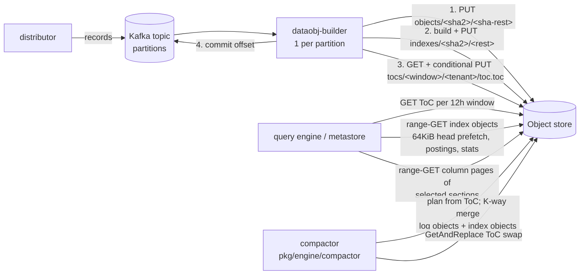

# Grafana Loki: Object-Storage-Backed Log Storage Architecture

> Research notes. Code references are to `github.com/grafana/loki` at `main`, commit `f3de4f5acef4` (2026-10-31).
> **[src]** marks a claim taken from docs, code comments or code. **[inf]** marks my own inference.

---

## 1. Overview

Grafana Loki is a multi-tenant log aggregation system. In its original design it indexes only a small set of
labels per log stream, and keeps the log lines in compressed chunks. Since Loki 2.0 the only durable
dependency is an object store (S3, GCS, Azure Blob, Swift, or a filesystem). Index files and chunk files go
to the same bucket through the index shipper. [src: architecture docs]

Loki is built for high-volume append-only ingest (TB to PB per day in Grafana Cloud), cheap long retention,
and queries that select streams by label and then brute-force scan the matching lines (LogQL filters,
parsers, metric aggregations). Grafana states the cost model plainly: keep the index tiny, keep the
bulk data in the cheapest storage, and pay for scanning at query time with massive parallelism.

The repository currently holds **two storage engines side by side**:

| | "Classic" (v1–v3) storage | Data objects ("dataobj", Loki 4 direction) |
|---|---|---|
| Ingest | Distributor → replicated ingesters (RF=3) with WAL, or Kafka partitions → ingesters | Distributor → Kafka → `dataobj-builder` (one consumer per partition) |
| Bulk data | Per-stream row-oriented **chunks** (~1.5 MB compressed), one object per chunk | Multi-stream **columnar data objects** (target up to 512 MB), one object per flush |
| Index | **TSDB** index files (Prometheus TSDB fork) shipped by the index shipper, per-day tables | **Index objects** (same container format) plus per-tenant, per-12h **Table of Contents** objects updated with conditional writes |
| Compaction | Singleton **compactor**: merges index files per tenant per day, applies retention and deletes | Compactor in `pkg/engine/compactor`: K-way, size-levelled merge of log objects and index objects, with atomic ToC swaps |
| Pruning extras | Experimental **bloom** blocks for structured metadata (bloom planner/builder/gateway) | Bloom filters and label postings inside index objects (`postings` section) |

**Release status (as of 2026-10-31).** The latest tagged release in `CHANGELOG.md` is **3.8.0 (2026-06-08)**.
That release already removed the legacy index and chunk backends: Cassandra, DynamoDB, BigTable, gRPC store,
BoltDB and BoltDB-shipper. TSDB is now the only index and object storage is the only chunk store. Grafana's
"what's next" pages (2026-08-24) list **Loki 4.0** as a targeted self-managed release. Its main breaking
change is the row-to-columnar move (`dataobj`), which needs Kafka for any distributed install. On `main`,
`-use-thanos-objstore` now defaults to `true` ([`pkg/storage/factory.go`][factory]), so classic chunk and
index I/O also goes through `thanos-io/objstore` (via `bucket.ObjectClientAdapter`). [src: code, changelog,
grafana.com/whats-next]

GrafanaCON 2026 coverage reports that the Kafka-backed architecture cuts cost by about 30% and that the
columnar format scans up to 20x less data, with aggregate queries up to 10x faster. These are vendor claims
reported second-hand, not benchmarks I checked. [src: techstrong.it, puzzle.ch]

---

## 2. Architecture outline

### 2.1 Classic path

```
                      WRITE PATH                                          READ PATH
 clients ──push──► distributor ──hash(tenant,labels) on ring──►  query-frontend ──split by time (1h) + shard by bytes──►
                     │  (dskit ring, RF=3, quorum)                    │ results cache                              │
                     ▼                                                 ▼                                            ▼
              ingester x3  (in-memory head chunks + WAL on disk)   query-scheduler ──► querier ──► ingesters (recent data)
               │  per-stream MemChunk; cut at 1.5MB / 2h / idle          │                     │
               │  TSDB head (multi-tenant) rotated every 15m              │                     ├─► index-gateway ──► TSDB files
               ▼                                                          │                     │     (downloaded from bucket,
   PUT chunk object  ──────────────►  OBJECT STORE  ◄────── GET chunk ────┘                     │      mmapped locally)
   PUT index/<table>/<ts>-<ingester>.tsdb.gz (every 1m check)  ▲  ▲                             └─► chunk cache (memcached) ─► GET chunk
                                                              │  │
                         compactor (singleton, every 10m) ────┘  └──── bloom-builder / bloom-planner (experimental)
                         LIST table, GET all files, merge per tenant,      read TSDB+chunks, PUT bloom blocks+metas
                         PUT compacted file, DELETE sources, mark + sweep
                         expired chunks after 2h
```

**Write path.** The distributor validates the push, rate-limits it, and hashes `(tenant, label set)` onto
the ingester ring (dskit `ring`). It sends the stream to `replication_factor` (default 3) ingesters and
returns success on a quorum. Each ingester appends to an in-memory `MemChunk` per stream and writes a WAL
on local disk, with a checkpoint every 5 minutes (`-ingester.checkpoint-duration`). A chunk is flushed
when it reaches `-ingester.chunk-target-size` (1,572,864 bytes, compressed), when it is older than
`-ingester.max-chunk-age` (2h), or when it has been idle. On flush the ingester encodes the chunk and PUTs
it, and records a `ChunkMeta` in its TSDB head. The head is rotated every 15 minutes
(`defaultRotationPeriod` in [`tsdb/head_manager.go`][head_manager]). Rotated heads become TSDB files that
the index shipper uploads. [src: code]

In the newer Kafka mode, the distributor writes records to a Kafka topic, and each ingester consumes one
partition (dskit partition ring). Kafka replaces ingest-time replication, so the effective RF is 1.
[src: architecture docs, techstrong]

**Read path.** The query-frontend splits a query by time (`split_queries_by_interval`, default `1h`).
It then shards each split by data volume, using TSDB index stats, to target
`tsdb_max_bytes_per_shard` (600 MB, [`sharding/power.go`][power]). It caches the results and enqueues
sub-queries through the query-scheduler. Queriers pull the work. They ask ingesters for recent data, and
ask index-gateways (or a local TSDB) for the chunk refs of matching streams. They then fetch chunks through
the chunk cache, falling back to object-store GETs, and decode and filter the blocks.

**Background work.** The compactor merges per-day index tables, applies retention, and processes delete
requests. Bloom planners and builders build bloom blocks from chunks and TSDB files.

### 2.2 Data-object path (`pkg/dataobj`, `pkg/engine`)



The builder ([`pkg/dataobj/builder`][builder_dir]) consumes one Kafka partition. It accumulates logs into
one data object per tenant per 12-hour window, and flushes on size, after `idle-flush-timeout` (1h), or
after `max-builder-age` (1h). `-dataobj.builder.flush-concurrency` (default 1) caps how many objects one
flush builds and uploads in parallel. The flush in [`flush_committer.go`][flush_committer] runs four steps in order:

1. **Upload** the sorted data object through the [`Uploader`][uploader]. The key is the content hash.
2. **Index** it with [`SimpleIndexer`][indexer]: build an *index object* (streams, postings, stats
   sections) and upload it, also content-addressed. "Retrying is safe because the index is not referenced
   from the metastore until it is recorded in the ToC." [src: code comment]
3. **Record** the index in the tenant's **Table of Contents** for that 12h window
   (`TableOfContentsWriter.WriteEntry`). This is a read-modify-write of one small object through
   `GetAndReplace` (a conditional PUT).
4. **Commit** the Kafka offset, only after every object in the flush has succeeded.

Queries reach the data through the [`ObjectMetastore`][metastore_obj]. For each 12h window in the query
range it reads the tenant's ToC, resolves the index objects that overlap in time, reads their postings,
streams and stats sections to pick the data-object *sections* that match the stream matchers and
predicates, and hands those `(object path, section index, stream IDs)` descriptors to the query engine. The
engine reads only the projected columns' pages.

`-dataobj.storage-lag` (default 3h, [`config.go`][dataobj_cfg]) is the delay after which data objects are
guaranteed to hold all data. **[inf]** Queries newer than that are answered from the ingest side.

---

## 3. Data model & on-disk/object format

### 3.1 Chunks (classic)

A chunk holds one stream (tenant + label set) over one time range. Two layers:

- **Outer wrapper** (`Chunk.EncodeTo`, [`pkg/storage/chunk/chunk.go`][chunk_go]): a 4-byte length, then
  snappy-compressed JSON metadata (labels, tenant, from, through, fingerprint, checksum, encoding), then a
  4-byte data length and the payload. [src: code]
- **Payload** (`MemChunk`, [`pkg/chunkenc/memchunk.go`][memchunk], format described in
  [`pkg/chunkenc/README.md`][chunkenc_readme]):
  - header: magic `uint32`, version byte, encoding byte
  - N compressed **blocks**, each followed by a CRC32. Block size is the uncompressed block target
    (256 KB by default).
  - **block metas**: for each block, #entries, minTs, maxTs, offset, len, and uncompressed size (uvarints),
    plus a checksum
  - **structured-metadata symbol table**, plus a checksum
  - **footer**: (len, offset) pairs pointing at the structured metadata and the metas

  Codec: `-ingester.chunk-encoding`, default **gzip** in code. snappy, lz4, zstd and none are also
  supported. The chunk is sized by *compressed* bytes (1.5 MB target). With target 0 it falls back to a
  fixed 10 blocks (`blocksPerChunk`).

**Object key** (`SchemaConfig.ExternalKey`, [`pkg/storage/config/schema_config.go`][schema_cfg]):

```
schema < v12:  <tenant>/<fingerprint hex>:<from hex>:<through hex>:<checksum hex>
schema >= v12: <tenant>/<fingerprint hex>/<from hex>:<through hex>:<checksum hex>
```

The v12 change adds a per-stream "directory" level. **[inf]** This spreads keys across many S3 prefixes
for better request-rate partitioning, and keeps per-stream LISTs cheap. I did not find a primary source
for the motivation. The key is fully determined by the chunk content (fingerprint, time bounds, CRC), so it is
deterministic across replicas. That is what makes dedupe possible (see 4.1).

### 3.2 TSDB index (classic)

A fork of the Prometheus TSDB index ([`tsdb/index/index.go`][tsdb_index]): magic `0xBAAAD700`, a symbol
table, series sorted by label fingerprint, label postings, and per-series lists of `ChunkMeta`
([`tsdb/index/chunk.go`][tsdb_chunk]). Each `ChunkMeta` holds `{Checksum, MinTime, MaxTime, KB, Entries}`,
and FormatV4 adds `IngestedAt`, a day-precision delta used for backfill retention. FormatV3 added
**paging** of chunk metas within a series: a marker every `ChunkPageSize = 16` chunks, so a time-bounded
lookup can skip pages. The KB and Entries fields are what lets the query frontend do **bytes-based
sharding** without touching chunks. Sharding works because series are ordered by fingerprint, so the
fingerprint space can be cut into contiguous shards (`shard=i_of_n`).

**Table layout.** Index periods are 24h. Tables are named `<prefix><day number>` (for example
`index_19700`). Objects are stored as gzip:

```
index/<table>/<unix-ts>-<ingester-name>.tsdb.gz                                         # multi-tenant, uploaded by ingesters
index/<table>/<tenant>/<ts>-compactor-<from>-<through>-<checksum>.tsdb.gz               # per-tenant, written by compactor
```

(`MultitenantTSDBIdentifier.Name` and `SingleTenantTSDBIdentifier.str` in
[`tsdb/identifier.go`][tsdb_ident]; `.gz` is appended in `uploads/index_set.go`.)

### 3.3 Bloom blocks (classic, experimental)

[`bloomshipper/resolver.go`][bloom_resolver]:

```
bloom/<table>/<tenant>/metas/<fp-bounds>-<checksum>.json
bloom/<table>/<tenant>/blocks/<fp-bounds>/<start>-<end>-<checksum>.tar[.<codec>]
```

A block covers a fingerprint range for one day and holds blooms over **structured metadata** keys and
key=value pairs. Each pair is also hashed together with the chunk ID, so a match can prune individual
chunks. Meta files list the blocks and the TSDB sources they were built from. Docs: blooms are "<1% of raw
structured metadata", and builders process about 4 MB/s per core. [src: bloom docs]

### 3.4 Data objects (`pkg/dataobj`)

One self-describing container format for log objects, index objects and ToC objects
([`README.md`][dataobj_readme], [`encoder.go`][encoder], [`decoder.go`][decoder]):

```
0    "DOBJ" magic
4    uint32 file-metadata size (LE)
8    varint format version
...  file metadata (protobuf: dictionary, section types, section layout)
...  [ all sections' METADATA regions, contiguous ]
...  [ all sections' DATA regions, contiguous ]
-4   "DOBJ"
```

Placing the file metadata **at the head** means one read from offset 0 resolves every section's layout.
Placing all section metadata before all section data means a single prefix read can also cover the
metadata of the non-logs sections. The metadata cache relies on this (see 6).

**Sections** are typed by `(namespace, kind, version)` and can be tenant-scoped. The section types in use:

| Section | Lives in | Columns (summary) |
|---|---|---|
| `logs` | log object | `stream_id`, `timestamp`, one column per structured-metadata key, `message` |
| `streams` | log object, index object | `stream_id`, min/max ts, one column per label, `rows`, `uncompressed_size` |
| `postings` | index object | `kind`, `object_path`, `section_index`, `column_name`, `label_value`, `bloom_filter`, `stream_id_bitmap`, sizes, min/max ts, shard buckets ([`postings.go`][postings]) |
| `stats` | index object | per-section statistics of referenced objects |
| `indexpointers` | ToC object | `path`, `min_time`, `max_time` |
| `pointers` (legacy) | old index objects | no longer written or read |

**Columnar encoding** ([`internal/dataset`][dataset_dir]): each column is split into **pages**. The target
is uncompressed size (logs: `TargetPageSize` 1 MB, at most 10,000 rows; index objects: 128 KB, chosen for
"more opportunities to prune"). Each page is compressed independently with zstd. Value encodings are
plain, delta and bitmap. Column metadata holds page descriptors (offset, size, row count, compression) and
min/max stats, which are used for page-level predicate pushdown.

**Builder sizing defaults** ([`builder/config.go`][builder_cfg]):

| Object | page | object (compressed) | section (uncompressed) | buffer |
|---|---|---|---|---|
| logs | 1 MB | 512 MB | 512 MB | 128 MB |
| index | 128 KB | 512 MB | 512 MB | 128 MB |
| ToC | 4 MB | 32 MB | 4 MB | 32 MB |

Section builders buffer records, sort them into **stripes** (zstd `SpeedFastest`), then merge the stripes
into final sections (zstd `SpeedDefault`). Pre-sorted input skips stripes. `EstimatedCompressionRatio=8` (logs objects only;
index objects override it to 1) lets the builder estimate the output size of ordered appends. The built object is materialized as a
`Snapshot` backed by a `scratch.Store` (memory or local disk) before upload.

**Object keys** (base prefix `-dataobj-storage-bucket-prefix=dataobj/`, index prefix
`-dataobj-metastore.index-storage-prefix=index/v0`):

```
objects/<sha224[:2]>/<sha224[2:]>                        # log objects (Uploader.getKey)
index/v0/indexes/<sha224[:2]>/<sha224[2:]>               # index objects (index.ObjectKey)
index/v0/tocs/<RFC3339 window, ':'→'_'>/<tenant>/toc.toc # ToC, one per tenant per 12h window
objects/tenants/<tenant>/<h2>/<hrest>                    # compacted log objects (compactionv2)
indexes/tenants/<tenant>/<h2>/<hrest>                    # compacted index objects
```

**[inf]** All of these sit under the `dataobj/` bucket prefix. The index and ToC keys sit under
`index/v0` too, because both are wrapped in `objstore.NewPrefixedBucket`.

---

## 4. How it achieves it

### 4.1 Writes

**Classic.**
- *Replication and dedupe.* With RF=3, all three ingesters cut chunks for the same stream. Ingesters
  synchronize chunk cut points (`-ingester.sync-period` 1h, `sync-min-utilization` 0.1), so replicas tend
  to produce byte-identical chunks, and therefore identical keys. Before a PUT, the store checks the
  **chunk cache** for that key. If the key is present, the write is skipped and counted in
  `chunk_store_deduped_chunks_total` ([`series_store_write.go`][series_write]). This is a cache-based
  write-dedupe: the cache stands in for "already in object storage". The **[inf]** cost: when the cache
  misses or replicas diverge, duplicate objects are written and later deduped at query time.
- *Flush concurrency.* `-ingester.concurrent-flushes=32` per ingester, a 10m flush op timeout,
  backoff from 10s to 1m. `PutChunks` writes chunks in parallel ([`object_client.go`][object_client]).
- *Index.* The TSDB head WAL makes the in-memory index durable. Every 15 minutes the head is turned into an
  immutable TSDB file. The upload table manager checks for new files every minute (`UploadInterval`,
  [`shipper.go`][shipper]) and PUTs them. Ingesters keep their local copy for queries until the copy is in
  storage and older than the retain period.

**Data objects.**
- *Sort-and-columnarize* in the builder. Records are buffered, sorted by stream and timestamp, and encoded
  into columns.
- *Content addressing.* The key is the SHA-224 of the full object. A retried upload writes the same key,
  so uploads are idempotent. The Uploader retries up to 20 times (100ms to 10s backoff).
- *Commit protocol.* PUT data → PUT index → conditional update of the ToC → Kafka commit. A crash before
  the ToC update leaves unreferenced objects (garbage) but no visible duplicates. A crash after the ToC
  update but before the Kafka commit re-processes the partition. **[inf]** The rebuilt object may differ
  (different batching), so it can produce duplicate rows. `DropDuplicates` exists as a logs-section builder option
([`sections/logs/builder.go`][logs_builder]),
  and the metastore checks that two index objects describing the same section have the same statistics
  (`errDifferentSectionStatistics`).

### 4.2 Reads

**Classic.** Querier → index gateway → TSDB lookup by matchers, time and shard → list of
`ChunkRef`s → `Fetcher.FetchChunks` ([`fetcher.go`][fetcher]). The fetcher tries the L1 chunk cache, then
an optional L2 cache (`l2CacheHandoff`), then parallel GETs from the object store. Chunks are always
fetched **whole** (`GetObject`). Block metas inside the chunk then allow decoding only the blocks in the
time range, but the bytes are already in memory. Query results and index stats or volume responses are
cached in the frontend.

**Data objects.** A read runs in three stages:
1. **Metastore resolution.** GET `toc.toc` for each 12h window, then open each matching index object.
   The open reads a 64 KiB head (`indexPrefetchBytes`). The metastore scans `postings` (label-value
   postings plus bloom filters per column) and `streams`/`stats`. Sections are deduplicated across index
   objects.
2. **Object open.** `dataobj.FromBucket` reads the first 16 KiB at minimum (`minimumPrefetchBytes`). The
   prefetched bytes stay as a window that later reads are served from (`prefetchedRangeReader`). File and
   section metadata can come from a shared **metadata cache** (memcached or similar, key
   `dataobj-metadata/v1:<path>`, at most 8 MiB per item by default, singleflight-coalesced;
   [`metadatacache/cache.go`][mdcache]).
3. **Column scan.** `RowReader` runs in two phases. *Primary* columns (those with predicates, for example
   `timestamp` or a metadata key) are read and filtered first. *Secondary* columns (for example `message`)
   are then read only for the rows that survived. Pages are pruned by min/max statistics. The
   `rowReaderDownloader` batches page downloads by priority (P1: same phase in range; P2: secondary in
   range; P3: read-ahead) up to 16 MB per batch.

### 4.3 Manipulation: compaction, retention, deletes

**Classic compactor** ([`pkg/compactor`][compactor_dir]). A singleton that runs every 10m.
- *Compaction.* For each table, it LISTs the files, downloads all of them, and merges the multi-tenant
  ingester files into **one file per tenant per day**. It uploads the result and then deletes the source
  files (`indexSet.done` → `upload` → `removeFilesFromStorage`, [`index_set.go`][compactor_indexset]), with
  `upload-parallelism=10`. Delete treats "not found" as success, which makes it idempotent.
- *Retention.* The compactor walks the compacted index, drops refs to expired chunks, and appends their IDs
  to **marker files** (local disk, or object storage via `deletion_marker_object_store_prefix`). It
  uploads the rewritten index. A **sweeper** deletes the chunk objects after
  `retention-delete-delay` (2h) with 150 workers ([`retention/retention.go`][retention]). The delay exists
  so that index gateways and queriers load the new index before the chunks disappear. [src: retention docs]
- *Deletes (log line deletion API).* Requests are stored in a delete-requests DB (boltdb or sqlite) that
  is itself shipped under `index/` (`delete_requests` table). After `delete-request-cancel-period` (24h)
  the compactor applies them. Whole chunks are dropped from the index. Partially affected chunks are
  **rewritten**: download, filter, re-encode, PUT the new chunk, re-index (`chunkRewriter.rewriteChunk`).
  Old chunks go through the same mark-and-sweep. Objects are never modified in place.
- *Horizontal scaling* is experimental (`-compactor.horizontal-scaling-mode`): a main compactor plus
  workers, using `pkg/compactor/jobqueue` and deletion manifests.

**Data-object compactor** ([`pkg/engine/compactor`][engine_compactor],
[`pkg/dataobj/compaction/v2`][compaction_v2]).
- The coordinator loops over the current window and `WindowLookback` older windows. For each tenant it
  re-reads the ToC and **re-plans** on every pass ("a crash recovers on the next pass").
- *Planning.* Sections carry inclusive ordering-key bounds (sort schema). `CalculateRuns` forms
  non-overlapping runs. `SizeLeveledStrategy` buckets runs by uncompressed size: level 0 is below
  `DefaultSizeLevelBase = 16 GiB`, and the level ratio is 8. That matches the merge fan-in **K = 8**, so
  "a merge of 8 runs from one level lands in the next level". A code comment notes that "a fresh run is one
  object of about 6GiB" uncompressed.
- *Execution.* `LogMerge` tasks do a K-way merge of log sections into new objects
  (`objects/tenants/<tenant>/...`). `IndexFilter` keeps unmerged runs. The new index objects are published
  by **`ReplaceIndexPointers`**, which removes the old paths and adds the new ones in **one conditional
  write** of the ToC. The swap applies only if the ToC still holds every old path. Otherwise it is
  "superseded", which prevents double-pointing at data.
- *Garbage collection.* In this tree I found no code that deletes log or index objects replaced by
  compaction, or orphaned by failed flushes. **[inf]** Physical deletion is either not yet implemented, or
  is left to bucket lifecycle policies. Retention for data objects is also not visible in `pkg/dataobj` or
  `pkg/engine/compactor`.

---

## 5. Object storage interaction patterns

### 5.1 Classic

| Operation | Pattern | Size / count |
|---|---|---|
| Chunk flush | 1 **PUT** per chunk, single-part, from an in-memory buffer | ~1.5 MB compressed target. Many chunks are much smaller (idle streams, 2h max age). Up to 32 concurrent per ingester. With RF=3, up to 3 PUTs per chunk unless the cache dedupes. |
| Chunk read | 1 **GET** (whole object) per chunk, behind memcached | Request count scales with the number of chunks. **[inf]** Small chunks are the main cost and latency problem for high-cardinality tenants. |
| Index upload | 1 **PUT** per TSDB file per ingester every 15 minutes (gzip) | Small to medium. Per day per ingester: about 96 files per table. |
| Index sync (queriers / index-gateways) | **LIST** `index/<table>/` (non-delimited, cached for 1 minute in `cachedObjectClient`, singleflight), then **GET** new files and decompress to local disk; resync every 5m (`resync-interval`) | Files stay local for `cache-ttl` 24h. `query-ready-num-days` downloads eagerly. |
| Compaction | LIST table, GET every file, PUT 1 file per tenant, DELETE the sources | Once per table per 10m cycle while the table is "active". |
| Retention / delete | DELETE per expired chunk (150 workers) after 2h. Rewrites: GET + PUT per affected chunk. | One DELETE per chunk, so request count is high. |
| Blooms | PUT blocks (tar) + metas; GET + local NVMe LRU in the bloom gateway; LIST of metas per tenant/table | Paged reads from the local copy, not range-GETs. |

**Consistency assumptions.**
- Chunk and index objects are immutable. Names carry a checksum and timestamp, so there is never an
  overwrite race.
- The design depends on LIST-after-PUT visibility for index discovery. Loki tolerates stale LISTs through
  the 1-minute LIST cache, periodic resync, and querying ingesters for anything still in their retain
  window (`query_ingesters_within`).
- The 2h sweeper delay is the mechanism that tolerates stale readers when objects are deleted.

**Metadata placement.** All metadata (TSDB index, delete requests, bloom metas, retention markers
optionally) lives in the same object store. No external database is required. The only extra state is
hash rings and KV (memberlist or consul via dskit `kv`), which are ephemeral.

### 5.2 Data objects

| Operation | Pattern | Notes |
|---|---|---|
| Log object upload | 1 **PUT** of up to ~512 MB, key = SHA-224 of content | The upload passes a reader that implements `objstore.ObjectSizer` and `io.Seeker` (`nopCloserWithObjectSize`, [`range_reader.go`][range_reader]). "Without the size, the S3 client starts a multipart upload, even for a small object, and allocates a part buffer of about 528MiB for each upload." Large objects still go **multipart** in minio-go when they exceed the part size (`-s3.part-size`, 0 = auto-computed). The object is hashed once (`getKey` streams it through SHA-224), then streamed again for the upload. |
| Index object upload | 1 PUT per log object flushed (content-addressed) | Built from the just-uploaded object, which is still in the local scratch store. |
| ToC update | `GetAndReplace`: **GET** + **conditional PUT** (`If-Match` ETag on S3, generation match on GCS) | Retries on `PreconditionFailed`/`ConditionalRequestConflict` (10 tries, 50ms to 10s). `sizedGetAndReplaceBucket` buffers the body so minio-go does not drop `If-Match` on its multipart path ([`client.go`][bucket_client]). Filesystem backend: file lock. In-memory: no check. |
| Query: metastore | 1 GET of `toc.toc` per (tenant, 12h window). Range-GET of the 64 KiB head per index object, then range-GETs of postings/stats pages. | ToC objects are small (32 MB target max). Index pages are 128 KB, so pruning is fine-grained. |
| Query: object open | 1 range-GET of the first ≥16 KiB (or a metadata-cache hit) | The size comes from the bucket's attributes when needed. |
| Query: page reads | `rangeio.ReadRanges` ([`rangeio.go`][rangeio]): **coalesce** ranges with gaps ≤1 MiB, **split** ranges >8 MiB down to ≥1 MiB pieces, fetch with **10-way parallelism** | Batched by the downloader to about 16 MB per round trip, so at most 2 download rounds per `Read` call (primary and secondary phase). |
| Compaction | Range-GET source sections; PUT merged objects (`objects/tenants/...`); PUT merged index; conditional ToC swap | No DELETE path found (see 4.3). |
| LIST | Only for tenant discovery in the compactor (`discoverTenants` lists `tocs/<window>/`) | Queries never LIST: the ToC replaces LIST-based discovery. |

**Request economics. [inf]**
- A 512 MB log object holds what would otherwise be hundreds of 1.5 MB chunks, across many streams.
  PUT counts fall by 2–3 orders of magnitude.
- Reads become a few range-GETs of 1–8 MiB each, sized to the S3 per-request throughput sweet spot (tens to
  low hundreds of MB/s per connection). Coalescing at 1 MiB gaps trades some wasted bytes for fewer GETs.
- Content addressing plus `<2 hex>` prefix fan-out spreads load across 256 S3 key prefixes (configurable
  `-dataobj.uploader.sha-prefix-size`).
- The ToC moves the "what exists" question from LIST (eventually listed, paginated, expensive at scale) to
  a single GET of a small object per tenant-window. Correctness under concurrent writers comes from
  compare-and-swap on that object. This depends on object-store conditional writes, which S3 added in
  2024 (`If-None-Match` in August, `If-Match` in November); GCS has long had generation preconditions.
- **[inf]** Contention on the ToC is bounded: one writer per Kafka partition per flush, plus the
  compactor, all contending on a single key per (tenant, 12h). At very high partition counts, a hot
  tenant's ToC could become a CAS hotspot. Retry metrics (`changeConflict`) exist for exactly this.

---

## 6. Performance

**Caching layers (classic).**
- *Results cache* in the query-frontend, for range-query results split by interval (memcached).
- *Index stats and volume caches*, used by sharding and the volume API.
- *Chunk cache* (memcached; optional L2 with `l2CacheHandoff`). It also serves write-dedupe.
- *TSDB files* are downloaded to local disk on index gateways or queriers and mmapped. The docs say "Loki
  does not use an index cache for TSDB". The `postings_cache.go` in the TSDB package caches postings
  lookups in memory.
- *Bloom gateway* keeps a local-disk LRU of blocks (NVMe recommended).

**Caching layers (data objects).**
- *Metadata cache* for object headers. The cached region is `[0, regionEnd)`: file metadata plus every
  non-logs section's metadata. Logs-section metadata is deliberately excluded because "it can grow
  arbitrarily large with schema width". Loads are singleflight-coalesced.
- *Prefetched head window*: the 16 KiB (log objects) or 64 KiB (index objects) read at open also serves the
  first metadata and section reads with no extra round trip.

**Pruning and skipping.**
- *Classic*: label index → streams. TSDB chunk-meta paging and time bounds → chunks. Block metas → blocks
  inside a chunk. Blooms (experimental) → chunks by structured metadata.
- *Data objects*: ToC time ranges → index objects. Postings (label values and blooms per column) and
  stream-ID bitmaps → sections. Column min/max page stats → pages. Two-phase reads keep `message` pages
  unread unless rows survive.

**Parallelism.**
- Time split (1h default), then dynamic bytes-based sharding: 600 MB target for TSDB. Power-of-two
  doubling means shards usually land at 300–600 MB.
- The data-object target is 10x that (`DefaultDataObjMaxBytesPerShard`).
- `tsdb_max_query_parallelism` 128.
- Inside a querier, data-object page I/O runs at 10 parallel range-GETs per `ReadRanges` call.

**Write-side batching.**
- Classic batches only up to the size of one chunk.
- The data-object builder batches up to 128 MB in memory and builds up to 512 MB compressed objects, sorted
  and columnar. Compression is two-tier: fast zstd for stripes, default zstd for final sections.

**Latency vs cost.**
- Classic: lower ingest-to-query latency on the storage side (chunks visible after one flush, index after
  15m plus upload), with high request counts.
- Data objects: Kafka plus flushes of up to 1h, and a 3h storage lag before objects are authoritative.
  In exchange, far fewer and larger objects and columnar scans.

**Benchmarks.** No primary-source benchmark numbers found beyond the reported GrafanaCON claims (20x less
data scanned, 10x faster aggregations, 30% cost reduction). The repo has micro-benchmarks
(`*_bench_test.go` in `pkg/dataobj/index`, `metastore`, `sections`), but I did not run them, per the
instructions.

---

## 7. Scaling

**Write.**
- Classic: ingesters scale horizontally on the dskit hash ring. Each stream lives on RF ingesters, so a
  hot stream is capped by one ingester. Per-stream rate limits and automatic stream sharding in the
  distributor split hot streams by adding a `__stream_shard__` label.
- Kafka mode: scaling is by partitions, with one ingester or builder consumer per partition. The builder
  reports a `required_replicas` metric for autoscaling, computed from partition offsets.

**Read.**
- Queriers are stateless and scale on queue depth. Index gateways can be sharded by tenant on a ring.
- With data objects, everything on the read side is stateless except caches. The metastore is
  "just objects".

**Metadata.**
- Classic: index size grows with streams × chunks. Compaction turns 96 × N ingester files per day into one
  file per tenant per day. Index gateways must download the tables they serve.
- Data objects: per-tenant ToCs per 12h window. Index objects shard the metadata. Index compaction merges
  index objects, grouped by "stream layout" so that incompatible schemas never merge.

**Compaction.**
- The classic compactor is a **singleton**. It must be a StatefulSet with persistent disk for markers.
  Horizontal mode is experimental. Delete-request processing with line filters is expensive, because
  every affected chunk is rewritten.
- The data-object compactor runs one worker per tenant with work in a window, and dispatches merge tasks
  through `pkg/engine` workflows.

**Multi-tenancy.**
- Every key embeds the tenant (`<tenant>/` chunk prefix, per-tenant TSDB dir, `tocs/<window>/<tenant>/`).
- Data objects are per-tenant: the builder makes one object per tenant per window, and `checkTenant`
  enforces single-tenant ToCs.
- The tenant ID is carried through dskit `user` and `tenant` packages.
- Per-tenant limits come from dskit `runtimeconfig` overrides.

**Known limits.**
- *Classic*: high cardinality leads to many small chunks and many GETs. Blooms are experimental and meant
  only above 75 TB/month. The compactor is a single point of throughput.
- *Data objects*: Kafka becomes a required dependency, which breaks the "object store only" principle for
  distributed mode. ToC CAS correctness depends on the backend supporting conditional writes, which
  excludes some S3-compatible stores. GC of superseded objects is not visible in the code.

**dskit usage.** `ring` and `ring/client` (ingester, partition, index-gateway, compactor, bloom-gateway
rings), `kv` (memberlist/consul), `services` (lifecycle), `backoff` (every upload, ToC and commit retry
loop), `concurrency`, `grpcclient`/`httpgrpc`/`middleware`/`server`, `user`/`tenant`, `flagext`,
`runtimeconfig`, `limiter`. Object storage I/O in the data-object path uses `thanos-io/objstore` (wrapped by
`pkg/storage/bucket`). The classic path goes through the `pkg/storage/chunk/client.ObjectClient`
interface. On `main` that interface is backed by thanos objstore by default (`use_thanos_objstore: true`,
through `bucket.ObjectClientAdapter`). The legacy per-cloud clients under `pkg/storage/chunk/client/{aws,gcp,azure,...}`
are deprecated and log a warning when enabled.

---

## 8. Trade-offs & lessons

1. **Index small, scan big, in the cheapest tier.** Classic Loki shows that a label-only index plus
   brute-force parallel scan is viable and cheap. Its weakness is many small per-stream objects. Request
   count, not bytes, became the dominant cost, and that drove the move to large multi-stream objects.
2. **Content-addressed, immutable objects** (chunk checksum keys; SHA-224 data-object keys) make retries
   and replica writes idempotent, and remove overwrite races. This is reusable as-is.
3. **Put the manifest in the object store, guarded by CAS.** The ToC pattern replaces LIST-based discovery
   with a small, per-tenant, per-time-window manifest updated with `If-Match`. Writers publish data, then
   publish the pointer, so readers never see partial state. Compaction swaps old for new pointers
   atomically, and the precondition ("all old paths present") makes the swap safe against concurrent
   compactors. Partitioning the manifest by (tenant, window) bounds contention and object size.
   Lesson in the code: verify your client actually sends the precondition. minio-go dropped `If-Match` on
   its unknown-length multipart path, and Loki had to buffer to force a sized PUT.
4. **Header-first metadata and a metadata/data split.** One small GET at offset 0 gets the whole layout,
   which is unlike Parquet's footer-first layout that needs a size lookup or a suffix range. Putting all
   section metadata before all data makes metadata a cacheable prefix.
5. **Range-read engineering is explicit and tunable**: coalesce gaps ≤1 MiB, split >8 MiB, 10-way
   parallel, and a ≤16 MB download batch per phase. Two-phase (predicate columns first, payload columns
   second) materialization keeps large `message` pages off the wire.
6. **Delay physical deletes.** Mark-and-sweep with a 2h delay is a simple way to keep stale readers safe
   on eventually-consistent caches and local index copies.
7. **Cache as dedupe oracle** (classic) is cheap but leaky. The Kafka design moves durability to the log
   and drops ingest-time replication altogether.
8. **Costs of the new design**: an extra hard dependency (Kafka), higher freshness lag (hours) before
   object storage is authoritative, reliance on conditional-write support, and (as of this commit) no
   visible GC for superseded objects.
9. **Size-levelled compaction with fan-in = level ratio** (K = 8, ratio 8) keeps write amplification
   logarithmic, and planning from the manifest on every pass gives crash recovery for free.

---

## 9. Sources

**Docs and articles**
- Loki architecture: https://grafana.com/docs/loki/next/get-started/architecture/
- TSDB index: https://grafana.com/docs/loki/latest/operations/storage/tsdb/
- Retention / compactor: https://grafana.com/docs/loki/latest/operations/storage/retention/
- Query acceleration with blooms: https://grafana.com/docs/loki/latest/operations/bloom-filters/
- Techstrong, "Loki pairs with Kafka and smarter storage…": https://techstrong.it/features/loki-pairs-with-kafka-and-smarter-storage-to-help-calm-cost-and-scaling-challenges/
- Puzzle ITC, GrafanaCON 2026 recap: https://www.puzzle.ch/blog/2026/06/10/grafanacon-2026-in-barcelona-back-where-it-all-began
- Grafana "what's next": Thanos object storage now default for Loki: https://grafana.com/whats-next/2026-08-24-thanos-object-storage-now-default-for-loki/
- Grafana "what's next": Loki multi-store backends removed: https://grafana.com/whats-next/2026-08-24-loki-multi-store-backends-removed/
- InfoQ (search result, not read in full): https://infoq.com/news/2026/04/grafana-loki-ai-agents

**Code (github.com/grafana/loki, `main`)**
- [dataobj_readme]: https://github.com/grafana/loki/blob/main/pkg/dataobj/README.md
- [encoder]: https://github.com/grafana/loki/blob/main/pkg/dataobj/encoder.go
- [decoder]: https://github.com/grafana/loki/blob/main/pkg/dataobj/decoder.go
- https://github.com/grafana/loki/blob/main/pkg/dataobj/dataobj.go
- https://github.com/grafana/loki/blob/main/pkg/dataobj/prefetch_range_reader.go
- [range_reader]: https://github.com/grafana/loki/blob/main/pkg/dataobj/range_reader.go
- [uploader]: https://github.com/grafana/loki/blob/main/pkg/dataobj/uploader/uploader.go
- [builder_dir]: https://github.com/grafana/loki/tree/main/pkg/dataobj/builder
- [builder_cfg]: https://github.com/grafana/loki/blob/main/pkg/dataobj/builder/config.go
- [flush_committer]: https://github.com/grafana/loki/blob/main/pkg/dataobj/builder/flush_committer.go
- https://github.com/grafana/loki/blob/main/pkg/dataobj/logsobj/builder.go
- [dataobj_cfg]: https://github.com/grafana/loki/blob/main/pkg/dataobj/config/config.go
- [indexer]: https://github.com/grafana/loki/blob/main/pkg/dataobj/index/indexer_simple.go
- [metastore_obj]: https://github.com/grafana/loki/blob/main/pkg/dataobj/metastore/object.go
- https://github.com/grafana/loki/blob/main/pkg/dataobj/metastore/toc_writer.go
- https://github.com/grafana/loki/blob/main/pkg/dataobj/metastore/config.go
- [mdcache]: https://github.com/grafana/loki/blob/main/pkg/dataobj/metadatacache/cache.go
- [dataset_dir]: https://github.com/grafana/loki/tree/main/pkg/dataobj/internal/dataset
- https://github.com/grafana/loki/blob/main/pkg/dataobj/internal/dataset/row_reader_downloader.go
- https://github.com/grafana/loki/blob/main/pkg/dataobj/sections/internal/columnar/decoder.go
- [postings]: https://github.com/grafana/loki/blob/main/pkg/dataobj/sections/postings/postings.go
- https://github.com/grafana/loki/blob/main/pkg/dataobj/sections/stats/stats.go
- [compaction_v2]: https://github.com/grafana/loki/tree/main/pkg/dataobj/compaction/v2 (`size_leveled.go`, `output_naming.go`, `doc.go`)
- [engine_compactor]: https://github.com/grafana/loki/blob/main/pkg/engine/compactor/coordinator.go
- [rangeio]: https://github.com/grafana/loki/blob/main/pkg/util/rangeio/rangeio.go
- [bucket_client]: https://github.com/grafana/loki/blob/main/pkg/storage/bucket/client.go
- https://github.com/grafana/loki/blob/main/pkg/storage/bucket/conditional.go
- https://github.com/grafana/loki/blob/main/pkg/storage/bucket/s3/config.go
- [memchunk]: https://github.com/grafana/loki/blob/main/pkg/chunkenc/memchunk.go
- [chunkenc_readme]: https://github.com/grafana/loki/blob/main/pkg/chunkenc/README.md
- [chunk_go]: https://github.com/grafana/loki/blob/main/pkg/storage/chunk/chunk.go
- [factory]: https://github.com/grafana/loki/blob/main/pkg/storage/factory.go
- https://github.com/grafana/loki/blob/main/pkg/storage/bucket/object_client_adapter.go
- [logs_builder]: https://github.com/grafana/loki/blob/main/pkg/dataobj/sections/logs/builder.go
- https://github.com/grafana/loki/blob/main/CHANGELOG.md (3.8.0 breaking changes)
- [object_client]: https://github.com/grafana/loki/blob/main/pkg/storage/chunk/client/object_client.go
- [fetcher]: https://github.com/grafana/loki/blob/main/pkg/storage/chunk/fetcher/fetcher.go
- [series_write]: https://github.com/grafana/loki/blob/main/pkg/storage/stores/series_store_write.go
- [schema_cfg]: https://github.com/grafana/loki/blob/main/pkg/storage/config/schema_config.go
- [shipper]: https://github.com/grafana/loki/blob/main/pkg/storage/stores/shipper/indexshipper/shipper.go
- https://github.com/grafana/loki/blob/main/pkg/storage/stores/shipper/indexshipper/uploads/index_set.go
- https://github.com/grafana/loki/blob/main/pkg/storage/stores/shipper/indexshipper/storage/cached_client.go
- [head_manager]: https://github.com/grafana/loki/blob/main/pkg/storage/stores/shipper/indexshipper/tsdb/head_manager.go
- https://github.com/grafana/loki/blob/main/pkg/storage/stores/shipper/indexshipper/tsdb/manager.go
- [tsdb_ident]: https://github.com/grafana/loki/blob/main/pkg/storage/stores/shipper/indexshipper/tsdb/identifier.go
- [tsdb_index]: https://github.com/grafana/loki/blob/main/pkg/storage/stores/shipper/indexshipper/tsdb/index/index.go
- [tsdb_chunk]: https://github.com/grafana/loki/blob/main/pkg/storage/stores/shipper/indexshipper/tsdb/index/chunk.go
- [power]: https://github.com/grafana/loki/blob/main/pkg/storage/stores/shipper/indexshipper/tsdb/sharding/power.go
- [bloom_resolver]: https://github.com/grafana/loki/blob/main/pkg/storage/stores/shipper/bloomshipper/resolver.go
- [compactor_dir]: https://github.com/grafana/loki/tree/main/pkg/compactor (`compactor.go`, `config.go`)
- [compactor_indexset]: https://github.com/grafana/loki/blob/main/pkg/compactor/index_set.go
- [retention]: https://github.com/grafana/loki/blob/main/pkg/compactor/retention/retention.go
- https://github.com/grafana/loki/tree/main/pkg/compactor/deletion
- https://github.com/grafana/loki/blob/main/pkg/ingester/ingester.go, https://github.com/grafana/loki/blob/main/pkg/ingester/wal.go
- https://github.com/grafana/loki/blob/main/pkg/validation/limits.go
- https://github.com/grafana/loki/blob/main/pkg/querier/queryrange/shard_resolver.go

[head_manager]: https://github.com/grafana/loki/blob/main/pkg/storage/stores/shipper/indexshipper/tsdb/head_manager.go
[power]: https://github.com/grafana/loki/blob/main/pkg/storage/stores/shipper/indexshipper/tsdb/sharding/power.go
[builder_dir]: https://github.com/grafana/loki/tree/main/pkg/dataobj/builder
[builder_cfg]: https://github.com/grafana/loki/blob/main/pkg/dataobj/builder/config.go
[flush_committer]: https://github.com/grafana/loki/blob/main/pkg/dataobj/builder/flush_committer.go
[uploader]: https://github.com/grafana/loki/blob/main/pkg/dataobj/uploader/uploader.go
[indexer]: https://github.com/grafana/loki/blob/main/pkg/dataobj/index/indexer_simple.go
[metastore_obj]: https://github.com/grafana/loki/blob/main/pkg/dataobj/metastore/object.go
[dataobj_cfg]: https://github.com/grafana/loki/blob/main/pkg/dataobj/config/config.go
[chunk_go]: https://github.com/grafana/loki/blob/main/pkg/storage/chunk/chunk.go
[memchunk]: https://github.com/grafana/loki/blob/main/pkg/chunkenc/memchunk.go
[chunkenc_readme]: https://github.com/grafana/loki/blob/main/pkg/chunkenc/README.md
[schema_cfg]: https://github.com/grafana/loki/blob/main/pkg/storage/config/schema_config.go
[tsdb_index]: https://github.com/grafana/loki/blob/main/pkg/storage/stores/shipper/indexshipper/tsdb/index/index.go
[tsdb_chunk]: https://github.com/grafana/loki/blob/main/pkg/storage/stores/shipper/indexshipper/tsdb/index/chunk.go
[tsdb_ident]: https://github.com/grafana/loki/blob/main/pkg/storage/stores/shipper/indexshipper/tsdb/identifier.go
[bloom_resolver]: https://github.com/grafana/loki/blob/main/pkg/storage/stores/shipper/bloomshipper/resolver.go
[dataobj_readme]: https://github.com/grafana/loki/blob/main/pkg/dataobj/README.md
[encoder]: https://github.com/grafana/loki/blob/main/pkg/dataobj/encoder.go
[decoder]: https://github.com/grafana/loki/blob/main/pkg/dataobj/decoder.go
[postings]: https://github.com/grafana/loki/blob/main/pkg/dataobj/sections/postings/postings.go
[dataset_dir]: https://github.com/grafana/loki/tree/main/pkg/dataobj/internal/dataset
[series_write]: https://github.com/grafana/loki/blob/main/pkg/storage/stores/series_store_write.go
[object_client]: https://github.com/grafana/loki/blob/main/pkg/storage/chunk/client/object_client.go
[shipper]: https://github.com/grafana/loki/blob/main/pkg/storage/stores/shipper/indexshipper/shipper.go
[fetcher]: https://github.com/grafana/loki/blob/main/pkg/storage/chunk/fetcher/fetcher.go
[mdcache]: https://github.com/grafana/loki/blob/main/pkg/dataobj/metadatacache/cache.go
[compactor_dir]: https://github.com/grafana/loki/tree/main/pkg/compactor
[compactor_indexset]: https://github.com/grafana/loki/blob/main/pkg/compactor/index_set.go
[retention]: https://github.com/grafana/loki/blob/main/pkg/compactor/retention/retention.go
[engine_compactor]: https://github.com/grafana/loki/blob/main/pkg/engine/compactor/coordinator.go
[compaction_v2]: https://github.com/grafana/loki/tree/main/pkg/dataobj/compaction/v2
[range_reader]: https://github.com/grafana/loki/blob/main/pkg/dataobj/range_reader.go
[bucket_client]: https://github.com/grafana/loki/blob/main/pkg/storage/bucket/client.go
[rangeio]: https://github.com/grafana/loki/blob/main/pkg/util/rangeio/rangeio.go
[factory]: https://github.com/grafana/loki/blob/main/pkg/storage/factory.go
[logs_builder]: https://github.com/grafana/loki/blob/main/pkg/dataobj/sections/logs/builder.go

---

## Review notes

Reviewed 2026-10-31 against the local clone at commit `f3de4f5acef4`, `CHANGELOG.md`, and Grafana web sources.

**Verified in code (correct as written):**
- TSDB head rotation 15m; `UploadInterval` 1m; shipper `cache-ttl` 24h and `resync-interval` 5m; `ChunkPageSize = 16`.
- Ingester defaults: chunk target 1,572,864 B, gzip encoding, max-chunk-age 2h, concurrent-flushes 32, flush backoff 10s to 1m, sync-period 1h / 0.1, WAL checkpoint 5m.
- `DefaultTSDBMaxBytesPerShard` 600 MB, and the data-object shard target is 10x that; `tsdb_max_query_parallelism` 128.
- Chunk-cache write-dedupe in `series_store_write.go` still exists. The "write dedupe cache" removed in 3.8.0 (#22056) is a separate, index-side mechanism.
- Compactor `retention-delete-delay` 2h with 150 workers; the delete-requests store exists in both boltdb and sqlite variants.
- Data objects: `DOBJ` header-first layout; builder size defaults; idle-flush and max-builder-age of 1h; storage-lag 3h; SHA-224 keys `objects/<2>/<rest>` and `indexes/<2>/<rest>`; uploader retries (20 tries, 100ms to 10s); 12h `MetastoreWindowSize`; `tocs/<window>/<tenant>/toc.toc`; ToC writer retries (10 tries, 50ms to 10s); 64 KiB index and 16 KiB object prefetch; metadata cache key `dataobj-metadata/v1:` capped at 8 MiB; rangeio defaults (parallelism 10, 1 MiB coalesce, 8 MiB max range); size-levelled compaction (16 GiB base, ratio 8); `sizedGetAndReplaceBucket` and the minio-go `If-Match` comment; the 528 MiB multipart comment; the flush order (upload, index, ToC `WriteEntry`, Kafka commit).
- Checked the claim that superseded objects have no GC or delete path: `pkg/dataobj` and `pkg/engine/compactor` contain no bucket `Delete` calls outside `required_replicas.go`.
- Every linked code path exists in the clone.

**Corrected or added:**
- Added release status. The latest tag is 3.8.0 (2026-06), which removed the legacy backends and left TSDB as the only index. Loki 4.0 is still "targeted", with dataobj and Kafka as its headline breaking change.
- Fixed the claim that the classic path uses Loki's own object clients. `use_thanos_objstore` now defaults to `true`, so classic I/O also goes through thanos objstore via `ObjectClientAdapter`, and the legacy clients are deprecated.
- `EstimatedCompressionRatio=8` applies to logs objects only; index objects override it to 1.
- `DropDuplicates` is a logs-section builder option, not a builder config field.
- Added `flush-concurrency` (default 1).
- Added sources: factory.go, object_client_adapter.go, CHANGELOG, and the Grafana "what's next" pages.

**Not independently verified:** the GrafanaCON performance and cost figures (vendor claims), and the motivation for the v12 chunk-key layout (marked [inf]).
