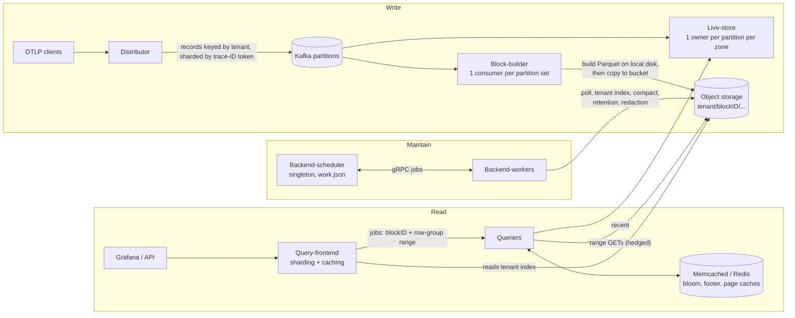

# Grafana Tempo: Object-Storage-Backed Trace Storage

> Research notes on how Grafana Tempo stores, retrieves and manipulates trace data with object storage (S3, GCS, Azure Blob) as its only durable backend.
>
> **Code baseline:** `github.com/grafana/tempo` at commit `9f689b08c522573f6c5b16a8ba4ac19609934c4a` (main, 2026-10-30, `VERSION` = `3.2.0-dev`, after the v3.1.0 release). Every file path below is relative to that commit. Permalink form: `https://github.com/grafana/tempo/blob/9f689b08c522573f6c5b16a8ba4ac19609934c4a/<path>`.
>
> **How to read the claims:** **[code]** means I checked it in source at the commit above. **[docs]** means it comes from the in-repo documentation (`docs/sources/tempo/...`) or the design proposals. **[inference]** is my own reading. grafana.com was not reachable from the research sandbox, so I read Grafana's documentation from the copies in the repository, which are the source for grafana.com/docs. Blog-post claims rest on search-result summaries.

---

## 1. Overview

Grafana Tempo is an open-source, multi-tenant distributed-tracing backend. It accepts spans over OTLP, Jaeger and Zipkin and stores them **only** in object storage. It runs no Cassandra or Elasticsearch, and no metadata database. The original pitch (Tempo 0.x/1.x, 2020–2021) was "trace-ID lookup only, at object-storage cost". In that version, blocks were found with **sharded bloom filters** and each block carried its own index pages. Over time, three changes reshaped the system:

| Era | Storage-relevant change |
|---|---|
| Tempo 1.x | Proprietary "v2" block format (index pages, sharded bloom filters), with ingesters at replication factor 3. Search was limited, and serverless functions were tried to brute-force it [docs: `docs/design-proposals/2022-04 Parquet.md`]. |
| Tempo 2.0 (2023) | **Apache Parquet** became the block format (`vParquet`), which enabled TraceQL. Row groups became the shard unit for queries. |
| Tempo 2.3–2.x | vParquet3 added **dedicated attribute columns**. vParquet4 added array, event and link columns. |
| Tempo 2.9–2.10 | "Project Rhythm" shipped as an experiment: a Kafka-based ingest path, **block-builders**, **live-stores**, and a backend scheduler and worker. |
| **Tempo 3.0** | Rhythm became the only ingest path. Ingesters and the compactor were removed, and blocks are written at **RF1** instead of RF3, which the release notes say used to cause "2 to 2.5 times data duplication" [docs: `release-notes/v3-0.md`]. |
| **Tempo 3.1** | **vParquet5** became the default block format [docs: `configuration/parquet.md`; code: `tempodb/encoding/versioned.go` `DefaultEncoding()` returns `vparquet5.Encoding{}`]. |
| 3.2-dev (HEAD) | vParquet3 reading was removed. Only vParquet4 and vParquet5 remain in `tempodb/encoding/`. |

**Target workload.** The data is very high-volume and write-heavy, with rare reads. Writes are append-only, immutable span data. The read patterns are (a) point lookup by 128-bit trace ID, (b) TraceQL search over span and resource attributes in a time range, and (c) TraceQL metrics, which aggregate over many spans. Grafana Cloud Traces runs this at multi-tenant scale. Self-hosted adopters are listed in `ADOPTERS.md`.

---

## 2. Architecture

Tempo 3.x has two deployment modes [docs: `reference-tempo-architecture/deployment-modes.md`, `components/*.md`]:

* **Microservices:** distributor → Kafka-compatible log → block-builders (write to object storage) and live-stores (serve recent data). Queries go through the query-frontend and queriers. The backend-scheduler and backend-workers handle compaction, retention and redaction.
* **Monolithic:** no Kafka. The live-store receives spans in-process and flushes completed blocks to object storage itself (`modules/livestore/complete_block_lifecycle.go`, `localCompleteBlockLifecycle`) [code].



**Components and how they touch object storage:**

| Component | Stateful? | Object-store interaction |
|---|---|---|
| Distributor | stateless | none |
| Kafka | durable log | none. It is the write-ahead log ("Kafka provides immediate durability") [docs: `object-storage.md`] |
| Block-builder | local scratch disk (WAL) | **only writer of new level-0 blocks** in microservices mode. It probes `meta.json` with GET on deterministic IDs and runs the multipart and PUT uploads |
| Live-store | memory + local WAL/blocks | none in microservices mode. Flushes completed blocks in monolithic mode |
| Backend-scheduler | singleton, local work cache | polls the blocklist and persists `work.json` at the bucket root |
| Backend-worker | stateless | builds the per-tenant index (LIST + GET of `meta.json`), and reads and writes blocks during compaction and redaction, deletes during retention |
| Query-frontend | stateless (+ result cache) | reads the tenant index to plan jobs (block metas are embedded in the job parameters) |
| Querier | stateless | range GETs into `data.parquet`, whole-object GETs of `bloom-N` and `index` |

---

## 3. Data model & on-object format

### 3.1 Object layout per block

A block is an immutable "directory" under `<prefix>/<tenantID>/<blockID>/`, where `blockID` is a UUID [code: `tempodb/backend/raw.go` `KeyPathForBlock`, `ObjectFileName`, `MetaFileName`]:

```
<bucket>/<prefix>/
  tempo_cluster_seed.json                 # cluster identity (usage stats)
  work.json                               # backend-scheduler work cache (WorkFileName)
  <tenant>/
    index.pb.zst                          # tenant index, proto + zstd (preferred)
    index.json.gz                         # tenant index, JSON + gzip (legacy fallback)
    <blockID>/
      data.parquet                        # all trace data (vParquet4/5)
      bloom-0 … bloom-(N-1)               # sharded trace-ID bloom filters
      index                               # JSON: max trace ID per row group
      nocompact.flg                       # optional: block not yet eligible for compaction
      meta.json                           # commit marker / block metadata
      meta.compacted.json                 # replaces meta.json once the block is retired
```

The constants live in `tempodb/backend/raw.go`: `MetaName="meta.json"`, `CompactedMetaName="meta.compacted.json"`, `DeletedMetaName="meta.deleted.json"`, `TenantIndexName="index.json.gz"`, `TenantIndexNamePb="index.pb.zst"`, `ClusterSeedFileName`, `WorkFileName="work.json"`, `NoCompactFileName="nocompact.flg"`. The bloom and index names are in `tempodb/encoding/common/block.go` (`NameIndex="index"`, `"bloom-"+shard`). `DataFileName="data.parquet"` is in `tempodb/encoding/vparquet5/block.go` [code].

### 3.2 `meta.json` (`BlockMeta`)

Defined in protobuf (`tempodb/backend/v1.pb.go`) and serialized to JSON for `meta.json` [code]:

| JSON field | Meaning |
|---|---|
| `format` | encoding version, e.g. `vParquet5` |
| `blockID`, `tenantID` | identity |
| `startTime`, `endTime` | span time range, used for time pruning and retention |
| `totalObjects` | number of traces (rows) |
| `size` | byte size of `data.parquet`. It lets readers do **footer reads without a HEAD** |
| `compactionLevel` | 0 for fresh blocks, +1 per compaction |
| `totalRecords` | **number of row groups** ("pages"), used for query sharding |
| `bloomShards` | number of `bloom-N` objects |
| `footerSize` | Parquet footer length, used to synthesize the magic footer read without I/O |
| `dedicatedColumns` | per-block mapping of attribute name to spare column (schema evolution) |
| `replicationFactor` | 0 = legacy RF3 ingester blocks, 1 = block-builder/live-store/generator blocks |

`CompactedBlockMeta` embeds `BlockMeta` plus `compactedTime`. In S3 that value comes from the **object's LastModified** (`tempodb/backend/s3/compactor.go` `CompactedBlockMeta`) [code].

> **Docs vs. code:** the 3.x docs (`block-format.md`, `components/block-builder.md`) describe a `replaces` field in `meta.json` "for atomic block replacement". I found **no such field** in `BlockMeta` or anywhere in Go code at this commit. The code handles the re-flush case differently (see §4.3). The docs may describe a planned or in-flight change.

### 3.3 `data.parquet` (vParquet5 schema)

One Parquet **row per trace**, with rows **sorted by trace ID** [docs + code: `tempodb/encoding/vparquet5/schema.go`]. The nested schema mirrors OTLP: `Trace{ TraceID, TraceIDText, StartTimeUnixNano, EndTimeUnixNano, DurationNano, RootServiceName, RootSpanName, ServiceStats, rs:[ResourceSpans{ Resource{…, DedicatedAttributes}, ss:[ScopeSpans{ Scope, Spans:[Span{…}] }] }] }`.

Encoding choices are visible in the struct tags [code]:

* Timestamps, durations and nested-set IDs use `delta` encoding. Span `Name`, `RootServiceName`, attribute `Key` and `Value` use `snappy,dict`.
* `Span` carries **nested-set columns** (`NestedSetLeft/Right`, `ParentID`, `ChildCount`). These let structural TraceQL operators (`>>`, `~`, and so on) evaluate parent/child relations without rebuilding the trace tree.
* **Generic attributes** are stored as `Attrs []Attribute{Key, IsArray, Value[]string, ValueInt[], ValueDouble[], ValueBool[], ValueUnsupported}`. Searching these means scanning a key column and a value column together.
* **Dedicated attribute columns:** spare typed columns (`String01…String20`, plus int columns) at the resource, span and (from vParquet5) event scope. They are assigned **per block** through `meta.dedicatedColumns`. Limits are `maxSupportedColumns` (20 strings and 5 ints per scope) in `tempodb/backend/block_meta.go`. The defaults (`defaultDedicatedColumns`) promote `k8s.cluster.name`, `k8s.namespace.name`, `k8s.pod.name`, `k8s.container.name`, `http.request.method`, `http.response.status_code`, `url.path`, `url.route`, `server.address`, `server.port` and legacy `http.*` [code].
* **Blob columns (vParquet5):** a dedicated column flagged `blob` is rewritten at runtime to `parquet:",zstd,optional"`, which **drops dictionary encoding** and skips page min/max bounds (`SchemaWithDynamicChanges`, the `blobify` closure). This suits stack traces and UUIDs, where dictionaries do not pay off [code].
* **Materialized step columns (vParquet5):** `StartTimeRounded15/60/300/3600` (uint32, delta) per span. TraceQL metrics can bucket by step from a small, well-compressed column instead of the 64-bit nanosecond timestamp [code + docs].

**Row group size:** `RowGroupSizeBytes` defaults to **250 MB** (estimated in-memory size) in `tempodb/encoding/common/config.go`, with a hard cap of `maxRowGroupSizeBytes = 800 MiB` of actual written bytes (`vparquet5/create.go` `RowGroupFull()`) [code]. Row groups are the unit of query sharding (they are counted as `totalRecords`).

### 3.4 Auxiliary objects

* **Sharded bloom filter** (`tempodb/encoding/common/bloom.go`): built with `bits-and-blooms/bloom/v3`. The defaults are FP = 1% (`DefaultBloomFP = .01`) and **shard size = 100 KiB** (`DefaultBloomShardSizeBytes`). The shard count is `ceil(m / (shardSize*8))`, clamped to 1…1000. A trace ID maps to its shard through `util.TokenForTraceID(traceID) % shardCount`, so **a lookup needs exactly one ~100 KiB bloom object** per block [code].
* **`index`**: a JSON array `rowGroups` holding the **maximum trace ID of each row group** (`vparquet5/index.go`). `Find` binary-searches it to get the candidate row group. The read side only consults it when env `VPARQUET_INDEX=1`. Otherwise it relies on the Parquet footer's TraceID column statistics (§5.2) [code].
* **`nocompact.flg`**: an empty marker that keeps a block out of compaction while its producer (the block-builder) may still replace it.

### 3.5 Tenant index

`index.pb.zst` (proto, zstd) and `index.json.gz` (JSON inside a gzip with internal name `index.json`) both hold `TenantIndex{CreatedAt, Meta[], CompactedMeta[], NoCompact[]}`. `WriteTenantIndex` writes **proto first, then JSON**. Readers try the proto and fall back to the JSON on `ErrDoesNotExist` (`tempodb/backend/raw.go`, `tenantindex.go`) [code]. The tenant index is Tempo's catalog: a full snapshot of every block's metadata, rebuilt by polling and stored in the bucket. **There is no external metadata store.**

---

## 4. Write path

### 4.1 Ingest to Kafka

Distributors write records to Kafka partitions. The record key is the tenant and the value is a `PushBytesRequest`. Traces are sharded by ID, so "each block is built exactly once" [docs: v3.0 release notes]. The write is acknowledged once Kafka acknowledges it. Kafka is the WAL, and Tempo itself keeps **no durable state on local disk**.

### 4.2 Block-builder consumption cycle

[code: `modules/blockbuilder/blockbuilder.go`, `partition_writer.go`, `tenant_store.go`, `config.go`]

1. For each assigned partition, the block-builder **rewinds to the committed offset** (`AddConsumePartitions` at `ps.getStartOffset()`). It consumes **one partition at a time**.
2. It reads until a record's timestamp passes `firstRecord.Timestamp + consume_cycle_duration` (default **5 min**) or `max_bytes_per_cycle` is reached (default **5 GB**). This is a "hard cut", so traces can span blocks and are merged at query time.
3. Records go into a per-tenant `tenantStore` (`livetraces`), and spans are deduplicated by span ID and kind.
4. **Flush** (`writer.flush`) runs per tenant, with bounded concurrency through `errgroup`:
   1. `determineBlockIDs` creates a **deterministic UUIDv5** with SHA-1 over `(tenantID, partitionID, startOffset, seq)` (`modules/blockbuilder/util/id.go`). For each candidate ID it does a `BlockMeta` probe: a **GET of `meta.json`**, then, if that is absent, a GET of `meta.compacted.json`.
      * Neither exists: use this ID.
      * `meta.compacted.json` exists: skip to the next `seq`.
      * `meta.json` exists (a previous attempt already published a block): **`MarkBlockCompacted`** on it, then try the next `seq`.
   2. `enc.CreateBlock` builds the full Parquet block **on local disk** (WAL dir `/var/tempo/block-builder/traces`), with the bloom and index.
   3. `w.WriteBlock` → `encoding.CopyBlock` copies it to object storage in this order: **`data.parquet` (streamed) → `bloom-0..N` → `index` → `nocompact.flg` → `meta.json`** (`vparquet5/copy.go` `CopyBlock`) [code].
5. **Commit the Kafka offset** of the last record (`kadm.CommitAllOffsets`).
6. Then `allowCompaction` **deletes `nocompact.flg`** for every block flushed in the cycle.

**Durability and consistency reasoning** [code + docs + inference]:

* `meta.json` is the **commit point**. Readers discover blocks only through `meta.json`, either by LIST or through the tenant index, so a crash before it is written leaves orphan objects that nobody reads. On restart the block-builder rewinds and regenerates **the same deterministic block ID**. It then overwrites those objects in place, which is safe because PUT is idempotent and whole-object.
* A crash after `meta.json` but **before** the offset commit leaves a visible block whose data will be re-consumed. On retry, `determineBlockIDs` finds the existing `meta.json`, retires it (copy to `meta.compacted.json` + delete), and writes the replacement under the next sequence ID. [inference] Until the new `meta.json` lands there is a short window where that data is in neither block. Queriers that cached the old blocklist keep seeing the old block until the next poll, because compacted blocks stay readable for `compacted_block_retention` (1h). The docs describe a `replaces` field for this case, which I could not find in the code (§3.2).
* `nocompact.flg` stays until the offset is committed. Compaction therefore cannot merge (and so delete) a block that the block-builder might still retire and replace.
* Block time range: `adjustTimeRangeForSlack` clamps `[start, end]` to `[cycleStart − ingestion_slack, cycleStart + cycle + slack]` (slack default **2h**), so a few bad timestamps cannot inflate the block's time range [code].
* Block size: `block_builder.max-block-bytes` defaults to 20 MiB in `config.go`, and the operations metric `tempo_block_builder_flush_size_bytes` exists to tune it. Level-0 blocks are small: one per tenant per partition per cycle. **Compaction exists to fix this.**

### 4.3 Writing a block's `data.parquet`

`streamingBlock` (`vparquet5/create.go`) wraps a `parquet.GenericWriter` around a `BufferedWriter`, which accumulates a whole row group in memory. On each row-group flush, the buffer is passed to `backendWriter.Write`, which calls **`backend.Writer.Append`** [code]:

* **S3** (`tempodb/backend/s3/s3.go`): the first `Append` calls `NewMultipartUpload`. Each later `Append` becomes one **`PutObjectPart`**, so with `part_size=0` (the default) **one row group (~hundreds of MB) is one part**. When `part_size>0`, parts are re-chunked to a uniform size ("R2-compliant chunking", because Cloudflare R2 requires equal-size parts). `CloseAppend` uploads the remainder and calls `CompleteMultipartUpload`.
* **GCS**: resumable writer with `ChunkSize = 10 MiB` (`gcs/config.go`).
* **Azure**: block blob staging, `BufferSize = 3 MiB`, `MaxBuffers = 4` (`azure/config.go`).

After `Complete()` the writer **reads back the last 8 bytes** with a range GET to check the `PAR1` magic and record `footerSize` in the meta. Blooms and the index are then written as single PUTs, and `meta.json` goes last (`writeBlockMeta` in `vparquet5/copy.go`) [code].

When the block-builder copies a locally built block, `CopyBlock` uses `StreamReader` → `StreamWriter`. On S3 that is `minio.PutObject(size)`, and minio-go switches to its own multipart upload for large objects [inference about the library's behavior].

### 4.4 Live-store (recent data)

Live-stores consume the same partitions independently, with one owner per partition **per zone**. They keep traces in memory (`max_trace_idle` 5s, `max_trace_live` 30s), flush them to a local Parquet WAL, and cut local "complete" blocks (`max_block_duration` 30s, `max_block_bytes` 50 MiB). Those blocks stay queryable for `complete_block_timeout` (20 min) [code: `modules/livestore/config.go`]. In Kafka mode they **never write to object storage**, and the `kafkaCompleteBlockLifecycle` is a no-op [code]. The query-frontend sends a query to live-stores only for the last `query_backend_after` (15 min) and to the backend for anything older (§5.1).

---

## 5. Read / query path

### 5.1 Planning in the query-frontend

The frontend holds the blocklist (§7.3) in memory and **embeds block metadata in every job**. A search job URL carries `blockID, startPage, pagesToSearch, version, size, footerSize, dc (dedicated columns), totalRecords, indexPageSize` (`pkg/api/http.go`). The querier can therefore open `data.parquet` **without fetching `meta.json`** [code].

* **Search / TraceQL** (`modules/frontend/search_sharder.go`): the query range is split. `[now − query_backend_after, now]` goes to live-stores (3 shards by default), and the rest goes to blocks whose `[startTime, endTime]` overlaps the range. Each block is cut into jobs of roughly `target_bytes_per_job` = **100 MiB** (600 MiB for metrics). `PagesPerRequest = target / (size / totalRecords)` row groups per job (`tempodb/blocksharding/blocksharding.go`). Up to `concurrent_jobs` = **1000** jobs per query are in flight, `most_recent_shards` = 200 ordering favors recent blocks, and the frontend **cancels remaining jobs** once `limit` results are found [code + docs].
* **Trace-by-ID** (`modules/frontend/traceid_sharder.go`): the **block-ID UUID space** is split into ranges. With `blocks_per_shard` = 30, the shard count is `ceil(numBlocks/30)`, bounded by `query_shards` = 50 as the legacy fixed count, between 2 and 100,000. Each querier job checks every block in its ID range whose time range matches.

### 5.2 Trace-by-ID inside one block

`backendBlock.FindTraceByID` (`vparquet5/block_findtracebyid.go`) [code]:

1. **Bloom check:** compute the shard and do a full-object GET of `bloom-<shard>` (~100 KiB) with cache role `bloom`. A miss ends the lookup for this block. At 1% FP, about 99% of non-matching blocks cost one cached small read.
2. **Optional index check** (`VPARQUET_INDEX=1`): GET `index` (cache role `trace-id-index`) and binary-search it for the row group.
3. **Open Parquet** (`openForSearch`) with `TraceByIDReadBufferSize` = **512 KiB** (`tempodb/config.go`). The 8-byte magic tail is synthesized from `meta.size`/`footerSize`, so the first real I/O is **one range GET of the footer** (cache role `parquet-footer`).
4. **Row-group pruning from footer statistics** (`findRowGroupByStats`): row groups are sorted by trace ID, so a binary search over the TraceID column's `MaxValue` and `MinValue` picks at most **one** row group with no extra I/O.
5. Scan only that row group's TraceID column chunk with an `In` predicate (dictionary/page pruning, §8) to find the row number.
6. **`preloadOffsetIndexes`**: the offset indexes of all column chunks in that row group are contiguous at the end of the file, so they are fetched with **a single range GET** (role `parquet-offset-idx`). `SeekToRow` can then jump straight to the right page of every column instead of decoding from the start of the row group.
7. Read the one row and convert it to OTLP proto. The querier and frontend merge results across blocks and live-stores, using a combiner that dedupes spans.

### 5.3 Search / TraceQL inside one block

`openForSearch` opens the file with `SkipBloomFilters(true)`, `SkipPageIndex(true)` (column and offset indexes are loaded lazily, only when a predicate can use them), and **`ReadModeAsync`**, so parquet-go prefetches pages in the background. The read buffer is `read_buffer_size_bytes` (code default **2 MiB**, `DefaultReadBufferSize`; the in-repo docs table still says 10 MiB) [code]. `rowGroupsFromFile` limits the scan to `[startPage, startPage+totalPages)`. The TraceQL engine (`block_traceql.go`, `pkg/parquetquery`) then builds a tree of column iterators:

* For each needed column only, chunk pruning uses **footer chunk statistics** first. Next comes the **column index** (a separate request, read only if the predicate `SupportsColumnIndexPruning()`), then the **dictionary**, and finally page and value evaluation (`pkg/parquetquery/predicate_pruning.go`).
* **Dictionary pushdown** (`dict_pushdown.go`): on dictionary-encoded chunks the predicate runs once per dictionary entry. If no entry matches, the whole chunk is skipped. Otherwise rows match by integer index without decoding values.
* Conditions are ordered so that selective trace-level filters run first, and "spanset" iterators join on row numbers (definition and repetition levels).

### 5.4 Caching layers

`tempodb/backend/cache/cache.go` wraps the raw backend. Cache roles (`pkg/cache/cache.go`) are `bloom`, `trace-id-index`, `parquet-footer`, `parquet-column-idx`, `parquet-offset-idx`, `parquet-page` and `frontend-search` [code]. Each role can go to a different Memcached or Redis cluster, or to an in-process cache.

* Whole-object reads are keyed `tenant:blockID:name`.
* **Range reads** are keyed `tenant:blockID:name:offset:length`. Caching works because Parquet section reads are deterministic. `cachedReaderAt` (`vparquet5/readers.go`) learns the footer, column-index and offset-index sections from parquet-go's `Set*Section` callbacks and tags them with the right role. Any read ≤ the read-buffer size is tagged `parquet-page`, and larger reads are not cached.
* Blooms are also **written into the cache at block-creation time** (write-through, `Write` with role `bloom`). A bloom only goes to cache when `compactionLevel ≥ cache_min_compaction_level` and the block is younger than `cache_max_block_age`, so the cache is reserved for long-lived blocks [code].
* Retention evicts cache entries for a deleted block (`removeCachedBlock` in `tempodb/retention.go`).
* The docs advise sizing the lower-level caches (bloom, page) more generously, because their hit rate is higher than the frontend result cache's [docs: `components/querier.md`].

---

## 6. Data manipulation

### 6.1 Compaction (backend-scheduler + backend-workers)

* **Scheduler** (`modules/backendscheduler`) is a **singleton**. Its compaction provider measures tenants every `measure_interval` (1m), picks blocks with the **time-window block selector**, and emits up to `max_jobs_per_tenant` (1000) jobs. Workers pull jobs over gRPC (`Next`, `UpdateJob`).
* **Block selection** (`tempodb/blockselector/compaction_block_selector.go`): blocks are bucketed into `compaction_window` windows (default **1h**). Inside the active 24h window, the group key is `(compactionLevel, window age, replicationFactor)` and the smallest blocks go first. Outside it, blocks are grouped by window only. Within a group the order is by object count, version and **dedicated-column hash**, so only blocks with the same schema are merged. Defaults: 2–4 input blocks per job, `max_compaction_objects` 6M traces, `max_block_bytes` 100 GB. The window adjacent to the active/inactive cut-over is skipped to avoid ownership races [code].
* **Merge** (`vparquet5/compactor.go` `Compact`): the worker opens each input with a 2 MiB × 64 buffered reader ("128 MB memory buffering", `block_iterator.go`) and `ReadModeAsync`, and does a **k-way merge on trace ID** (`multiblockIterator`). Byte-identical rows are dropped cheaply. Otherwise rows for the same trace are reconstructed and combined (span dedup, which is how RF3 duplicates collapsed in 2.x). The output is streamed into a new block with a **random UUID**, `compactionLevel+1`, and `OutputBlocks = 1`. The output is uploaded with multipart upload as in §4.3, row group by row group, followed by bloom, index and `meta.json`.
* **Commit:** after the outputs are written, each input is retired with `MarkBlockCompacted`, which does a **server-side COPY `meta.json` → `meta.compacted.json`** and then a **DELETE of `meta.json`** (`s3/compactor.go`). The order means readers may briefly see both inputs and outputs (duplicates are merged at query time) but never neither [inference from the code order].
* The scheduler's work cache is kept on local disk in shards and **flushed to `work.json` in the bucket** every `backend_flush_interval` (1m). After a restart it is reloaded from local disk or the bucket and replayed onto the blocklist (`modules/backendscheduler/cache.go`) [code].

### 6.2 Retention and deletion (two-phase GC)

`tempodb/retention.go` `retainTenant` [code]:

1. Live blocks with `endTime < now − block_retention` (default **14 days**, per-tenant override) are **marked compacted** (COPY + DELETE of the meta).
2. Compacted blocks whose `compactedTime < now − compacted_block_retention` (default **1h**) are deleted with **`ClearBlock`**: a LIST of the block prefix, then a DELETE of each object, with `retention_block_concurrency` = 4.

The one-hour grace period is the read/delete consistency mechanism. Queriers still holding a stale blocklist (poll every 5 min) can keep reading a compacted block's data for up to an hour. Compacted blocks are excluded from new searches.

Empty tenants (no metas) have their tenant index deleted, and with `empty_tenant_deletion_enabled` the tenant prefix is removed after `empty_tenant_deletion_age` (12h) (`blocklist/poller.go` `deleteTenant`).

### 6.3 Redaction (in-place rewrite)

Tempo 3.0 added **trace redaction jobs**. `tempo-cli redact` submits trace IDs or (3.1) a TraceQL selector, optionally with a `[start, end]` window. Workers **rewrite every affected block**, producing a new block without the matching traces (via the compactor's `DropObject` hook), and retire the old one. The scheduler waits for compaction jobs that were active at submission time to finish, so a concurrent compaction cannot resurrect a trace (`modules/backendscheduler/redaction_*.go`, `tempodb/redaction.go`) [code + docs]. Since objects are immutable, deletion means **rewrite + tombstone**, the same pattern as compaction.

### 6.4 Schema evolution

* **Per-block schema:** dedicated columns are recorded in each `meta.json`. Readers rebuild the Parquet schema dynamically (`SchemaWithDynamicChanges`), so a tenant can change dedicated columns at any time with no migration. Compaction only merges blocks with equal `DedicatedColumnsHash`.
* **Format versioning:** `meta.format` selects the encoding (`tempodb/encoding/versioned.go`). New formats are enabled for writes while old blocks stay readable until they age out. The deprecation sequence was v2 removed in 3.0 and vParquet3 removed in 3.2, with `tempo-cli` able to convert [docs].

---

## 7. Object storage interaction patterns (key section)

### 7.1 Key layout and naming

* `prefix/tenant/blockUUID/<file>`. Every block's files share one prefix, which makes "delete block" a prefix LIST + DELETEs and "list blocks" a prefix LIST. There are no hierarchical time partitions in keys: time pruning comes entirely from `meta` time ranges in the tenant index.
* Block IDs are **random UUIDv4** for compaction output and **deterministic UUIDv5** for block-builder output. Both spread keys evenly over the UUID space. Tempo uses this to **parallelize LIST**: `ListBlocks` splits the UUID space into `list_blocks_concurrency` (default 3 for S3 and GCS, 1 for Azure) ranges with `blockboundary.CreateBlockBoundaries`. Each goroutine runs `ListObjectsV2(prefix=tenant/, StartAfter=tenant/<minUUID>)` and stops at its max UUID (`s3/s3.go` `ListBlocks`) [code].
* That listing **uses no delimiter**, so it enumerates every object of every block. It keeps only keys whose second path segment is `meta.json`, `meta.compacted.json` or `nocompact.flg`. With ~7–15 objects per block this is the most expensive LIST pattern, which is one reason it runs only on index builders (§7.3) [inference + code].

### 7.2 Object sizes and request shapes

| Object | Typical size | Write | Read |
|---|---|---|---|
| `data.parquet` | level-0: a few MB to tens of MB (block-builder, 5-min cycle). Compacted: up to 100 GB (`max_block_bytes`) | S3 multipart, one part per row group (≤ 250 MB est., ≤ 800 MiB hard), or `part_size` chunks. GCS 10 MiB resumable chunks. Azure 3 MiB blocks × 4 parallel | **Range GETs only**: an 8-byte tail at write verification, the footer, column/offset index regions, and page reads of ~`read_buffer_size` (2 MiB search, 512 KiB trace-by-ID) |
| `bloom-N` | ≤ 100 KiB each, N = 1…1000 | single PUT (+ cache write-through) | whole-object GET, one per block per trace-ID lookup, cacheable |
| `index` | small JSON (one 16-byte ID per row group) | single PUT | whole GET (only if `VPARQUET_INDEX=1`) |
| `meta.json` | a few KB | single PUT, **last** (commit) | GET only during polling of *unknown* blocks |
| `meta.compacted.json` | a few KB | **server-side COPY** from `meta.json` | GET during polling, LastModified = compactedTime |
| `nocompact.flg` | 0 bytes | PUT / DELETE | discovered via LIST |
| `index.pb.zst` / `index.json.gz` | O(#blocks × ~1 KB) compressed | PUT by index builders each poll | GET by every reader each poll (5 min) |
| `work.json` | O(#jobs) | PUT every 1 min | GET on scheduler start |

**HEAD usage:** essentially none on the hot path. Object sizes come from `meta.size`, which removes the HEAD-then-range-GET round trip most Parquet readers need [code]. Existence checks are GETs that map `NoSuchKey` to `ErrDoesNotExist`.

### 7.3 Catalog: polling + a tenant index stored in the bucket

[code: `tempodb/blocklist/poller.go`, `tempodb/config.go`, `modules/storage/config.go`]

* Every `blocklist_poll` (**5 min**), each component that needs the blocklist (frontends, queriers, workers, scheduler) runs `Poller.Do`.
* **Non-builders** do a **single GET** of the tenant index per tenant (proto, falling back to JSON). If the index is older than `blocklist_poll_stale_tenant_index` they treat it as an error. With `blocklist_poll_fallback=true` (default) they then poll the bucket themselves.
* **Builders** are `blocklist_poll_tenant_index_builders` = **2** owners per tenant (redundancy), chosen by ring ownership of `build-tenant-index-<tenant>` and run on backend-workers. They do the full poll:
  * `ListBlocks` (parallel LIST, §7.1);
  * **incremental metadata**: blocks already in the previous in-memory list are reused, and a live→compacted transition is handled **without any GET** by copying the old meta and setting `CompactedTime = now`;
  * only **unknown** blocks are fetched (GET `meta.json` or `meta.compacted.json`), with `blocklist_poll_concurrency` = **50** and optional jitter;
  * then PUT `index.pb.zst` + `index.json.gz`.
* The result: in a cluster of Q queriers, F frontends and W workers, the LIST cost is paid by ~2 builders per tenant instead of by every pod, and per-pod polling costs **one GET per tenant per 5 min**. The trade-off is **up to ~2 poll periods of staleness**. New blocks are invisible to the backend path for up to ~10 min, which the live-store window (`query_backend_after` 15 min, `complete_block_timeout` 20 min) is sized to cover [inference from defaults].
* Fault tolerance: `blocklist_poll_tolerate_consecutive_errors` = 1 and `tolerate_tenant_failures` = 1. On failure the previous list is kept. Corrupt metas are skipped, but "skipped all blocks" fails the tenant so it is not mistaken for an empty one and deleted [code].

### 7.4 Consistency assumptions and atomic commits

* Tempo assumes **read-after-write consistency for new objects** and **eventual LIST consistency**. Correctness rests on single-object atomicity: `meta.json` is written last and acts as the commit record. No multi-object transaction is needed.
* "Retire" is COPY + DELETE (S3/GCS/Azure). It is **not atomic**: a crash between them leaves both `meta.json` and `meta.compacted.json`. The poller lists both IDs, and the block is then treated as compacted, because `pollBlock` is called with `compacted=true` when a compacted meta exists [inference from `pollTenantBlocks` logic; verify before relying on it].
* **Conditional writes** are used only for "versioned" objects such as the user-configurable overrides JSON (`WriteVersioned`). GCS uses real preconditions (`GenerationMatch` / `DoesNotExist`). The S3 implementation notes in a comment that "S3 does not support conditional headers" and does a read-compare-write with a race window (`s3/s3.go` `WriteVersioned`) [code]. That comment predates S3's 2024 `If-None-Match`/`If-Match` support, so this is an opportunity.
* Idempotency comes from **deterministic block IDs** (block-builder) plus **singleton scheduling** (compaction). Two writers never race on the same key except for a block-builder retrying its own block.

### 7.5 Request fan-out, hedging, and retries

* **Hedged requests** (`cristalhq/hedgedhttp`): every backend builds two clients. A plain one is used for writes, LIST and DELETE. A **hedged** one is used for all GETs (`readAll`, `readRange`). If a GET has not answered within `hedge_requests_at`, another identical request is sent, up to `hedge_requests_up_to` (default **2**). Hedging is disabled when `hedge_requests_at = 0`, the default. Hedging only reads is safe because reads are idempotent [code: `s3.go` `createCore`, `gcs.go` `createBucket`].
* **Retries:** minio `MaxRetry`, `DefaultRetryUnit` and `DefaultRetryCap` can be configured (`retry_max_attempts` and similar). GCS has `max_retries` = 3.
* **Connection pooling:** `max_idle_connections(_per_host)` = 100. The config help notes that this should be ≥ concurrent backend requests, because returning a connection to a full pool closes it. `readRange` reads one extra byte after `ReadFull` so the HTTP connection can be reused [code].
* **Fan-out:** a single query may run up to `concurrent_jobs` (1000) jobs at once. Each querier runs `max_concurrent_queries` jobs. Each job opens one Parquet file and issues async page reads, and the global worker pool has `trace.pool.max_workers` = 400 and `queue_depth` = 20000 (`modules/storage/config.go`).

### 7.6 Cost (request-count) considerations

* **PUTs per block** ≈ (#parts of `data.parquet`) + `bloomShards` + 1 (index) + 1 (nocompact) + 1 (meta), plus a DELETE of the nocompact flag. Small, frequent level-0 blocks (one per tenant per partition per 5 min) make PUT count grow with tenants × partitions. Compaction amortizes that over time.
* **GETs per trace-by-ID** ≈ Σ over candidate blocks of 1 bloom (usually cached), and for the ~1% FP plus the true hit, footer + TraceID chunk pages + one offset-index region + the row's pages. Searches cost roughly `bytes_scanned / read_buffer_size` GETs for the selected columns only.
* **LIST** is confined to tenant-index builders and `ClearBlock`. The docs say compaction "reduces LIST costs by consolidating blocks" and caching "reduces GET costs" [docs: `object-storage.md`].
* **RF1:** Tempo 3.0 removed the 2–2.5× storage and write amplification of RF3 ingesters. Before, three ingesters each flushed a copy of each trace and compaction deduplicated them later [docs].

---

## 8. Performance

How Tempo gets latency and throughput down, in order of impact [code unless noted]:

1. **Columnar projection + predicate pushdown** (Parquet): only the referenced columns are read. The 2022 design doc measured a ~600 MB block where a single filter column was a few MB (e.g. `HttpStatusCode` 6.35 MB vs `Span.ID` 82 MB) [docs: Parquet design proposal].
2. **Multi-level pruning before I/O:** block time range (tenant index) → bloom (trace-ID) → row-group footer stats (sorted TraceID) → column index → dictionary → page. Every level is either free (footer already in hand) or a small, cacheable object.
3. **Dedicated columns** turn generic-attribute scans (key and value columns across all attributes) into single-column scans. This is the main TraceQL tuning knob [blog: "Accelerate TraceQL queries at scale with dedicated attribute columns", Jan 2024]. vParquet5 doubled them to 20 per scope, added event scope, and added blob (zstd, no dictionary) columns for high-cardinality strings.
4. **Footer elision:** `meta.size`/`footerSize` let `cachedReaderAt` answer parquet-go's magic-header and magic-footer probes with no I/O. The footer itself is cached under the `parquet-footer` role.
5. **Single-request offset-index preload** for trace-by-ID (§5.2, step 6).
6. **Async page prefetch** (`ReadModeAsync`), plus large sequential buffered readers for compaction (2 MiB × 64).
7. **Caches:** page and bloom caches with high hit rates (Memcached/Redis), the frontend result cache, bloom write-through, and an age/level policy so short-lived level-0 blooms do not churn the cache.
8. **Hedged GETs** cut tail latency from slow object-store replicas.
9. **Massive parallelism:** the frontend shards by row groups (~100 MiB jobs), a querier pool runs 1000 jobs per query, and the frontend cancels early when it hits the limit. Queriers hold no state.
10. **Materialized step columns** (vParquet5) and the `spanonly_fetch` hint speed up TraceQL metrics [docs: v3.0 release notes].

[inference] There is no SIMD-specific work in Tempo itself. Decode performance comes from parquet-go (Tempo uses the `parquet-go/parquet-go` fork, which has vectorized bit-unpacking in Go assembly) plus Tempo's own row-number join iterators and dictionary pushdown.

---

## 9. Scaling

* **Write path:** scales with Kafka partitions. Each partition has exactly one block-builder consumer (static assignment through `partitions_per_instance` or `assigned_partitions`, with no consumer-group rebalancing), so `max block-builders = #partitions`. KEDA autoscaling exists for block-builders and live-stores (3.1 changelog). Block-builders are effectively stateless: their scratch disk is rebuildable from Kafka.
* **Recent reads:** live-stores own partitions (partition ring through memberlist, with pending/active/inactive states), one owner per zone. Queriers need one response per partition (read quorum 1). Scaling down requires marking the partition inactive and waiting until the data is in object storage [docs: `components/live-store.md`].
* **Historical reads:** queriers are stateless and scale horizontally. Their memory ≈ `job_size × concurrency + buffer` [docs]. Throughput is limited by object-store GET bandwidth and cache capacity.
* **Maintenance:** the backend-scheduler is a **singleton**, which is a potential bottleneck and SPOF, mitigated by the persisted `work.json` and fast restart. Backend-workers scale horizontally on the `tempodb_compaction_outstanding_blocks` signal. Tenant-index building is sharded across workers by a ring.
* **Multi-tenancy:** hard isolation by key prefix, with no cross-tenant blocks. There are per-tenant overrides for retention, dedicated columns, `max_bytes_per_trace`, query limits and so on, and per-tenant frontend queues (`max_outstanding_per_tenant` = 2000).
* **Limits and bottlenecks** [inference + docs]:
  * Blocklist size per tenant: the tenant index is one object rewritten every poll and read by every reader. Very large blocklists (hundreds of thousands of blocks) make polling, index size and frontend planning expensive. Hence `tempodb_blocklist_length` is a key alert, and compaction must keep up.
  * Polling latency (5 min) adds a fixed visibility delay, which the live-store window has to cover.
  * Level-0 block count = tenants × partitions × (60/5) per hour. Many small tenants on many partitions produce many tiny blocks and objects.
  * Trace-by-ID cost grows linearly with the number of blocks in the time range (one bloom check each). Compaction and the bloom cache are the mitigations.

---

## 10. Trade-offs & lessons

**Notable design choices**

1. **The object store is the database.** There is no metadata service. The catalog is a polled snapshot (tenant index) stored in the bucket next to the data. This works because data is immutable, the system tolerates minutes of metadata staleness, and a separate hot tier (live-store) covers the gap.
2. **A "commit marker written last"** (`meta.json`) plus **"tombstone by rename"** (`meta.compacted.json`) plus **delayed GC** (1h) give snapshot-like safety with no transactions and no conditional writes.
3. **Deterministic block IDs derived from log offsets** make the writer idempotent across crashes, the same idea as Kafka-sink exactly-once via deterministic file names.
4. **Kafka as the WAL** removed RF3 and moved durability out of Tempo. The cost is an operational dependency on Kafka and hard-cut blocks that split traces, so trace assembly moves to query time.
5. **Parquet as the block format** brings ecosystem compatibility and columnar pruning. The cost is more CPU and memory to build blocks: the Tempo 2.0 post warned of "at least 1.5x" resource increase. A nested schema with a generic attribute map is also slow for non-dedicated attributes.
6. **Bloom filters outside Parquet**, sharded into ≤ 100 KiB objects, keep each trace-ID membership check to one small cacheable GET per block. Parquet's native bloom filters are deliberately unused (`SkipBloomFilters(true)`, and the design doc says the same).
7. **Metadata travels with the job.** Query jobs carry size, footer size, row-group range and schema, so queriers never GET `meta.json`.

**Weaknesses**

* The singleton scheduler, plus polling-based discovery with minutes of lag.
* Non-atomic COPY + DELETE retirement, and a documented-but-unimplemented (at this commit) `replaces` mechanism for block-builder re-flushes.
* The S3 versioned write has a known race, because it predates S3 conditional writes.
* Trace-by-ID latency degrades with block count. Correctness and cost depend on compaction keeping up.
* Many small level-0 objects under high tenant × partition counts.

**Transferable lessons for a new object-store-backed system**

* Store **object size and footer length in your catalog** to skip HEADs and the footer-length probe.
* Make **row groups (or an equivalent) the unit of parallelism** and put their count in metadata, so planners can shard without opening files.
* **Tag every range read with a semantic role** and key the cache by `(object, offset, length)`. Deterministic read plans give high hit rates.
* **Hedge only idempotent GETs**, and keep separate HTTP clients for hedged and non-hedged traffic.
* **Shard LIST across the key space** with `StartAfter` ranges when keys are uniformly random. Better still, avoid LIST on the read path by materializing a catalog object, and have a small set of builders own it.
* Keep a **two-phase delete** (tombstone, then GC after a grace period longer than max reader staleness).
* Derive **IDs from input positions** (log offsets) for idempotent retries, and gate background rewrites with an explicit "not yet final" flag (`nocompact.flg`) until upstream offsets are committed.
* Prefer **per-object schema metadata** (dedicated column mappings) over global schema migrations.

---

## 11. References

### Source code (grafana/tempo @ `9f689b08c522573f6c5b16a8ba4ac19609934c4a`)

Base URL: `https://github.com/grafana/tempo/blob/9f689b08c522573f6c5b16a8ba4ac19609934c4a/`

* `tempodb/backend/backend.go`: Reader/Writer/Compactor interfaces
* `tempodb/backend/raw.go`: object names, key paths, tenant index read/write
* `tempodb/backend/v1.pb.go`, `block_meta.go`, `tenantindex.go`: BlockMeta, CompactedBlockMeta, TenantIndex, dedicated columns
* `tempodb/backend/s3/s3.go`, `s3/config.go`, `s3/compactor.go`: S3 multipart Append, hedged GETs, parallel ListBlocks, COPY+DELETE retire, ClearBlock
* `tempodb/backend/gcs/gcs.go`, `gcs/config.go`; `tempodb/backend/azure/config.go`
* `tempodb/backend/cache/cache.go`; `pkg/cache/cache.go`: cache roles and keys
* `tempodb/blocklist/poller.go`: polling, tenant index builders, incremental metadata
* `tempodb/config.go`; `modules/storage/config.go`: defaults
* `tempodb/encoding/versioned.go`: default encoding (vParquet5)
* `tempodb/encoding/common/bloom.go`, `common/block.go`, `common/config.go`
* `tempodb/encoding/vparquet5/block.go`, `create.go`, `copy.go`, `index.go`, `readers.go`, `block_search.go`, `block_findtracebyid.go`, `block_iterator.go`, `compactor.go`, `schema.go`
* `pkg/parquetquery/predicates.go`, `predicate_pruning.go`, `dict_pushdown.go`
* `tempodb/blockselector/compaction_block_selector.go`; `tempodb/compactor.go`; `tempodb/retention.go`; `tempodb/redaction.go`
* `tempodb/blocksharding/blocksharding.go`; `pkg/api/http.go`
* `modules/blockbuilder/blockbuilder.go`, `partition_writer.go`, `tenant_store.go`, `writeable_block.go`, `config.go`, `util/id.go`
* `modules/livestore/config.go`, `complete_block_lifecycle.go`
* `modules/backendscheduler/cache.go`, `config.go`, `provider/compaction.go`, `work/config.go`; `modules/backendworker/config.go`
* `modules/frontend/config.go`, `search_sharder.go`, `traceid_sharder.go`
* `CHANGELOG.md` (v3.1.0 entries)

### Documentation (in-repo sources of grafana.com/docs/tempo, same commit)

* `docs/sources/tempo/reference-tempo-architecture/block-format.md` (https://grafana.com/docs/tempo/latest/reference-tempo-architecture/block-format/)
* `docs/sources/tempo/reference-tempo-architecture/object-storage.md` (https://grafana.com/docs/tempo/latest/reference-tempo-architecture/object-storage/)
* `docs/sources/tempo/reference-tempo-architecture/components/{block-builder,compaction,live-store,querier,query-frontend}.md`
* `docs/sources/tempo/configuration/parquet.md` (https://grafana.com/docs/tempo/latest/configuration/parquet/)
* `docs/sources/tempo/release-notes/v3-0.md` (https://grafana.com/docs/tempo/latest/release-notes/v3-0/)
* Migration guide: https://grafana.com/docs/tempo/latest/set-up-for-tracing/setup-tempo/migrate-to-3/

### Design proposals

* `docs/design-proposals/2022-04 Parquet.md`: rationale for Parquet, encodings, row-group sharding, why Parquet bloom filters are not used
* `docs/design-proposals/2023-05 vParquet3.md`: dedicated columns

### Blog posts / articles

* "New in Grafana Tempo 2.0: Apache Parquet as the default storage format, support for TraceQL": https://grafana.com/blog/new-in-grafana-tempo-2-0-apache-parquet-as-the-default-storage-format-support-for-traceql
* "Accelerate TraceQL queries at scale with dedicated attribute columns in Grafana Tempo" (2024-01-22): https://grafana.com/blog/2024/01/22/accelerate-traceql-queries-at-scale-with-dedicated-attribute-columns-in-grafana-tempo
* Tempo 3.0 release blog (linked from the release notes): https://grafana.com/blog/tempo-3-0-release-all-the-latest-features/
* InfoQ, "Grafana Tempo distributed tracing" (Dec 2020): https://www.infoq.com/news/2020/12/grafana-tempo-distributed-tracin
