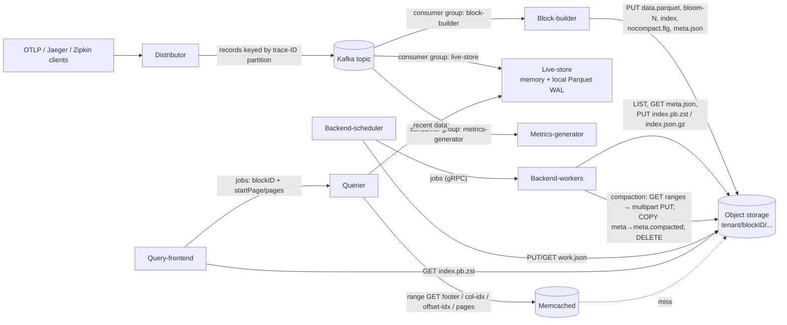

# Grafana Tempo: Object-Storage-Backed Trace Storage

> Research notes on how Grafana Tempo stores, retrieves and changes trace data in object storage (S3, GCS, Azure Blob).
> Code references are to `github.com/grafana/tempo` at commit `9f689b08` on `main` (2026-10-30, `VERSION` = `3.2.0-dev`, with v3.1.0 the latest release in `CHANGELOG.md`).
> Statements are marked **[docs]**, **[blog]** or **[code]** by source. **[inference]** marks my own reasoning, which no source states.

---

## 1. Overview

Grafana Tempo is an open-source distributed tracing backend (AGPLv3). It accepts spans over OTLP, Jaeger and Zipkin, and serves two kinds of reads:

* **Trace-by-ID lookup:** fetch every span of one trace.
* **Search:** TraceQL queries, tag and tag-value autocomplete, and TraceQL *metrics* (`rate()`, `quantile_over_time()`, and so on) computed from spans at query time.

Its main design commitment is that **object storage is the only long-term datastore** **[docs]**: "Cost-efficient storage: Tempo stores all trace data in object storage." Tempo has no index database (no Cassandra or Elasticsearch, unlike Jaeger). Every index structure sits next to the data in the bucket, or is derived from the bucket and cached. The workload is write-heavy and append-only. Ingest runs at very high volume: one Grafana blog describes load tests at ">600 MB/s and 1.2 million spans/s". Reads are rare, latency-tolerant and scan-heavy, except for trace-by-ID, which is a point lookup.

The design has had three stages:

| Era | Storage format | Write path | Notes |
|---|---|---|---|
| Tempo 1.x | "v2" blocks: protobuf traces in pages, a paged index, sharded bloom filters | Ingesters (RF3) → object storage | Only trace-by-ID was fast. Search relied on brute force, even "massively-parallel serverless functions" **[docs: 2022-04 Parquet proposal]** |
| Tempo 2.x | Apache Parquet ("vParquet", then vParquet2/3/4) | Ingesters (RF3), plus compactors | TraceQL added. Dedicated attribute columns arrived in vParquet3 (2.3) |
| Tempo 3.x | vParquet4 / **vParquet5 (default for new blocks since 3.1, PR #7775)** | **Distributor → Kafka → block-builders (RF1)**, live-stores for recent data, backend-scheduler/worker in place of the compactor | The new architecture, formerly called "Project Rhythm" **[docs: v3.0 release notes]** |

**Encoding support on `main`:** `tempodb/encoding/versioned.go` `FromVersion` recognizes only `vParquet4` and `vParquet5` (plus an `unsupported` stub for `*preview*` versions); there is no `vparquet3` package any more. vParquet2 was removed in 3.0 (PR #6071). The v3.1.0 changelog says vParquet3 can no longer be written or compacted but "existing vParquet3 blocks remain readable"; on `main` (3.2.0-dev) the package is gone, so operators should expect to age out or rewrite vParquet3 blocks before moving past 3.1 **[code + changelog]**.

This document describes the **3.x architecture**, because it is what `main` contains. The `modules/` directory no longer has an `ingester` or `compactor` module. It has `blockbuilder`, `livestore`, `backendscheduler` and `backendworker` instead.

---

## 2. Architecture outline

### 2.1 Components

All components ship in one Go binary, and `-target` selects which ones a process runs **[docs]**. They are built on Grafana's **dskit** library **[code]**:

* `dskit/services` for the lifecycle of every module.
* `dskit/ring` for the distributor ring, the backend-worker ring (tenant-poll sharding) and the **partition ring** (`ring.PartitionRingReader`, `ring.PartitionInactive`, and so on) that maps Kafka partitions to live-stores.
* `dskit/kv/memberlist` for gossip.
* `dskit/user` and `dskit/tenant` for X-Scope-OrgID multi-tenancy.
* `dskit/httpgrpc` for frontend→querier jobs, and `dskit/backoff`, `dskit/flagext` and `dskit/runtimeconfig` for overrides.

| Component | Role regarding object storage |
|---|---|
| **Distributor** | Validates spans and hashes the trace ID to an *active partition* from the partition ring (`modules/distributor/distributor.go`, which calls `ShuffleShard` and `ring.DoBatchWithOptions`). It writes records to one Kafka topic and never touches the bucket. |
| **Kafka (or a compatible system such as WarpStream or Redpanda)** | The durable WAL. Once Kafka acks, the write is durable, so Tempo runs at **RF1** **[docs]**. |
| **Block-builder** | A Kafka consumer group with *static* partition assignment. Every cycle (default 5 min) it consumes up to a cutoff, builds one Parquet block per (tenant, partition) on local disk, uploads it, then commits the Kafka offset. **The only writer of new data blocks** in microservices mode. |
| **Live-store** | A separate Kafka consumer group. It holds recent traces in memory and in a local Parquet WAL, and serves queries for roughly the last 15–60 minutes. It does not write to the bucket in microservices mode. In monolithic mode it flushes complete blocks to the bucket itself. |
| **Query-frontend** | Reads the tenant's blocklist from the tenant index. Shards queries by **block and row-group range** (search) or **block-ID range** (trace-by-ID), queues jobs and merges results. |
| **Querier** | A stateless worker. It runs jobs against live-stores (recent data) or directly against Parquet objects in the bucket, using range GETs plus caches. |
| **Backend-scheduler** | A singleton that creates compaction, retention and redaction jobs from the blocklist, hands them to workers over gRPC, and persists its work cache to `work.json` in the bucket. |
| **Backend-worker** | Stateless. Runs compaction, retention and redaction jobs, and is the main builder of tenant indexes (tenant ownership is sharded by a ring). |
| **Memcached / Redis** | External caches, split by *role*: bloom, trace-id-index, parquet-footer, parquet-column-idx, parquet-offset-idx, parquet-page and frontend-search. |

### 2.2 Data flow



**Write path [docs + code]:**

1. The distributor writes to Kafka and returns success to the client once Kafka acks.
2. The block-builder (`modules/blockbuilder/blockbuilder.go`, `consumePartition`) rewinds to the last committed offset. It reads records until the cycle boundary, or until `max_bytes_per_cycle` (default 5 GB), and groups traces per tenant in memory (`tenantStore.liveTraces`).
3. For each tenant it streams sorted traces into a vParquet block **on local disk**, using the WAL's `local.Backend` (`tenantStore.Flush` → `enc.CreateBlock`).
4. It copies the finished block to object storage (`WriteableBlock.Write` → `encoding.CopyBlock`), then writes a `flushed` marker.
5. It commits the Kafka offset (`commitOffset`).
6. It deletes `nocompact.flg` for each block (`writer.allowCompaction`), which lets compaction pick the block up.

**Read path:** the frontend splits the time range. The window after `query_backend_after` (default 15 m) goes to live-stores only, and older ranges go to backend jobs over blocks from the blocklist. Queriers open the Parquet file through range reads.

**Background work:** tenant-index building (polling), compaction, retention (soft delete, then hard delete) and redaction (rewriting a block without the matching traces).

---

## 3. Data model and on-disk/object format

### 3.1 Bucket layout

Key construction comes from `backend.KeyPathForBlock`, `ObjectFileName` and the name constants in `tempodb/backend/raw.go` **[code]**:

```
<bucket>/[<prefix>/]
  tempo_cluster_seed.json                 # cluster seed (usage stats)
  work.json                               # backend-scheduler work cache
  <tenantID>/
    index.pb.zst                          # tenant index (proto + zstd); preferred
    index.json.gz                         # tenant index (JSON + gzip); fallback/compat
    <blockUUID>/
      data.parquet                        # all trace data for the block
      bloom-0 … bloom-(N-1)               # sharded bloom filter over trace IDs
      index                               # JSON: max trace ID per row group
      meta.json                           # block metadata; its presence = block is live
      meta.compacted.json                 # replaces meta.json once the block is retired
      nocompact.flg                       # 0-byte flag: do not compact (block-builder in-flight)
      flushed                             # block-builder flush timestamp (text)
```

Some design points:

* **One "directory" per block, and blocks are immutable.** Nothing is ever appended to a finished object. Every change creates a new block. The only object that is mutated in place is `meta.json`, which is *renamed* (copied and then deleted) to `meta.compacted.json`.
* **Block IDs are UUIDs**, so blocks spread across the key space. Compactor blocks get a random v4 UUID (`backend.NewUUID()`). Block-builder blocks get deterministic v5 UUIDs (§4.1). `ListBlocks` relies on UUID ordering to split a LIST into parallel `StartAfter` ranges (§5.4).
* **Tenant = top-level prefix.** "Tenants are fully isolated at the storage level … There's no cross-tenant data sharing or block merging" **[docs]**.

### 3.2 `meta.json` (BlockMeta)

`BlockMeta` is defined as protobuf (`tempodb/backend/v1/v1.proto`) and serialized as JSON in `meta.json`. Its fields:

`format` (encoding version, e.g. `vParquet5`), `blockID`, `tenantID`, `startTime`, `endTime`, `totalObjects` (traces), `size` (bytes of `data.parquet`), `compactionLevel`, `totalRecords` (**the number of Parquet row groups**, which the frontend uses for sharding), `bloomShards`, `footerSize`, `dedicatedColumns` (column assignment for this block) and `replicationFactor` (1 for block-builder blocks, 0 meaning legacy RF3).

`footerSize` and `size` together let a reader **skip the usual Parquet tail read**. `cachedReaderAt.ReadAt` synthesizes the 4-byte header magic and the 8-byte footer-length+magic from meta, so opening a file costs a single range GET of the footer (`tempodb/encoding/vparquet5/readers.go`) **[code]**.

The frontend passes `size`, `footerSize`, `totalRecords`, `dedicatedColumns` and the page range inside each search job. The querier rebuilds a `BlockMeta` from the request (`modules/querier/querier.go`, `internalSearchBlock`) and **does not GET `meta.json` per job** **[code]**.

### 3.3 `data.parquet` (vParquet5 schema)

The schema is defined as Go structs with parquet tags in `tempodb/encoding/vparquet5/schema.go` **[code]**:

* **One row per trace, rows sorted by trace ID.** `Trace{TraceID []byte, TraceIDText, StartTimeUnixNano, EndTimeUnixNano, DurationNano, RootServiceName, RootSpanName, ServiceStats[], ResourceSpans[] "rs"}`.
* **Fully nested** OTLP shape: `ResourceSpans → Resource{ServiceName, Attrs[], DedicatedAttributes} → ScopeSpans "ss" → Spans[] → {SpanID, ParentSpanID, ParentID, NestedSetLeft, NestedSetRight, ChildCount, Name, Kind, StartTimeUnixNano, DurationNano, StatusCode, Attrs[], Events[], Links[], DedicatedAttributes, StartTimeRounded15/60/300/3600}`.
* **Encodings:** snappy plus dictionary for strings (names, attribute keys and values), `delta` for timestamps, durations and ints. A few blob-like dedicated columns are switched to `zstd` without a dictionary and with page bounds turned off (`SchemaWithDynamicChanges`, "Blobify").
* **Generic attributes** live in `Attrs{Key, IsArray, Value[], ValueInt[], ValueDouble[], ValueBool[], ValueUnsupported}`. A query on a generic attribute has to scan the key column and the value columns together.
* **Dedicated columns:** `String01…String20` and `Int01…Int05` spare columns at the resource, span and event scopes. Configured attributes are mapped onto them, and the mapping is recorded in `meta.dedicatedColumns`. In vParquet5, spare columns that are not in use are **removed from the schema per block** (`parquet:"-"` struct-tag override in `SchemaWithDynamicChanges`). That is what "Columns are allocated dynamically to reduce overhead" means **[blog: Tempo 3.0]**.
* **Precomputed query helpers:** nested-set `NestedSetLeft/Right` encode parent and child structure, so structural TraceQL operators (`>>`, `>`, `~`) run as interval comparisons with no tree walk. Rounded start times speed up metrics bucketing, and `ServiceStats` stores per-trace counts.

**Row groups** are cut when the estimated buffered bytes exceed `RowGroupSizeBytes` (default **250 MB**, `tempodb/encoding/common/config.go`), or when the writer's measured row-group size reaches a hard cap of **800 MB** (`maxRowGroupSizeBytes`, `create.go`) **[code]**. The Parquet design doc expected row groups of "50–100MB"; the current default is larger.

### 3.4 Trace-ID lookup structures

* **Bloom filter (`bloom-N`)**. `common.NewBloom(fp, shardSize, estimatedObjects)` sizes one logical filter (default FP rate **1 %**, shard size **100 KiB**) and splits it into `ceil(m / (shardSize*8))` shards, clamped to between 1 and 1000. A trace ID maps to exactly one shard via `ShardKeyForTraceID = TokenForTraceID(id) % shardCount` (`tempodb/encoding/common/bloom.go`) **[code]**. At 1 % FP, m ≈ 9.6 bits per key, so one 100 KiB shard covers about 85 k traces **[inference]**. A lookup therefore GETs **one small object** per candidate block, no matter how large the block is. Tempo uses its own blooms and turns off Parquet's native bloom filters (`parquet.SkipBloomFilters(true)`).
* **`index`**: JSON `{"rowGroups":[maxTraceID_rg0, maxTraceID_rg1, …]}`, binary-searched by `index.Find` (`vparquet5/index.go`). On the current branch it is **only consulted when the `VPARQUET_INDEX=1` environment variable is set** (`block_findtracebyid.go`, `checkIndex`) **[code]**. By default the reader uses the **footer's min/max statistics for the TraceID column chunk in each row group** to find the row group (`findRowGroupByStats`). Because rows are sorted by trace ID, at most one row group can match.

### 3.5 Tenant index

`index.pb.zst` (and `index.json.gz` for compatibility) holds `TenantIndex{created_at, meta[], compacted_meta[], no_compact[]}`: the complete blocklist for one tenant in one object (`tempodb/backend/tenantindex.go`, `raw.go` `WriteTenantIndex`) **[code]**. Readers try the proto first and fall back to JSON.

---

## 4. How it achieves it

### 4.1 Write: block-builder

In `modules/blockbuilder/tenant_store.go` and `writeable_block.go` **[code]**:

1. **Accumulate.** `AppendTrace` collects per-tenant traces for the cycle. It deduplicates spans by (span ID, kind), because the rewind-on-every-cycle design re-reads records **[docs]**.
2. **Choose a deterministic block ID.** `util.NewDeterministicIDGenerator(tenantID, partitionID, startOffset)` computes SHA-1 v5 UUIDs over `tenant ‖ partition ‖ startOffset ‖ seq`. `determineBlockIDs` probes the bucket for each candidate ID:
   * If neither `meta.json` nor `meta.compacted.json` exists, it uses that ID.
   * If `meta.compacted.json` exists, it skips to the next sequence number.
   * If `meta.json` exists (a block from a previous attempt became visible), it adds the ID to a list of blocks to retire and moves on to the next ID.

   `tenantStore.Flush` then calls `MarkBlockCompacted` on every block in that list **before** it builds and uploads the new block (`tenant_store.go`, around lines 126–189) **[code]**. So for a short time neither the old copy nor the new one is "live" in `meta.json` terms. Queries still find the data, because the querier also searches blocks compacted within the last `2 × blocklist_poll` (`includeCompactedBlock`, §4.2), and recent data is also served by live-stores **[code + inference]**.

   The docs describe this as a `replaces` field in `meta.json`. **No `replaces` field exists in `BlockMeta` or anywhere in the Go code on `main`.** The mechanism that exists is the "retire the older block, then write the next deterministic ID" probe above **[code vs docs]**. Either way, a block-builder that crashes and replays a cycle never leaves two visible copies of the same data.
3. **Build locally.** `enc.CreateBlock` (`vparquet5/create.go`) uses a `streamingBlock`: a `parquet.GenericWriter[*Trace]` over a buffered writer whose `Write` calls `backend.Writer.Append`. Rows are added in trace-ID order, and the writer updates the index and bloom per row. Row groups are flushed at the size threshold. `Complete()` closes the Parquet file, then reads back the last 8 bytes to record `footerSize`. Next, if the block was created with `CreateWithNoCompactFlag`, it writes `nocompact.flg` (always true for the block-builder). Last, `writeBlockMeta` writes the bloom shards, then `index`, then `meta.json`.
4. **Upload.** `CopyBlock` (`vparquet5/copy.go`) **streams `data.parquet` first** (`StreamReader` → `StreamWriter`), then reads and writes each `bloom-N` and `index` (passing a cache role, so they are **written through into the cache**), then `nocompact.flg`, then **`meta.json` last**. After that, `setFlushed` writes `flushed`.

   The docs give a slightly different order (blooms and index before data). In the code, data goes first. Both orders agree that `meta.json` is the commit point **[code vs docs]**.
5. **Commit and release.** The Kafka offset is committed only after every tenant's block is in the bucket. Then `nocompact.flg` is deleted. The flag stops a backend-worker from compacting a block that a replay might still retire **[docs]**.

Block start and end times are clamped to `[cycleStart − slack, cycleStart + cycle + slack]` (`adjustTimeRangeForSlack`), so a client with a skewed clock cannot produce a block with an absurd time range that defeats time-based pruning.

### 4.2 Read: trace-by-ID

**Frontend** (`modules/frontend/traceid_sharder.go`). It emits one live-store job, plus N block jobs over **contiguous ranges of block-ID space** (`blockBoundariesForTenant`). Since 3.1, `blocks_per_shard` replaces `query_shards` (changelog #7105): when it is non-zero, N = `ceil(numBlocks / blocks_per_shard)`, and otherwise the code falls back to the fixed `query_shards` boundaries. Each job carries its block list as a `tempopb.TraceByIDBlocks` message (`tempodb/backend/trace_by_id_blocks.go`). For each block that message holds the ID, version, start time, `size`, `compactionLevel`, `bloomShardCount` and `footerSize`. Dedicated-column sets are deduplicated across blocks. With this, the querier can check blooms and open footers without fetching `meta.json` **[code]**.

**Querier → `tempodb.Find`.** `includeBlock` filters candidates by time range and shard boundary. Per-block min/max trace-ID pruning is **turned off** ("min/max ids are currently not recorded correctly", issue #1903) **[code]**. Blocks compacted within the last `2 × blocklist_poll` are also searched (`includeCompactedBlock`), which covers stale blocklists.

**Per block** (`vparquet5/block_findtracebyid.go`):

1. `checkBloom`: GET the one `bloom-<shard>` object (cacheable, role `bloom`). On a miss, the lookup stops here.
2. `checkIndex` (optional, env-gated).
3. `openForSearch`: one range GET of the footer (role `parquet-footer`), with Parquet page indexes skipped.
4. `findRowGroupByStats`: binary search over the footer's TraceID statistics.
5. A `SyncIterator` on the TraceID column with a `StringInPredicate` finds the row number inside that row group.
6. `preloadOffsetIndexes`: **one range GET** covering every column's offset index for that row group (they are stored contiguously), role `parquet-offset-idx`.
7. `SeekToRow` plus `Read`: range GETs only of the pages that hold that row, one per leaf column, using a 512 KiB read buffer (`DefaultTraceByIDReadBufferSize`).

### 4.3 Read: search, TraceQL and metrics

**Frontend** (`search_sharder.go`, `tempodb/blocksharding/blocksharding.go`). For each block overlapping the backend time range, `PagesPerRequest(meta, target_bytes_per_job)` divides the block's row groups into jobs of about `target_bytes_per_job` (default **100 MB** for search and **600 MB** for metrics). Each job carries `{blockID, startPage, pagesToSearch, size, footerSize, totalRecords, dedicatedColumns}`. Jobs for the most recent blocks are emitted first, and the frontend stops early once `limit` results arrive. "The smallest possible job size is a single parquet row group" **[docs]**.

**Querier** (`vparquet5/block_search.go`, `block_traceql.go`, `pkg/parquetquery`). It opens the file with `parquet.FileReadMode(parquet.ReadModeAsync)` and `ReadBufferSize` (default **2 MiB**), and limits row groups to `[StartPage, StartPage+TotalPages)`. The TraceQL engine fetches conditions as a tree of **column iterators**: span-level columns → span collector → scope attributes → resource columns → trace columns, joined by row number with `JoinIterator`, `LeftJoinIterator` and `UnionIterator`. Only the columns that the conditions reference are opened, so **column pruning** falls out of the design. An optional second pass (`SecondPass`, or `SecondPassSelectAll` for `select(...)` and full spans) fetches extra columns only for the spansets that survived the first pass.

**Predicate pushdown** happens in `pkg/parquetquery` (`predicates.go`, `predicate_pruning.go`, `dict_pushdown.go`) **[code]**:

* `keepColumnChunk` checks footer chunk statistics first (no I/O), then the **dictionary**: the predicate runs once per dictionary entry, and the chunk is skipped when nothing matches. It reads the **column index** (an extra range request) only when `SupportsColumnIndexPruning()` says the bounds can help.
* `keepPage` skips pages by their min and max values.
* **Dictionary pushdown** compares rows by dictionary index and never decodes values that do not match.
* `SeekTo` on iterators lets a selective column jump other columns forward, skipping whole pages.

### 4.4 Change: compaction, retention, redaction

**Compaction** (`tempodb/compactor.go` `CompactWithConfig`, `vparquet5/compactor.go`, `blockselector/compaction_block_selector.go`) **[code]**:

* *Selection.* `timeWindowBlockSelector` groups blocks by time window (`compaction_window`, default 1 h). Inside the active window it also groups by compaction level, smallest blocks first. Only blocks with the **same encoding version and the same dedicated-column hash** are compacted together. Each job takes 2–4 input blocks (`DefaultMinInputBlocks` and `DefaultMaxInputBlocks`) and respects `max_compaction_objects` (6 M) and `max_block_bytes` (100 GB). Blocks with `nocompact.flg` are excluded.
* *Execution.* The scheduler (`modules/backendscheduler/provider/compaction.go`) emits jobs, and a worker calls `CompactWithConfig`. That re-checks each input's `meta.json` (GET) so it can drop inputs another job already retired. Each input is opened with a **`BufferedReaderAt` of 64 × 2 MiB buffers** ("128 MB memory buffering", `block_iterator.go`), which turns Parquet's many small reads into large sequential range GETs. A `MultiBlockIterator` performs a **k-way merge by trace ID** over raw `parquet.Row`s, combining rows that share a trace ID (deduplicating spans, and dropping traces over `max_bytes_per_trace`). The output goes to a new `streamingBlock` with a random UUID, written **straight to object storage** with no local staging, as a multipart upload (§5.2).
* *Commit.* `markCompacted` calls `MarkBlockCompacted` on every input (S3: `CopyObject meta.json → meta.compacted.json`, then `RemoveObject meta.json`). It treats `NoSuchKey` as "already retired" and updates the in-memory blocklist. **Readers see the new block and the old blocks overlapping for a while.** That is safe, because the query combiners deduplicate spans across blocks (trace-by-ID combiner, search combiners).

**Retention** (`tempodb/retention.go`) runs in two phases:

1. Blocks past `block_retention` (default 14 d, overridable per tenant) are soft-deleted with `MarkBlockCompacted`.
2. Blocks compacted more than `compacted_block_retention` ago (default **1 h**, which "should be twice the configured blocklist_poll" **[docs]**) are hard-deleted by `ClearBlock`: a LIST of the block prefix, then one `RemoveObject` per object. Cached blooms for the block are evicted at the same time (`removeCachedBlock`).

**Updates and deletes (redaction).** Tempo has no in-place update. `RedactBlock` (`tempodb/tempodb.go`) resolves the target trace IDs (an explicit list or a TraceQL selector, optionally limited to a time window) and **rewrites the block as a single-input compaction** (`OutputBlocks: 1`, `DropObject` predicate). It then marks the old block compacted. The scheduler coordinates with running compactions ("quiescence" and "rescan" in `backendscheduler.go`), so a trace that moves into a newly compacted block is still found. Changing data means writing a new immutable object and retiring the old one.

---

## 5. Object storage interaction patterns

### 5.1 Backend abstraction

Two interface layers sit in `tempodb/backend` **[code]**:

* `RawReader`/`RawWriter` (`raw.go`): `Write(name, keypath, io.Reader, size)`, `Append`/`CloseAppend` (streaming multipart), `Read`, `ReadRange(offset, buf)`, `List`, `ListBlocks`, `Find`, `Delete`.
* `Reader`/`Writer` (`backend.go`): block-aware wrappers such as `WriteBlockMeta`, `TenantIndex`, `WriteNoCompactFlag` and `HasNoCompactFlag`.

Every call can carry a `CacheInfo{Role, Meta}`. The **cache is a decorator** over the raw backend (`tempodb/backend/cache/cache.go`). An `instrumentation` package wraps the HTTP transport for request metrics, and S3 and GCS support **hedged requests** (`hedge_requests_at`, `hedge_requests_up_to`) through `hedgedhttp` on the GET client only (`s3.go`, `createCore`).

Implementations: `s3` (minio-go v7), `gcs` (cloud.google.com/go/storage), `azure` (azblob SDK) and `local`.

### 5.2 PUT patterns and multipart

| Object | Writer | Mechanism | Typical size **[inference unless noted]** |
|---|---|---|---|
| `data.parquet` (block-builder) | `CopyBlock.copyStream` → `Write` | S3: one `minio.PutObject(size known)`. minio-go switches to multipart above its part size internally. GCS: resumable `storage.Writer` with `ChunkSize = chunk_buffer_size` (default 10 MiB). | Roughly the per-tenant, per-partition volume of a 5-minute cycle, so from KBs to a few GB (`max_bytes_per_cycle` 5 GB caps the input per partition). |
| `data.parquet` (compactor) | `streamingBlock` → `backendWriter.Append` | **S3:** `NewMultipartUpload` on the first append, then **one `PutObjectPart` per row-group flush** when `part_size == 0` (default). Setting `part_size` re-chunks into uniform parts, for example for Cloudflare R2. Finished by `CompleteMultipartUpload` (`s3.go` `Append`/`CloseAppend`). **Azure:** `StageBlock` per append, then `CommitBlockList`. **GCS:** writes into the same resumable writer. | Up to `max_block_bytes`. Each part is about one row group (≤250 MB estimate, hard cap 800 MB), which stays well inside S3's 5 MB–5 GB part limits. |
| `bloom-N` | `Write` | Single PUT per shard, also stored in cache | ≤100 KiB each, 1–1000 shards |
| `index` | `Write` | Single PUT, also stored in cache | Small JSON (16-byte IDs × row groups) |
| `meta.json` | `WriteBlockMeta` | Single PUT, **always last** | ~1 KB |
| `nocompact.flg` | `WriteNoCompactFlag` | 0-byte PUT, later DELETE | 0 B |
| `flushed` | block-builder | Single PUT after meta | ~35 B |
| `index.pb.zst`, `index.json.gz` | tenant-index builder | Two PUTs per tenant per poll cycle | Grows with block count, from KB to MB |
| `work.json` | backend-scheduler | PUT every `backend_flush_interval` (1 m) | Grows with job count |

**Request count for one block-builder flush** (per tenant × partition × cycle) **[inference from code]**:

* About 2 GETs to probe the ID (`BlockMeta` checks `meta.json` and `meta.compacted.json`).
* 1 PUT (or a multipart sequence) for data.
* N PUTs for blooms, 1 for `index`, 1 for `nocompact.flg`, 1 for `meta.json` and 1 for `flushed`.
* 1 DELETE for `nocompact.flg` after the Kafka commit.

That comes to roughly **N + 7 requests per block**, and every 5 minutes produces `#tenants-with-data × #partitions` blocks. Multiplying by tenants and partitions is what creates the "many small blocks" problem that compaction exists to solve.

### 5.3 GET and range-GET patterns

* **Whole-object GETs** fetch `meta.json` (polling of unknown blocks, compaction pre-check), `bloom-N`, `index` and the tenant index.
* **Range GETs** fetch everything inside `data.parquet` (`ReadRange`, implemented with `GetObjectOptions.SetRange(offset, offset+len-1)` on the hedged client). The `cachedReaderAt` labels each range:
  * `footer` (exactly `footerSize` bytes at `size − 8 − footerSize`)
  * `column-idx` and `offset-idx` sections (offsets reported by parquet-go through `SetColumnIndexSection` and `SetOffsetIndexSection`)
  * **any read ≤ read-buffer size → `parquet-page`** (cached)
  * larger reads → uncached.

  The cache key is `tenant:block:name:offset:length` (`cache.go` `ReadRange`). **Immutability makes this cache trivially coherent.** Keys never need invalidation, apart from best-effort eviction when a block is deleted.
* **No tail probe.** Because of `footerSize` in meta, opening a block costs one footer GET instead of the usual two-step Parquet open (an 8-byte tail read, then the footer). Once the footer is cached, it costs 0 GETs.
* **Read sizes.** Search uses 2 MiB `ReadBufferSize` with async read-ahead. Trace-by-ID uses 512 KiB. Compaction uses 2 MiB × 64 buffered sequential reads. `read_buffer_count` defaults to 32.

**Trace-by-ID cost per candidate block** **[inference]**:

* 1 bloom GET (usually a cache hit). About 99 % of non-matching blocks stop here at a 1 % FP rate.
* For the block that holds the trace: 1 footer GET (cached), 1 offset-index range GET (cached), and about one page range GET per non-empty leaf column chunk in the row group. That can be dozens of ranged requests, most of which the `parquet-page` cache can serve.

### 5.4 LIST patterns

* **Tenants:** `List` at the root with delimiter `/` (`reader.Tenants`). It filters out `tempo_cluster_seed.json` and `work.json`.
* **Blocks:** `ListBlocks(tenant)` (`s3.go`) runs **`ListObjectsV2` without a delimiter**, recursively, over `tenant/`. It is split into `list_blocks_concurrency` (default 3) parallel ranges using `blockboundary.CreateBlockBoundaries` on the UUID space and `StartAfter = prefix + minUUID`. It keeps only keys whose leaf name is `meta.json`, `meta.compacted.json` or `nocompact.flg`. **Every object in the tenant is listed**, data, blooms and index files included, so LIST cost grows with *objects*, not blocks. That is about N_bloom + 6 keys per block **[inference]**. This is one reason the docs say "Compaction reduces LIST costs by consolidating blocks" **[docs]**.
* **Block deletion:** `ClearBlock` LISTs the block prefix (delimiter `/`), then DELETEs each key. It does not use the S3 batch `DeleteObjects` API.

### 5.5 Metadata kept out of the hot path: the tenant index

Polling (`tempodb/blocklist/poller.go`) runs every `blocklist_poll` (default **5 m**) in every component that needs a blocklist (query-frontend, querier, backend-scheduler, backend-worker) **[code]**:

* **Index builders.** For each tenant, the `blocklist_poll_tenant_index_builders` (default 2) workers that own `jobPrefix+i+"-"+tenant` in the backend-worker ring are the builders. A builder runs `pollTenantBlocks`: `ListBlocks`, reuse of the previous in-memory metas, and a **GET of `meta.json` only for unknown block IDs** (at most `blocklist_poll_concurrency` = 50 in parallel). It then writes `index.pb.zst` and `index.json.gz`. A block that moves from live to compacted needs no GET at all, because `meta.compacted.json` is a copy of `meta.json` and the poller reuses the previous meta with `CompactedTime = now`.
* **Everyone else** does **one GET per tenant per poll** (`index.pb.zst`). If the index is missing or older than `blocklist_poll_stale_tenant_index`, and `blocklist_poll_fallback` is true (the default), the component falls back to a full poll.
* **Staleness bound.** "The blocklist will be stale by at most twice the configured `blocklist_poll` duration" **[docs]**. That bound drives three settings: `query_backend_after ≥ 2×poll`, `compacted_block_retention ≥ 2×poll`, and searching recently compacted blocks within `2×poll`.
* **Empty-tenant cleanup.** Once a tenant has no blocks, its index is deleted, and if `empty_tenant_deletion_enabled` is set, the tenant's leftover objects are removed.

This is a **bucket-index** pattern (the same idea as Cortex, Mimir and Loki bucket indexes): the full blocklist is materialized as one object, so N readers cost N GETs per poll instead of N full LIST-plus-GET scans.

### 5.6 Immutability, atomicity and consistency assumptions

* **Commit = single-object PUT of `meta.json`.** "A block is invisible to queriers until `meta.json` exists" **[docs]**. All data objects are written before it, and a crash beforehand leaves only invisible garbage. For a block-builder, replay overwrites that garbage under the same deterministic ID. For a compactor, the orphan has a random ID and is never referenced. I did not find an explicit sweeper for orphaned meta-less prefixes. `pollBlock` treats "blocks in intermediate states may not have a compacted or normal block meta" as normal **[code]**.
* **Retire = copy plus delete.** S3 and GCS have no atomic rename, so `MarkBlockCompacted` does `CopyObject` and then `DeleteObject`. Between the two calls both metas exist. Pollers see both IDs and classify the block correctly in either state, because a block in the compacted list wins in queries anyway.
* **Read-after-write and list-after-write.** The design needs a newly written `meta.json` to be visible to the next LIST or GET by a poller **[inference]**. AWS S3 has offered strong consistency since December 2020, and GCS and Azure are strongly consistent. Even so, Tempo tolerates delay: readers lag by up to 2 poll intervals by design, and queries for that window go to live-stores.
* **No conditional writes or CAS.** Tempo does not use `If-None-Match`, generation preconditions or object versions for blocks. Two mechanisms prevent concurrent writers: ownership (Kafka partition → one block-builder, a ring for compaction ownership in the legacy compactor, a singleton scheduler for jobs) and deterministic IDs. A `VersionedReaderWriter` (`WriteVersioned` and friends) exists, but only for user-configurable overrides.

### 5.7 Cost considerations

Sources say costs are driven by "storage volume … and API operations (GET/PUT/LIST calls). Compaction reduces LIST costs by consolidating blocks. Caching reduces GET costs" **[docs]**. The 3.0 move from RF3 ingesters to RF1 block-builders removed the "3 to 3.5 times the actual volume" stored when the local-blocks processor was in use **[blog: Tempo 3.0]**. The RF3 design also produced three copies of every block that compactors then had to deduplicate.

My own reading of the cost model **[inference]**:

* PUT count is set by `tenants × partitions × cycles`.
* GET count is set by query fan-out (blocks × row-group jobs × columns), with caches absorbing most of it.
* LIST count is roughly `poll builders × tenants × (objects/1000)` every 5 minutes.

---

## 6. Performance

**Caching layers** (`pkg/cache/cache.go` roles, `tempodb/backend/cache/cache.go`, `docs/.../operations/caching.md`):

| Role | Object | Notes |
|---|---|---|
| `bloom` | `bloom-N` | High hit rate. Can be limited to blocks with `compactionLevel ≥ cache_min_compaction_level` or younger than `cache_max_block_age`. Written through on block creation. |
| `trace-id-index` | `index` | Written through. |
| `parquet-footer` | footer range | "Useful for both search and trace-by-ID" |
| `parquet-column-idx`, `parquet-offset-idx` | page-index sections | The offset index is preloaded in a single request for trace-by-ID. |
| `parquet-page` | any range ≤ read buffer | "Caches most Parquet reads", the highest-volume role **[docs]** |
| `frontend-search` | job results | Low hit rate. Keyed by a hash of the canonicalized query (`hashForSearchRequest`). |

The docs advise sizing lower-level caches (bloom and page) more generously than the result cache **[docs]**. A background write-back queue (`BackgroundCache.WriteBackBuffer` 10000, 10 goroutines) keeps cache stores off the request path **[code]**.

**Pruning and skipping**, in order:

1. Time-range filter on block metas, from the in-memory blocklist.
2. Block-ID shard ranges (trace-by-ID).
3. One bloom shard per block (trace-by-ID).
4. Row-group selection by footer min/max on TraceID.
5. Columns: only the referenced ones are read.
6. Chunk skipping via footer statistics, then dictionary matching, then the column index.
7. Page skipping via page min/max and offset index.
8. Dictionary-index row matching with no value decoding.
9. A second pass that fetches the full span payload only for matches.

**Schema-level levers:**

* *Dedicated columns.* vParquet3 benchmarks: block size −10 %, generic attribute columns −40 %, search speed +50–80 % on dedicated attributes **[docs: vParquet3 proposal]**. Production load tests: "tail latency decreased by up to 75%", querier CPU down "up to 70%", querier memory down "up to 50%" **[blog: dedicated columns]**.
* *Nested-set columns* for structural queries.
* *Precomputed rounded timestamps* for metrics.

**Parallelism:**

* Frontend fan-out is bounded by `concurrent_jobs` (for example 2000) and `max_outstanding_per_tenant`.
* Queriers run `max_concurrent_queries` × `max_batch_size` jobs at once.
* Inside one block, async read mode overlaps I/O across columns.
* Compaction and retention scale out with workers.
* Polling runs 50 meta GETs in parallel per tenant and `ListBlocks` uses 3 parallel LIST streams.
* Hedged GETs cut tail latency at the price of extra requests.

**Latency versus cost knobs.**

* `target_bytes_per_job`: smaller jobs mean more parallelism and lower latency, but more requests and more per-job overhead.
* Read buffer size: larger buffers mean fewer, bigger range GETs that may over-read.
* Bloom FP rate and shard size: tune size against wasted block opens.
* `blocklist_poll`: a shorter interval gives fresher reads at the cost of more LIST and GET traffic.

**Cited benchmarks.**

* The Parquet proposal ran a local prototype on a ~600 MB block holding 154 k traces: a search took 21.11 s over protobuf and **0.18 s** over Parquet, reading "290 [reads] 6.65 MB" **[docs: 2022-04 Parquet proposal]**.
* The same proposal said that even "scanning speeds of 60 gb/s from object storage" could not make protobuf blocks searchable beyond 24 h, which was the motivation for going columnar.
* Building columnar blocks costs CPU: Tempo 2.0 required "at least 1.5x increase in required resources" **[blog: Tempo 2.0]**.

---

## 7. Scaling

* **Write scaling.** Write throughput is bounded by Kafka partitions. Each active partition has exactly one block-builder, and the maximum number of block-builders equals the number of partitions **[docs]**. Block-builders are stateless apart from scratch disk ("Size the scratch disk to hold at least one full consumption cycle's worth of data"). Live-stores own partitions through the dskit **partition ring** (states pending, active and inactive), one owner per availability zone. Scaling down requires marking the partition inactive first (`modules/livestore/downscale.go`). KEDA autoscaling exists for live-stores and block-builders (v3.1 changelog). Distributors can shuffle-shard a tenant across a subset of partitions (`IngestionTenantShardSize`).
* **Read scaling.** Queriers are stateless and scale horizontally. The frontend is "scaled vertically", and running two replicas is recommended because each holds its own queue **[docs]**. Querier memory is roughly `job_size × concurrency + buffer` **[docs]**. The bucket's aggregate throughput is effectively unbounded, so read scaling is mostly querier CPU plus cache capacity **[inference]**.
* **Metadata scaling.** Each tenant's blocklist lives in one object. Polling is sharded across backend-workers through the ring, and readers fetch one object per tenant. The limits are the blocklist size in memory on every frontend and querier, and the size of the tenant index object. `tempodb_blocklist_length` is the health signal ("high values indicate compaction is falling behind") **[docs]**.
* **Compaction scaling.** One singleton scheduler serves N stateless workers. Jobs are per tenant, and `tempodb_compaction_outstanding_blocks` is "the primary autoscaling signal" **[docs]**. The scheduler's state is checkpointed to `work.json` so it survives restarts.
* **Multi-tenancy.** Each tenant has its own prefix, tenant index, blocklist and compaction stream. Per-tenant overrides cover retention, `max_bytes_per_trace`, ingestion shard size, compaction disable and dedicated columns. Queue fairness comes from `max_outstanding_per_tenant`.
* **Known limits:**
  * No cross-tenant block merging, so tenants with very low volume still produce a block per partition per cycle with data **[inference]**.
  * Trace-by-ID cost grows with the number of candidate blocks, because ID-range pruning is turned off and the bloom check is per block.
  * Search scans every block in range: "Tempo searches all of the blocks in the specified time range" **[docs]**.
  * A trace split across cycles or blocks is reassembled only at query time ("hard cuts") **[docs]**.
  * Blocks with different dedicated-column configurations never compact together **[blog]**.

---

## 8. Trade-offs and lessons

1. **Put the WAL outside the object store, and make object writes idempotent.** Tempo 3 moved durability to Kafka. Each block-builder upload is then a *replayable* function of `(tenant, partition, startOffset)`. Deterministic block IDs plus "retire the previously visible copy" make retries safe without conditional PUTs. The Kafka offset is committed only after the bucket holds the block. **Reusable:** derive object keys from the input offset range.
2. **Use a single commit object per immutable unit.** All data first, then `meta.json`. Retirement is a meta rename (copy plus delete) rather than a data delete, and the physical delete comes much later (`compacted_block_retention`). Readers with stale views keep working. **Reusable:** separate soft delete from hard delete by more than the longest reader staleness.
3. **Materialize the bucket listing.** Per-object LIST is expensive and grows with objects, not blocks. A per-tenant index object that a few elected builders (selected by ring ownership) write, and everyone else reads with one GET, turns O(readers × objects) LIST traffic into O(builders × objects) + O(readers) GETs. Explicit staleness bounds (2 × poll) then feed into query routing and retention settings.
4. **Keep enough metadata outside the data file to avoid probe reads.** Storing `footerSize`, `size`, `totalRecords` (row groups) and the dedicated-column map in `meta.json`, and passing them inside job requests, removes the Parquet tail read and any per-job meta GET. It also lets the frontend plan row-group-granular jobs without opening files.
5. **Use small side objects for point lookups.** Sharded bloom filters keep a negative trace-ID lookup at one ~100 KiB GET (usually cached) per block, regardless of block size. Keeping rows sorted by the lookup key lets footer statistics replace a separate index. Tempo now leaves its own row-group index turned off by default.
6. **Use role-tagged range caching.** Tagging each range read (footer, column index, offset index, page) lets operators size caches per access pattern. Immutability means cache keys `(block, offset, length)` never go stale.
7. **Make the schema the main performance lever.** Generic key/value attribute columns are flexible but slow. Dedicated columns that are assigned per block and recorded in block meta give most of the benefit of a dynamic schema without schema evolution across files. The cost is compaction fragmentation, since only identical configurations merge. vParquet5 goes further and drops unused spare columns per block.
8. **Separate the write path from compaction, and let compaction write directly to the bucket.** The compactor streams a k-way merge of sorted inputs into a multipart upload with one part per row group, so memory stays bounded and needs no local disk. Block-builders, in contrast, stage on local disk, because they must re-read the block to stream it and to compute the footer.
9. **Use rewrite-based deletes.** GDPR-style redaction is a single-block compaction with a drop predicate. That is simple and correct on immutable storage, but costly: rewriting a whole block per redaction. Windowed redaction exists to bound that cost.
10. **Watch docs against code.** At least two places in the 3.x architecture docs disagree with `main`: the `replaces` field and the flush order. Treat docs as intent and code as the truth.

What Tempo gives up: no point updates, an eventually consistent blocklist (minutes), the query-time cost of reassembling traces that span blocks, and a read path that depends on large external caches to keep GET counts and latency acceptable.

---

## 9. Sources

**Code** (github.com/grafana/tempo, `main`):

* Backend interfaces and key layout: https://github.com/grafana/tempo/blob/main/tempodb/backend/backend.go, https://github.com/grafana/tempo/blob/main/tempodb/backend/raw.go
* BlockMeta and TenantIndex proto: https://github.com/grafana/tempo/blob/main/tempodb/backend/v1/v1.proto, https://github.com/grafana/tempo/blob/main/tempodb/backend/tenantindex.go
* S3 backend (PUT, multipart Append, ranged GET, parallel ListBlocks, hedging): https://github.com/grafana/tempo/blob/main/tempodb/backend/s3/s3.go, https://github.com/grafana/tempo/blob/main/tempodb/backend/s3/compactor.go, https://github.com/grafana/tempo/blob/main/tempodb/backend/s3/config.go
* GCS and Azure: https://github.com/grafana/tempo/blob/main/tempodb/backend/gcs/gcs.go, https://github.com/grafana/tempo/blob/main/tempodb/backend/gcs/config.go, https://github.com/grafana/tempo/blob/main/tempodb/backend/azure/azure.go
* Cache decorator: https://github.com/grafana/tempo/blob/main/tempodb/backend/cache/cache.go, https://github.com/grafana/tempo/blob/main/pkg/cache/cache.go
* Blocklist poller and tenant index: https://github.com/grafana/tempo/blob/main/tempodb/blocklist/poller.go
* tempodb core (Find, includeBlock, RedactBlock, WriteBlock): https://github.com/grafana/tempo/blob/main/tempodb/tempodb.go, https://github.com/grafana/tempo/blob/main/tempodb/config.go
* Compaction and retention: https://github.com/grafana/tempo/blob/main/tempodb/compactor.go, https://github.com/grafana/tempo/blob/main/tempodb/retention.go, https://github.com/grafana/tempo/blob/main/tempodb/blockselector/compaction_block_selector.go, https://github.com/grafana/tempo/blob/main/tempodb/redaction.go
* vParquet5: https://github.com/grafana/tempo/blob/main/tempodb/encoding/vparquet5/create.go, https://github.com/grafana/tempo/blob/main/tempodb/encoding/vparquet5/copy.go, https://github.com/grafana/tempo/blob/main/tempodb/encoding/vparquet5/schema.go, https://github.com/grafana/tempo/blob/main/tempodb/encoding/vparquet5/index.go, https://github.com/grafana/tempo/blob/main/tempodb/encoding/vparquet5/readers.go, https://github.com/grafana/tempo/blob/main/tempodb/encoding/vparquet5/block_search.go, https://github.com/grafana/tempo/blob/main/tempodb/encoding/vparquet5/block_findtracebyid.go, https://github.com/grafana/tempo/blob/main/tempodb/encoding/vparquet5/block_traceql.go, https://github.com/grafana/tempo/blob/main/tempodb/encoding/vparquet5/compactor.go, https://github.com/grafana/tempo/blob/main/tempodb/encoding/vparquet5/block_iterator.go, https://github.com/grafana/tempo/blob/main/tempodb/encoding/vparquet5/multiblock_iterator.go
* Bloom and block config: https://github.com/grafana/tempo/blob/main/tempodb/encoding/common/bloom.go, https://github.com/grafana/tempo/blob/main/tempodb/encoding/common/config.go, https://github.com/grafana/tempo/blob/main/tempodb/encoding/common/block.go
* Parquet query engine: https://github.com/grafana/tempo/blob/main/pkg/parquetquery/iters.go, https://github.com/grafana/tempo/blob/main/pkg/parquetquery/predicates.go, https://github.com/grafana/tempo/blob/main/pkg/parquetquery/predicate_pruning.go, https://github.com/grafana/tempo/blob/main/pkg/parquetquery/dict_pushdown.go
* Block-builder: https://github.com/grafana/tempo/blob/main/modules/blockbuilder/blockbuilder.go, https://github.com/grafana/tempo/blob/main/modules/blockbuilder/tenant_store.go, https://github.com/grafana/tempo/blob/main/modules/blockbuilder/writeable_block.go, https://github.com/grafana/tempo/blob/main/modules/blockbuilder/config.go, https://github.com/grafana/tempo/tree/main/modules/blockbuilder/util
* Backend scheduler and worker: https://github.com/grafana/tempo/blob/main/modules/backendscheduler/backendscheduler.go, https://github.com/grafana/tempo/blob/main/modules/backendscheduler/cache.go, https://github.com/grafana/tempo/blob/main/modules/backendscheduler/provider/compaction.go, https://github.com/grafana/tempo/blob/main/modules/backendworker/backendworker.go
* Frontend sharding and querier: https://github.com/grafana/tempo/blob/main/modules/frontend/search_sharder.go, https://github.com/grafana/tempo/blob/main/modules/frontend/traceid_sharder.go, https://github.com/grafana/tempo/blob/main/tempodb/blocksharding/blocksharding.go, https://github.com/grafana/tempo/blob/main/modules/querier/querier.go
* Distributor and live-store: https://github.com/grafana/tempo/blob/main/modules/distributor/distributor.go, https://github.com/grafana/tempo/blob/main/modules/livestore/downscale.go, https://github.com/grafana/tempo/blob/main/modules/livestore/complete_block_lifecycle.go
* Changelog: https://github.com/grafana/tempo/blob/main/CHANGELOG.md

**Design docs (in repo):**

* Parquet proposal (2022-04): https://github.com/grafana/tempo/blob/main/docs/design-proposals/2022-04%20Parquet.md
* vParquet3 proposal (2023-05): https://github.com/grafana/tempo/blob/main/docs/design-proposals/2023-05%20vParquet3.md

**Official docs** (in repo under `docs/sources/tempo/` and on grafana.com):

* Architecture: https://grafana.com/docs/tempo/latest/introduction/architecture/
* Object storage: https://github.com/grafana/tempo/blob/main/docs/sources/tempo/reference-tempo-architecture/object-storage.md
* Block format: https://grafana.com/docs/tempo/latest/reference-tempo-architecture/block-format/
* Components (block-builder, compaction, live-store, query-frontend, querier, Kafka): https://github.com/grafana/tempo/tree/main/docs/sources/tempo/reference-tempo-architecture/components
* Polling: https://github.com/grafana/tempo/blob/main/docs/sources/tempo/configuration/polling.md
* Caching: https://github.com/grafana/tempo/blob/main/docs/sources/tempo/operations/caching.md
* Tune search performance: https://github.com/grafana/tempo/blob/main/docs/sources/tempo/operations/backend_search.md
* Parquet configuration: https://grafana.com/docs/tempo/latest/configuration/parquet/
* v3.0 release notes: https://grafana.com/docs/tempo/latest/release-notes/v3-0/
* Migrate to 3.0: https://grafana.com/docs/tempo/latest/set-up-for-tracing/setup-tempo/migrate-to-3/

**Blog posts:**

* Tempo 3.0 release (new architecture, RF1, vParquet5): https://grafana.com/blog/tempo-3-0-release-all-the-latest-features/
* Tempo 2.0 release (Parquet default, TraceQL): https://grafana.com/blog/new-in-grafana-tempo-2-0-apache-parquet-as-the-default-storage-format-support-for-traceql/
* Dedicated attribute columns: https://grafana.com/blog/accelerate-traceql-queries-at-scale-with-dedicated-attribute-columns-in-grafana-tempo/

---

## Review notes

Reviewed 2026-10-31 against `grafana/tempo` `main` at `9f689b08` (3.2.0-dev), the in-repo docs, and the Tempo 3.0 blog (dated 2026-06-01).

**Verified in code (no change needed):**
* Modules on `main`: `blockbuilder`, `livestore`, `backendscheduler` and `backendworker`, with no `ingester` or `compactor`.
* Bloom defaults (1 % FP, 100 KiB shards) and row-group sizes (`RowGroupSizeBytes` 250 MB, `maxRowGroupSizeBytes` 800 MiB).
* `VPARQUET_INDEX` env gating of `checkIndex`. Issue #1903 comment on disabled min/max ID pruning.
* Compaction takes 2–4 input blocks.
* Defaults: `query_backend_after` 15 m, `blocklist_poll` 5 m, poll concurrency 50, 2 tenant-index builders, `list_blocks_concurrency` 3.
* Read buffers (2 MiB × 32; 512 KiB for trace-by-ID) and the 64 × 2 MiB `BufferedReaderAt` used by compaction.
* Job sizes: 100 MB for search and 600 MB for metrics.
* Cache role names. `SkipBloomFilters(true)`.
* S3 multipart `Append`: one part per append when `part_size == 0`, uniform chunks otherwise.
* `ListBlocks` filters on `meta.json`, `meta.compacted.json` and `nocompact.flg`.
* `cachedReaderAt` synthesizes the footer length from `footerSize`.
* `CopyBlock` order: data, blooms, index, `nocompact.flg`, then meta.
* The `replaces` field appears only in the docs (`block-builder.md`, `block-format.md`), not in Go or proto code.
* Every file path cited in §9 exists.
* Blog quotes "3 to 3.5 times" and the dynamic column allocation statement.

**Corrected or added:**
* §4.1: the block-builder retires previously visible blocks (`MarkBlockCompacted`) *before* it writes the replacement, not after. Added how reads stay correct during that gap.
* §4.2: `blocks_per_shard` replaced `query_shards` in 3.1. Documented the `TraceByIDBlocks` job payload, which explains why queriers need no `meta.json` GET for trace-by-ID either.
* §1: vParquet5 became the default for new blocks in 3.1 (#7775). Added encoding support on `main`: only vParquet4 and vParquet5 are recognized, vParquet2 was removed, and vParquet3 is read-only in 3.1 with its package gone on `main`.

**Not independently verified:** benchmark numbers quoted from the Parquet and vParquet3 proposals and the dedicated-columns blog, which are taken from the cited sources as written.

