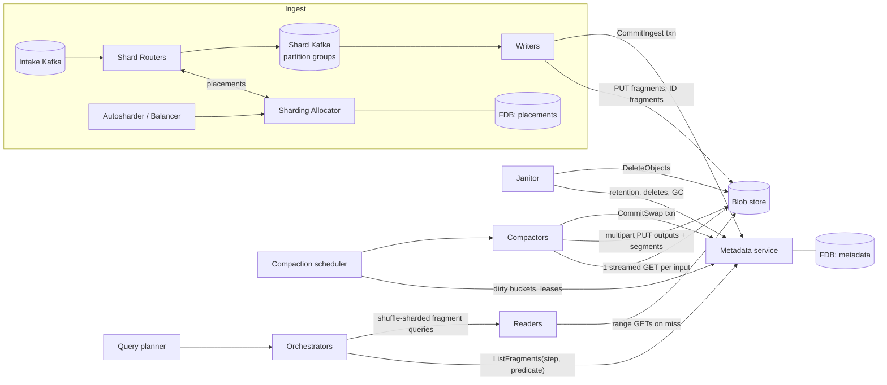

# Rebuilding Husky: a full system design

This document asks: if we had to build Datadog's Husky again from scratch, using only what is publicly known about it, what would the complete system look like? It turns the research in [datadog-husky.md](datadog-husky.md) into a buildable design. That means:

- concrete byte layouts for fragments and text-search segments;
- a FoundationDB keyspace;
- an object key scheme;
- write, compaction and query protocols;
- cache designs;
- deletes and garbage collection;
- sizing and failure handling.

Husky is closed source, so a large part of this design has to fill gaps. Every significant choice is labelled:

- **[K] Known.** Datadog states it in a primary source. This document keeps to it.
- **[R] Reconstructed.** Not stated, but strongly implied by what is stated. Usually only one design fits the known facts.
- **[D] Design choice.** Datadog has published nothing here. I chose this option to fill the gap, and give the reasoning.

When a section has no label, the label on its heading applies. Section 17 lists every gap and the choice made for it. Unlike [design-event-store.md](design-event-store.md), which borrows from all six systems, this document stays inside Husky's known architecture wherever it can, even where another system's approach might be better. Section 16 lists where I would deviate.

---

## Contents

1. Goals, workload and service levels
2. System overview
3. Data model
4. Ingest routing: shards, placements, autosharding
5. Writers: deduplication, buffering, flush and commit
6. The fragment format
7. The text-search segment format
8. Object storage layout and request patterns
9. The metadata store (FoundationDB)
10. Compaction
11. Query processing
12. Caching
13. Retention, deletes and garbage collection
14. Multi-tenancy, isolation and scaling
15. Sizing a cell
16. Failure modes
17. Gaps filled, and where I would deviate
18. Build order

---

## 1. Goals, workload and service levels

### 1.1 Workload [K]

| Property | Value |
|---|---|
| Data | Timestamped "multi-kilobyte" events: logs, spans, RUM, network events, CI events, security signals |
| Schema | None. Attributes are arbitrary, and a compacted fragment can hold hundreds of thousands to millions of columns |
| Writes | Very high volume, append-mostly; updates and deletes are rare |
| Reads | Biased toward recent data. Two shapes: needle-in-a-haystack searches, and analytics (timeseries, group-by) |
| Tenancy | Hundreds of thousands of tenant tables. Monitors and human queries must be isolated from each other |
| Correctness | Exactly-once ingestion, because duplicates flip monitors and corrupt billing |
| Retention | Days to 15 months (Flex Logs), at commodity object-storage cost |

### 1.2 Service levels [D]

Datadog publishes no SLOs. These are targets the design is sized against:

| Objective | Target |
|---|---|
| Ingest to queryable (p99) | ≤ 10 s |
| Duplicate events visible to queries | 0 within the deduplication window (24 h) |
| Fragment-query latency | p50 ≈ 2 ms (cache hit), p99 ≤ 300 ms. Datadog reports p50 2.01 ms and p99 257 ms [K] |
| Interactive search over the last 15 min | first results < 1 s, complete < 3 s |
| Fragment queries that reach object storage | < 1%. Datadog reports 0.4% [K] |
| Data loss after a write is acknowledged | none (Kafka is replicated, and the object store is durable) |

### 1.3 Non-goals

- Point updates at OLTP rates.
- Joins across tables beyond simple enrichments.
- Exposing the object store to external engines. That is a later option, discussed in section 16.

---

## 2. System overview

### 2.1 Components [K]

The component list matches Datadog's own. The table adds the state each component owns and how it scales.

| Component | Responsibility | State | Scales with |
|---|---|---|---|
| **Intake** (outside Husky) | Accepts events and writes them to intake Kafka topics | Kafka | Events/s |
| **Shard Router** | Looks up the (tenant, time) placement and republishes each event to a shard partition | Placement cache | Events/s |
| **Sharding Allocator** | Creates or returns immutable, time-bounded placements in FoundationDB | FoundationDB (placements cluster) | Tenants × placement rate |
| **Autosharder / Balancer** | Sizes each tenant's shard count and rebalances salts | Tenant config | Tenants |
| **Writers** | Deduplicate, buffer, sort, write fragments, and commit them with offsets | None (soft caches) | Events/s, tenants per Writer |
| **Metadata service** | The only API over fragment metadata: commits, listing, pruning | FoundationDB (metadata clusters) | Fragments, commits/s |
| **Compaction scheduler** | Finds dirty buckets, plans jobs, hands out leases | FoundationDB | Dirty buckets |
| **Compactors** | Streaming k-way merges, building segments, pruning regexes and zone maps | None | Bytes compacted/s |
| **Query planner** | Parses, validates, throttles, optimises, splits into time steps, merges | None | Queries/s |
| **Query orchestrator** | Per step: fetches metadata, prunes, dispatches, aggregates | None | Fragment queries/s |
| **Readers** | Execute one fragment query with result, range and predicate caches | Soft caches (RAM, NVMe) | Fragment queries/s, cache footprint |
| **Janitor** [D] | Retention, delete requests, GC, orphan sweeps | FoundationDB | Objects deleted/s |
| **Blob store** | S3, GCS or Azure Blob | Durable | Bytes, requests |

### 2.2 Diagram



### 2.3 Cells [R]/[D]

Datadog's diagrams show several metadata stores and blob stores [K]. The design therefore partitions the system into **cells** [D]. A cell has:

- one Kafka cluster;
- one FoundationDB cluster for placements and one or more for metadata;
- one or more blob buckets;
- its own Writer and compactor pools;
- its own reader pools.

Tenants map to a home cell through a global directory. Query planners and orchestrators are multi-tenant, and they route each query to the tenant's cell. A tenant moves between cells by starting new placements in the new cell, then copying or aging out old data. The old data stays readable from the old cell until it expires.

### 2.4 Lifecycle of one event

1. Intake writes the event to the intake topic.
2. The Shard Router finds the placement for (tenant, event timestamp) and picks `shard = placement.shards[hash(event_id) % n]`. It publishes the event to one of that shard's partitions.
3. A Writer that owns the shard drops the event if its ID is already known. Otherwise it appends the event to the buffer for (tenant table, time bucket).
4. When the buffer seals, the Writer sorts it by row key, encodes a fragment, and uploads it.
5. At the end of the shard's flush cycle, one FoundationDB transaction publishes every sealed fragment, the ID-table fragment, and the new Kafka offsets. The event is now queryable.
6. Within minutes, compaction merges the event's fragment with a few dozen others. Over the next hours it moves up into large, sorted fragments with narrow key ranges.
7. Queries prune by time, pruning regex and zone map, then route surviving fragments to readers. Most are answered from caches.
8. When the table's TTL passes, the janitor clears the bucket's metadata and deletes its objects.

---

## 3. Data model

### 3.1 Tenants and tables [K]

- A **tenant** (org) owns **tables**. A table belongs to one product (logs, spans, RUM and so on), and Flex and Standard logs may be separate tables.
- Tables are never mixed within one object [K].
- Each table has:
  - a **sort schema**: an ordered list of columns ending in `timestamp`, for example `service,status,env,timestamp` for logs [K];
  - a **TTL** [K];
  - **text-search settings**: which fields count as "standard text fields", the n-gram cap, and whether indexing is on [K/3P].
- **ID tables** are per shard and per time partition, and they are ordinary tables [K].

Table identity [D]: `table_id` is a 64-bit integer allocated by FoundationDB. The tenant config maps `(tenant, product, name) → table_id`. Object keys and metadata keys use `table_id` and never tenant names.

### 3.2 Events and columns

An event is a timestamp plus a nested JSON-like document of attributes [K]. Ingest flattens it into **columns** [D]:

- **Column identity is `(path, type)`.** For example, `@http.status_code` arrives as an integer from one service and as a string from another. That produces two columns, `(@http.status_code, i64)` and `(@http.status_code, str)`. A query on `@http.status_code:500` reads both and coerces as needed. There is never a schema migration, and never a write-time conflict.
- **Paths** are dot-joined keys. Datadog's `@`-prefix convention, which separates attributes from reserved fields and tags, is preserved as part of the path.
- **Types**:

  | Type | Use |
  |---|---|
  | `str` | UTF-8 strings |
  | `i64` | integers |
  | `f64` | floats |
  | `bool` | booleans |
  | `ts` | nanosecond timestamps |
  | `list<str>`, `list<i64>`, `list<f64>` | arrays |
  | `bytes` | rare binary values |

  An array of objects is flattened into one list column per leaf path. Positional correlation between those columns is lost, and Datadog's facet model does not need it.
- **Reserved columns**: `timestamp (ts)`, `event_id (bytes[16])`, `message (str)` and the tag set (`host`, `service`, `status`, `env`, `source`, `version`, …). The tags are stored as ordinary `str` columns that most tables pin.
- **Tags** in `key:value` form become columns named `tag.key`. Repeated tag keys become `list<str>`.

### 3.3 Row key and sort order [K]

Each row's **row key** is the concatenation of its sort-schema values. Writers sort rows by row key before writing [K]. The encoding is a design choice [D]:

```
row_key := enc(v1) 0x00 enc(v2) 0x00 ... enc(timestamp)
enc(str)   = bytes with 0x00 → 0x00 0xFF escaping (order-preserving)
enc(i64)   = big-endian with sign bit flipped
enc(null)  = empty (sorts first)
enc(ts)    = big-endian u64 nanoseconds
```

The encoding is order-preserving and byte-comparable. Fragment min and max row keys, and locality-compaction split points, are compared as raw bytes.

### 3.4 Time buckets [K]/[D]

Every fragment holds events from **one time window** of one table [K]. The window width is not published. I choose [D]:

| Table class | Bucket width | Reasoning |
|---|---|---|
| Event tables | 1 h | Matches typical query steps. A 15-month table has about 11k buckets. Small tenants still get at most one mature fragment per bucket |
| ID tables | 1 h, aligned with event buckets | Writers page in an ID interval per (shard, hour) |

Events are bucketed by **event timestamp**, not ingest time. Late data lands in old buckets and makes them dirty again, which compaction handles as normal work [K].

---

## 4. Ingest routing: shards, placements, autosharding [K]

This section follows the 2023 deep-dive post closely. The FoundationDB layout and the parameter values are design choices.

### 4.1 Shards

A **shard** is the unit of ingest ownership. It maps to a group of Kafka partitions, which may span topics and clusters [K]. A cell has `S` shards, for example `S = 4,096`. Shards are small, so each Writer owns many of them [K].

```
("shard", shard_id) → ShardDef { partitions: [(cluster, topic, partition)], excluded: bool }
```

### 4.2 Placements

A **placement** is immutable, covers a short time range, and does not overlap other placements for the same tenant. It assigns `n` shards to a tenant [K]. Placements last "usually just a few minutes" [K]. I use 5 minutes [D].

```
("placement", tenant_id, window_start) → Placement {
    window_end, shards: [shard_id x n], salt, created_at
}
```

Creating a placement (Sharding Allocator, in one FoundationDB transaction) [K]:

1. Read the key. If it exists, return it.
2. Otherwise read the tenant config `(n, salt)` and the list of excluded shards.
3. `first = H(tenant_id + salt) mod S`. Walk the ring from `first` and take the next `n` shards that are not excluded [K].
4. Write the placement and commit. If two allocators race, FoundationDB's conflict detection makes one retry, and the retry returns the value the other wrote.

Shard Routers cache placements in memory, keyed by `(tenant, window_start)`. They prefetch the next window about 30 s before it starts [D]. An event with a timestamp far in the past still needs its own placement, so the allocator creates historical placements on demand. The deduplication guarantee depends on this: a retried event carries the same timestamp, so it maps to the same placement, the same shard, and therefore the same Writer and ID table.

### 4.3 Routing

```
placement = placements[(tenant, floor(ts, 5min))]
shard     = placement.shards[xxhash64(event_id) mod placement.n]
partition = shard.partitions[xxhash64(event_id) mod len(partitions)]   [D]
```

`event_id` is a 128-bit identifier assigned at intake. If a client resends an event, it keeps the same ID [R].

### 4.4 Autosharder and Balancer [K]

- **Autosharder**: computes `n` per tenant from published per-tenant byte throughput. Bytes predict ingest cost better than event counts do [K]. It scales up within one placement window and scales down over hours [K]. Policy [D]: target 2 MiB/s of raw bytes per tenant per shard, with `n` between 1 and 512, rounded up to a power of two.
- **Balancer**: lowers the variance of per-shard load by changing tenant salts. It is limited to `M` moves per run [K]. [D]: M = 50 per cell per run, run every 5 minutes.
- **Hot-shard exclusion**: a shard whose consumer lag is above a threshold is marked `excluded`. New placements skip it until it drains [K].

Changes take effect only at placement boundaries. That is why placements are immutable: routing for any (tenant, time) is fixed forever once created, which keeps deduplication correct.

---

## 5. Writers: deduplication, buffering, flush and commit

### 5.1 Shard ownership [R]/[D]

Writers are stateless and autoscaled on CPU (the Watermark Pod Autoscaler [K]). Shards are spread across Writers by an assignment service: a Kafka consumer group whose member identity is the shard, or a dskit ring [D]. **Correctness does not depend on the assignment being exclusive.** Two Writers that briefly own the same shard are resolved by optimistic concurrency in the commit (section 5.5) [K].

### 5.2 Per-shard state

```
ShardState (in FDB, key ("shardstate", shard_id)):
    offsets:      map[partition] → next offset to consume
    id_version:   u64     // bumped on every successful commit
    writer_token: u128    // informational: last committer
```

When a Writer takes over a shard:

1. Read `ShardState`.
2. Seek every partition to `offsets[p]`.
3. Set `expected_version = id_version`.
4. Lazily page in ID intervals (5.3).

### 5.3 Deduplication against ID tables [K]

**ID table layout** [D]: one logical ID table per shard. It is bucketed by event-time hour like event tables, with this schema:

| Column | Type | Note |
|---|---|---|
| `event_id` | bytes[16] | Sort key, sorted ascending |
| `tenant_id` | i64 | Kept for diagnostics and for per-tenant purges |

**Writer memory** [K/D]:

- Per (shard, hour), a hash set of 16-byte IDs, with LRU eviction by interval [K].
- Paging in an interval means reading all fragments of that (ID table, hour) bucket. Compaction keeps that to a handful of large fragments, so a page-in is "a very limited number of IO operations" [K].
- The set is an open-addressing table with 16-byte slots at 70% load, about 23 B per ID [D].

**Check** for each incoming event:

1. Find the hour of `ts`.
2. Make sure that interval is resident. If not, page it in. While the page-in runs, the shard's consumer pauses [D].
3. If the ID is in the set, drop the event and count it as a duplicate.
4. Otherwise add it to the set and to the **pending ID buffer** for the current flush cycle.

**Deduplication window** [D]: 24 h by event time. ID tables use a TTL of 48 h. An event whose timestamp is older than the window still passes through the check, but it is checked only against intervals that are still retained. That is accepted and documented: very late retries may duplicate.

Datadog states that ID page-in throughput is about two orders of magnitude higher than event throughput [K], so a takeover costs seconds, not minutes.

### 5.4 Buffering and sealing

Writers keep one **buffer per (table_id, bucket)** for each shard they own [K]. A buffer **seals** into a fragment when any of these is true [D]:

- it reaches 4,000 events. Datadog says writer fragments hold "a maximum of a few thousand events" [K];
- it reaches 8 MiB of raw bytes;
- the shard's flush cycle ends (5.5).

Sealing a buffer:

1. Compute row keys and sort by `(row_key, event_id)`. The tiebreak makes the sort deterministic.
2. Encode a fragment in the format of section 6, with LZ4 compression (section 6.6).
3. Write a `pending` record in FDB (section 13.4), then PUT the object. The upload happens in the background and does not wait for the cycle to end.

Writers do **not** build text-search segments [D]. Writer fragments hold a few thousand rows, so a brute-force scan is cheap. Building segments at write time would roughly double the Writers' PUT count. Segments are built once compaction produces fragments of class ≥ 1 (section 10.3).

### 5.5 Flush cycle and commit protocol [K]/[R]

**Known**:

- data and ID-table updates are committed in one FDB transaction;
- ID-table updates are versioned;
- out-of-order commits are rejected;
- the losing Writer drops its cache and resets "to the latest committed fragment".

**Reconstructed**: the Kafka offsets live in the same transaction. Otherwise "reset to the latest committed fragment" would not be well defined.

Each shard runs a **flush cycle** at most every 5 s, or sooner if 64 MiB of sealed-but-uncommitted data has built up [D]:

```
cycle(shard):
  1. Seal every non-empty buffer in the shard. Wait for all uploads to finish.
  2. Encode the pending IDs as one ID-table fragment per hour touched. PUT them.
  3. FDB transaction via the metadata service CommitIngest:
       st = get ("shardstate", shard)
       if st.id_version != expected_version: abort CONFLICT
       for f in event_fragments ∪ id_fragments:
           set ("frag", f.table_id, f.bucket, f.fragment_id) = FragmentMeta(f)
           atomic_add ("bucket", f.table_id, f.bucket).{rows, frags, bytes}
           set ("dirty", f.table_id, f.bucket) = versionstamp
           clear ("pending", writer_id, f.fragment_id)
       st.offsets = consumed_offsets; st.id_version += 1
       set ("shardstate", shard) = st
     commit
  4. On success: expected_version += 1, clear the pending ID buffer, and
     send ReportNewFragments to readers (section 12.5).
  5. On CONFLICT: drop all buffers and every cached ID interval for the shard.
     Reread ShardState and seek back to st.offsets. The uploaded objects become
     orphans, which the janitor sweeps (section 13.4).
```

**Ambiguous commits.** FoundationDB can return `commit_unknown_result`. The Writer retries the same transaction with the same `expected_version`.

- If the first attempt actually committed, `id_version` has already moved on. The retry gets CONFLICT, and the Writer resets and re-reads the offsets. Those offsets are past the committed events, so nothing is duplicated.
- If the first attempt did not commit, the retry succeeds.

Exactly-once follows from the version CAS alone. Object writes do not need to be idempotent, and no conditional PUTs are needed.

**Transaction size**: one cycle on a busy shard commits about 10–200 fragment records of about 1–2 KiB each. That is well under FoundationDB's 10 MB limit and takes milliseconds, far from the 5 s limit.

### 5.6 Why one cycle per shard

All tables in a shard commit together because Kafka offsets are per partition, not per table. A Kafka offset can only advance once every event before it is durable. Committing per shard keeps "offset" meaning "everything before this is published", with no per-table watermarks. The cost is that a shard's slowest upload sets the cycle latency. A tiny cycle cap (5 s) and background uploads keep that cost small.

---

## 6. The fragment format

### 6.1 Requirements

Known requirements [K]:

1. The fragment is columnar and concatenates **entire columns**. Each column is preceded by a **column header**.
2. Each column splits into "row groups" (page-like units), with the **same number of rows in every column** of the fragment.
3. Row-group metadata includes min and max values.
4. A **skip list of column offsets** lets a reader jump to a column without scanning.
5. The **fragment header** stores the sort schema and the **min and max row keys**.
6. **Column-level metadata** covers existence, min/max, and small explicit value lists.
7. A compactor can **stream a fragment with one GET**, finding columns as it goes.
8. Fragments can have around 10^6 columns. Values can reach 75 KiB.

Requirements I add [D]:

9. Compactors write output in a single streaming pass to a multipart upload. Column and file sizes are not known in advance.
10. Opening a fragment for a query takes one ranged GET, which is usually cached.
11. The directory stays small enough to fetch even when there are 10^6 columns.

Requirements 7 and 9 together mean: header at the front, column data in a fixed canonical order, and the random-access directory at the end. The directory's offset is stored in FDB, so readers never need a speculative tail read.

### 6.2 Layout

```
┌──────────────────────────────────────────────────────────────────────────┐
│ FragmentHeader            (front: known before any column is written)      │
├──────────────────────────────────────────────────────────────────────────┤
│ Column 0  = sort column 1 │ ColumnHeader │ RG page 0 │ RG page 1 │ … │ ColumnIndex │
│ Column 1  = sort column 2 │ …                                                │
│ …         = sort columns, then `timestamp`, then `event_id`                 │
│ Column k… = all other columns in canonical (path, type) order              │
├──────────────────────────────────────────────────────────────────────────┤
│ Directory blocks          (column entries, 1,024 columns per block)        │
│ Directory top index       (first column name per block + offsets)           │
│ FragmentFooter            (fixed 64 B)                                      │
└──────────────────────────────────────────────────────────────────────────┘
```

All integers are little-endian. Varints are LEB128. Every structure ends with a CRC32C.

### 6.3 FragmentHeader

```
FragmentHeader {
  magic            : u32  = "HSKF"
  format_version   : u16
  flags            : u16  // bit0 has_segments, bit1 locality_sorted, bit2 sparse_allowed
  fragment_id      : u128 // UUIDv7
  table_id         : u64
  bucket_start     : i64  // ns
  bucket_width     : u32  // seconds
  row_count        : u32
  rg_rows          : u32  // rows per row group, uniform across columns
  rg_count         : u32  // ceil(row_count / rg_rows)
  ts_min, ts_max   : i64
  max_value_bytes  : u32  // largest single value in any column (for compactor rg sizing)
  sort_schema      : varint n, then n × (path string, type u8)
  min_row_key      : varbytes
  max_row_key      : varbytes
  producer         : u8   // writer | compactor | purge
  input_count      : u16  // provenance: number of inputs merged
  crc32c           : u32
}
```

Every field is known before the first column is written:

- **Writers** have the whole buffer in memory.
- **Compactors** first read the sort columns of every input, which come first in each input, and compute the merge permutation (section 10.5). That gives `row_count`, the min and max row keys, `ts_min` and `ts_max`, and the split points between output files. `max_value_bytes` is the maximum over the inputs' headers, which is a valid upper bound.

### 6.4 Columns

**Canonical column order** [R]. Sort columns come first, in schema order. Then `timestamp`, then `event_id`. Then every other column, ordered by `(path bytes, type)`.

This order is fixed for every fragment of a table. A k-way merge can then walk all inputs **in lockstep, one column at a time**: at each step it takes the smallest next column among the inputs, and inputs that lack that column contribute nulls. This is how "one GET per input" and "one column at a time" fit together (see [datadog-husky.md](datadog-husky.md) §4.3).

```
ColumnHeader {
  magic        : u16 = 0xC0 1F
  path         : varstring
  type         : u8
  encoding     : u8   // DENSE | SPARSE | CONST | ALL_NULL (ALL_NULL columns are omitted entirely)
  codec        : u8   // NONE | LZ4 | ZSTD
  flags        : u8   // bit0 has_dict, bit1 text_field (standard text field), bit2 sorted
  non_null     : u32
}
RowGroupPage × rg_count (DENSE) or × present_rg_count (SPARSE) {
  page_len     : varint   // compressed bytes that follow, so a streaming reader can skip
  rg_index     : varint   // explicit for SPARSE, implicit for DENSE
  rows_present : varint
  validity     : bitmap (rg_rows bits, omitted if all present) | row offsets (SPARSE)
  min, max     : typed, truncated to 64 B for str
  payload      : encoded + compressed values
  crc32c       : u32
}
ColumnEnd marker : page_len = 0
ColumnIndex {
  page_offsets : u32 × pages   // relative to column start
  page_stats   : (min, max, null_count) × pages
  value_list   : optional, ≤ 32 distinct values (sorted), for the directory
  bloom        : optional split-block bloom over values, if 32 < NDV ≤ 64k and type = str
  crc32c
}
```

- **Streaming readers**, which is how compactors read, parse `ColumnHeader`, then length-prefixed pages up to the end marker, then the `ColumnIndex`. They never need the directory.
- **Random-access readers**, which is how query readers read, get the column's start offset and its `ColumnIndex` offset from the directory. They prune pages using `page_stats`, then fetch only the pages they need.

**Sparse columns** [D]. With about 10^6 columns, most columns appear in a tiny fraction of rows. A column with `non_null / row_count < 1/64` uses `SPARSE`: pages exist only for row groups that contain at least one value, and each page lists the present row offsets as delta varints in place of a validity bitmap. A column that appears in 50 of 1M rows therefore costs one or two small pages, plus one directory entry.

### 6.5 Row-group size [K]/[D]

- **Known**: rows per row group are uniform within a fragment. They are chosen per output from the largest value size in the heaviest input column. Readers want "a few hundred rows" so a row group fits in CPU cache. If an output goes over its budget, the compactor restarts it with a smaller row-group size.
- **Rule** [D]:

  ```
  rg_rows = clamp(pow2_floor(RG_BYTE_BUDGET / max_value_bytes), 16, 1024)
  RG_BYTE_BUDGET = 4 MiB uncompressed per column per row group
  ```

  With typical values under 4 KiB, `rg_rows` hits the 1,024 cap. Lower it to 512 to match "a few hundred rows". With 75 KiB messages, it is 32.
- **Restart rule**: while writing, if any column's row group exceeds `2 × RG_BYTE_BUDGET` uncompressed, for example from many large values in a list column, abort the multipart upload and retry with `rg_rows / 4`. This needs a second GET of the inputs. It is rare, and it is counted.

### 6.6 Encodings and codecs [D]

Datadog does not publish codecs. These choices follow the common practice for sorted columnar data:

| Type | Encoding | Notes |
|---|---|---|
| `str`, low cardinality | Page-local dictionary + bit-packed codes, RLE when sorted | Covers sort columns and tags, which compress to almost nothing after sorting |
| `str`, high cardinality | Length-prefixed plain values | `message`, URLs, stack traces |
| `i64` | Frame-of-reference + bit-packing; delta first if `sorted` | |
| `f64` | Plain, or ALP-style decimal encoding when lossless | |
| `ts` | Delta-of-delta + bit-packing | `timestamp` is sorted inside each sort-key run |
| `bool` | Bitmap | |
| `list<T>` | Offsets (FOR-packed) + child values encoded as `T` | |
| `bytes[16]` (`event_id`) | Plain | Random by design |

Compression is applied per page, after encoding:

| Producer | Codec | Why |
|---|---|---|
| Writer | LZ4 | Writer CPU sets the freshness budget. These fragments are short-lived |
| Compactor | zstd level 3 | Fragments live for days to months. Decoding cost is about the same as LZ4 when reading from cache |
| Compactor, mature buckets | zstd level 6 for `str` columns > 1 MiB | The final compaction runs once |

### 6.7 Directory

```
DirectoryBlock (≤ 1,024 entries, zstd-compressed) {
  entries: [ ColumnEntry ]
}
ColumnEntry {
  path, type, encoding, flags
  col_offset, col_len          : u64, u32
  index_offset, index_len      : u32 (relative to col_offset)
  non_null                     : u32
  min, max                     : typed, truncated
  value_list                   : copied from ColumnIndex when present
  has_bloom                    : bool
}
DirectoryTopIndex {
  block_count
  [ first_path, first_type, block_offset, block_len ] × block_count
  text_fields                  : bitset over sort order of standard-text columns
  segment_ref                  : optional (segment object key suffix, length)
  crc32c
}
FragmentFooter (64 B) {
  top_index_offset : u64, top_index_len : u32
  directory_offset : u64, directory_len : u32
  row_count, column_count : u32
  magic "HSKF", crc32c
}
```

The **skip list of column offsets** [K] is this two-level directory. Here are the sizes for a fragment with 10^6 columns:

| Part | Calculation | Size |
|---|---|---|
| Directory blocks | about 1,000 blocks × about 1,024 entries × about 40 B compressed | about 40 MB |
| Top index | about 1,000 entries × about 50 B | about 50 KB |

A query names a handful of columns. It reads the top index, which is cached, and then only the directory blocks those columns fall in. That is usually 1–5 blocks of about 40 KB each.

The FDB fragment record stores `top_index_offset` and `top_index_len` (section 9.3), so a cold open is **one ranged GET** for the top index. A fragment with fewer than 1,024 columns has a single directory block, and that block is fetched in the same GET.

### 6.8 Worked example

Here is a log fragment after size-tiering:

- 1M rows, 512 rows per row group, so 1,954 row groups;
- 3,200 columns, of which 2,900 are sparse;
- sort schema `service,status,env,timestamp`.

| Section | Approximate size |
|---|---|
| Header | 300 B |
| `service`, `status`, `env` (dictionary + RLE, sorted) | 40 KB total |
| `timestamp` (delta-of-delta) | 1.5 MB |
| `event_id` | 16 MB |
| `message` (zstd) | 95 MB |
| 296 dense attribute columns | 60 MB |
| 2,900 sparse columns | 8 MB |
| Directory (4 blocks) + top index | 150 KB |
| **Total** | **≈ 180 MB** (from about 1.1 GB raw, about 6×) |

`event_id` is 9% of the fragment and is never compressible. It is kept because purges, exact deduplication audits and trace joins need it.

---

## 7. The text-search segment format [K]/[D]

### 7.1 Known

- Segments are "additional files … attached to fragments".
- Each term has two posting bitsets. One covers standard text fields such as `message`, `title` and `error.stacktrace`. The other covers all fields.
- Hashed n-grams (4-grams) have their own posting bitsets. The number of n-grams per segment is capped, and collisions only cause false positives.
- Queries rewrite text predicates into row-set algebra.
- Indexing is optional per table or column [3P].

### 7.2 Choices [D]

- A segment is a **separate object**, `<fragment key>.seg`, written by the compactor right after the fragment. It is listed in the fragment's FDB record and in `DirectoryTopIndex.segment_ref`.
- The fragment and its segment are published in the same CommitSwap. A fragment is never visible without its segment.
- Segments exist only on compactor outputs with at least 16k rows (size class ≥ 1).

### 7.3 Layout

```
SegmentHeader { magic "HSKS", version, fragment_id, row_count, tokenizer_id, ngram_n=4, ngram_cap }
TermDictionary      // sorted terms in blocks of 128, front-coded
  block: [ term_suffix, text_postings_ref, all_postings_ref ] × 128
TermBlockIndex      // first term per block + block offset (binary-searchable, cached)
NgramTable          // open-addressed table: hash32 → postings_ref, capped at ngram_cap entries
Postings            // roaring bitmaps of row index (u32), serialized portable format
FieldPresence       // optional: column_ordinal → roaring of rows with that column non-null
SegmentFooter       { offsets/lengths of the above, crc32c }
```

### 7.4 Tokenisation and n-grams

- **Tokeniser**: lowercase ASCII and Unicode letters. Split on whitespace and punctuation, except that `.`, `-`, `_` and `:` are kept inside tokens of 3–64 characters. That keeps `10.0.0.12`, `req-7f2a` and `user_id` intact. The parts are emitted as well.
- **Which values are tokenised**: every `str` value. Values in standard text fields set bits in both bitsets. All other values set bits only in the "all fields" bitset.
- **N-grams**: 4-grams over standard text fields only, hashed to 32 bits. When there are more distinct grams than `ngram_cap` (default 2^20), keep the grams with the **fewest** postings. Rare grams prune best, and common grams barely narrow anything.
- **Sizes**: typically 5–15% of the fragment. Roaring compresses dense postings well on sorted data, because rows from the same service cluster together.

### 7.5 How queries use it

| Query | Segment use |
|---|---|
| `error` (free text) | Bitset for `error` from standard text fields |
| `*:error` (all fields) | The all-fields bitset |
| `@user.id:abc123` | Term `abc123`, all-fields bitset, AND'd with presence of `@user.id`. The column is then checked to confirm the value |
| `*timeout*` | Intersect the 4-gram bitsets `time`, `imeo`, `meou`, `eout`. Confirm candidates against the column (false positives are possible) |
| `(login AND error) OR unavailable` | Bitset algebra, which gives row ranges [K] |

If a predicate's result is empty, the fragment returns `NO_MATCH` without reading columns. If it covers every row and the query is a count, the fragment returns `MATCH_ALL` [K].

---

## 8. Object storage layout and request patterns

### 8.1 Key scheme [D]

Datadog stores file paths in metadata [K] and has not published a key scheme. I choose:

```
<cell>/f/<h2>/<table_id>/<bucket_yyyymmddhh>/<fragment_id>.frag
<cell>/f/<h2>/<table_id>/<bucket_yyyymmddhh>/<fragment_id>.seg
<cell>/i/<h2>/<shard_id>/<bucket_yyyymmddhh>/<fragment_id>.frag       // ID tables

h2 = hex(xxhash32(table_id))[0:2]
```

- **The `h2` prefix** spreads tables across 256 prefixes, so S3 partitions split early, and GCS and Azure spread load too. All of a table's objects stay under one prefix, so retention backstops and diagnostics can LIST one table. LIST is never on the hot path.
- **The bucket** is in the key so that a reconciliation LIST of a table can be narrowed to a time range.
- **The fragment ID** is a UUIDv7, which is time-ordered and unique. Keys are never reused, so caches keyed by object key never go stale.

### 8.2 Object sizes

| Object | Rows | Bytes (compressed) |
|---|---|---|
| Writer fragment | ≤ 4,000 | 50 KiB – 1 MiB |
| ID-table fragment | ≤ about 20,000 IDs | ≤ 400 KiB |
| Class 1 fragment | 32k – 1M | 5 – 150 MiB |
| Class 2 / locality fragment | about 1M (target) | 100 – 300 MiB |
| Segment | — | 5–15% of its fragment |

### 8.3 Requests per operation

| Operation | Requests | Notes |
|---|---|---|
| Writer flush cycle (per shard) | 1 PUT per sealed fragment + 1 PUT per ID fragment + 1 FDB transaction | Single PUT, because every object is < 16 MiB |
| Compaction, k inputs → m outputs | k streamed GETs; m multipart uploads (16 MiB parts) + m segment PUTs; 1 FDB transaction; later k fragment DELETEs and k segment DELETEs, batched | Datadog states the GETs and the transaction [K] |
| Fragment query (cold) | 1 GET top index, 0–3 GETs directory blocks, 0–1 GET column indexes, 1–N GETs pages (coalesced) | The reader's range cache absorbs most of these |
| Fragment query (warm) | 0 GETs | 99.6% of the sample did not reach blob storage [K] |
| ID page-in (per shard-hour) | about 1–5 GETs | Compaction keeps ID buckets to a few fragments |
| GC | `DeleteObjects`, ≤ 1,000 keys per request (S3) | GCS and Azure use batch endpoints |

### 8.4 What the design asks of the object store

- **Required**: read-after-write for new keys, ranged GET, multipart upload, and batch delete.
- **Not required**: consistent LIST, conditional PUT, object versioning, or rename.

All visibility comes from FDB. That is why S3, GCS and Azure work interchangeably [K].

---

## 9. The metadata store (FoundationDB)

### 9.1 Principles

- FDB is the **only** source of truth for visibility [K].
- Every mutation goes through the **metadata service** [K]. The service hides FDB's limits (5 s transactions, 10 MB transactions, 100 KB values) behind the API calls below.
- Records must be small, because millions of them are scanned per hour of queries. The target is **≤ 2 KiB per fragment record**, with a hard cap of 8 KiB.

### 9.2 Keyspace

The keyspace uses the tuple layer, with one directory per cell and per metadata cluster.

| Subspace | Key | Value | Written by |
|---|---|---|---|
| Tenant config | `("tenant", tenant_id)` | `{salt, n_shards, tables[], reader_pool, quotas}` | Control plane, Autosharder |
| Table | `("table", table_id)` | `{tenant, product, sort_schema, ttl, text_cfg, bucket_width, delete_epoch}` | Control plane |
| Shard state | `("shardstate", shard_id)` | `{offsets{}, id_version}` | Writers |
| Fragment | `("frag", table_id, bucket, fragment_id)` | `FragmentMeta` | Writers, compactors, purge |
| Bucket | `("bucket", table_id, bucket)` | `{rows, frags, bytes, version, last_write_ts, state}` (atomic-add counters) | Writers, compactors |
| Dirty queue | `("dirty", table_id, bucket)` | versionstamp of last change | Writers, compactors |
| Compaction lease | `("lease", table_id, bucket)` | `{job_id, worker, expires, inputs_digest}` | Scheduler |
| Pending upload | `("pending", producer_id, fragment_id)` | `{key, created_ts}` | Writers, compactors |
| GC queue | `("gc", delete_after_ts, object_key)` | `{}` | Metadata service at swap/expiry |
| Delete request | `("delreq", table_id, request_id)` | `{predicate, ts_range, created, epoch}` | Delete API |
| Placement | `("placement", tenant_id, window_start)` | `Placement` | Allocator (on the separate placements cluster) |

```
FragmentMeta {
  object_key_suffix  : bytes          // key minus cell/prefix
  segment            : optional {len}
  version            : versionstamp   // set at commit; cache-key component
  producer, level    : u8, u8         // writer=0 | class1 | class2 | locality level n
  size_class         : u8
  row_count          : u32
  bytes              : u32
  ts_min, ts_max     : i64
  min_row_key        : bytes (≤ 256 B, truncated with an exact-prefix flag)
  max_row_key        : bytes (≤ 256 B)
  zone_map           : [(column_ordinal, min, max)] over sort columns + up to 4 hot facets
  prune_regex        : [regex per sort column] (locality outputs only; ≤ 512 B each)
  top_index          : {offset u64, len u32}
  applied_delete_epoch : u32
  created_ts         : i64
}
```

### 9.3 API

| Call | Semantics | FDB pattern |
|---|---|---|
| `CommitIngest(shard, expected_version, fragments, offsets)` | Section 5.5 | One transaction, CAS on `id_version` |
| `CommitSwap(table, bucket, inputs[], outputs[], lease)` | Atomically remove inputs and add outputs | One transaction. Reads each input key, which adds a conflict range, so a concurrent swap or purge aborts it. Checks the lease. Writes outputs, clears inputs, enqueues inputs to `gc` with `delete_after = now + gc_grace`, bumps the bucket version |
| `ListFragments(table, ts_range, predicate)` | Streams the fragments that may match | Snapshot reads paginated across transactions with a bucket-version check (9.4). Evaluates `prune_regex` on the server [K] |
| `BucketsChangedSince(cursor)` | Feeds the compaction scheduler | Range read over `dirty` |
| `ExpireBefore(table, bucket)` | Retention | Reads fragment keys in pages and enqueues them to GC, then `clear_range` on the bucket. Range clears are O(1) in transaction size |

### 9.4 Living with the 5-second limit [K]/[R]

Datadog says the metadata service "preserves atomicity even though FoundationDB enforces a hard five-second limit on transactions" [K]. The design handles it this way:

- **Writes stay small by construction.** CommitIngest is bounded per shard per cycle. CommitSwap is always within one (table, bucket) and limited to ≤ 64 inputs and ≤ 16 outputs. Retention uses range clears. No mutation can come near 10 MB or 5 s.
- **Large reads are paginated with a consistency check.** A query step over one big bucket might list 5,000 fragments.
  1. The service reads the bucket's `version` and up to 1,000 records per transaction.
  2. On every later page it checks that `version` has not changed.
  3. If it has changed (a swap landed mid-scan), it restarts that bucket only.

  Each bucket's listing is therefore a consistent snapshot. Different buckets may be read at slightly different versions, which is safe: each bucket's set of fragments is complete in itself, and buckets never share rows.
- **Query snapshots.** The orchestrator keeps the materialised fragment list for the whole step. Snapshot isolation per query, as described by DBDB.io [3P], is achieved by holding this list, not an FDB read version, so it can outlive 5 s. GC grace (13.3) must be longer than the maximum query duration.

### 9.5 Server-side pruning

`ListFragments` takes the query's predicates on sort-schema columns (equality, IN, prefix, and range) and evaluates them in the metadata service. Rejected records are never sent to the orchestrator [K]:

1. `ts_range` overlap.
2. `prune_regex` per sort column. Equality or IN values must match the column's regex. Prefix predicates are tested against the regex's automaton for a non-empty intersection.
3. `min_row_key` / `max_row_key` against the query's row-key prefix bounds. This works when the predicate fixes a prefix of the sort schema.

The orchestrator then applies `zone_map` checks to the facets that the service does not evaluate [K]. Splitting the work this way keeps the service's CPU per record roughly constant.

---

## 10. Compaction

### 10.1 Goals [K]

- Minimise fragment count, which reduces GETs and metadata.
- Keep compaction's own CPU and request cost low.
- Reach a "Goldilocks" size of about 1M rows.
- Narrow each fragment's key range so pruning works.

### 10.2 Scheduling [K]/[D]

- **Finding work** [K]: the scheduler reads `dirty` (buckets that "received new data recently"). It never lists the blob store.
- **Scheduler topology** [D]: sharded by `hash(table_id) mod 64`. Each scheduler shard holds an FDB lease, so there is one active planner per shard. If a planner crashes, another takes its lease within 10 s.
- **Planning**: for each dirty bucket, the planner reads its fragment records (one prefix range read) and runs the policy in 10.3 and 10.4. Each job it produces gets a `lease` record holding `inputs_digest` and an expiry of 15 minutes.
- **Workers**: a stateless, autoscaled pool. Workers pull jobs from the scheduler over gRPC, on a pull model sized by CPU slots. Each job runs on one core with a fixed memory budget [K].
- **Bucket states** [D]:

  | State | Condition |
  |---|---|
  | `open` | Now < bucket end + 10 min |
  | `settling` | Up to 2 h after the bucket ends |
  | `mature` | After that. A late write moves it back to `settling` [K] |

### 10.3 Stage 1: lazy size-tiering [K]

**Size classes** [D] grow exponentially by rows, with a factor of 32:

| Class | Rows | Typical source |
|---|---|---|
| 0 | < 32k | Writers (about 1k–4k rows) |
| 1 | 32k – 1M | First merge |
| 2 | ≥ about 1M | Second merge. Size-tiering ends here, and the fragment enters locality level 0 |

**Trigger** [K]: compaction waits "until a few dozen fragments are available". Datadog says this is an order of magnitude cheaper than eager merging [K]. For each class `c` in a bucket [D]:

```
merge if  count(class c) ≥ 24
      or (state ≠ open and count(class c) ≥ 2)
      or (count(class c) ≥ 2 and oldest(class c) age ≥ 10 min)
choose the oldest fragments of class c, up to 64 inputs
       or 1.2M output rows (outputs are split at 1M rows)
```

- The age trigger caps how long a busy query has to fan out over hundreds of writer fragments.
- The `state ≠ open` trigger produces the "(presumably) final" compaction [K]: small tenants converge to a single fragment per bucket.

**Write amplification of size-tiering**: each row is rewritten about twice (0 → 1 → 2). Small tenants whose bucket never reaches 32k rows are rewritten about once.

### 10.4 Stage 2: locality compaction [K]/[D]

**Known**:

- Locality compaction is a best-effort, leveled LSM per (table, bucket).
- Overlapping fragments, judged by min/max row key, are merged into non-overlapping outputs.
- Each level has a row limit, and when it is exceeded fragments move up to an exponentially larger level.
- Fragment size stays constant, so key ranges narrow at higher levels.
- Locality is configured to use no more CPU than size-tiering, and it cut the reader pool by 30%.

**Level limits** [D]: `limit(L) = 4M rows × 8^L`.

| Level | Row limit |
|---|---|
| L0 | 4M |
| L1 | 32M |
| L2 | 256M |
| L3 | 2B |

A bucket holding 1.8B rows (a tenant at 500k events/s) reaches L3.

**Picking a compaction**: when level `L` is over its limit, choose the L-fragment with the largest **overlap score**, then merge it with every L+1 fragment its key range overlaps.

```
overlap score = (number of L+1 fragments its range overlaps)
              × (recent query hits on the bucket, decayed)
```

Outputs are cut at 1M rows. Cuts happen at row-key boundaries, so outputs do not overlap.

**CPU budget controller** [D]. Classic leveled compaction rewrites each row about `fanout` times per level. That would break the rule that locality costs no more than size-tiering [K]. So:

1. Every scheduler shard tracks `cpu_size_tier` and `cpu_locality` as exponentially decaying averages.
2. Locality jobs are admitted only while `cpu_locality ≤ cpu_size_tier`.
3. Admitted jobs are ordered by `benefit = overlap_score × query_heat / input_rows`.

Cold buckets that nobody queries may therefore never get past L0. That is fine, because pruning only pays off for buckets that are queried.

**Mature-bucket pass** [D]. When a bucket becomes `mature`, a final locality job merges any remaining overlapping runs. It uses the zstd-6 profile and writes the pruning regexes in their final form. After that the bucket is frozen until a late write or a purge arrives.

### 10.5 The merge algorithm [K]/[R]

This is a streaming k-way merge with one GET per input and memory of about one row group per input [K].

```
merge(inputs[1..k], target_rows=1M):
  # Phase A: sort columns (the front of every object)
  for each input i (parallel):
      open one streaming GET of the whole object
      parse FragmentHeader
      read sort columns + timestamp + event_id pages → row keys R_i (already sorted)
  P = k-way merge of R_1..R_k by (row_key, event_id)   # sequence of (input, row)
  if dedupe_on_merge: drop rows with equal event_id adjacent in P   # [D] safety net
  apply active delete predicates on sort columns (section 13.2) → drop rows
  split P into outputs at 1M-row boundaries (row-key aligned)
  choose rg_rows from max(max_value_bytes_i)   # section 6.5
  for each output o: start multipart upload; write FragmentHeader (all fields known)

  # Phase B: every other column, lockstep
  write sort/ts/event_id columns from data already in memory
  loop:
      c = min over inputs of next ColumnHeader (path, type)   # canonical order
      for each output o, for each output row group g:
          gather values per P from inputs' current pages of c
          (inputs without c → null)
          encode + compress page; append to o's current part buffer
          flush 16 MiB parts as they fill
      advance inputs that had c past its ColumnIndex
      record ColumnEntry for c in each output (pruning/statistics)
  until all inputs exhausted

  # Phase C: tail
  write directory blocks + top index + footer to each output; complete uploads
  build segment for each output (postings accumulated during Phase B for str columns)
  build prune_regex + zone_map from sort-column values seen in Phase A
  CommitSwap(inputs, outputs)
```

**Memory bound.** Phase A holds the row keys and P: 1M output rows × (8 B entry + about 40 B key) ≈ 50 MB. Phase B holds, for each input, the current decoded page of one column, plus a 16 MiB part buffer for each output.

| Inputs | Outputs | Phase B memory |
|---|---|---|
| 24 | 1 | 24 × 512 rows × 1 KB + 16 MiB ≈ 30 MB |
| 64 | 4 | about 100 MB |

That fits "less than the memory available for one CPU" on a 4 GB/core machine [K].

**Why P consumes each input in order.** Every input is sorted, so P visits each input's rows in increasing order. A single forward-only stream per input is enough, and it never has to rewind.

**Building segments during Phase B.** As each `str` column passes through, the compactor tokenises its values and adds row ordinals to term postings, which are held in memory as roaring bitmaps. For a 1M-row output, the postings typically take 50–200 MB. If the postings for one output pass 512 MB, the compactor spills sorted runs to local disk and merges them at the end. This is the only use of local disk in the compactor.

### 10.6 Pruning regexes and zone maps [K]/[D]

**Building a pruning regex**, for each sort column of a locality output [K]:

1. Collect the column's distinct values. They come out sorted from Phase A, so this is a streaming pass.
2. Build the minimal acyclic DFA, using incremental construction for sorted input in the style of Daciuk.
3. **Trim** to at most 256 transitions while keeping a superset of the values [K]. Repeatedly take the deepest state with the most outgoing transitions and replace its subtree with a wildcard (`.*`). Every original value still matches, so there are no false negatives.
4. Emit a regex, for example `^(compactor|reader|writer)$` [K] or `^(api-.*|web)$`, at most 512 B.

**Zone map** [D]: min and max over the sort columns, `ts`, and up to 4 "hot facets" per table. Hot facets are the columns that appear most often in queries for that table, chosen from planner statistics and refreshed daily.

Writer fragments and class 1 fragments get zone maps but no regex [R]. Datadog says regexes are produced by locality compaction [K]. Fragments that are still young are pruned by time and zone map, and they are small anyway.

### 10.7 Compaction of ID tables

ID tables are compacted with the same machinery. They sort by `event_id`, have no segments, no regex, and no locality stage. They exist so that a page-in costs a few GETs.

### 10.8 Throughput [K]

Datadog reports compacting "thousands of fragments" and "dozens of GB per second". At about 70 MB/s of raw-equivalent merge throughput per core, 40 GB/s needs about 600 cores (section 15.3 derives that figure for one illustrative cell). That is consistent with a pool that scales with ingest.

---

## 11. Query processing

### 11.1 Query surface

The log search syntax (free text, `@attr:value`, wildcards, ranges, booleans, facets) and the analytics operations are parsed into a logical plan [D]:

```
Plan {
  table(s), ts_range
  filter      : boolean tree of { Term(field?, text) | Eq(col, v) | In | Range | Wildcard | Exists }
  projection  : columns | *
  op          : List(sort=ts desc, limit) | Count | Timeseries(rollup, interval, group_by[], aggs[])
              | TopList(group_by[], agg, limit) | Distinct(col, limit)
}
```

### 11.2 The planner [K]

The planner is responsible for context resolution, validation, throttling, optimisation and time-step splitting [K].

1. **Resolve context**: the tenant, the tables the user can see, and per-tenant reader pool and quotas.
2. **Validate and throttle**: per-tenant concurrency and scanned-byte budgets. Monitors and humans have separate quotas.
3. **Optimise**:
   - Normalise predicates (de Morgan; push `NOT` down).
   - Rewrite `Term` predicates on sort columns as `Eq`, so they prune in the metadata service.
   - Mark which predicates each fragment layer can evaluate (metadata, segment, column).
   - Order predicates by estimated cost per selectivity.
4. **Split into time steps** aligned to buckets (1 h). Each step goes to an orchestrator.
   - **List queries** (latest N) run steps newest first, one or two in parallel, and stop once N rows exist with timestamps newer than the next step. This is the main reason for steps: most "show me recent logs" queries touch one or two buckets.
   - **Analytics queries** run all steps in parallel. The tenant's concurrency limit applies.
5. **Merge** step results: k-way merge for List, and combining partial aggregates for analytics.
6. **Stream** progressive results to clients through a job interface that clients poll [K].

### 11.3 The orchestrator [K]

For each step:

1. Call `ListFragments(table, step_range, sort-column predicates)`. Most pruning happens in the service (9.5).
2. Apply zone-map pruning [K].
3. **Dispatch** each surviving fragment to a reader (section 12.4), in parallel. Each orchestrator has its own concurrency limit.
4. **Aggregate** the fragment results as they arrive, and send partial results upstream.
5. **Checkpoint** [K]: track which fragments have completed. If a reader fails, or the orchestrator's own RPC fails and is retried, only the fragments that are not done are re-sent. Completed partials are never double-counted.

### 11.4 The fragment query

The orchestrator sends this request to a reader:

```
FragmentQuery {
  fragment_id, version, object_key, top_index{offset,len}, row_count, ts_min/max
  plan_fragment   : filter + projection + op (with ts_range clipped to the fragment)
  plan_hash       : hash of normalized plan_fragment with ts_range replaced by
                    FULL if it covers [ts_min, ts_max] else the clipped range
  deadline, tenant, priority
}
```

**The reader's pipeline**, in Datadog's order [K]. Each step can answer the query by itself and end it:

1. **Result cache** keyed by `(fragment_id, version, plan_hash)`. A hit returns the stored partial result immediately.
2. **Fragment column metadata**: fetch or get from cache the top index, then the directory blocks for the columns the plan references.
   - If a required column is absent, the result is `NO_MATCH`. For example, `@requestId:abc` on a fragment with no `@requestId` column.
   - If the column's `value_list` excludes the value, or its min/max excludes the range, the result is `NO_MATCH`.
   - If `has_bloom` is set and the bloom says absent, the result is `NO_MATCH`. The bloom is a design addition [D].
3. **Segments and predicate cache**: evaluate text and term predicates as bitsets. Look up cached bitsets for the normalised predicates first. The result is `NO_MATCH`, `MATCH_ALL` (for a count-only query), or a candidate row set.
4. **Row-group pruning**: for each remaining column predicate, read the column's `ColumnIndex` (cached) and drop row groups whose page min/max cannot match.
5. **Scan** the surviving row groups in **cost order**: the cheapest and most selective predicate column first. Its pages are fetched through the range cache. Values are decoded only for rows still selected. The decoded batch is passed on by **lazy reference**, so a column is decoded only when an operator touches it [K].
6. **Project and aggregate**: decode projected columns only for the final selected rows (late materialisation). Produce a partial result: the top N rows for List, or partial aggregate state for analytics.
7. **Store the result** in the result cache, and record the predicate's cost for the predicate-cache builder.

### 11.5 Execution engine [K]

- Volcano-style operators (`open/next/close`), where each `next` returns a **row-group batch** (≤ 1,024 rows) [K].
- Each batch has a selection vector. Filters update it, and operators skip unselected rows.
- Inner loops are simple and type-specialised so the Go compiler can vectorise them, or hand-written SIMD is used for hot kernels: dictionary-code comparison, bitmap AND and OR, and FOR unpacking [K/D].
- **Partial aggregates**: counts and sums are exact. `count distinct` uses HyperLogLog++ and percentiles use DDSketch, both mergeable [D]. Group-by on high-cardinality keys is limited to the top 10k groups per fragment, with an `others` bucket and an error bound that the planner reports.

### 11.6 Example queries

**A needle**: `service:checkout status:error @request_id:7f2a9c` over the last hour.

| Stage | Survivors |
|---|---|
| 1 bucket in range | 900 fragments |
| Service regexes in the metadata service | about 40 fragments (checkout covers about 4% of the tenant's key range) |
| `status:error` against zone maps | 22 |
| Readers: result cache misses (new query) | 22 |
| Column presence (`@request_id` absent) | 14 |
| Segment term lookup | 13 return `NO_MATCH`, 1 has candidate rows |
| Pages read | 1 page of `@request_id` and 4 projected columns (≈ 300 KB, one coalesced GET if cold) |

**Analytics**: `count by status` for `service:web` every 5 minutes over 7 days.

- 168 steps, run in parallel within the concurrency limit.
- The service regex keeps about 3% of fragments.
- Each surviving fragment reads only `status` (dictionary + RLE pages) and `timestamp` pages for the matching sort-key range. Rows are sorted by `service,status`, so the matching rows are contiguous and row-group pruning on `service` keeps about 1–3 row groups per fragment.
- When the dashboard refreshes, every fragment fully inside the window hits the result cache. Only fragments at the window's edges and new writer fragments are recomputed (12.1).

---

## 12. Caching [K]

### 12.1 Result cache

| Aspect | Design |
|---|---|
| Key | `(fragment_id, version, plan_hash)` |
| Value | Serialised partial result, capped at 1 MiB. Larger results are not cached |
| Storage | In-memory LRU (about 10% of reader RAM), spilling to a RocksDB instance on NVMe. Persisted across restarts [K] |
| Invalidation | None needed. Fragments are immutable, and `version` changes whenever a record is replaced [K] |
| Why it hits | Dashboard refreshes, repeated monitor evaluations, and widgets that share filters. Datadog reports about 80% hits [K] |

`plan_hash` treats a fragment fully covered by the query range as `FULL` (section 11.4). So "last 15 minutes" and "last 16 minutes" share entries for every fragment inside both ranges.

### 12.2 Blob range cache

| Aspect | Design |
|---|---|
| Key | `(object_key, chunk_index)`, with 1 MiB aligned chunks [D] |
| Storage | RocksDB on local NVMe [K], about 80% of the disk, with a FIFO+LRU compaction filter |
| Admission | Skip any single request larger than 32 MiB. Skip any object larger than 2 GiB [K: "objects that are too large"]. **Bypass** the cache, going straight to the blob store, when disk utilisation is above 85% or the read queue is above its threshold [K] |
| Deduplication | Single-flight per `(object_key, chunk_index)` [K] |
| Prefetch | When a column chunk spans several chunks, fetch them in one coalesced GET. Merge gaps of up to 512 KiB [D] |
| Hit rate | About 70% per Datadog [K] |

Directory top indexes and column indexes are also kept in a separate in-memory **metadata cache** (about 5% of RAM) [D]. That gives step 2 of the pipeline memory latency for hot fragments.

### 12.3 Predicate cache

| Aspect | Design |
|---|---|
| Key | `(fragment_id, version, normalised predicate)` |
| Value | Roaring bitmap of matching rows |
| Admission | A background job runs every 60 s. It ranks the predicates seen since its last run by accumulated evaluation cost, and materialises the top 1% [K: "top N% most expensive"] |
| Value delivered | About 3–4% hit rate, but about 11–15× the CPU saved compared with what it costs to build [K]. A cached predicate can remove the need to fetch its column at all |

### 12.4 Routing for cache affinity [K]

**Shuffle sharding**: each tenant gets `k` readers from its pool. `k` scales with the tenant's query load, and the tenant config holds `k` and a seed. The readers are picked by consistent hashing with virtual nodes.

**Choosing a reader for a fragment**:

```
candidates = tenant_shard(tenant)                         // k readers
primary    = rendezvous_hash(fragment_id, candidates)     // same fragment → same reader
secondary  = rendezvous_hash(fragment_id, candidates \ {primary})
if load(primary) > threshold and not maybe_cached(primary, fragment):
    send to secondary                                     // consistent fallback [K]
```

- **Load** is reported back on every reader response and also gathered by background probes [K].
- **`maybe_cached`** is a per-reader bloom of result-cache keys, gossiped every 30 s [D]. It lets an overloaded primary keep fragments it can answer from cache.
- **New readers** start with a small share of virtual nodes and ramp up to full weight over about 30 minutes while their caches warm [K]. Heterogeneous hardware gets weight in proportion to its capacity [K].

### 12.5 Warming new fragments [D]

When a commit succeeds, Writers and compactors send `ReportNewFragments(fragment_id, key, top_index)` to the primary reader for each fragment, under each tenant's shuffle shard. That reader fetches the top index and, for small fragments, the whole object.

Without this, the first query after every commit would pay object-store latency on hundreds of tiny writer fragments. The idea comes from Quickwit's split-cache prewarm. Datadog does not describe it, but Writers stay off the query path [K], because the warming is asynchronous and best-effort.

---

## 13. Retention, deletes and garbage collection

### 13.1 Retention [K]/[D]

Tables have TTLs [K]. A janitor shard per table hash scans `("bucket", table_id, *)` for buckets that ended more than `ttl` ago. For each one, it calls `ExpireBefore`:

1. Read the bucket's fragment keys in pages of 1,000.
2. Enqueue each object and its segment into `gc` with `delete_after = now + gc_grace`.
3. `clear_range` the bucket's `frag` subspace and its `bucket` record.

Queries stop seeing the data at once. Bytes are deleted after the grace period.

### 13.2 Deletes and updates [D]

Datadog says only that updates and deletes happen. A 2026 job posting mentions "timely deletion across hundreds of thousands of customer tables" [K]. The design is copy-on-write in three stages:

1. **Request.** `Delete(table, predicate, ts_range)` writes `("delreq", table_id, request_id)` and bumps `table.delete_epoch`. Predicates are restricted to equality on columns, or `event_id IN (…)`.
2. **Hide.** `ListFragments` attaches every active delete predicate to the fragments it returns when their `applied_delete_epoch` is older than the request. Readers apply those predicates as extra `NOT` filters. Deleted rows disappear from results within seconds. Plan hashes include the attached predicates, so cached results that predate the delete are not reused.
3. **Rewrite.** The scheduler plans `purge` jobs for every fragment in `ts_range` that may match. It skips fragments whose regex or zone map rules them out. A purge is a one-input merge: it streams the fragment, drops matching rows, writes a new fragment with a new ID and a raised `applied_delete_epoch`, and commits with `CommitSwap`. When no fragment in the range still has an older epoch, the request record is cleared.

**Deadline**: purge jobs share compaction capacity at a higher priority, with a target of 72 h and a hard deadline of 7 days. When a purge is scheduled, it is merged into any pending compaction for that bucket, so a row is not rewritten twice.

**Updates** are rare [K]. They are a delete followed by an insert of the corrected event, which goes through ingest with a new `event_id`.

### 13.3 Garbage collection [R]/[D]

Compaction inputs cannot be deleted at commit time. In-flight queries hold fragment lists that reference them [R]. So:

- `gc_grace` = 2 h. That exceeds the maximum query duration (1 h) plus the retry window [D].
- **GC workers** read `("gc", ≤ now, *)` in key order. They group keys by bucket and call `DeleteObjects` with up to 1,000 keys per request, then clear the `gc` entries.
- A key that is already deleted counts as a success.
- A failed delete is retried, with a dead-letter counter.

### 13.4 Orphan uploads [D]

An orphan is an upload whose commit failed: a Writer conflict, a compactor crash, or a swap that lost a race.

- Every producer writes `("pending", producer_id, fragment_id)` **before** its PUT, and clears it in the commit transaction.
- A sweeper scans `pending` entries older than 1 h. If no `frag` record exists for an entry, it enqueues the object to `gc` and clears the entry.
- A weekly **reconciliation LIST** per table prefix compares objects older than 24 h with FDB. It catches anything missed, such as a process that crashed between writing `pending` and the PUT. It is never on any hot path.

Here is the cost of the pending records at about 15k PUT/s per cell. Each record costs one write in the producer's transaction or batch, and one clear in the commit. FDB handles hundreds of thousands of writes per second per cluster, so this is not a bottleneck.

---

## 14. Multi-tenancy, isolation and scaling [K]

### 14.1 Isolation on each path

| Path | Mechanism |
|---|---|
| Storage | One table per tenant per product. No mixing within an object [K] |
| Ingest | Placements give each tenant `n` shards, so a noisy tenant affects only its shards. The Balancer moves salts, and hot shards are excluded [K] |
| Writers | A tenant's data reaches only Writers that own its shards. Locality bounds tenants per Writer, which bounds files per Writer [K] |
| Compaction | Per-tenant fair-share queues in the scheduler. Purge jobs have their own priority class |
| Query | Separate reader pools for monitors and humans, and optionally by product or tenant tier [K]. Shuffle sharding within a pool [K]. Per-tenant quotas on concurrency and scanned bytes. Flex tenants are capped, and they can burst onto idle capacity [K] |
| Metadata | Multiple FDB clusters per cell, with tenants assigned by hash. Placements live on their own cluster [K] |

### 14.2 How each layer scales

| Layer | Scales by | Limits and mitigations |
|---|---|---|
| Shard Routers | Horizontal, stateless | Placement cache misses; prefetching (4.2) |
| Kafka | Partitions per shard; clusters per cell [K] | Shards abstract over partitions, so Kafka can be resized independently [K] |
| Writers | Horizontal on CPU. Adding Writers lowers shards per Writer [K] | Files per Writer grow with tenants per Writer; locality routing caps this [K] |
| FDB metadata | Horizontal; more clusters per cell | Fragment count is the main driver, and compaction keeps it in check [K] |
| Compactors | Horizontal; one core per job [K] | Request budget per bucket |
| Readers | Horizontal (smaller overlap between shuffle shards) and vertical (bigger NVMe) [K] | Cold caches after scaling; virtual-node ramp-up [K] |
| Planner, orchestrator | Horizontal, multi-tenant, multi-region [K] | — |

### 14.3 Reading other cells

Every reader pool can read every metadata store and blob store in its region [K]. Queries that span a tenant's old and new cells after a migration are planned as two sub-queries, and their results are merged.

---

## 15. Sizing a cell [D]

The numbers below are an illustrative cell, not Datadog's real figures.

**Assumptions**:

| Parameter | Value |
|---|---|
| Ingest | 10M events/s, 1.0 KiB average raw size, so about 10 GiB/s raw |
| Active tenant tables | 50,000. The top 1% carry 70% of volume, and the bottom 80% carry 3% |
| Shards / Writers | 4,096 shards; 200 Writers, so about 20 shards each |
| Flush cycle | 5 s, with writer fragments sealed at 4,000 events |
| Retention mix | 15 days on average, with Flex tables up to 15 months |
| Compression (compacted) | 6× |

### 15.1 Writer PUT rate

| Component | Calculation | PUT/s |
|---|---|---|
| Full fragments from large tenants | 70% × 10M / 4,000 | 1,750 |
| Partial fragments from the long tail | 50k tables, each typically on one or two shards, flushed every 5 s | about 15,000 |
| ID-table fragments | 4,096 shards / 5 s | about 820 |
| **Total** | | **≈ 17,500 PUT/s** |

At $5 per million PUTs, that is about $225k a month. **Without locality routing**, every tenant would spread across all 200 Writers, and the long tail alone would be 50k × 200 / 5 s = **2M PUT/s**. That is why Datadog calls file count a first-class cost [K]. The two levers left to tune are the flush cycle, which trades freshness against PUTs, and Writer count. Doubling the cycle to 10 s cuts the long-tail PUTs in half.

### 15.2 Storage

| Quantity | Calculation | Value |
|---|---|---|
| Raw ingest per day | 10 GiB/s × 86,400 s | about 844 TiB |
| Compacted per day | ÷ 6 | about 141 TiB |
| Stored at 15 days | | about 2.1 PiB |
| Segments | +10% | about 2.3 PiB |
| Cost | at $21 per TiB-month (S3 Standard, list price) | about $50k/month |

Writer fragments are short-lived. At any moment fewer than 30 minutes of data are in class 0 or class 1, so they add little to storage.

### 15.3 Compaction

Per row:

| Stage | Rewrites |
|---|---|
| Size-tiering | about 2 |
| Locality (under the CPU-parity rule) | ≤ 2 |
| Purges | negligible |
| **Total** | **about 4** |

That is about 40 GiB/s of raw-equivalent bytes through compactors. At about 70 MB/s of raw throughput per core, it needs **about 600 cores**. This is consistent with Datadog's "dozens of GB per second" [K].

Requests:

- GETs: 17,500 writer fragments/s, each compacted once, plus far fewer higher-class inputs ≈ **18–20k GET/s**. At $0.40 per million GETs, that is about $20k a month.
- Multipart outputs: about 1 PUT per 16 MiB at class 2 and above. That is small next to the Writer PUT rate.

### 15.4 Metadata

| Quantity | Calculation | Value |
|---|---|---|
| Live writer and class 1 fragments | 17.5k/s × 600 s average life | about 10M |
| Mature fragments per day | about 864B rows/day ÷ 1M rows, plus about 1 per small-tenant bucket | ≈ 0.86M + 50k × 24 ≈ 2.1M |
| Mature fragments at 15 days | | about 30M (more for Flex) |
| Records stored | about 40M × about 1.5 KiB | about 60 GiB |

That is comfortable for a five-to-nine node FDB cluster.

| Load | Calculation | Value |
|---|---|---|
| Commit rate | 820 CommitIngest/s, plus about 600 CommitSwap/s, plus GC | ≈ 2–3k transactions/s, each small |
| Read rate | ListFragments (query-dependent) | 10–50 MB/s of record scans |

### 15.5 Readers

Assume 50k fragment queries per second, with 80% answered from the result cache and 0.4% reaching blob storage [K]:

| Quantity | Value |
|---|---|
| Blob GETs from readers | about 200 fragment queries/s × about 3 GETs ≈ 600 GET/s, which is negligible |
| Reader fleet | sized by CPU for scans and by cache footprint |
| Example fleet | 300 readers × 32 cores × 3.5 TB NVMe ≈ 1 PB of cache, which covers about the newest 7 days of compacted data |

---

## 16. Failure modes

| Failure | Effect | Handling |
|---|---|---|
| Writer crash mid-cycle | Uncommitted buffers are lost | The new owner reads `ShardState`, seeks back to the committed offsets, and re-reads from Kafka. Orphaned uploads are swept (13.4) |
| Two Writers on one shard | Both build cycles | The first commit wins on the `id_version` CAS. The loser resets [K] |
| `commit_unknown_result` | Ambiguous commit | Retry with the same expected version, which is safe (5.5) |
| Kafka partition lag | Freshness degrades for the tenants on that shard | The shard is excluded from new placements and drains its backlog [K]. Autoscaling adds Writers |
| Blob-store PUT throttling (503 SlowDown) | Writer cycles stall | Retry with jittered backoff. `h2` prefix spreading means throttling is limited to one prefix. Alert on cycle latency. The cycle stretches up to 30 s before the shard is excluded |
| Blob-store GET latency spike | Fragment query tail | Hedged GETs after p95 latency for cold reads [D]. Load-aware secondary routing. Streaming partial results [K] |
| FDB unavailable | No commits and no listings | Writers stop committing, and Kafka buffers the backlog (retention ≥ 24 h). Queries fail fast. This is the design's single point of failure; FDB's own replication covers it |
| Compactor crash | The job is lost | The lease expires and the job is replanned. Its partial multipart upload is aborted by a bucket lifecycle rule after 1 day. Pending records are swept |
| Compaction swap conflict | Inputs changed (purge or another swap) | The swap aborts. Outputs go to GC, and the scheduler replans |
| Reader loss | Its cache is lost | Rendezvous hashing moves only that reader's fragments. Virtual-node weighting ramps the replacement |
| Bug producing a corrupt fragment | Reads fail checksums | Fragments carry CRCs per page and structure. A failing fragment is quarantined in metadata (`quarantined` flag), and queries report partial results. Because the inputs sit in GC grace for 2 h, a compaction can be rolled back by a reverse swap within that window [D]. ID tables plus Kafka retention allow a rebuild from Kafka for young data |
| Query bomb (huge scan) | Pool saturation | Planner quotas, per-tenant shuffle shards, separate monitor pools, and per-fragment deadlines [K] |

---

## 17. Gaps filled, and where I would deviate

### 17.1 Gaps in the public record, and the choices made

| Gap (per [datadog-husky.md](datadog-husky.md) §8) | Choice in this design | Section |
|---|---|---|
| Object key scheme | `<cell>/f/<h2>/<table_id>/<bucket>/<uuidv7>.frag` | 8.1 |
| Multipart use | Writers use single PUTs. Compactors stream 16 MiB parts | 8.3, 10.5 |
| Delete and GC protocol | Pending records before upload; GC queue keyed by time with a 2 h grace; weekly LIST backstop | 13.3, 13.4 |
| Codecs | Dictionary/RLE/FOR/delta-of-delta; LZ4 at the Writer, zstd 3–6 at compaction | 6.6 |
| Segment layout | A separate `.seg` object per compacted fragment, published atomically with it | 7 |
| FDB key schema | Tuple-layer subspaces | 9.2 |
| Updates and deletes | Hide immediately, then rewrite (purge jobs) with a 7-day deadline | 13.2 |
| Time-bucket width | 1 h | 3.4 |
| Writer flush thresholds | 4,000 events or 8 MiB per fragment; 5 s per-shard commit cycle | 5.4, 5.5 |
| Where Kafka offsets live | In `ShardState`, committed with the fragments [R] | 5.5 |
| How 1 GET fits with column-at-a-time | Canonical column order, sort columns first, lockstep merge [R] | 6.4, 10.5 |
| Where the skip list lives | A two-level directory at the end; its offset is in FDB | 6.7 |

### 17.2 Where I would deviate from Husky, given a free hand

Each of these is borrowed from another system in this research set:

1. **Multi-tenant writer files** (WarpStream). Writer PUT cost is dominated by the long tail (15.1). Writing one bundle per Writer per cycle, with a section per tenant table, and letting the first compaction split it per tenant, would cut 17.5k PUT/s to about 1k PUT/s. The cost is that "no mixing of tables in one object" holds only after the first compaction. Husky's locality routing is the less invasive fix, and Datadog chose it deliberately, perhaps for isolation or deletion guarantees. [design-event-store.md](design-event-store.md) takes the WarpStream route.
2. **Bloom filters or a trace-ID index for high-cardinality lookups** (Tempo). The regex and zone maps prune only sort-schema columns. A lookup by `trace_id` or `request_id` relies on reader-side checks, so every fragment in range still costs a fragment query, even if it is cheap. A per-fragment bloom on 2–3 designated ID columns, stored in the FDB record when it is small or summarised per bucket, would prune in the metadata service. The `has_bloom` column-index blooms in 6.4 are a partial step toward this.
3. **Open formats** (Datadog's own direction [K]). Arrow as the in-memory batch format inside readers, Substrait as the plan format between orchestrator and reader, and DataFusion operators would replace the custom engine.
   - For the fragment itself, Parquet works for tables with fewer than about 10k columns, given small pages, page indexes and canonical column order.
   - The very wide tail still needs either the sparse layout here or an overflow map column, as in [design-event-store.md](design-event-store.md).
   - A practical path is to keep the custom format for writer and class 1 fragments, and write mature buckets as Parquet plus a sidecar segment, so external engines can read them.
4. **Speculative prewarm on commit** (Quickwit). Already included as 12.5, though Husky does not describe it.

---

## 18. Build order

| Phase | Deliverable | Exit criterion |
|---|---|---|
| 0 | Fragment format library: writer, streaming reader, random-access reader, plus a fuzzer | Round-trips 10^6-column synthetic data. A streaming merge of 64 inputs fits in 128 MB |
| 1 | Metadata service on FDB: CommitIngest, CommitSwap, ListFragments with regex evaluation | Exactly-once proven by a Jepsen-style test that kills Writers during commit |
| 2 | Shard Router, Allocator and Writers with ID-table deduplication | Zero duplicates under replay and Writer churn; ingest-to-visible p99 under 10 s |
| 3 | Readers with the result cache and range cache; planner and orchestrator with steps and streaming | Needle and analytics queries correct against a reference engine |
| 4 | Compaction: size-tiering, then locality with the CPU-parity controller; segments | Fragment count reduced 30× within 10 minutes; reader CPU down ≥ 20% from locality |
| 5 | Janitor: retention, GC, orphans, purge | Reconciliation LIST finds 0 untracked objects; purge meets its SLA |
| 6 | Autosharder, Balancer, shuffle sharding, predicate cache, prewarm | Per-shard load coefficient of variation < 0.2; blob-store hit rate < 1% |
| 7 | Shadow production traffic and dual-write for months before switching over, as Datadog did [K] | Results match; p99 latency is no worse |
