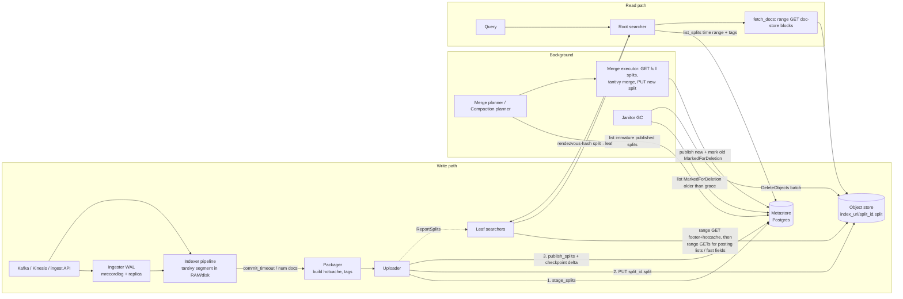

# Quickwit: storage architecture on object storage

> Research note. The code citations refer to `quickwit-oss/quickwit` on the `main` branch, read at commit `5fd12206ee3113b54a656e4cd768785a804722f9` (2026-10-31). All repository paths sit under the `quickwit/` workspace directory. GitHub links use `https://github.com/quickwit-oss/quickwit/blob/main/quickwit/<path>`.
> The workspace version at that commit is `0.9.3` (`quickwit/Cargo.toml`). The last tagged CHANGELOG section is 0.8.0, and everything since is under "Unreleased". tantivy is pinned to a git revision of tantivy `main`.
> **[Source]** marks claims taken from docs, blogs or code. **[Inference]** marks my own reading or extrapolation.

---

## 1. Overview

Quickwit is a distributed search and analytics engine written in Rust, built on the **tantivy** full-text library. It targets append-mostly, timestamped, immutable data: logs, traces (it has native OTLP and Jaeger APIs) and other event data. Object storage (S3, GCS, Azure Blob, or any S3-compatible store) is the **only** system of record for index data. Compute nodes keep no persistent index state. They hold only caches and, for the ingest v2 API, a short-lived replicated WAL. **[Source: architecture docs; Quickwit 101 blog]**

The workload it is built for:

- **Write:** high-throughput, append-only ingestion from Kafka, Kinesis, Pulsar, GCP Pub/Sub, files, or its own ingest API. A source checkpoint stored in the metastore gives exactly-once semantics. Documents become searchable after `commit_timeout_secs` (60 s by default) plus the upload time.
- **Read:** needle-in-haystack full-text search, filtered and sorted top-K, and aggregations (date histograms, terms) over very large historical datasets. The searchers run directly against object storage, with sub-second latency as the goal.
- **Scale references (vendor-reported):** Binance runs about 100 PB of logs (about 20 PB compressed on S3), indexes 1.6 PB/day on 700 indexer pods (about 2,800 vCPU), and searches it all from one 30-pod search cluster (1,200 vCPU, 3 TB RAM). The indexers use about 6 TB of RAM in total. **[Source: Binance blog]**

**Datadog context.** Datadog acquired Quickwit, announced on 2025-01-09. The founders said they would relicense Quickwit and a major tantivy update under Apache 2.0 and focus on "building a new product with Datadog". **[Source: quickwit-joins-datadog blog; Datadog blog]** The current repository bears this out: file headers read `Copyright 2021-Present Datadog, Inc.` and the license is Apache-2.0. Recent work includes:

- a dedicated **compactor service** (`quickwit-compaction`);
- **Lambda offload** of leaf search (`SearcherConfig::lambda`);
- **random S3 key prefixes** for split IDs;
- a **split footer trailer**;
- Postgres tables `metrics_splits` and `sketch_splits` for a Parquet metrics/DDSketch path with "two-tier pruning" (Postgres GIN indexes, then Parquet bloom filters).

Only the schema migrations for that metrics path are in this repository, so I do not cover it further. **[Source: code; Inference: much of this is Datadog-driven hardening for very large scale]**

---

## 2. Architecture outline

### Components (all roles of a single `quickwit` binary)

| Role | Responsibility | State |
|---|---|---|
| **Indexer** | Runs indexing pipelines (source → doc processor → indexer → serializer → packager → uploader → sequencer → publisher). Runs merge pipelines in older deployments. | Scratch dir and a local split cache for not-yet-merged splits. No durable state. |
| **Ingester** (ingest v2) | Accepts pushes, writes them to a local `mrecordlog` WAL, replicates to one follower, and serves shards to indexers. | Local WAL, truncated once splits are published. |
| **Control plane** | Schedules indexing tasks and shards onto nodes. Heartbeat every 3 s; rebuilds the plan every minute. | Stateless (derives from the metastore). |
| **Metastore** | Index config, split catalog (state, time range, tags, footer offsets, …), source checkpoints, shards, delete tasks. | PostgreSQL (clusters), or JSON files on object storage (single writer). |
| **Searcher** | Root (plans, fans out, merges) and leaf (runs per-split search against object storage). | Memory caches and an optional on-disk split cache. |
| **Janitor** | Garbage collection, retention, delete-task execution. | Stateless. |
| **Compactor** (new) | Planner and workers that execute merge tasks, decoupled from indexers. | Stateless. |

Nodes discover each other with **chitchat**, a Scuttlebutt gossip implementation. **[Source: Quickwit 101]**

### Data flow



**Write path.**

1. Documents are accumulated into an in-progress tantivy index.
2. On `commit_timeout_secs` (default 60 s) or `split_num_docs_target` (default 10 M docs), the indexer finalizes the segment. The packager produces a hotcache and collects tags. The uploader then:
   1. stages the split in the metastore;
   2. PUTs one object `{split_id}.split`;
   3. sends a `SplitsUpdate` to the sequencer and publisher.
3. The publisher atomically flips Staged → Published **and** advances the source checkpoint.

**[Source: `quickwit-indexing/src/actors/uploader.rs`; `index_config/mod.rs` defaults]**

**Read path.**

1. The root lists splits from the metastore, pruned by time range and tags.
2. The root assigns splits to leaves with load-aware rendezvous hashing.
3. Each leaf range-GETs the split footer (bundle metadata plus hotcache), opens the tantivy index virtually, then *warms up* exactly the byte ranges the query needs with concurrent range GETs, and runs the query in memory.
4. The root merges partial results and runs a fetch-docs phase.

**Background work.**

- **Merges:** download whole splits, merge with tantivy, upload the new split, and atomically swap them in the metastore.
- **Delete tasks:** rewrite splits through the same merge executor.
- **GC:** deletes objects for splits in `MarkedForDeletion` after a grace period.

---

## 3. Data model & object format

### Index layout in the bucket

- Each index has an `index_uri`. By default it is `{default_index_root_uri}/{index_id}`, where the default root is `{data_dir}/indexes` (`quickwit-config/src/node_config/serialize.rs::default_index_root_uri`). In production it is typically `s3://bucket/prefix/indexes/{index_id}`.
- Each split is **one object**: `{index_uri}/{split_id}.split` (`quickwit-common/src/lib.rs::split_file`, used in `IndexingSplitStore::split_path` and `leaf.rs::open_split_bundle`).
- **Split IDs** are opaque strings, ULIDs by default (26 Crockford base32 chars). With `QW_RANDOM_SPLIT_PREFIX=true`, the ID becomes `<last 4 ULID chars>_<first 22 chars>`. The code says: "This spreads S3 key prefixes across partitions and avoids hot-spots when writes concentrate on the same time window." (`quickwit-proto/src/types/split_id.rs::SplitId::from_ulid`)
- With the **file-backed metastore**, the bucket also holds `manifest.json` (the index_id → status map) and `{index_id}/metastore.json` (all index metadata plus every split's metadata in one JSON document) (`quickwit-metastore/src/metastore/file_backed/{mod.rs,store_operations.rs}`).

### The split file ("bundle")

A split is a complete, self-contained tantivy index (normally a single segment after packaging) concatenated into one object with a footer. `SplitPayloadBuilder::finalize_with_footer_trailer` in `quickwit-storage/src/split.rs` writes:

```
[ tantivy file 1 ][ tantivy file 2 ] ... [ split_fields ][ split_recovery_metadata? ]
[ bundle metadata (JSON: file name -> byte range) ][ u32 LE: bundle metadata len ]
[ hotcache bytes ][ u32 LE: hotcache len ]
[ optional 16-byte trailer: u64 LE footer_start | u32 LE version=1 | b"QWFT" ]   <- QW_ENABLE_SPLIT_FOOTER_TRAILER
```

- The tantivy files are the usual set:
  - **term dictionary** (`.term`, an FST-based SSTable with a block index);
  - **postings** (`.idx`, block-compressed with bitpacked blocks of 128 docs and skip info);
  - **positions** (`.pos`);
  - **fast fields** (`.fast`, a columnar store used for sort, aggregation and range filters);
  - **doc store** (`.store`, row-oriented, zstd-compressed (level 8 by default) in blocks of about 1 MB uncompressed (`docstore_blocksize`), with a skip index; `quickwit-config/src/index_config/mod.rs`, `indexer.rs`);
  - **fieldnorms**;
  - `meta.json`.
- `split_fields` is an encoded list of field names, types and capabilities. It serves the `list_fields` API without opening the index (`quickwit-search/src/list_fields/leaf.rs`). `split_recovery_metadata` (`SPLIT_RECOVERY_METADATA_FILE_NAME`) embeds enough metadata to rebuild metastore rows from the bucket. **[Source: code; Inference on recovery purpose from the name and `split_recovery_tests.rs`]**
- The **footer** is the bundle metadata plus the hotcache. The writer puts them next to each other on purpose: "The hotcache needs to be next to the bundle metadata in order to read both in one continuous read." The footer's byte range (`footer_offsets: Range<u64>`) is stored in `SplitMetadata` in the metastore, so a searcher opens a split with **one ranged GET** and does not need to discover the footer by reading the tail (`quickwit-metastore/src/split_metadata.rs`).
- The optional **trailer** (`bundle_storage.rs::serialize_split_footer_trailer`) is for consumers that do *not* have metastore metadata. `locate_split_footer_range` reads the last 16 bytes, which takes 1 GET for new splits. Legacy splits need up to 2 more GETs, walking back through the hotcache-length and metadata-length fields. `fetch_file_from_split` speculatively reads a 1 MiB tail (`DEFAULT_SPLIT_TAIL_WINDOW_NUM_BYTES`), hoping the wanted file is inside it.

### The hotcache

`quickwit-directories/src/hot_directory.rs::write_hotcache` builds the hotcache at packaging time. It:

1. opens the freshly built index through a `DebugProxyDirectory` that **records every read**;
2. forces the opening of every indexed field's inverted index for every segment;
3. serializes exactly those byte ranges into a `StaticDirectoryCache` (per file: file length plus a sorted list of cached slices).

Slices of 10 MB or more are dropped, except for files ending in `store` or `term` (the doc-store skip index and term-dictionary index are "required for quickwit to work"). At search time, `HotDirectory::open` wraps the remote directory so that every read made while *opening* the index is served from memory. **[Source: code]** According to the blog, the hotcache is "less than 0.1% of the split size, around 10 MB" for a 15 GB / 10 M-doc split. **[Source: Quickwit 101]**

### Metadata (metastore)

`SplitMetadata` (`quickwit-metastore/src/split_metadata.rs`) holds:

- identity and ownership: `split_id`, `index_uid`, `partition_id`, `source_id`, `node_id`;
- `num_docs`, `uncompressed_docs_size_in_bytes`;
- `time_range` (min/max of the timestamp field), `create_timestamp`, `maturity` (mature, or immature until a timestamp);
- `tags`, a set of `field:value` entries for configured tag fields, only when the field has ≤1000 distinct values in the split (`packager.rs::MAX_VALUES_PER_TAG_FIELD`), plus a `field!` marker;
- `footer_offsets`, `delete_opstamp`, `num_merge_ops`, `doc_mapping_uid`.

`SplitState` is one of `Staged | Published | MarkedForDeletion`.

In Postgres (`quickwit-metastore/migrations/postgresql/`), the `splits` table has:

- `split_id`, `split_state`, `time_range_start/end`, `tags TEXT[]`;
- `split_metadata_json`, `index_uid`;
- create/update/publish timestamps, `maturity_timestamp`, `delete_opstamp`, `node_id`;
- the generated column `split_size_bytes = split_metadata_json->'footer_offsets'->>'end'`. The object size is derived from the footer end, so no object HEAD is needed to know split size (migration 25).

The `indexes` table stores `index_metadata_json`, which embeds the per-source **checkpoints**.

---

## 4. How it achieves it

### Write

1. **Indexing pipeline (actor chain).**
   - `DocProcessor` parses and maps JSON, optionally applying a VRL transform.
   - `Indexer` adds documents to a tantivy `IndexWriter` (default `heap_size` 2 GB). It cuts a split when `split_num_docs_target` or `commit_timeout_secs` is reached, and partitions by `partition_key` when one is configured.
   - `IndexSerializer` and `Packager` finalize the segment, compute tags, and write the hotcache.
   - `Uploader` uploads, `Sequencer` keeps publish order, and `Publisher` publishes.

   (`quickwit-indexing/src/actors/*.rs`)
2. **Stage → upload → publish** (`uploader.rs` around lines 296–410):
   - `metastore.stage_splits(...)` inserts rows in the `Staged` state *before* the upload. If the indexer crashes mid-upload, GC can find the orphaned object by listing Staged splits older than 24 h; it never needs to LIST the bucket.
   - `IndexingSplitStore::store_split` does a single `Storage::put` of the `SplitPayload`. The payload is assembled **lazily as a stream** from the on-disk tantivy files plus the in-memory footer (`SplitPayload::range_byte_stream` concatenates per-file `ByteStream`s), so the bundle is never materialized on local disk: "In order to save the cost of an extra write, we store splits in the form of a directory and the split bundles are built upon upload." (`indexing_split_cache.rs`)
   - If the split is **immature**, its directory is *moved* into the local `IndexingSplitCache` so an imminent merge does not have to re-download it.
   - `publish_splits(staged_split_ids, replaced_split_ids, checkpoint_delta)` runs in a single Postgres transaction. It locks the split rows (`FOR UPDATE`), checks expected states, updates `indexes.index_metadata_json` with the new checkpoint, and flips Staged → Published and replaced → MarkedForDeletion (`postgres/metastore.rs`, `PUBLISH_SPLITS_QUERY`). Exactly-once comes from this checkpoint CAS: a checkpoint delta that does not apply cleanly fails with `FailedPrecondition`.
3. **Ordering.** The `Sequencer` publishes splits in production order, so checkpoints have no "holes". Merges bypass it because their publish order does not matter (`uploader.rs` doc comment on `SplitsUpdateMailbox`).
4. **Ingest v2 WAL.** Ingesters persist pushes into `mrecordlog` and replicate to a follower before acknowledging. The timeouts are: ingest 35 s, persist 6 s, replicate 3 s, 5 persist attempts (`quickwit-ingest/src/ingest_v2/ingest.md`). Indexers fetch from shards, and shard positions become part of the checkpoint, which allows the WAL to be truncated after publish. The WAL is the only durable-ish local state, and it is short-lived. **[Source: code; Inference on truncation flow]**

### Read

See section 6 for the caching detail. The core mechanism:

- A tantivy `Directory` implementation (`StorageDirectory`, `quickwit-directories/src/storage_directory.rs`) turns every file read into a `get_slice(path, range)` on a `BundleStorage`, which translates file-relative ranges into split-relative ranges.
- Synchronous reads **panic** by design. Every byte must be fetched beforehand by the async **warmup** phase (`leaf.rs::warmup`). Warmup:
  - resolves the query to the exact terms, term ranges, automatons, fast fields and fieldnorms it needs;
  - issues all the corresponding async range reads concurrently;
  - stores the results in a per-request `ByteRangeCache`;
  - lets tantivy then execute synchronously against memory.

### Manipulation

- **Merge (compaction).**
  - The default policy is `StableLogMergePolicy` (`merge_policy/stable_log_merge_policy.rs`; defaults in `quickwit-config/src/merge_policy_config.rs`): `merge_factor` 10, `max_merge_factor` 12, `min_level_num_docs` 100 k, `maturation_period` 48 h. It targets `split_num_docs_target` 10 M docs. Splits are bucketed into log-scale levels (each level ≥3× the previous), sorted by recency, and merged within a level.
  - A split becomes **mature** and is never merged again once it reaches the target size or exceeds the maturation period.
  - `ConstWriteAmplificationMergePolicy` ("limit_merge") caps the number of merge ops per split instead. Its documentation argues this suits many small tenants, where StableLog would cost a write amplification of about 7 for tiny splits.
  - The merge pipeline runs `MergeSplitDownloader` (full download, or a move out of the local indexing split cache), then `MergeExecutor` (tantivy merge with `IoControls` throttling), then packager → uploader → publisher with `replaced_split_ids`.
  - New code moves this into a separate `quickwit-compaction` service. A `CompactionPlanner` scans immature published splits ordered by `maturity_timestamp` and keeps a priority heap of `MergeOperation`s. `CompactorService` workers run "single-use" pipelines. A comment notes that the indexing split store "is slated for removal once the compactor service lands" (`indexing_split_cache.rs`).
- **Retention.** The janitor's `RetentionPolicyExecutor` marks splits whose `time_range_end` is past the retention period as `MarkedForDeletion`. This is a metadata-only operation; GC later removes the objects.
- **Deletes.** These are delete-by-query tasks with an increasing `opstamp`, stored in a `delete_tasks` table. `DeleteTaskPlanner` finds *mature* splits whose `delete_opstamp` is behind the latest one. It checks each delete query against the split's time range and tags. If none apply, it just bumps `delete_opstamp` in metadata. Otherwise, it sends a single-split `MergeOperation` that rewrites the split without the deleted documents (`quickwit-janitor/src/actors/delete_task_planner.rs`). This is a full copy-on-write rewrite.
- **Updates.** There are none; documents are immutable. Updating means delete plus reinsert.
- **Garbage collection** (`quickwit-index-management/src/garbage_collection.rs::run_garbage_collect`, called every `RUN_INTERVAL = 10 min`):
  1. Staged splits not updated for `STAGED_GRACE_PERIOD = 24 h` are marked for deletion.
  2. `MarkedForDeletion` splits older than `split_deletion_grace_period()` are deleted from storage with `bulk_delete`, then from the metastore, in batches of up to 10,000 (`DELETE_SPLITS_BATCH_SIZE`), paged with a `search_after`-style cursor. An optional `QW_MAX_SPLIT_DELETION_RATE_PER_SEC` throttles deletion by sleeping between batches, which protects the object store and metastore during large retention sweeps. The grace period defaults to 32 min and is clamped to 5 min–48 h via `QW_SPLIT_DELETION_GRACE_PERIOD_SECS`. It exists because "in-flight queries could actually have selected this split, scroll queries may also have a point in time on these splits" (`quickwit-common/src/shared_consts.rs`).

---

## 5. Object storage interaction patterns

### The `Storage` abstraction

`quickwit-storage/src/storage.rs::Storage` is a minimal immutable-blob interface:

```rust
async fn put(&self, path: &Path, payload: Box<dyn PutPayload>) -> StorageResult<()>;
async fn copy_to(&self, path: &Path, output: &mut dyn SendableAsync) -> StorageResult<()>;
async fn get_slice(&self, path: &Path, range: Range<usize>) -> StorageResult<OwnedBytes>;
async fn get_slice_stream(...); async fn get_all(...);
async fn delete(&self, path: &Path) -> StorageResult<()>;
async fn bulk_delete<'a>(&self, paths: &[&'a Path]) -> Result<(), BulkDeleteError>;
fn list(&self, prefix: &Path) -> ListObjectsStream;
async fn exists(...); async fn file_num_bytes(...);
```

There is no append, rename, conditional put or overwrite semantics. Implementations:

- `S3CompatibleObjectStorage` (`object_storage/s3_compatible_storage.rs`, AWS SDK; flavors for MinIO, GCS-via-S3, Garage, DigitalOcean, R2, …);
- `AzureBlobStorage`;
- an OpenDAL-based GCS backend (`opendal_storage/`, `gcs` feature);
- `LocalFileStorage`, `RamStorage`.

Decorators compose on top:

- `PrefixStorage`;
- `StorageWithCache` (memory cache routed by file suffix);
- `TimeoutAndRetryStorage` (latency hedging);
- `CountingStorage` (byte accounting per request);
- `BundleStorage` (a virtual filesystem over one split object);
- `SplitCacheBackingStorage` (local disk split cache);
- a debouncer that collapses concurrent identical requests (`debouncer.rs::AsyncDebouncer`).

### Object sizes

**[Source: config defaults + blog; Inference for ranges]**

- **Fresh splits** are bounded by `commit_timeout_secs` (60 s) and the 10 M-doc target. At moderate ingest rates they are typically tens to hundreds of MB.
- **Mature splits** hold about 10 M docs. The blog's example is about 15 GB for 10 M GitHub events with every field indexed, stored and fast. Log splits are typically a few GB.
- **Footer/hotcache** is about 0.1% of the split, i.e. a few MB.
- **Ranged reads during warmup** are small. Lambda measurements show term-query reads of at most about 65 KB per request, and the largest aggregation read was about 9 MB (a fast-field column). **[Source: Lambda perf blog]**

### PUT and multipart

From `object_storage/policy.rs::MultiPartPolicy::default`:

```rust
target_part_num_bytes: ByteSize::gib(5),     // "each part is charged as a put request"
multipart_threshold_num_bytes: ByteSize::mib(128),
max_num_parts: 10_000,
max_object_num_bytes: ByteSize::tb(5),
max_concurrent_uploads: 100,
```

`put()` uses a single-part PUT when `part_num_bytes(len) >= len`. Because `part_num_bytes` returns `max(ceil(len/10_000), 5 GiB)` above the threshold, **every object under 5 GiB is uploaded with a single PUT**. Multipart starts only for objects larger than 5 GiB, with parts of 5 GiB uploaded concurrently (up to 100 at a time). Failed multipart uploads are aborted. Content-MD5 or a configurable checksum is sent per part. `disable_multipart_upload` exists for stores that do not support multipart. **[Source: code; Inference: the 128 MiB threshold is effectively dominated by the 5 GiB target; the design minimizes PUT request count over upload parallelism.]**

**Request count per new split:** 1 PUT (or about ⌈size/5 GiB⌉+2 for huge merges) plus 2 metastore transactions (stage, publish). There are no object-store writes for metadata, no manifests and no LIST.

### GET patterns (search)

**Open a split:** a footer-cache hit costs 0 GETs. A miss costs **1 ranged GET** `bytes=footer_start-footer_end`, using the offsets from the metastore (`leaf.rs::get_split_footer_from_cache_or_fetch`). The result goes into the `split_footer_cache` (default 500 MB LRU).

**Warmup:** N concurrent ranged GETs, roughly:

- for each query term: term-dictionary block(s), unless they are already in the hotcache, then the posting-list range (plus the positions range for phrase queries);
- for each needed fast-field column: its range (cached in the 1 GB `.fast` cache);
- fieldnorms, if scoring is needed.

Tantivy's directory reads are mapped 1:1 to ranged GETs. The design does not coalesce them across files but deduplicates identical in-flight requests. The vendor's Loki benchmark measured **88–255 GET requests per query** across a 53 GiB, 25-split index, against 47–204,622 for Loki. **[Source: Loki benchmark blog]**

**Fetch docs:** for each hit, a ranged GET for the compressed doc-store block that contains it (a block holds about 1 MB of uncompressed documents by default, so a hit costs one GET of a few hundred KB, and hits in the same block share it). The block index is in the hotcache.

**Merges:** a full-object GET (`copy_to` streams into a local file through `IoControls`), unless the split is still in the local `IndexingSplitCache`.

**Searcher split cache:** a background full-object GET of whole splits to local disk (see section 6).

**Range-header format:** `bytes={start}-{end-1}` (`s3_compatible_storage.rs::get_object`). Response checksum validation is disabled because "We mostly do range request anyway."

### LIST, HEAD, DELETE

- **LIST** is not used on any hot path. The metastore is the catalog. `list()` exists for tooling and recovery, and `check_connectivity` does `list_objects_v2 max_keys=1`.
- **HEAD** (`file_num_bytes`) is used only when footer offsets are unknown (`BundleStorage::open_from_storage`).
- **DELETE** goes through `bulk_delete`, which uses S3 `DeleteObjects` with up to 1,000 keys per request (`build_delete_batch_requests`, `MAX_NUM_KEYS = 1_000`). It falls back to one `DeleteObject` per key when `disable_multi_object_delete` is set (for stores lacking multi-delete). `NoSuchKey` counts as success, so deletes are idempotent.

### Immutability and consistency assumptions

- Split objects are written once and never modified. Keys are never reused, because each split ID is a fresh ULID. As a result, Quickwit needs neither strong read-after-overwrite nor list consistency, only read-after-write for new keys, which S3 provides. The stage-before-upload ordering, together with the 24 h staged grace period, tolerates crashes between PUT and publish.
- **All mutability lives in the metastore.** Split visibility, replacement after a merge, retention marks and checkpoints are Postgres transactions. Physical deletion is deferred, which gives readers a lease-free snapshot isolation window of 32 min by default.
- The **file-backed metastore** stores mutable JSON *on* object storage, but it is explicitly restricted to a single writer: "testing; single-node environment; multiple-nodes environment with only one writer and readers" (`file_backed/mod.rs`). Reader nodes poll for changes, and the polling interval is configurable.

### Concurrency control and cost

- A process-wide `REQUEST_SEMAPHORE` caps concurrent S3 requests (`QW_S3_MAX_CONCURRENCY`, default 10,000), because "Some object stores (R2, SeaweedFs...) return errors when too many concurrent requests are emitted."
- SDK calls are retried with `RetryParams::aggressive()`: 250 ms base delay, 20 s max, 5 attempts.
- Cost model **[Inference from the above]**: writes cost about 1 PUT per split plus about 1 PUT per merge output. With merge factor 10 and a log-scale policy, each document is rewritten roughly log₁₀(10 M / docs per fresh split) times, typically 2–4×. Reads cost O(#splits × (1 + terms × 1–3)) GETs per query, which pushes design toward fewer, larger splits and strong time and tag pruning. In the Loki benchmark, the vendor priced 145 k GETs at about $0.06 at $0.0004 per 1,000.

---

## 6. Performance

### Cache hierarchy on a searcher

Defaults come from `quickwit-config/src/node_config/mod.rs::SearcherConfig::default`.

| Layer | Default | What / where |
|---|---|---|
| Partial request (leaf result) cache | 64 MB | Caches leaf responses per split and request. Repeated dashboard queries do zero I/O (`leaf_cache.rs`). |
| Predicate cache | 256 MB | Caches filter results. Term-absence pruning records "required term proven absent" per (split, term) so later queries skip the split *before* warmup (`leaf.rs::term_absence_cache_key`). |
| Split footer cache | 500 MB | Footer plus hotcache per split; removes 1 GET per split per query. |
| Fast field cache | 1 GB | `QuickwitCache` routes paths ending in `.fast` to a `SimpleCache` (`cache/quickwit_cache.rs`). |
| Per-request `ByteRangeCache` | unbounded, per split search | Holds everything warmup fetched. Freed after the search. |
| On-disk split cache (opt-in) | `max_num_bytes`, `max_num_splits` (10,000), `num_concurrent_downloads` (1), `max_file_descriptors` | Whole `.split` files on local SSD (`quickwit-storage/src/split_cache/`). |

Cache eviction policies are configurable: `Lru`, `S3Fifo` or `TinyLfu` (`CachePolicy`).

**The split cache is pre-warmed via affinity.** When an uploader stages splits, it publishes a `ReportSplitsRequest`. The `SearchJobPlacer` subscribes, computes `node_affinity(node_id, split_id)` with rendezvous hashing, and forwards the report to the searcher that will most likely be assigned that split (`search_job_placer.rs` `handle_event`). That searcher's `SplitTable` registers the split as a download *candidate*. A background task downloads candidates and evicts by last access time. A newly reported split gets an artificial last-access time of `now - NEWLY_REPORT_SPLIT_LAST_TIME`, so it does not evict hotter splits (`split_table.rs::NEWLY_REPORTED_SPLIT_LAST_TIME`, 10 min). `SplitCacheBackingStorage` serves `get_slice` from a local file descriptor (through `FileDescriptorCache`) when the split is present. Otherwise it falls through to S3 and "touches" the split, raising its download priority.

### Pruning and skipping

1. **Metastore pruning.** `list_relevant_splits` filters by `time_range` overlap and tag filters. The tags come from the query AST via `extract_tags_from_query`. Splits whose tag set proves a tag value absent are skipped, and when a split has more than 1,000 distinct values for a field, the split is conservatively not prunable. The root also tightens `start/end_timestamp` from the query AST (`root.rs::refine_and_list_matches`).
2. **Count-only and `match_all` queries** can be answered from `num_docs` in metadata without opening splits (`leaf.rs::is_simple_all_query`, `get_leaf_resp_from_count`).
3. **Timestamp range normalization** per split avoids range filters that cover the whole split (`normalize_timestamp_range`).
4. **Term-absence short-circuit** before warmup (above).
5. **Inside a split**, tantivy's term dictionary, block-max WAND for top-K, and columnar fast fields keep the number of fetched bytes proportional to what the query touches.

### Parallelism, batching, admission control

- Root fan-out is **load-aware rendezvous hashing**. The placer queries each searcher's current load with a short timeout. It computes a target load (total cost × 1.05, iteratively excluding overloaded nodes) and assigns jobs (splits) in cost order to the highest-affinity node below target (`search_job_placer.rs::assign_jobs_inner`). This keeps cache locality while bounding skew.
- On the leaf, `SearchPermitProvider` gates split searches. It orders requests by priority, then by estimated cost. Each permit reserves a **warmup slot** (bounding concurrent downloads) and a pessimistic memory allocation (`warmup_single_split_initial_allocation` 300 MB against a `warmup_memory_budget` of 100 GB), and adjusts after warmup to the actual `ByteRangeCache` size. `max_num_concurrent_split_searches` defaults to 100.
- **Lambda offload.** When pending split searches exceed `offload_threshold`, splits are batched with greedy LPT by doc count (`leaf.rs::greedy_batch_split`) and sent to AWS Lambda invocations (`run_offloaded_search_tasks`). Leaf compute becomes elastic, while the cache-heavy root and searcher stay fixed.
- **Latency hedging.** `StorageTimeoutPolicy` retries a `get_slice` when it exceeds `timeout_millis + num_bytes / min_throughput_bytes_per_secs`, following AWS guidance for latency-sensitive S3 access (`timeout_and_retry_storage.rs`).
- **Indexing uploads** run concurrently, bounded by a semaphore (`max_concurrent_split_uploads`). Merges are throttled by `IoControls` write limits.

### Benchmarks cited by sources

- Opening a split on S3 takes "60ms" thanks to the hotcache. **[architecture docs]** (The same page still describes a split as "identified by a UUID". The code has used ULIDs for years, so the docs are out of date on this point.)
- Lambda leaf search on 20 M HDFS logs (1.3 GB, 8 splits):
  - term query under 1 s cold or warm;
  - S3 GETs of up to 65 KB at 15 ms to a few hundred ms (p90 about 165 ms on a 1 GB Lambda);
  - aggregations about 700 ms with footer and fast-field caches, under 100 ms with the partial-request cache;
  - Lambda network throughput about 80 MB/s.

  **[Lambda perf blog]**
- Against Loki on GCS (212 GB raw, 243 M logs): Quickwit used 25 objects / 53 GiB against Loki's 145,756 objects / 55 GiB. Queries took 0.4–2.1 s against 1–565 s, with 88–255 GETs against up to about 205 k. Indexing CPU was about 80% higher than Loki's. **[Loki benchmark blog]**
- Binance: about 6.6 MB/s/vCPU indexing on average, and 11 MB/s/vCPU on a high-throughput topic. Five searchers with 8 vCPU and 6 GB each can find a needle in 400 TB. **[Binance blog]**

**Latency vs cost.** The architecture spends CPU and RAM (hotcache, caches, warmup memory) to avoid object-store round trips, and uses many small parallel range GETs rather than full downloads. This is cheap in bytes but not in request count, so pruning and split size matter most.

---

## 7. Scaling

- **Write scaling.** Indexing pipelines are independent per (index, source, shard or partition). The control plane spreads them across indexers. Ingest v2 shards scale the push API, with about 5 MiB/s throughput per shard (`DEFAULT_SHARD_THROUGHPUT_LIMIT`). Object storage absorbs writes horizontally. Random split-ID prefixes remove S3 per-prefix hot spots when many splits land in the same time window. Binance reached 1.6 PB/day on 10 indexing clusters.
- **Read scaling.** Searchers are stateless. "Adding or removing nodes takes seconds and requires no data movement." **[architecture docs]** Rendezvous hashing means a membership change remaps only about 1/N of the splits, preserving cache warmth. Lambda offload absorbs bursts. Read cost grows with the number of *candidate* splits after pruning, not with total data size.
- **Metadata scaling.** One Postgres row per split. Merging to about 10 M docs per split keeps the row count manageable (Quickwit 101: "one PostgreSQL row per 10M documents"). Root planning is a single indexed `list_splits` query (the indexes on `(index_uid, split_state)`, the time range and tags were added by migrations 16–17 and 25). There is optional **metastore read-replica routing** for searchers (`use_metastore_read_replica`). At Binance scale, metadata from many indexing clusters was replicated into one Postgres instance for a unified search cluster. The file-backed metastore does not scale beyond a single writer.
- **Compaction scaling.** It used to be colocated with indexers, where it relied on the local split cache to avoid re-downloads. It is now moving to a separate, horizontally scalable compactor pool with a central planner: priority queue, task assignment, draining for decommission. Merges are bounded by the maturity rule, so each split is merged a bounded number of times and then never again.
- **Multi-tenancy.** It works through partitioning (`partition_key` and `partition_id`, so splits from different partitions are kept apart and preferably not merged together), tag-based pruning (`tag_fields`), many indexes with index-ID patterns in queries, and the `ConstWriteAmplification` merge policy for many small tenants.
- **Known limits and pain points.**
  - Gossip instability with hundreds of pods, and uneven indexing distribution. **[Binance blog]**
  - Heavy queries over many splits generate sustained S3 read load. **[GitHub issue #6210, from search results]**
  - Cold-split first-query latency.
  - Delete-by-query is a full split rewrite and runs only on mature splits.
  - Metastore row count, and the `list_splits` result size for wide time ranges, become the planning bottleneck. `max_splits_per_search` exists as a guardrail.

---

## 8. Trade-offs & lessons

1. **One object per immutable split, with the catalog in a real database.** Quickwit never needs LIST, rename, or conditional writes on the object store. Postgres transactions give atomic publish, merge swaps and checkpoint CAS (exactly-once). This is the most reusable pattern: *object store for bytes, an OLTP store for the manifest*.
2. **Stage before upload, delete after a grace period.** Two-phase visibility (Staged → Published → MarkedForDeletion → deleted) makes crashes safe and gives in-flight readers a snapshot window without leases or reference counting.
3. **Store the footer offsets in the catalog.** Opening a remote file costs exactly one ranged GET, instead of the usual "read tail → read length → read footer" chain. The new 16-byte trailer keeps the file self-describing for catalog-less consumers.
4. **Record-and-replay hotcache.** Rather than hand-picking which index structures to cache, the packager *records* the reads made while opening the index and persists those bytes. The approach is generic to any library with a VFS abstraction.
5. **Async warmup, then synchronous execution.** Adapting a synchronous, mmap-oriented library (tantivy) to high-latency storage by pre-computing the read set and fetching it concurrently avoids rewriting the query engine to be async. The cost is some over-fetching and per-query memory, managed with permits and memory budgets.
6. **Minimize request count.** A single PUT up to 5 GiB, `DeleteObjects` in batches of 1,000, request dedup, and caching keyed by split ID (immutable, so never invalidated) all reduce request count. Splits are self-contained tantivy indexes, so merges are CPU-heavy and require full download plus re-upload (write amplification about log(target / fresh size)).
7. **Affinity plus load-aware placement.** Rendezvous hashing with a 5% load slack gives cache locality without static shard ownership. Pushing "new split" notifications to the future owner lets the disk cache warm proactively.
8. **Separate compaction from ingestion.** The move to a dedicated compactor service shows that colocated merges, though cache-friendly, become a scaling and operational bottleneck at very large scale.
9. **What it does not do.**
   - No per-row updates.
   - No columnar file formats such as Parquet for logs (the new metrics path suggests Parquet is being adopted for metrics).
   - No coalescing of adjacent ranged reads across tantivy files.
   - Request-count-bound costs on wide queries.
   - The file-backed metastore is single-writer only.

---

## 9. Sources

**Blogs and docs**
- Quickwit 101 – Architecture of a distributed search engine on object storage: https://quickwit.io/blog/quickwit-101
- Architecture overview (docs): https://quickwit.io/docs/overview/architecture
- Node configuration (searcher caches, split cache): https://quickwit.io/docs/configuration/node-config
- Quickwit Lambda search performance: https://quickwit.io/blog/quickwit-lambda-search-performance
- Benchmarking Quickwit vs Loki: https://quickwit.io/blog/benchmarking-quickwit-loki
- How Binance built a 100PB log service with Quickwit: https://quickwit.io/blog/quickwit-binance-story
- Quickwit joins Datadog: https://quickwit.io/blog/quickwit-joins-datadog
- Datadog acquires Quickwit: https://www.datadoghq.com/blog/datadog-acquires-quickwit/
- GitHub issue on heavy S3 reads (seen via search): https://github.com/quickwit-oss/quickwit/issues/6210

**Code** (https://github.com/quickwit-oss/quickwit/blob/main/quickwit/…)
- `quickwit-storage/src/storage.rs`: `Storage` trait
- `quickwit-storage/src/object_storage/s3_compatible_storage.rs`: PUT, multipart, ranged GET, `DeleteObjects`, `REQUEST_SEMAPHORE`
- `quickwit-storage/src/object_storage/policy.rs`: `MultiPartPolicy`
- `quickwit-storage/src/split.rs`: `SplitPayloadBuilder`, footer layout, streamed payload
- `quickwit-storage/src/bundle_storage.rs`: `BundleStorage`, footer trailer, `locate_split_footer_range`
- `quickwit-storage/src/split_cache/{mod.rs,split_table.rs,download_task.rs}`: searcher disk split cache
- `quickwit-storage/src/cache/{quickwit_cache.rs,byte_range_cache.rs,storage_with_cache.rs}`
- `quickwit-storage/src/timeout_and_retry_storage.rs`, `quickwit-storage/src/debouncer.rs`
- `quickwit-directories/src/hot_directory.rs`: `HotDirectory`, `write_hotcache`
- `quickwit-directories/src/storage_directory.rs`, `quickwit-directories/src/caching_directory.rs`
- `quickwit-indexing/src/actors/uploader.rs`: stage → upload → publish
- `quickwit-indexing/src/actors/packager.rs`: hotcache, tags
- `quickwit-indexing/src/actors/merge_split_downloader.rs`
- `quickwit-indexing/src/split_store/{indexing_split_store.rs,indexing_split_cache.rs}`
- `quickwit-indexing/src/merge_policy/{stable_log_merge_policy.rs,const_write_amplification.rs}`
- `quickwit-config/src/merge_policy_config.rs`, `quickwit-config/src/index_config/mod.rs`, `quickwit-config/src/node_config/{mod.rs,serialize.rs}`
- `quickwit-compaction/src/{lib.rs,compactor_service.rs,compaction_pipeline.rs,planner/compaction_planner.rs}`
- `quickwit-search/src/leaf.rs`: footer fetch, warmup, permits, Lambda offload
- `quickwit-search/src/root.rs`: planning, `refine_and_list_matches`
- `quickwit-search/src/search_job_placer.rs`: rendezvous plus load-aware placement, `ReportSplits` routing
- `quickwit-search/src/search_permit_provider.rs`
- `quickwit-metastore/src/split_metadata.rs`: `SplitMetadata`, `SplitState`
- `quickwit-metastore/src/metastore/postgres/metastore.rs`: `PUBLISH_SPLITS_QUERY`
- `quickwit-metastore/src/metastore/file_backed/mod.rs`: single-writer JSON metastore
- `quickwit-metastore/migrations/postgresql/*.sql`: `splits`, `metrics_splits`, `sketch_splits`
- `quickwit-index-management/src/garbage_collection.rs`, `quickwit-janitor/src/actors/{garbage_collector.rs,delete_task_planner.rs}`
- `quickwit-common/src/shared_consts.rs`: deletion grace period, file names
- `quickwit-proto/src/types/split_id.rs`: random-prefix split IDs
- `quickwit-ingest/src/ingest_v2/ingest.md`: WAL replication timeouts

---

## Review notes

Reviewed on 2026-10-31 against the clone at commit `5fd12206` and the primary blog and docs pages.

**Verified against code, all correct as written:**
- `MultiPartPolicy` defaults and the logic in `part_num_bytes`. Objects under 5 GiB do go up in a single PUT.
- `MAX_NUM_KEYS = 1_000` for `DeleteObjects`, and `QW_S3_MAX_CONCURRENCY` defaults to 10,000.
- The range header is `bytes={start}-{end-1}`. The comment that disables response checksums is quoted correctly.
- `RetryParams::aggressive` is 250 ms / 20 s / 5 attempts.
- GC uses `RUN_INTERVAL` 10 min and `STAGED_GRACE_PERIOD` 24 h. The deletion grace period defaults to 32 min and is clamped to 5 min–48 h.
- The `QW_RANDOM_SPLIT_PREFIX` layout is right.
- The footer trailer is right: `QWFT` magic, 1 MiB tail window, opt-in through `QW_ENABLE_SPLIT_FOOTER_TRAILER`.
- The hotcache keeps any slice under 10 MB, plus slices of any size from files ending in `store` or `term`.
- `SearcherConfig` defaults are right: cache sizes, 100 concurrent split searches, warmup budget of 100 GB / 300 MB.
- `StableLogMergePolicy` defaults are right: 10 / 12 / 100 k / 48 h.
- Indexing defaults are right: 60 s commit timeout, 10 M doc target, 2 GB heap.
- `MAX_VALUES_PER_TAG_FIELD` is 1000.
- `DEFAULT_SHARD_THROUGHPUT_LIMIT` is 5 MiB.
- The ingest v2 timeouts are right.
- Migration 25 is right: `split_size_bytes` is a generated column. The metrics and sketch split tables are migrations 26 and 28.
- Every code path listed under Sources exists at this commit.

**Verified against blogs and docs:**
- Binance figures: 100 PB / 20 PB, 1.6 PB/day, 700 pods, about 2,800 vCPU, 10 clusters, a 30-pod search cluster, 6.6 and 11 MB/s/vCPU, and the 5 × 8 vCPU searchers over 400 TB.
- Loki benchmark figures: 25 vs 145,756 objects, 0.4–2.1 s vs 0.98–565 s, 88–255 GETs, about 80% more CPU.
- The "60ms" split-open figure and the "takes seconds, no data movement" claim from the architecture docs.

**Corrections and additions:**
- Fixed the constant name to `NEWLY_REPORTED_SPLIT_LAST_TIME` and added its value (10 min).
- Added the doc-store format (zstd level 8, blocks of about 1 MB) and what it means for the size of fetch-docs GETs.
- Added the GC paging cursor and the optional `QW_MAX_SPLIT_DELETION_RATE_PER_SEC` throttle.
- Added the repository version context (0.9.3 workspace, tantivy pinned to `main`) and noted that the architecture docs' "UUID" wording is stale.
- Added Binance indexer RAM (about 6 TB).

**Not independently verified:** the Lambda performance blog figures, and GitHub issue #6210 (cited from search results). No Parquet metrics engine crate exists in this repository; only the migrations do, as the document already says.

