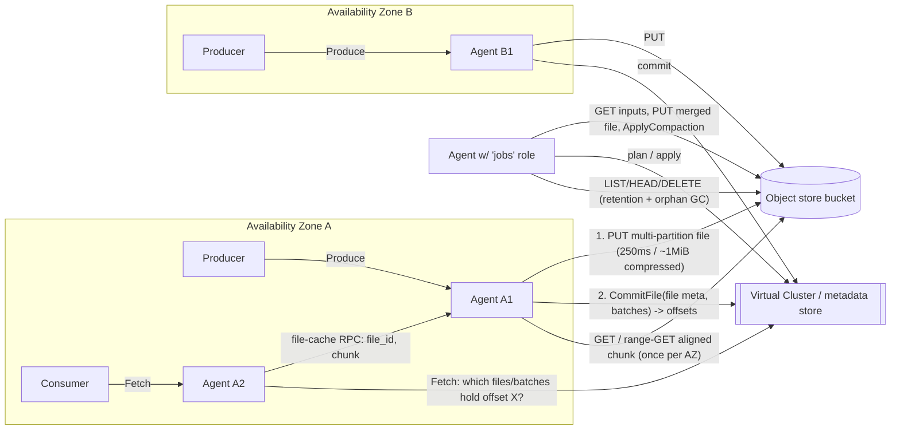

# WarpStream: Object-Storage-Native ("Diskless") Kafka

> Research note on how WarpStream stores, retrieves and manipulates data in object storage (S3 / GCS / Azure Blob) as its only durable data tier.
>
> **About the sources.** WarpStream is closed source. The company was founded by Richard Artoul and Ryan Worl, and Confluent acquired it in 2024. No storage-engine code is public. The `warpstreamlabs` GitHub org publishes Helm charts, Terraform modules and a fork of Bento, but nothing from the agent's storage path. So this note relies on the WarpStream engineering blog, the official docs (including the full GitBook corpus at `docs.warpstream.com/warpstream/llms-full.txt`) and the agent change log.
>
> Claims are marked as follows:
> - **[Stated]**: a WarpStream primary source says it.
> - **[Inferred]**: my own deduction from stated facts.
> - **[3rd-party]**: from a non-WarpStream source.
>
> Numbers are vendor-reported unless noted otherwise.

---

## 1. Overview

WarpStream is a drop-in replacement for Apache Kafka that speaks the Kafka wire protocol. It has **no local disks and no broker-to-broker replication**. All record data lives in object storage. All ordering and offset metadata lives in a remote, strongly consistent metadata service called the *Virtual Cluster*, which runs in WarpStream's control plane. **[Stated]**

The founding argument comes from "Kafka is dead, long live Kafka" and "Minimizing S3 API Costs with Distributed mmap". In the cloud, Kafka's cost is dominated by **inter-AZ networking**, not compute. The cost comes from producer-to-leader traffic plus leader-to-follower replication. AWS charges $0.01/GiB egress in the source AZ plus $0.01/GiB ingress in the destination AZ, so $0.02 per GiB per AZ crossing. WarpStream's best-case total is about $0.053 for every GiB streamed through a 3-AZ Kafka cluster. That compares with about $0.0214/GiB-month to *store* the same data in S3. S3 replicates across AZs internally and charges nothing for in-region transfer. So pushing replication into the object store removes the dominant cost line and removes broker state at the same time. **[Stated]**

**Target workloads [Stated]:**
- High-throughput, latency-tolerant streaming. Examples are logging and observability pipelines (Grafana Labs, Robinhood, ShareChat), CDC/analytics, and blockchain indexing (Goldsky, about 3.7 PiB and 41k+ partitions).
- The original design point was produce P99 of about 400 ms and end-to-end (E2E) P99 of about 1 s.
- Later tiers bring produce latency down to about 33 ms median. These use S3 Express One Zone, reduced batch timeouts and asynchronous commit ("Lightning Topics").

**Deployment model ("BYOC") [Stated]:**
- The *data plane* is a pool of stateless Go binaries ("Agents") that run in the customer's VPC and write to the customer's bucket.
- The *control plane* holds metadata: topic names, file metadata, offsets, timestamps, consumer groups and producer IDs. It never holds record keys or values.

---

## 2. Architecture outline

### Components

| Component | Where | Role |
|---|---|---|
| **Agent** | Customer VPC, stateless | Speaks Kafka. Buffers produce requests, writes files, commits metadata, serves fetches, takes part in a per-AZ distributed file cache, and runs background "jobs" (compaction, retention, GC scanning, Orbit, Tableflow). Any Agent can act as "leader" for any partition. **[Stated]** |
| **Virtual Cluster (metadata store)** | WarpStream cloud | A replicated state machine that maps object-store files and batches to offset ranges per topic-partition. It assigns offsets at commit time, holds consumer-group state and idempotent-producer state, and handles transactions. Every operation is journaled to "our strongly-consistent log storage system" before it executes. It is backed up to object storage, and replicas are rebuilt from backup plus log replay. WarpStream built it themselves rather than using an off-the-shelf store. **[Stated]** |
| **Control plane scheduler** | WarpStream cloud | Decides which Agents run compaction, which take part in the file cache, which scan the bucket for expired or orphaned files, and which replay Lightning/Ripcord journals. **[Stated]** |
| **Service discovery** | WarpStream cloud + custom DNS | Agents heartbeat their AZ, address and load. `Metadata` responses are synthesized so that clients see Agents in their own AZ as partition leaders. **[Stated]** |
| **Object storage** | Customer account | The only durable home for record data. Optional tiers: S3 Express One Zone, Azure Premium Blob, GCS Rapid buckets, DynamoDB or Spanner act as a low-latency *ingestion* tier, with compaction moving data into a standard *compaction* bucket. **[Stated]** |

### Data flow

**Write path [Stated]** (from "Life of a Request", the write-path docs and the "Art of being Lazy" post):
1. The client calls `Metadata`. Service discovery returns an Agent **in the client's AZ** as leader. The AZ is encoded in the client ID (`warpstream_az=...`). The default partition-assignment strategy, `consistent_random_jump`, makes most produce traffic for a given partition land on the same Agent.
2. The Agent appends incoming batches from **many clients and many topic-partitions** into an in-memory "Active Buffer".
3. The buffer is flushed when the **batch timeout** fires or when the size limit is hit. The timeout defaults to 250 ms and can go as low as 25 ms, a floor lowered from 50 ms in v648 once S3EOZ got cheaper. The agent flag table still says "minimum is 50ms". Since agent v750 the limit is about 1 MiB *compressed* (`-batchMaxCompressedSizeBytes`) with a 64 MiB uncompressed backstop. Before that it was a 4 MiB, and at one point 8 MiB, uncompressed limit. The flushed buffer is serialized into WarpStream's own file format, recompressed (zstd by default) and handed to a flush queue.
4. **One PUT** writes the file to object storage. With a multi-bucket ingestion tier, the PUT goes to N buckets and needs a quorum to succeed.
5. The Agent sends the file's metadata (file ID, bucket, sizes, and the list of per-partition batches with record counts and timestamps) to the Virtual Cluster. The VC **sequences** the batches, assigns offsets, applies idempotency de-duplication, and journals the result.
6. Only after step 5 does the Agent fan out acknowledgements carrying the offsets. Durability is equivalent to `acks=all`.

**Read path [Stated]:**
1. The consumer's `Fetch` arrives at an AZ-local Agent.
2. The Agent asks the VC for "the set of files and batches containing offset ≥ X", which comes back as an ordered list of `(file, batch)` pointers.
3. For each pointer, the Agent routes a sub-request to the Agent that owns that `(file_id, extent)` on the **per-AZ consistent-hash ring**.
4. The owner serves the data from memory, or pages in an aligned chunk from object storage, de-duplicating concurrent misses.
5. The bytes are decoded from WarpStream's format, re-encoded as Kafka record batches (lz4 by default) and returned.

**Background work [Stated]:**
- **Compaction.** An LSM-style merge (L0 → L1 → … L4) that rewrites small multi-partition ingestion files into larger files with better per-partition locality. It also moves data from an ingestion bucket to a compaction bucket, drops retroactively tombstoned batches, and de-duplicates keys for compacted topics.
- **Retention and GC.** Agents delete files whose data has fully expired, delete compaction inputs after a delay, and run a reconciliation scanner that LISTs the bucket to find orphans.
- **Journal replay.** Agents replay Lightning/Ripcord journals.

---

## 3. Data model & on-disk/object format

### Logical model
- **Record → batch → file.** A *batch* is "a group of records that all belong to the same topic-partition". It is the smallest unit for which the control plane assigns offsets. **[Stated]**
- A *file* (also called a "segment file" in the docs and metrics, e.g. `agent_segment_batcher_*`) holds batches for **many topics and partitions**. Inside an ingestion file, batches are **sorted by topic, then by partition**. **[Stated]**
- **Files are immutable.** The VC holds the "mutable view": which batches in which files are live, and in what logical order. Two files flushed in one order may be sequenced in the other. The read docs give an example where offsets 306–1306 resolve to batch X in file 900 followed by batch Y in file 806. **[Stated]**

### File format
WarpStream uses its own format, **not Kafka's record-batch format on disk**. Producer batches are decompressed and re-encoded into the WarpStream format. Storage compression is set per Agent (`-storageCompression`, zstd by default since v671, previously lz4). Fetch responses are re-encoded and compressed separately (`-kafkaFetchCompression`, lz4 by default). **[Stated]**

The public sources give little detail on internals:
- **[Stated]** A file has a **metadata section** that can be read on its own. During journal replay, an Agent "downloads each file's metadata section" to rebuild the commit request.
- **[Inferred]** The metadata section is most likely a footer or header index of `(topic, partition, batch offset-in-file, length, record count, min/max timestamp)` entries. That is exactly what `CommitFile` needs, and per-batch byte ranges are what make range-reads of single partitions possible. The same index is also sent to the VC at commit, so normal reads never fetch it from S3. The VC already returns per-batch pointers.
- **[Inferred]** Batches are laid out contiguously and sorted by topic/partition. That ordering means a range read for one partition is one contiguous byte range per file.
- **[Stated]** Compacted and non-compacted topics (`cleanup.policy=compact` vs `delete`) are stored in **separate files**, so a topic cannot switch policy.

### Metadata (kept out of the object store)
The VC tracks the following **[Stated]**, from the security docs:
- file metadata: bucket name, compressed and uncompressed size
- per-batch placement and logical order
- record timestamps and offsets (never keys or values)
- topic config
- consumer-group offsets
- producer IDs, epochs and sequence numbers, with the last 5 committed sequence IDs per `<producer_id, partition>`
- Agent membership, AZ, vCPU and load

Metadata volume scales roughly with *partitions × retention* and with **batches/s**. This is the main scaling constraint (§7). **[Stated]**

### Object key layout
WarpStream does not document the full key schema. The sources say this much:
- **[Stated]** All data lives under a `warpstream/` directory, optionally beneath a user prefix: `s3://bucket?region=…&prefix=my_prefix/`. Manually deleting anything there "will effectively brick a virtual cluster".
- **[Stated]** Files are identified by a **file ID** and have a creation timestamp. The GC scanner compares listed file IDs against the VC, and the cache ring hashes on file ID.
- **[Stated]** Lightning/Ripcord journal files are written into a **"sequence"**. A sequence is a folder of about 1,000 consecutive files from one Agent, rotated when it grows too large or stays open too long. Recovery LISTs open sequences.
- **[Stated]** The GC scanner "spreads LIST and HEAD requests evenly across prefixes" because rate limits are tied to key ranges and prefixes.
- **[Stated]** Keys are derived from the file ID. A "range file ID allocator" became the default in v853 (opt-in since v814, `WARPSTREAM_USE_RANGE_FILE_ID_ALLOCATOR`). It hands out IDs from "several discontiguous reserved ranges to spread object-storage key prefixes more evenly" and so cut S3 `503 SlowDown` in clusters that write many files per second. The change log says "the key layout is unchanged". This means the object key prefix depends on the ID value, and before this change sequential IDs concentrated writes on few prefixes.
- **[Stated]** Striped buckets place an object by hashing its key across 2–32 sub-buckets.

### Low-latency tiers on non-blob stores
- **[Stated]** DynamoDB and Spanner can serve as the ingestion "bucket". Each uses two tables (`warpstream_files`, `warpstream_chunks`).
- **[Inferred]** The files table probably stores file headers and the chunks table the payload split to fit item-size limits. This suggests the storage layer sits behind a generic blob interface (`PutBytes`, `Get`, `List`, `Delete`), consistent with the change-log mention of multi-bucket `PutBytes`.

---

## 4. How it achieves it

### 4.1 Writes: decoupling data flush from ordering
- **Leaderless writes [Stated].** Any Agent can append to any partition. Order is fixed when the batch **commits** to the VC, not when it is written. Many Agents can write one partition in parallel, and an Agent failure needs no leader election. The client retries on another Agent.
- **Batching across partitions [Stated].** One file per Agent per flush interval, rather than one per partition. At 1,024 partitions, a file per partition every 250 ms would mean about 4,096 PUT/s and about $50/month in PUTs *per partition*. The architecture page's figure for 100 ms flushes is about $130/month per partition.
- **Merging batches [Stated].** With idempotency disabled, the Agent merges batches from *different producers* for the same partition into one batch before flushing. This cuts the number of batches the control plane must sequence. With idempotency enabled it cannot merge, because a duplicate might be mixed in with valid data.
- **Idempotency via retroactive tombstones [Stated].** The Agent can't pre-check sequence numbers because it isn't a leader, and a lock-plus-round-trip would cost latency and availability. So it flushes first. At commit, the VC checks each batch's `(producer_id, partition, seq)` against the last five committed and **drops duplicates from the metadata only**. The bytes stay in the immutable file as dead data. Reads never see them because the VC never returns them. Compaction plans list the valid batches per input file and discard everything else.
- **Transactions [Stated, in feature-support docs].** Transactions are supported and handled by the control plane. No design write-up was found on how markers are stored. The 2026 change logs mention "aborted transaction offload jobs" that upload and commit an "offloaded file", and compacted-topic compaction categorizes each record as committed or aborted. **[Inferred]** Transaction state, such as aborted ranges, is periodically moved out of the VC into object-storage files, and compaction uses it to drop aborted records.
- **Speculative (hedged) uploads [Stated].** File flushes use speculative retries, which "dramatically reduce outlier latency for Produce". Fetch-path reads got the same later, with hedges capped at 2% of requests to limit read amplification. The batcher also keeps a CPU-sized queue of **"prepared upload files"**, object uploads opened ahead of time. This matters most for GCS Rapid Storage's streaming/appendable writes, where Agents "pre-warm upload streams" and finalize asynchronously with a marker so that multi-bucket readers never pick a truncated replica.

### 4.2 Reads: per-AZ "distributed mmap"
- **[Stated]** A consistent-hash ring over the AZ's Agents (those with the consume role) assigns ownership of `<file_id, 16 MiB extent>`. This was originally file ID alone and later split by extent to spread load from big files.
- **[Stated]** The owner pages in **aligned chunks**, 4 MiB in the original post, whatever the size of the read that triggered it. It **de-duplicates concurrent loads** of the same `(file_id, chunk)`, so N partitions × M consumers reading the live edge collapse to about one GET per chunk per AZ.
- **[Stated]** Cache size defaults to 0.5 GiB per vCPU (`-fileCacheSizeBytes`), with 1 extra replica by default (`-fileCacheExtraReplicas`). The change log notes a switch to "4MiB pages by default instead of 16MiB pages", so chunk size has gone back and forth.
- **[Stated]** The cache was moved from off-heap to on-heap for a better eviction policy. It is replicated, so a failed owner can be retried on another Agent. It reduces the default IO size under high churn.
- **[Stated]** Batching of file-cache RPCs: one RPC per set of batches instead of one per batch. This fixed an E2E latency regression with idempotent producers, where uncompacted files held 40+ batches per partition.
- **[Stated]** Large or historical reads can skip the cache and go **straight to object storage**, with more parallelism, smaller chunks and "FastRetry" (hedged requests).
- **[Stated]** A **prefetcher** speculatively loads the next fetch for a consumer, with up to 64 MiB of concurrent prefetch per request. Concurrency is tuned dynamically by CPU. Prefetching is disabled when the consumer polls more slowly than the prefetch hold time. Single-partition consumers such as Spark reach about 99% hit ratio.
- **[Stated]** Fetch size limits are read as *uncompressed* bytes, deliberately unlike Kafka, so a change in compression ratio can't OOM consumers.

### 4.3 Compaction (LSM over immutable objects)
- **Purpose [Stated]:** turn many small, multi-partition L0 files into fewer, larger files with good per-partition locality. This makes historical replay efficient: a few large sequential range reads per partition instead of one GET per small file. It also bounds VC metadata (fewer files and batches), removes tombstoned batches, merges small same-partition batches (better compression), and moves data between storage tiers.
- **Levels and triggers [Stated, compacted-topics docs]:**
  - L0 → L1 runs at about 32 L0 files and copies data without de-duplication.
  - L1 → L2 runs at 32 L1 files. In "small" clusters L2 is the top level, and in "big" (Storage V2) clusters data continues up to L4. Key de-duplication for compacted topics happens from L1 → L2 onward. For a single Agent writing 4 L0 files/s, reaching L2 takes about 256 s (32 × 32 / 4).
  - The scheduler merges about 10 or more files of *similar size* and avoids merging very different sizes (write-amplification control). About once a day it merges anyway, to remove duplicate keys.
  - Files with more than 128 GiB of uncompressed records are never compacted further.
- **Compacted-topic key de-duplication [Stated]:**
  - A 128 MiB buffer per partition per job holds SHA-512/256 key hashes, at 41 bytes per entry, which is about 3.27 M keys.
  - It works as a streaming k-way merge. Above about 3 M distinct keys per job, some duplicates survive.
  - `max.compaction.lag.ms` is honoured with a minimum of 2 h, plus about 15–30 min of batching, by rewriting whole files that contain dirty records. `min.compaction.lag.ms` is also supported.
- **Cost profile [Stated]:**
  - Compaction is streaming and low-memory, and adds **one GET per input file**.
  - Steady-state write amplification is about 2× in "small" mode. "Big cluster" mode (Storage V2) raises it to about 4× for some workloads but cuts metadata by up to 256×.
- **Commit [Stated]:** the output is written as new objects, then `ApplyCompaction` atomically swaps input files for outputs in the VC.

### 4.4 Retention, deletes and garbage collection
- **[Stated]** Bucket lifecycle TTLs are rejected as the main mechanism. A single file mixes topics with different retention (1 h vs 90 days, for example), and compacted topics delete by key. Agents need `DeleteObject` and `ListBucket`. Object versioning, soft delete and retention locks must be **off**, because compaction rewrites would inflate storage.
- **[Stated]** Deletion works in two layers. The VC is "always the source of truth for what files exist".
  1. **Optimistic deletion queue.** After `ApplyCompaction` succeeds, the input file IDs go into a buffered in-memory queue on the Agent. At `CreatedAt + DELETION_DELAY` the Agent re-checks the VC and DELETEs any file that is no longer tracked. The delay protects in-flight readers that resolved metadata before the swap.
  2. **Asynchronous reconciliation (mark and sweep).** This step LISTs the bucket, skips file IDs the VC tracks, HEADs to get age, and deletes untracked files older than the delay. It auto-tunes to throughput and spreads LIST and HEAD across prefixes. It catches anything the queue lost, such as an Agent crash or files removed by topic expiry or deletion, "within a few hours".
- **[Stated]** Change log: a newer deletion mechanism "dramatically reduc[es] the amount of LIST and HEAD requests".
- **[Stated]** The GC post rejects a delayed-delete queue held inside the metadata store on **cost** grounds: the metadata store is "the most expensive component in the stack in terms of cost-per-byte stored". The same post makes a separate point about the deletion delay itself, which "acts as a hard boundary on how old of a backup can ever be restored". So the delay has to be longer than the oldest metadata backup you might restore.
- **[Stated]** The optimistic queue only covers compaction-deleted inputs. Files removed by retention or topic deletion are found only by the reconciliation scanner, the "deadscanner", which is visible as `warpstream_agent_deadscanner_outcomes`. A recent change log entry mentions that the deadscanner does "long-lived file rewrites" to refresh the modification time of old live files. **[Inferred]** This probably stops age-based HEAD checks or lifecycle rules from treating old but still-live files as dead.
- **[Stated]** Since v839, Agents read the bucket lifecycle configuration and report policies that "can corrupt your WarpStream clusters". This needs `s3:GetLifecycleConfiguration`, `s3express:GetLifecycleConfiguration` or GCS `storage.buckets.get`.
- **[Stated]** A recommended bucket lifecycle rule aborts incomplete **multipart uploads**, for example after 7 days.

### 4.5 Asynchronous sequencing (Lightning Topics and Ripcord)
- **[Stated]** In the low-latency classic configuration (50 ms batch timeout, S3EOZ), produce costs about 30 ms of buffering, about 20 ms of upload to a quorum of S3EOZ buckets and about 50 ms of VC commit (the commit has its own batching window). The measured result was 105 ms median and 170 ms p99. With Lightning and a 25 ms timeout it dropped to a 33 ms median and under 50 ms p99, at no extra cost. E2E latency does not improve, because consumers still wait for sequencing. Lightning Topics remove the commit from the critical path:
  1. The Agent writes the file into its open **journal sequence** in object storage.
  2. It acks with offset `0`.
  3. It commits to the VC in the background.
- **[Stated]** If the background commit fails, a **slow path** recovers it:
  - The scheduler assigns scan jobs that LIST open sequences.
  - Replay jobs LIST the uncommitted files, GET each file's metadata section and commit them.
  - A sequence closes once all its files have been compacted away or expired.
- **[Stated]** Trade-offs: no idempotent producers, no transactions, no returned offsets, and no external consistency. A later-produced batch can get a lower offset.
- **[Stated]** Ripcord applies the same mechanism to every topic, so produce survives a control-plane outage. Fetch, admin and Agent restarts still need the VC.

### 4.6 Tableflow (Iceberg materialization)
**[Stated]** Dedicated Agents read topics with `read_committed` isolation and write **Parquet** data files to `data/` in the customer bucket. Iceberg metadata (manifests and manifest lists in Avro, `*.metadata.json`, `version-hint.text`) is *managed in WarpStream Cloud* and periodically synced to `metadata/` in the bucket. Compaction runs continuously. This repeats the same pattern of data in the bucket and authoritative metadata in the control plane.

---

## 5. Object storage interaction patterns

### Object sizes
| Object | Size | Source |
|---|---|---|
| L0 ingestion file | ≤ ~1 MiB compressed by default (v750+). Earlier defaults were ≤ 4 MiB and then 8 MiB uncompressed. Configurable up to 128 MiB uncompressed (`batchMaxSizeBytes`). Often smaller, because flushes are timeout-driven (`flush_cause=timeout` vs `buffer_full`). | **[Stated]** change log and cost docs |
| Cache read unit | Aligned 4 MiB chunk (original). Ownership granule is a 16 MiB extent. Chunk size shrinks under churn. | **[Stated]** |
| Compacted files | Grow by level (about 32 inputs at L0→L1). Capped at 128 GiB of uncompressed records for further compaction. | **[Stated]** |
| Journal sequence | About 1,000 files per "folder" | **[Stated]** |

### Request patterns per operation
| Operation | Object-store calls | Notes |
|---|---|---|
| Produce flush | **1 PUT** per Agent per flush. With S3EOZ multi-bucket: **N PUTs, wait for ⌈N/2⌉+** (3 buckets, 2 must succeed). | Upper bound is `agents × (1 / batch_timeout)` PUT/s, independent of partition and producer count. **[Stated/Inferred]** |
| Produce commit | 0 object calls; 1 control-plane RPC | Metadata kept entirely out of S3 **[Stated]** |
| Fetch (live edge) | ~1 ranged GET per 4 MiB chunk **per AZ**, shared by every partition and consumer reading that chunk | 3 AZs means each byte is downloaded about 3×. **[Stated]** |
| Fetch (lagging/historical) | GETs on compacted files. These are mostly cache misses, and the worst case is about one extra stream of GETs per lagging consumer. Large reads go direct to S3 in parallel with hedging. | **[Stated]** |
| Compaction | 1 GET per input file (streamed), plus PUT(s) for the output, plus a VC `ApplyCompaction` | **[Stated]** that outputs may be large. **[Inferred]** that they are written with **multipart uploads**: the multipart-abort lifecycle advice and the `storage.multipartUploads.*` GCS permission both point that way. |
| Retention/GC | DELETE per file (queued after compaction); periodic LIST + HEAD sweep | LIST/HEAD spread across prefixes **[Stated]** |
| Journal recovery | LIST sequences, LIST files, GET each file's metadata section | **[Stated]** |
| Agent startup | None required from S3. Caches warm from the control plane. | **[Stated]** (an S3 copy of caches is "may in future") |

**Range GETs.** **[Inferred]** Range GETs are near-certain. Paging aligned 4 MiB chunks out of larger compacted files, and fetching only a "metadata section", both need HTTP Range requests. WarpStream does not use the word explicitly.

**No overwrite, no append, no rename.** **[Stated/Inferred]** Every object is written once and later deleted. Correctness never depends on LIST consistency or read-after-overwrite. The VC records which file IDs exist, and readers only GET files the VC has told them about. LIST is used only for garbage collection and journal recovery, where staleness is tolerated by the deletion delay and repeated scans. This approach needs only read-after-write consistency for new keys, plus *eventual* LIST.

### Measured request rates and costs
- **Original sample workload [Stated]:** about 140 MiB/s writes, 3 consumers, 560 MiB/s total. Object-store API cost was under $40/day, compared with about $641/day of inter-AZ traffic for tuned Kafka with follower fetch.
- **1 GiB/s benchmark [Stated]:** 6 × m6in.4xlarge Agents, 288 partitions.
  - About 138 PUT/s and about 490 GET/s.
  - PUT costs $1,788/month and GET $508/month. Infrastructure total is $5,327/month, or $12,868 with the control-plane fee.
  - Going from 1× to 3× consumer fan-out raised GETs only about 22%.
  - Going from 1,152 to 4,608 partitions did **not** change PUT or GET counts.
- **S3 Express low-latency benchmark [Stated]:** 268 MiB/s, 50 ms batch timeout, 2-bucket replication.
  - About 150 PUT/s and about 800 GET/s.
  - S3EOZ PUT cost about one-fifth of S3 Standard per request but adds per-GiB upload/retrieval fees. Retrievals are counted 4× (3 AZs plus 1 for L0→L1 compaction).
  - Infrastructure total about $2,961/month.
  - Note: the post's own arithmetic has small inconsistencies (§9).

### Cost levers
- **[Stated]** `batchTimeout` and batch size trade PUT cost against latency.
  - Fewer, larger Agents produce bigger files.
  - Agent Roles split producers off so that only a few Agents create files.
  - On DynamoDB or Spanner, cost is per byte rather than per request, so a short timeout costs nothing extra.
- **[Stated]** The S3EOZ, Azure Premium and Rapid tiers are used **only for ingestion**, then compacted into a standard bucket: "tiered storage *within* the object store". This holds the about 7× higher storage price of S3EOZ to a few seconds of data.

### Multi-bucket topologies
- **[Stated]** `warpstream_multi://b1<>b2<>…` replicates every PUT to all sub-buckets and acks on a majority. Reads go to any replica. It is used for S3EOZ AZ-resilience and for multi-region RPO=0. A "reduced quorum" degraded mode exists.
- **[Stated]** `warpstream_stripe://…` (v827+, 2–32 buckets) puts each object in exactly one bucket chosen by key hash. This scales past per-bucket request-rate ceilings (S3 `503 SlowDown`). A circuit breaker steers new writes away from a throttled sub-bucket. The set of sub-buckets can only grow; old files are read from where they were written.
- **[Inferred]** Because placement must survive changes to the bucket set and circuit-breaker redirects, the VC file metadata, which already includes "bucket name", probably records the physical bucket of each file.

---

## 6. Performance

- **Latency model [Stated]:** produce latency ≈ buffering (batch timeout) + PUT latency (+ quorum) + VC commit (with its own batching window). E2E latency adds VC lookup, cache or S3 GET, and consumer poll.

| Configuration | Produce p50 / p99 | E2E p50 / p99 |
|---|---|---|
| S3 Standard, 250 ms timeout, 25 ms linger | 250 / 500 ms | 500 / 900 ms |
| S3 Express, 50 ms timeout | <80 / <150 ms | <200 / <400 ms |
| S3 Express, 25 ms timeout, Lightning | <35 / <50 ms | <200 / <400 ms |
| Original launch (2023) | p99 ~400 ms | p99 ~1 s |
| 1 GiB/s benchmark | p99 <1 s | p99 <2 s |

- **Caching layers:**
  - Per-AZ distributed in-memory file cache, with chunk-aligned paging, request coalescing, extent-level sharding, replication and backpressure. **[Stated]**
  - Prefetch buffers per consumer. **[Stated]**
  - Agent-side caches of topic metadata and service discovery ("activation cache" with bounded staleness). **[Stated]**
  - No local disk cache. **[Stated]**
- **Pruning and skipping:**
  - The VC returns exact `(file, batch)` pointers for the requested offsets. **[Stated]**
  - **[Inferred]** Agents GET only byte ranges containing needed batches, never whole multi-partition files.
  - Compaction keeps historical data partition-local, so replay becomes large sequential ranges. **[Stated]**
- **Parallelism [Stated]:**
  - Many Agents write one partition concurrently.
  - Fetch fans out across cache owners.
  - Direct-from-S3 loads use high concurrency, small chunks and hedged retries ("FastRetry").
  - Compaction is distributed across "jobs" Agents.
- **Batching everywhere [Stated]:**
  - Producer batching (linger).
  - Agent cross-partition file batching.
  - Batch merging across producers.
  - VC commit batching (tier-dependent: Fundamentals and Pro "batch less").
  - Batched file-cache RPCs.
- **Placement for locality [Stated]:** `consistent_random_jump` routes most produce traffic for a partition to one Agent, with hot-spot detection. This concentrates each partition into fewer files. Compared with `single_agent`, it reduces batches/s on the VC and the amount of compaction. `consistent_spread` can cut batches a further 2–3× for balanced workloads.
- **Client tuning matters [Stated]:** WarpStream is "a higher latency system than Apache Kafka". Clients need larger linger, larger fetch sizes and more in-flight requests to reach throughput, and the docs cite 10–20× gains from correct client configuration.
- **Network as the bottleneck [Stated]:** Agents are network-heavy (produce + consume + compaction), and network-optimized instances such as m6in are recommended. Compression still matters, for NIC capacity rather than for cost.

---

## 7. Scaling

- **Write scaling [Stated].** Agents are stateless and leaderless, so throughput scales by adding Agents. Agents autoscale on CPU, and no partitions move. PUT rate scales with Agents × flush rate, not with partitions. Producer-only Agent pools (`proxy-produce`) concentrate traffic into bigger files. Per-bucket request limits are handled by **striped buckets**.
- **Read scaling [Stated].**
  - Live-edge GETs are roughly independent of consumer and partition counts, at about one GET per chunk per AZ.
  - Fan-out mostly costs Agent CPU and NIC capacity, not S3 calls.
  - Consume-only pools (`proxy-consume`) get larger file caches.
  - Historical reads hit compacted files and can be served directly from S3 in parallel. WarpStream claims consistent performance for live and historical reads, unlike Kafka tiered storage.
- **Metadata scaling [Stated], the real limit.**
  - Each cluster has a dedicated control plane, "provisioned for maximum potential capacity", that "cannot be scaled further".
  - Utilization is driven mainly by **batches processed per second**, which depends on actively produced partitions, key distribution, assignment strategy and (with idempotency) the number of active producers. Guidance is to act above about **400,000 batches/s**.
  - Remedies: disable idempotency, use null keys, reduce partitions, raise the batch timeout, and use consistent assignment strategies.
  - A blog claims "millions of metadata operations/s per virtual cluster".
  - Metadata *size* grows with partitions × retention. Storage V2 / "big cluster" mode changes compaction planning to cut metadata up to 256×, which gave an 85% reduction at Goldsky. WarpStream claims a single cluster can hold up to about 100 PiB and hundreds of thousands of partitions.
- **Compaction scaling [Stated].** The control plane schedules jobs onto Agents with the `jobs` role. These can be split into dedicated groups with `-jobSelector`, for example separating Orbit and query jobs. Compaction is streaming and low-memory, so it scales with Agent count.
- **Multi-tenancy [Stated].**
  - Each customer can create multiple isolated Virtual Clusters, each with its own control plane, so one cluster saturating its VC doesn't affect others.
  - Within a cluster, **Agent Groups** isolate network and service discovery (for example across VPCs or k8s clusters) while sharing the VC and bucket.
  - Agent Roles separate produce, consume, jobs and pipelines.
- **Availability [Stated].**
  - Losing every Agent loses no acknowledged data.
  - Losing the control plane stops produce, except with Ripcord or Lightning topics, and it always stops fetch and admin operations.
  - Multi-region control plane plus a multi-bucket data plane gives RPO=0 across a region loss.
- **Known limits [Stated]:**
  - Higher latency than disk-based Kafka unless premium tiers are used.
  - Hard dependency on the remote control plane for reads.
  - Idempotency cuts batching efficiency.
  - Compacted-topic de-duplication is approximate above about 3 M keys per job or 128 GiB.
  - `max.compaction.lag.ms` must be ≥ 2 h.
  - Lightning topics weaken ordering and consistency.

---

## 8. Trade-offs & lessons

1. **Separate data from metadata, and give metadata a real database.** Every byte goes to S3 as immutable objects, and every ordering decision goes to a strongly consistent, journaled state machine. This gives leaderless parallel writes, mutable views over immutable files (tombstones without rewrites), atomic compaction swaps, and correctness that never depends on LIST. The cost is a hard runtime dependency on the metadata service, which also becomes the scaling bottleneck (batches/s). Its throughput needs to be designed in from the start.
2. **Design around the cloud bill, not the hardware.** The most important numbers are $/GiB of inter-AZ transfer, $/PUT and $/GET:
   - Batch across partitions to make PUT cost independent of partition count.
   - Coalesce reads per AZ to make GET cost independent of consumer count.
   - Keep clients zone-aligned so that S3 does the cross-AZ replication for free.
   - Tunable knobs (batch timeout, file size, ingestion tier) expose the latency/cost curve to the operator.
3. **Small writes, big reads, and compaction in between.** Ingestion files are tuned for latency and PUT economics (about 1 MiB, multi-partition). Historical reads want large partition-local files. An LSM-style compactor connects the two and does several jobs on the side: tier migration (premium → standard bucket), dead-data removal and key de-duplication. Watch the trade-off between metadata amplification and write amplification (Storage V2: 2× → 4× write amplification for up to 256× less metadata).
4. **Don't build file-per-partition, and don't build a cache per node.** A consistent-hash ring over `(file_id, extent)`, plus aligned chunk paging and single-flight de-duplication, turns a cluster's RAM into one shared page cache per AZ. Batch the RPCs into that cache, because per-batch RPCs became a bottleneck once files held many small batches.
5. **Garbage collection over object stores needs belt and braces.** Use a fast optimistic delete queue after compaction, with a delay that covers in-flight readers. Back it with a slow mark-and-sweep reconciler (LIST/HEAD, spread across prefixes) that treats the metadata store as truth. Don't rely on bucket TTLs when one object mixes retention classes. Turn off versioning and soft delete, and add a multipart-abort lifecycle rule.
6. **Decouple durability from sequencing when latency matters.** Journal to object storage (per-Agent "sequences" that can be LISTed) and commit metadata asynchronously. Recovery is "LIST open sequences, read file metadata sections, re-commit". This gives about 33 ms produce and control-plane-outage tolerance (Ripcord), at the cost of returned offsets, idempotency and external consistency. Design files to be **self-describing**, with a readable metadata section, so the metadata store can be rebuilt from them.
7. **Use bucket composition as a scaling and resilience primitive.** Quorum replication across buckets (S3EOZ AZ-resilience, multi-region) and hash striping (request-rate ceilings) sit behind one blob abstraction. The same abstraction admits DynamoDB or Spanner as the "bucket" for low-throughput, low-latency ingestion.
8. **Own the file format.** Re-encoding instead of storing Kafka batches verbatim costs some CPU. In exchange it allows multi-partition files, batch merging, storage compression independent of client compression, and uncompressed-byte fetch limits that protect consumers. Because each record is processed by one Agent instead of three replicas, the CPU cost largely balances out.
9. **Leaderless ingestion still needs locality.** Pure random load balancing (`single_agent`) spreads each partition across every Agent's files and blows up batches/s and compaction work. Soft affinity (consistent hashing with hot-spot "random jumps") restores locality without bringing back leaders.

---

## 9. Sources

**WarpStream blog (primary)**
- Kafka is dead, long live Kafka: https://www.warpstream.com/blog/kafka-is-dead-long-live-kafka
- Minimizing S3 API Costs with Distributed mmap: https://www.warpstream.com/blog/minimizing-s3-api-costs-with-distributed-mmap
- Unlocking Idempotency with Retroactive Tombstones: https://www.warpstream.com/blog/unlocking-idempotency-with-retroactive-tombstones
- Taking out the Trash: Garbage Collection of Object Storage at Massive Scale: https://www.warpstream.com/blog/taking-out-the-trash-garbage-collection-of-object-storage-at-massive-scale
- The Art of Being Lazy(log): Lower Latency and Higher Availability with Delayed Sequencing: https://www.warpstream.com/blog/the-art-of-being-lazy-log-lower-latency-and-higher-availability-with-delayed-sequencing
- WarpStream S3 Express One Zone Benchmark and TCO: https://www.warpstream.com/blog/warpstream-s3-express-one-zone-benchmark-and-total-cost-of-ownership
- WarpStream Benchmarks and TCO: https://www.warpstream.com/blog/warpstream-benchmarks-and-tco
- The Road to 100 PiBs and Hundreds of Thousands of Partitions (Goldsky): https://www.warpstream.com/blog/the-road-to-100pibs-and-hundreds-of-thousands-of-partitions-goldsky-case-study
- Hacking the Kafka Protocol (via search summary): https://www.warpstream.com/blog/hacking-the-kafka-protocol
- llms.txt index: https://www.warpstream.com/llms.txt

**WarpStream docs (primary)**
- Architecture: https://docs.warpstream.com/warpstream/overview/architecture
- Write path: https://docs.warpstream.com/warpstream/overview/architecture/write-path
- Read path: https://docs.warpstream.com/warpstream/overview/architecture/read-path
- Full docs corpus, including Life of a Request, Change Log, Object Storage Configuration, Multi Buckets, Striped Buckets, Low Latency Clusters, S3 Express, DynamoDB, Spanner, Lightning Topics, Partition Assignment Strategies, Control Plane Utilization, Reducing Infrastructure Costs, Compression, Benchmark and Agent Roles: https://docs.warpstream.com/warpstream/llms-full.txt
- Low latency clusters: https://docs.warpstream.com/warpstream/kafka/advanced-agent-deployment-options/low-latency-clusters
- Ripcord: https://docs.warpstream.com/warpstream/kafka/advanced-agent-deployment-options/ripcord
- Compacted topics: https://docs.warpstream.com/warpstream/kafka/reference/protocol-and-feature-support/compacted-topics
- Tableflow: https://docs.warpstream.com/warpstream/tableflow/tableflow
- Security and privacy considerations: https://docs.warpstream.com/warpstream/reference/security-and-privacy-considerations
- Agent roles (search summary): https://docs.warpstream.com/warpstream/kafka/advanced-agent-deployment-options/splitting-agent-roles

**Code**
- None. The WarpStream agent and control plane are closed source, so no storage-path code could be read. The 39 public repos under https://github.com/warpstreamlabs do not contain the storage engine: Helm charts, Terraform modules and provider, the Bento fork, and forks of `franz-go`, `sarama`, `kafkajs`, `parquet-go`, `golz4`, `btree`, `avro` and `molecule`. The forks hint at agent dependencies (LZ4, Parquet for Tableflow, B-trees, low-alloc protobuf parsing) but contain no WarpStream storage logic.

**Notes on source discrepancies**
- *Default L0 file size.* The Distributed mmap post says 4 MiB, the write-path docs say 8 MiB, and the v750 change log says about 1 MiB compressed / 64 MiB uncompressed. This note treats the v750 change log as current.
- *Buffering window.* The tombstones post says about 100 ms; the docs say 250 ms by default.
- *S3 Express buckets.* The S3EOZ blog post uses 2 buckets; the S3 Express docs require ≥ 3 buckets with a write quorum of 2.
- *S3EOZ cost arithmetic.* The VM and PUT figures in the S3EOZ TCO post don't exactly match their own stated formulas.

---

## Review notes (2026-10-31)

I checked the claims below against the WarpStream blog and the current docs corpus (`llms-full.txt`, change log up to v855, 2026-10-30).

**Verified as accurate:**
- 4 MiB / 250 ms flushes in the original design, 4 MiB aligned cache chunks, about $50/month in PUTs per partition, and one download per chunk per AZ (Distributed mmap post).
- Cache partitioning by `<file_id, 16MiB extent>` (v515).
- The v750 batch-size defaults: 1 MiB compressed and 64 MiB uncompressed.
- The `batchMaxSizeBytes` maximum of 128 MiB.
- Retroactive tombstones: last 5 sequence IDs, and valid-batch lists in compaction plans.
- The Lightning sequence and replay mechanism, and the 33 ms median.
- Compacted-topic numbers: 32-file L0→L1 trigger, merges of 10+ similar-size files, the 128 GiB cap, SHA-512/256 key hashes in a 128 MiB buffer, and the 2 h minimum for `max.compaction.lag.ms`.
- The 400k batches/s guidance.
- Striped buckets: 2–32 sub-buckets.
- DynamoDB/Spanner table names.
- Goldsky figures: 3.7 PiB, 41k+ partitions, "up to 256" metadata reduction, 85%, 2× → 4× write amplification, Storage V2 "Big Clusters".
- The closed-source status, checked against the warpstreamlabs repo list.

**Corrected:**
- Inter-AZ pricing: it is $0.01 egress + $0.01 ingress per crossing. The earlier text said "$0.02/GiB in each direction". S3 storage is $0.0214/GiB-month.
- The GC post rejects a metadata-store delayed-delete queue because of metadata cost-per-byte, not because of backup restore. Backup restore is a separate constraint on the deletion delay.
- The minimum batch timeout is 25 ms since v648. The flag table still says 50 ms, and this is now noted.
- The 30/20/50 ms latency breakdown applies to the 50 ms-timeout S3EOZ configuration. Its measured result (105/170 ms) is now included.
- Compaction levels: small clusters stop at L2 and big clusters go to L4. De-duplication starts at L1→L2.

**Added (newer information):**
- The v853 default range file-ID allocator, which spreads key prefixes. This turns the earlier [Inferred] prefix-spreading claim into a stated one.
- Lifecycle-policy verification (v839).
- Speculative uploads and reads (2% hedge cap), "prepared upload files", and GCS Rapid stream-batcher finalization.
- Deadscanner details, including long-lived file rewrites.
- Transaction offload files.
- File cache defaults (0.5 GiB/vCPU, 1 extra replica).

**Not independently verifiable:** the internal file format layout, the exact object key schema, and the VC implementation. These remain marked [Inferred] or undocumented because no code is public.
